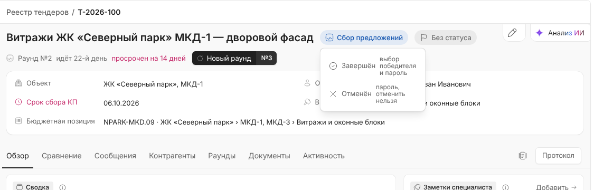
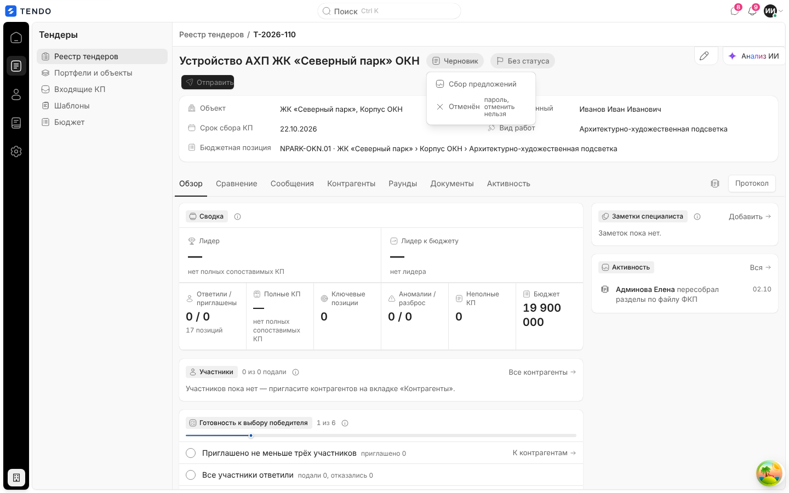
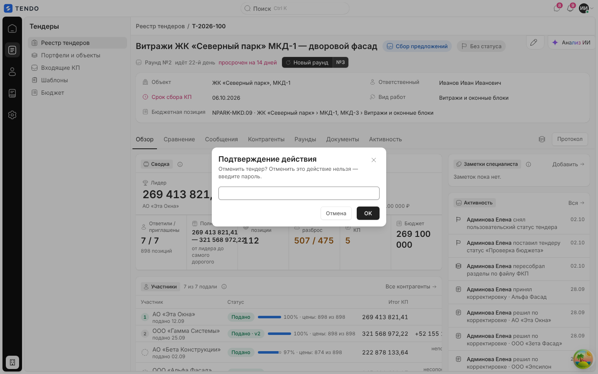
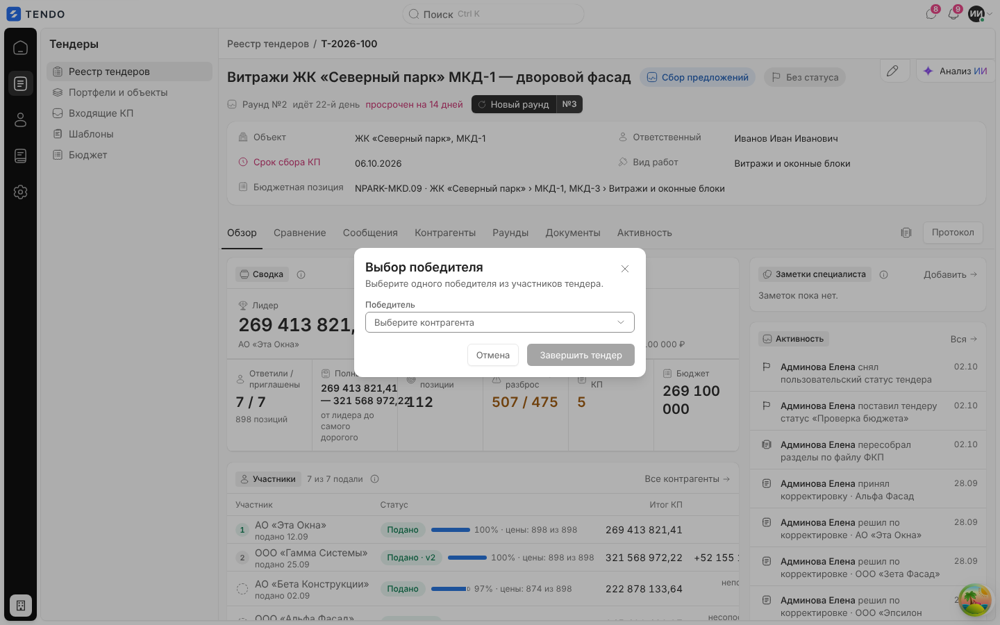
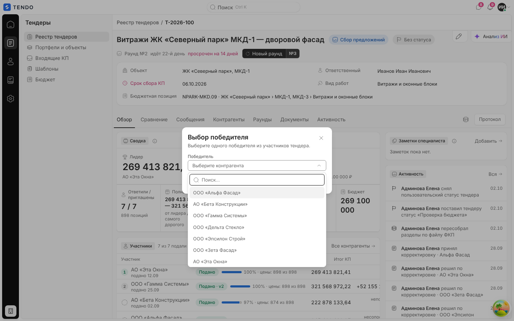
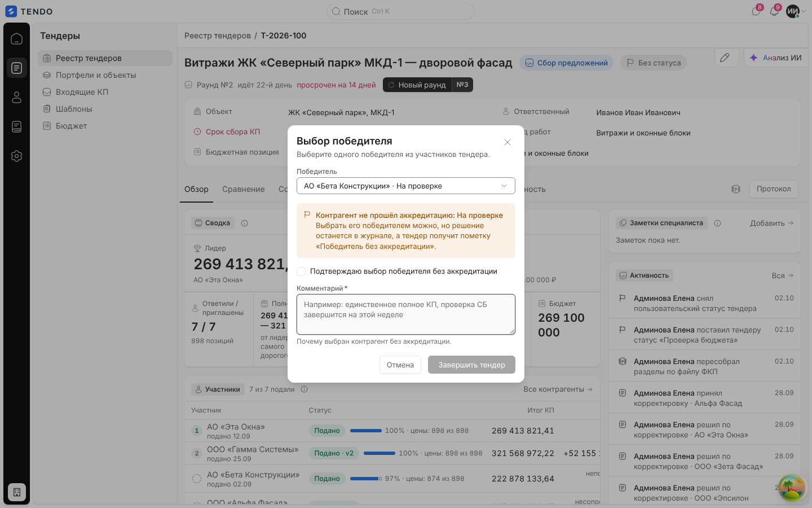
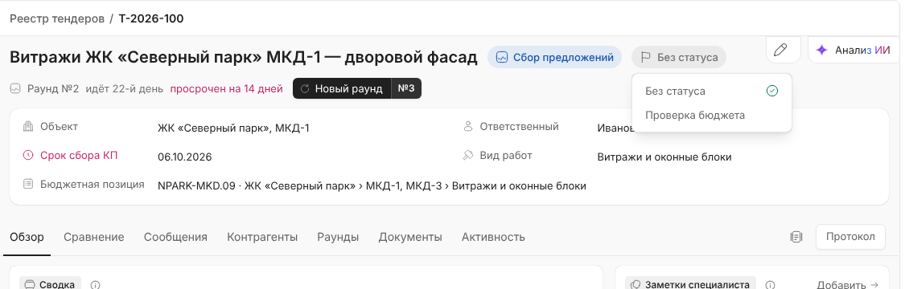
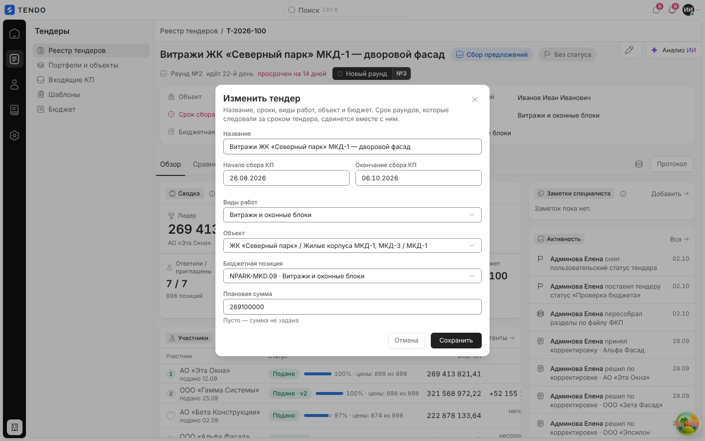
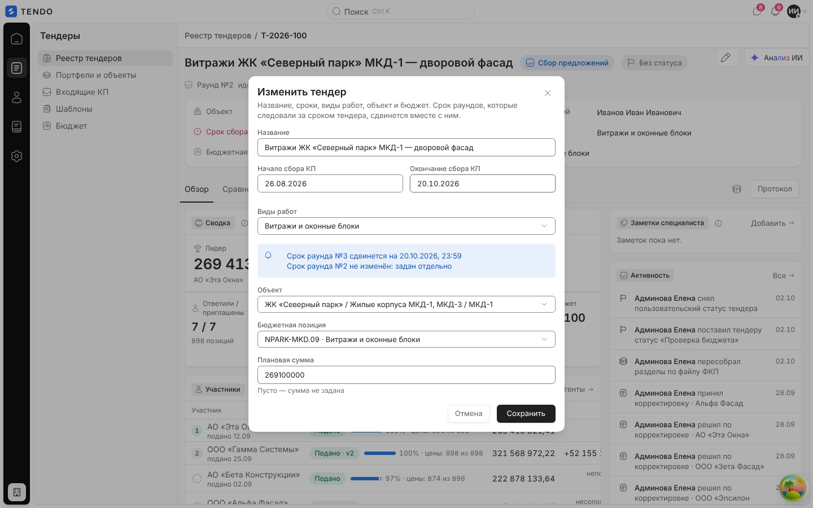
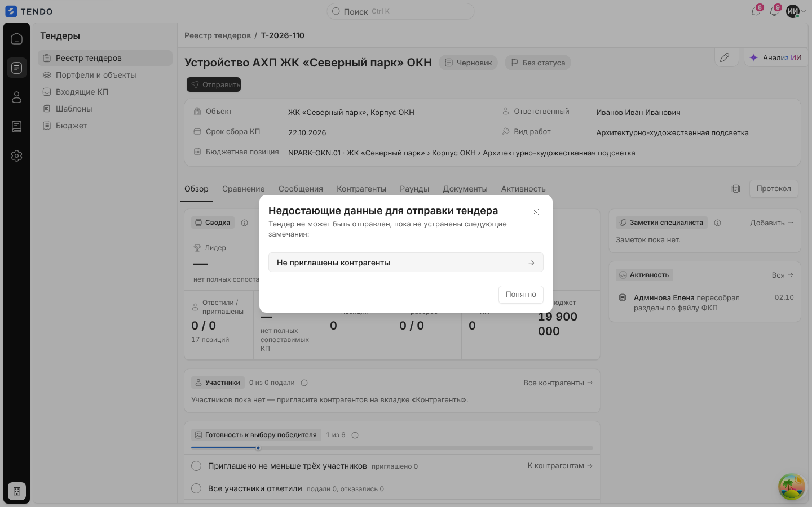

# Карточка тендера — жизненный цикл и окна шапки

Окна, которые открываются из шапки карточки тендера: смена системного и пользовательского статуса, выбор победителя (в т.ч. без аккредитации), подтверждение паролем, «Изменить тендер» с предпросмотром последствий, отправка черновика и «Сохранить как шаблон».

Связанные разделы: обзор экрана — [tender-card.md](tender-card.md); API — [../04-api/endpoints-tenders.md](../04-api/endpoints-tenders.md) (`PATCH /tenders/{id}`, `POST /tenders/{id}/edit-preview`); статусная модель — [../02-business-logic/](../02-business-logic/); данные — [../05-data-model/tables.md#tenders](../05-data-model/tables.md#tenders).

## Маршрут и роли

Все окна открываются поверх `/tenders/:id` (модальные `<dialog>` с затемнением; закрытие — крестик, Esc, «Отмена»). Запись требует права `tenders.manage` (тендерный специалист с правом, администратор). Завершённому и отменённому тендеру окна правки недоступны.

## Смена статуса

- Клик по капсуле статуса открывает меню допустимых переходов (см. таблицу статусов в [tender-card.md](tender-card.md#системные-статусы)). Пункт несёт значок и подсказку справа: «Завершён — выбор победителя и пароль», «Отменён — пароль, отменить нельзя».
- Пока запрос смены статуса в пути — капсула недоступна.
- **Черновик**: меню «Сбор предложений» (без пароля) и «Отменён».

| Цель | Что спрашивает система | Запрос |
|---|---|---|
| Сбор предложений (`open`) | Ничего (из меню); кнопка «Отправить» дополнительно проверяет готовность — см. ниже | `PATCH /tenders/{id}` `{status:"open"}` |
| Завершён (`closed`) | Окно «Выбор победителя» → окно пароля | `PATCH /tenders/{id}` `{status:"closed", winner_supplier_id, [confirm_non_accredited, non_accredited_comment]}` + заголовок `X-Reauth-Password` |
| Отменён (`cancelled`) | Окно пароля «Отменить тендер? Отменить это действие нельзя — введите пароль.» | `PATCH /tenders/{id}` `{status:"cancelled"}` + `X-Reauth-Password` |

Пароль спрашивается **до** запроса (не после отказа). Ошибки сервера показываются как есть в окне-уведомлении (при выборе победителя — полосой внутри окна).

Серверные отказы (тексты): «Недопустимый статус тендера»; «Переход из «Завершён»/«Отменён» запрещён без административного восстановления с причиной»; «Для статуса «Завершён» укажите победителя (winner_supplier_id)»; «Победитель должен быть участником этого тендера»; «Контрагент не найден»; «Подтвердите действие паролем»; «Пароль не подошёл — действие не выполнено» (оба — 403).

### Подтверждение паролем

Общее окно «Подтверждение действия»: текст «{Действие} Отменить это действие нельзя — введите пароль.», поле пароля (маскированное, обязательно), кнопки «Отмена» и «OK». Пустой ввод = отмена. Тот же компонент используется для перевыпуска и обнуления ссылок приглашения.

## Выбор победителя

Открывается пунктом «Завершён». Победитель — единственное обязательное поле.

| Поле | Тип | Обязательность | Правила |
|---|---|---|---|
| Победитель | выпадающий список с поиском, плейсхолдер «Выберите контрагента» | да | Кандидаты — приглашённые участники тендера, кроме отозванных; у неаккредитованных в подписи варианта статус: «АО «…» · На проверке» |
| Подтверждаю выбор победителя без аккредитации | флажок | да, если выбран неаккредитованный | — |
| Комментарий | многострочный текст, 3 строки | да, если выбран неаккредитованный | Плейсхолдер «Например: единственное полное КП, проверка СБ завершится на этой неделе», подсказка «Почему выбран контрагент без аккредитации.» |

- Описание окна: «Выберите одного победителя из участников тендера.». Если участников нет — «В тендере нет участников — выбирать победителя не из кого. Пригласите контрагентов и дождитесь предложений.», поля нет.
- **Победитель без аккредитации — предупреждение, а не запрет.** При выборе контрагента со сводным статусом, отличным от «Аккредитован», появляется жёлтая плашка «Контрагент не прошёл аккредитацию: {статус}» с текстом «Выбрать его победителем можно, но решение останется в журнале, а тендер получит пометку «Победитель без аккредитации».», флажок и обязательный комментарий.
- Кнопка «Завершить тендер» недоступна, пока решение неполное (никто не выбран; или выбран неаккредитованный без флажка и комментария). Во время запроса — «Завершаем…».
- Порядок: «Завершить тендер» → окно выбора закрывается → окно пароля → запрос. При отказе сервера окно выбора открывается снова с сохранённым выбором и красной полосой ошибки.
- Сервер повторяет проверку аккредитации (ошибка `non_approved_confirmation_required`: «Контрагент не прошёл аккредитацию: {статус}. Подтвердите выбор победителя и укажите комментарий.»; без комментария — «Укажите комментарий к выбору победителя без аккредитации»).
- Результат: тендер `closed`, КП победителя — `accepted`, статус участника «Победитель», фиксируются дата закрытия и статус аккредитации победителя на момент выбора; событие в ленте; баннер итога в шапке.

## Пользовательский статус

- Вторая капсула справа от системного статуса. Меню: «Без статуса» и действующие статусы справочника «Статусы» (раздел настроек) с галочкой у выбранного. Если тендеру проставлен статус, снятый в архив, — он остаётся пунктом с подсказкой «в архиве» и недоступен.
- Выбор применяется сразу, без подтверждения и пароля: `PATCH /tenders/{id}` `{custom_status_code: "<код>" | null}`. Ошибка — окно-уведомление «Не удалось сменить статус» (или текст сервера, например, если статус успели снять).
- Смена пишется в ленту активности («поставил тендеру статус «…»», «снял пользовательский статус тендера»).

## Изменить тендер

Кнопка-карандаш на линии крошек (подпись по наведению «Изменить тендер»).

| Поле | Тип | Обязательность / формат | Ошибка (текст) |
|---|---|---|---|
| Название | строка | обязательно, ≤ 500 символов | «Название не может быть пустым», «Название длиннее 500 символов» |
| Начало сбора КП | дата (календарь, ДД.ММ.ГГГГ) | обязательно | «Укажите даты начала и окончания сбора КП» |
| Окончание сбора КП | дата, не раньше начала (раньше — поле очищается) | обязательно, позже начала | «Дата окончания сбора КП должна быть позже даты начала» |
| Виды работ | мультивыбор с поиском из действующих видов работ | минимум один | «Укажите хотя бы один вид работ» |
| Объект | выбор проекта (портфель / группа / проект) | обязательно | — |
| Бюджетная позиция | выбор из **активных** позиций справочника, подпись «код · название» | обязательно | «Бюджетная позиция обязательна» |
| Плановая сумма | число (пробелы и запятая допускаются) | необязательно; пусто — «сумма не задана» | «Плановая сумма — число», «Плановая сумма не может быть отрицательной» |

**Предпросмотр последствий.** При изменении сроков или видов работ окно (без записи) запрашивает `POST /tenders/{id}/edit-preview` и показывает голубую плашку:

- «Срок раунда №N сдвинется на ДД.ММ.ГГГГ, 23:59» — раунды, чей срок совпадал со сроком тендера, сдвигаются каскадом;
- «Срок раунда №N не изменён: задан отдельно»;
- «Срок отправленного раунда №N сократить нельзя. Закройте раунд и создайте новый» (красная плашка, «Сохранить» недоступна);
- «Письмо о новом сроке уйдёт адресатам: N».

Если участники уже приглашены, сервер требует подтверждения: в окне появляются флажки «Участники уже приглашены — подтверждаю правку; контрагентов это не пересчитает» (для сроков/видов работ) и «Участники уже приглашены — подтверждаю смену объекта» (для объекта). Без флажка «Сохранить» недоступна.

Сохранение — последовательно и независимо (откатить уже записанное нечем):
1. название/сроки/виды работ — `PATCH /tenders/{id}` `{title, start_date, end_date, work_type_ids, confirm_details_change}`;
2. объект — `PATCH /tenders/{id}` `{project_id, confirm_project_change}`;
3. бюджет — `PATCH /tenders/{id}` `{budget_position_id, budget_amount}`.

Ошибка шага 2–3 показывается с префиксом «Название и сроки сохранены.». Карточка перечитывается после первого успешного шага. Пока идёт предпросмотр, «Сохранить» недоступна. Кнопка в процессе — «Сохраняем…».

## Отправка черновика

Кнопка «Отправить» (у статуса «Черновик» — в шапке и в пустом состоянии СТ) проверяет на клиенте:

| Проверка | Пункт списка | Действие по клику на пункт |
|---|---|---|
| Нет приглашённых | «Не приглашены контрагенты» | вкладка «Контрагенты» + окно приглашения |
| В тендере нет позиций | «В тендере нет позиций» | вкладка «Сравнение» |
| Не указан срок сбора КП | «Не указан срок сбора КП» | окно «Изменить тендер» |

Если что-то не выполнено — окно «Недостающие данные для отправки тендера» с описанием «Тендер не может быть отправлен, пока не устранены следующие замечания:», список пунктов-кнопок со стрелкой и кнопка «Понятно». Иначе — переход в «Сбор предложений».

## Сохранить как шаблон

Значок «Сохранить как шаблон» на строке вкладок (только на «Обзоре»). Окно ввода «Сохранить как шаблон» с полем «Название шаблона» (по умолчанию — название тендера). Пустое имя — отмена. Запрос `POST /templates/from-tender/{id}` `{name}` (состав собирает сервер). Успех — «Шаблон «…» сохранён в библиотеке.» (кнопка «Готово»); ошибка — «Не удалось сохранить шаблон». Во время запроса значок недоступен, подпись «Сохраняем шаблон…».

## Сложность

**M** (меню статусов, окно победителя с ветвлением аккредитации, повторный ввод пароля, форма правки с серверным предпросмотром и пошаговым сохранением, чек-лист отправки).
