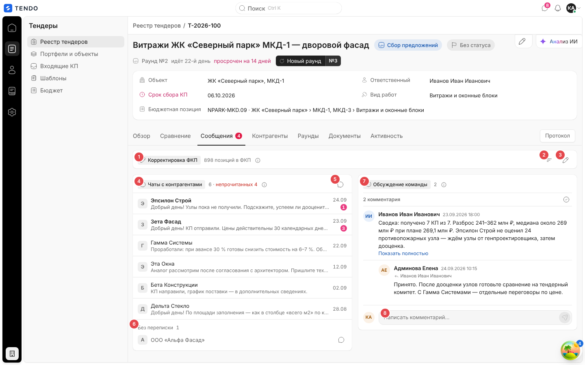
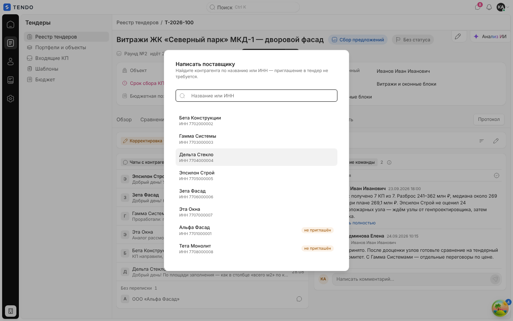
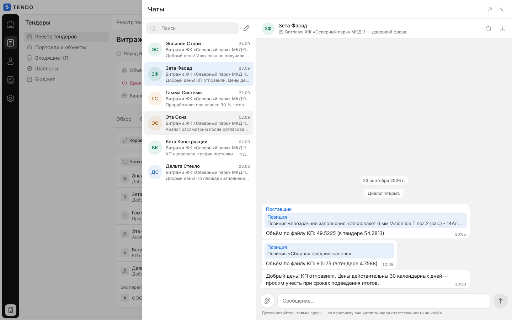

# Карточка тендера — вкладка «Сообщения»

Вкладка переписки по тендеру: диалоги с контрагентами (чаты), внутреннее обсуждение команды и — сверху — блок «Корректировка ФКП» (описан отдельно в [tender-card-structure.md](tender-card-structure.md)). Плюс плавающая кнопка чата, доступная на всех вкладках карточки.

Связанные разделы: обзор экрана — [tender-card.md](tender-card.md); корректировка ФКП — [tender-card-structure.md](tender-card-structure.md); комментарии к ячейкам СТ — [tender-card-comparison.md](tender-card-comparison.md#комментарии-к-ячейкам); API — [../04-api/endpoints-chat.md](../04-api/endpoints-chat.md), [../04-api/endpoints-comments.md](../04-api/endpoints-comments.md).

## Маршрут, роли, как попасть

- `/tenders/:id`, вкладка «Сообщения». На ярлыке вкладки — красный счётчик непрочитанных сообщений контрагентов по этому тендеру (тот же источник, что у плавающей кнопки и колокольчика чатов в верхней панели).
- Роли — тендерный специалист, администратор. Контрагент видит переписку со своей стороны в кабинете и на форме КП по ссылке (другие экраны).
- Попасть: вкладка; плавающая кнопка чата; «Написать поставщику» в досье СТ; «Ответить контрагенту» в треде ячейки; уведомление о новом сообщении.

## Снимок

| № | Блок | Поведение |
|---|---|---|
| ① | «Корректировка ФКП» | Сводка «N позиций в ФКП» / «не применено: N»; см. [tender-card-structure.md](tender-card-structure.md) |
| ② | «Пересобрать разделы по файлу ФКП» | Значок; окно пересборки |
| ③ | «Править ФКП» | Значок; режим правки позиций |
| ④ | «Чаты с контрагентами» | Список диалогов по этому тендеру; счётчик «6 · непрочитанных 4» |
| ⑤ | «Написать контрагенту» | Значок; окно выбора контрагента |
| ⑥ | «Без переписки» | Приглашённые участники, с которыми диалога ещё нет (кроме отказавшихся); у каждого значок «Написать «…»»; показано 5, «Ещё N» / «Свернуть» |
| ⑦ | «Обсуждение команды» | Внутренние комментарии сотрудников по тендеру, контрагенты их не видят |
| ⑧ | Поле «Написать комментарий…» | Комментарий команды |

Над блоками может стоять баннер неразосланной версии ФКП (см. [tender-card-structure.md](tender-card-structure.md#баннер-неразосланной-версии)).

## Чаты с контрагентами

- Подсказка «i»: «Диалоги с контрагентами по этому тендеру. Приглашение в тендер для переписки не требуется — написать можно любому контрагенту из реестра.».
- Строка диалога: аватар-инициал организации, название контрагента (жирным, если есть непрочитанные), превью последнего сообщения («Нет сообщений»), время (сегодня — ЧЧ:ММ, иначе ДД.ММ), красный счётчик непрочитанных. Сортировка — по последней активности, новые сверху. Клик — открыть панель «Чаты» на этом диалоге.
- Пусто (нет ни диалогов, ни приглашённых без переписки): «Диалогов по этому тендеру пока нет. Найдите контрагента и напишите — приглашение в тендер для этого не требуется.».
- Список синхронизирован с общим хранилищем чатов (обновляется по событиям реального времени, без опроса).

### Написать контрагенту

Окно «Написать поставщику», описание «Найдите контрагента по названию или ИНН — приглашение в тендер не требуется.», поле поиска «Название или ИНН», список контрагентов реестра («ИНН …»), у не приглашённых в этот тендер — метка «не приглашён». Выбор — открывает (или создаёт) диалог `POST /chats/open` `{tender_id, supplier_id}` и панель «Чаты».

## Обсуждение команды

- Подсказка: «Внутренняя переписка сотрудников по тендеру. Контрагенты её не видят — диалог с ними идёт в разделе «Чаты с контрагентами».».
- Лента комментариев (автор, аватар, дата и время, текст; длинный — «Показать полностью»), ответы с отступом и пометкой «↳ {кому}», «N комментариев», «Отметить все прочитанными».
- Меню записи: «Ответить», «Копировать», «Выделить», «Продублировать в чат».
- Поле ввода внизу; отправка — `POST /comments` `{entity_type:"tender", entity_id, comment_text, parent_comment_id?}`; список — `GET /comments?entity_type=tender&entity_id={id}` (с вложенными ответами). Ошибка — «Не удалось загрузить обсуждение».

## Плавающая кнопка и панель чатов

- Круглая кнопка в правом нижнем углу на всех вкладках карточки; подпись «Переписка по тендеру» / «Переписка по тендеру: N новых сообщений»; красный счётчик при N > 0. Скрыта, пока открыта панель «Анализ ИИ».
- Открывает выезжающую справа панель «Чаты» (та же, что из верхней панели приложения), отфильтрованную по тендеру.

Панель «Чаты» (общий компонент приложения): слева — поиск и список диалогов (контрагент, тендер, превью, дата), кнопка «Новый диалог» (карандаш); справа — переписка: шапка (контрагент, тендер-ссылка, «Поиск по переписке», «Выгрузить переписку»), лента с разделителями дней и системными событиями («Диалог открыт.»), пузыри со статусом доставки/прочтения, цитаты «Позиция «…»» для сообщений, привязанных к ячейке СТ (клик — переход к ячейке в сравнении), вложения; поле «Сообщение…» (до 4000 символов, Enter — отправить; более длинный вставленный текст прикладывается файлом), «Прикрепить файл» (до 25 МБ), ответ на сообщение, редактирование своего сообщения, «Отправить заново» для неотправленного; подпись внизу «Договаривайтесь только здесь — за переписку вне чатов тендера ответственности не несём.»; кнопки «Развернуть на страницу» и «Закрыть». Индикатор «печатает…».

API: `GET /chats?tender_id=…`, `POST /chats/open`, `GET/POST /chats/{thread}/messages`, `POST /chats/{thread}/messages/file`, `PATCH/DELETE /chats/{thread}/messages/{id}`, `POST /chats/{thread}/read`, `POST /chats/{thread}/typing`, `GET /chats/search`, `GET /chats/{thread}/export`, `GET /chats/updates?since=` + поток событий реального времени (SSE) — [../04-api/endpoints-chat.md](../04-api/endpoints-chat.md).

## Состояния

| Состояние | Поведение |
|---|---|
| Загрузка | Скелетон вкладки |
| Ошибка снимка позиций | «Сообщения не загрузились» + текст + «Повторить» |
| Нет диалогов | Текст-приглашение написать (см. выше) |
| Завершённый тендер | Переписка доступна (чтение и отправка не блокируются интерфейсом) |

## Сложность

**L** (с учётом общей панели чатов реального времени: синхронизация, очередь исходящих, прочитанность, вложения, поиск и выгрузка). Сама вкладка — **M**.
