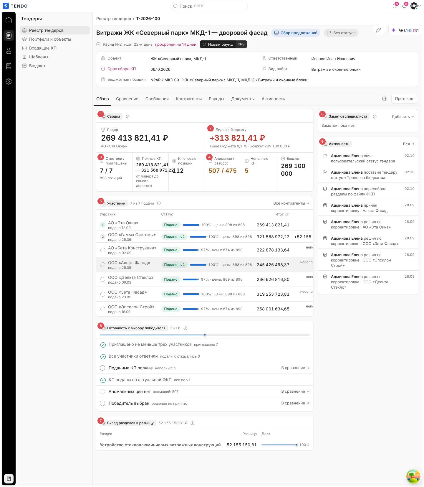
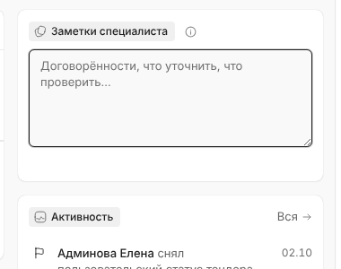
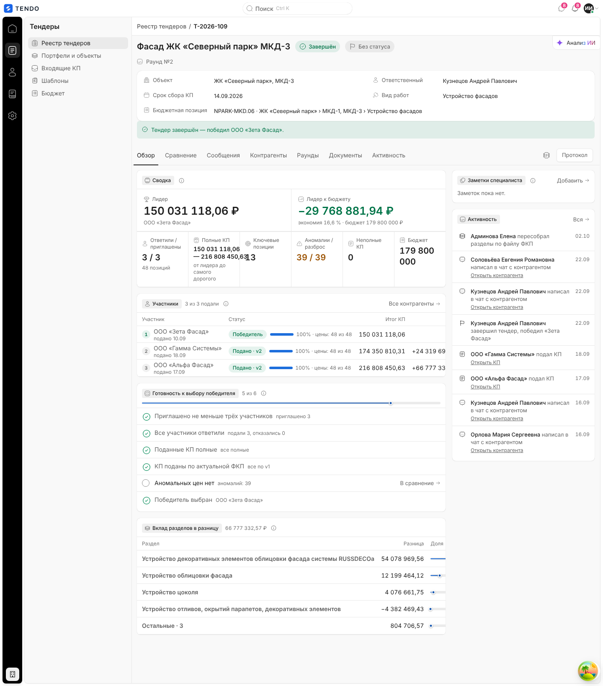

# Карточка тендера — вкладка «Обзор»

Вкладка по умолчанию: основание для решения до погружения в цифры — кто лидер и насколько, кто ответил, что мешает выбрать победителя, где сидит разница между КП; справа — заметки специалиста и короткая лента событий.

Связанные разделы: обзор экрана — [tender-card.md](tender-card.md); сравнение — [tender-card-comparison.md](tender-card-comparison.md); формулы (лидер, полнота КП, аномалии, вклад) — [../02-business-logic/tenders-comparison.md](../02-business-logic/tenders-comparison.md); API — [../04-api/endpoints-tenders.md](../04-api/endpoints-tenders.md).

## Маршрут, роли, как попасть

- `/tenders/:id`, вкладка «Обзор» — открывается первой при каждом входе в карточку.
- Роли — как у карточки ([tender-card.md](tender-card.md#роли-и-права)). Без права видеть финансы суммы (лидер, диапазон, бюджет) приходят пустыми и показываются прочерком.
- Данные: снимок сравнения `GET /tenders/{id}/comparison` (поле `analytics` — серверная аналитика) и карточка `GET /tenders/{id}`; оба запроса общие с шапкой и вкладкой «Сравнение» (повторно не запрашиваются).

## Снимок

| № | Блок | Поведение |
|---|---|---|
| ① | Группа «Сводка» | Ряд показателей; показатель со «срезом» кликабелен (подсказка «открыть в сравнении») и ведёт на вкладку «Сравнение» с нужным пресетом. Подсказка «i»: «Показатели сравнения КП одним экраном…»; если КП ещё нет — добавляется «КП ещё не поступали — сравнительная таблица заполнится после первых подач.» |
| ② | «Лидер к бюджету» | Разница «бюджет − итог лидера» |
| ③ | «Ответили / приглашены» | Счётчик и число позиций |
| ④ | «Аномалии / разброс» | Ведёт в пресет «Аномалии» |
| ⑤ | Группа «Участники» | Таблица с местами; ссылка «Все контрагенты →» — на вкладку «Контрагенты» |
| ⑥ | «Готовность к выбору победителя» | Чек-лист, вычисляемый из данных; прогресс «N из M» |
| ⑦ | «Вклад разделов в разницу» | Где сидит разница между самым дорогим полным КП и лидером |
| ⑧ | «Заметки специалиста» | Внутренняя заметка с автосохранением |
| ⑨ | «Активность» | Последние 8 событий; ссылка «Вся →» — вкладка «Активность» |

## Блок «Сводка» — показатели

| Показатель | Значение | Подпись | Переход |
|---|---|---|---|
| Лидер (крупно) | Итог лидера, ₽ (с копейками) | Имя лидера; без лидера — «нет полных сопоставимых КП» | Сравнение, пресет «Обзор» |
| Лидер к бюджету (крупно) | `бюджет − итог лидера`: «−N ₽» зелёным (экономия) или «+N ₽» красным (выше бюджета) | «экономия X,X % · бюджет N ₽» / «выше бюджета X,X % · …»; без бюджета — «бюджет не задан», без лидера — «нет лидера» | — |
| Ответили / приглашены | «подали / приглашено» | «N позиций» (число позиций в ФКП) | Сравнение, «Обзор» |
| Полные КП | Диапазон «min — max» итогов полных сопоставимых КП | «от лидера до самого дорогого» | Сравнение, «Обзор» |
| Ключевые позиции | Число ключевых позиций (по правилу доли стоимости, см. СТ) | — | Сравнение, «Обзор» |
| Аномалии / разброс | «число аномальных цен / число строк с высоким разбросом»; жёлтый, если аномалии > 0 | — | Сравнение, «Аномалии» |
| Неполные КП | Число КП, где цены есть не у всех позиций; жёлтый, если > 0 | — | Сравнение, «Торги» |
| Бюджет | Плановая сумма тендера | «не задан» | — |

**Лидер** — самое дешёвое **полное и сопоставимое** КП (цены по всем позициям, объёмы не расходятся со сметой). Ранги, итоги и отставания приходят готовыми из серверной аналитики (`analytics.contractors[*].rank / total / delta_to_leader_abs / delta_to_leader_pct / complete / incomparable_volume`). Формулы — [../02-business-logic/tenders-comparison.md](../02-business-logic/tenders-comparison.md).

Переход из цифры «Обзора» **возвратный**: вид СТ пользователя сохраняется, на панели СТ появляется кнопка «Вернуть мой вид».

## Блок «Участники»

Заголовок «Участники», счётчик «N из M подали», подсказка «Место дают только полным сопоставимым КП: у остальных вместо номера стоит причина. Отставание считается от лидера — самого дешёвого полного КП.».

| Колонка | Содержимое |
|---|---|
| (место) | Кружок с номером места; у лидера — выделен; без места — пустой пунктирный кружок |
| Участник | Название + «подано ДД.ММ» |
| Статус | Капсула стадии: «Подано» / «Подано · vN» (зелёная), «Победитель» (зелёная), «На доработке» (жёлтая), «Заполняет» (синяя), «Доставлено», «Отправлено», «Отказался», «Доступ закрыт» (серые) + полоска заполнения «97 % · цены: 874 из 898» (если начато заполнение) |
| Итог КП | Сумма, ₽ |
| Отставание | У лидера — метка «лидер»; у остальных с местом — «+N ₽ · +X %» к лидеру; без места — причина: текст сервера (например «неполное КП», «несопоставимый итог») или «КП ещё не подано» / «отказался участвовать» / «приглашение отозвано» / «КП не участвует в расчёте» |

Сортировка: сначала по месту, затем без места — по алфавиту. Пусто — «Участников пока нет — пригласите контрагентов на вкладке «Контрагенты».».

## Блок «Готовность к выбору победителя»

Пункты вычисляются из данных, руками не отмечаются (подсказка: «Пункты считаются из данных тендера, а не отмечаются руками: галочка появится сама, когда условие выполнится.»). Участники с закрытым доступом не учитываются. Сверху — прогресс-линия «N из M».

| Пункт | Выполнен, если | Пояснение справа | Ссылка, если не выполнен |
|---|---|---|---|
| Приглашено не меньше трёх участников | приглашено ≥ 3 | «приглашено N» | «К контрагентам →» |
| Все участники ответили | все подали КП или отказались | «подали N, отказались M» / «ждём ответа: N» | «К контрагентам →» |
| Поданные КП полные | есть поданные и неполных 0 | «все полные» / «неполных: N» / «КП ещё нет» | «В сравнение →» (пресет «Торги») |
| КП поданы по актуальной ФКП (только если у тендера есть версии ФКП) | нет КП, поданных по старой версии | «все по vN» / «по старой версии: N, актуальна vN» | «К контрагентам →» |
| Аномальных цен нет | есть поданные и аномалий 0 | «не найдено» / «аномалий: N» / «сравнивать пока нечего» | «В сравнение →» (пресет «Аномалии») |
| Победитель выбран | у тендера есть победитель | имя (и «победитель без аккредитации: …») / «решение не принято» | «В сравнение →» (пресет «Обзор») |

## Блок «Вклад разделов в разницу»

Показывается, если полных сопоставимых КП не меньше двух. Разница «самое дорогое полное КП − лидер» раскладывается по разделам ФКП верхнего уровня; остаток вне разделов — строка «Вне разделов». Колонки: «Раздел», «Разница» (₽, может быть отрицательной — «в этом разделе дорогое КП дешевле лидера»), «Доля» (полоска + %). Строки по убыванию; максимум 5 строк — четыре крупнейших по модулю и «Остальные · N». Суммы складываются ровно в общую разницу (округление до копеек, расхождение доливается в крупнейшую строку). Заголовок несёт общую сумму.

## Заметки специалиста

- Пустая заметка свёрнута: «Заметок пока нет.» и ссылка «Добавить →»; непустая — сразу поле.
- Поле: многострочный текст, 5 строк, плейсхолдер «Договорённости, что уточнить, что проверить…». Автосохранение через 800 мс после паузы набора (`PUT /tenders/{id}/staff-notes` `{text}`); индикатор «Сохраняется / Сохранено / Ошибка + Повторить» («Не удалось сохранить заметку»). Сервер обрезает текст до 20 000 символов.
- Под полем — «{кто правил}, ДД.ММ ЧЧ:ММ».
- Подсказка «i»: «Рабочая заметка тендерного специалиста. Видна только сотрудникам, подрядчикам не показывается.».

## Лента «Активность» (боковая)

Последние 8 событий тендера (`GET /tenders/{id}/activity?limit=8`): значок типа, «**Автор** действие · объект», дата ДД.ММ, ссылки «Открыть КП» / «Открыть контрагента». «Вся →» открывает вкладку «Активность». Пусто — «Событий пока нет.»; ошибка — «Лента не загрузилась. Повторить».

## Состояния

| Состояние | Поведение |
|---|---|
| Загрузка | Скелетон вкладки |
| Ошибка | «Обзор не загрузился» + текст + «Повторить» (перечитывает упавший запрос) |
| Нет КП / черновик | Прочерки в показателях с подписями «нет полных сопоставимых КП», «нет лидера»; в «Участниках» — пусто или стадии без итогов; готовность «1 из 6» (см. [черновик](assets/tender-card--draft.png)) |
| Завершённый тендер | Стадия победителя «Победитель», пункт «Победитель выбран» с галочкой; баннер в шапке |

## Действия на строке вкладок

«Сохранить как шаблон» (значок) и «Протокол» — см. [tender-card-lifecycle.md](tender-card-lifecycle.md#сохранить-как-шаблон) и [tender-card-documents.md](tender-card-documents.md#тендерный-протокол).

## Сложность

**M** — вёрстка показателей и таблиц простая, но нужна серверная аналитика (ранги, полнота, сопоставимость) и точная раскладка вклада разделов.
