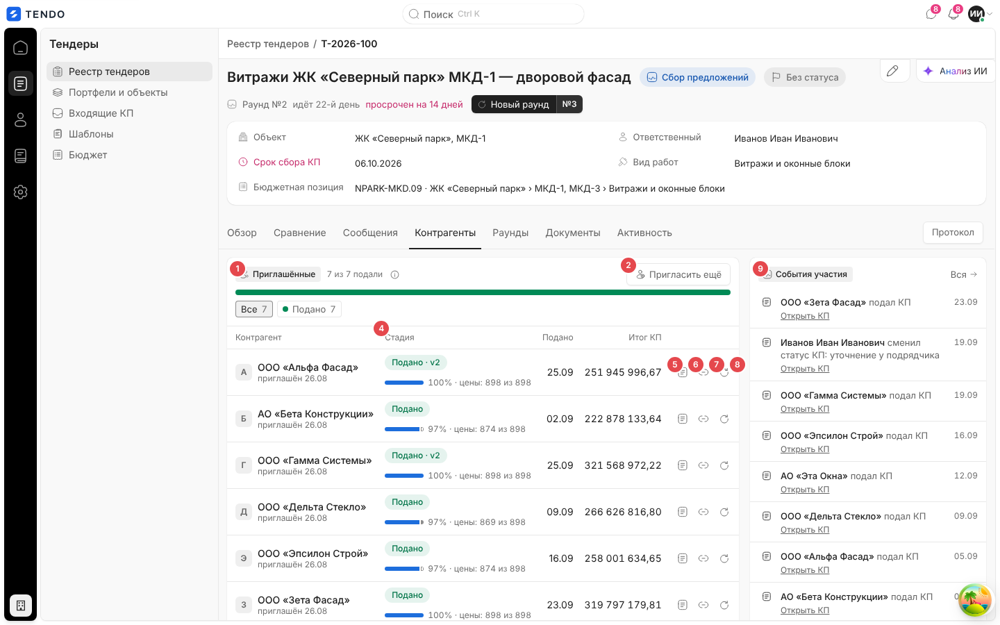
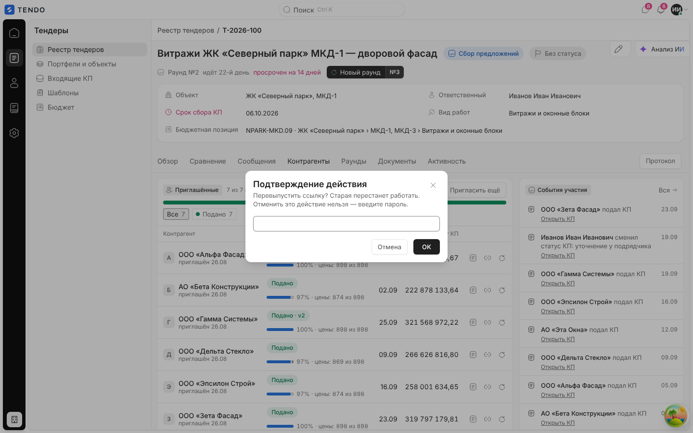
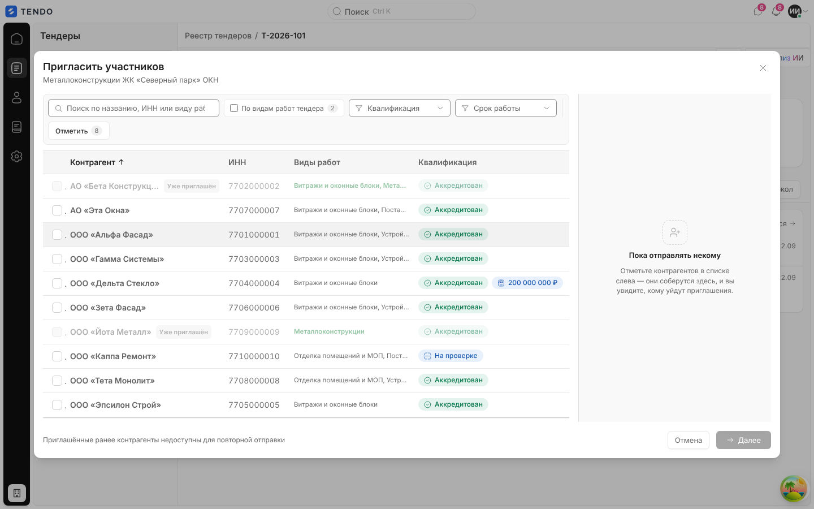
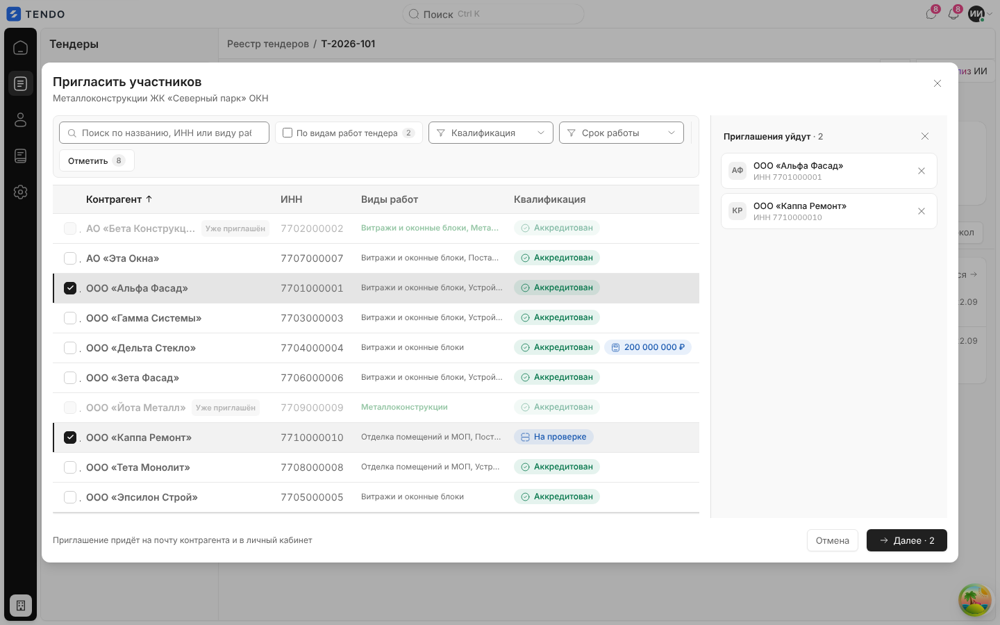
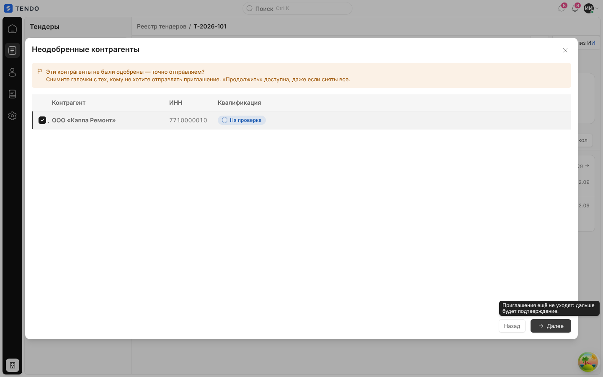
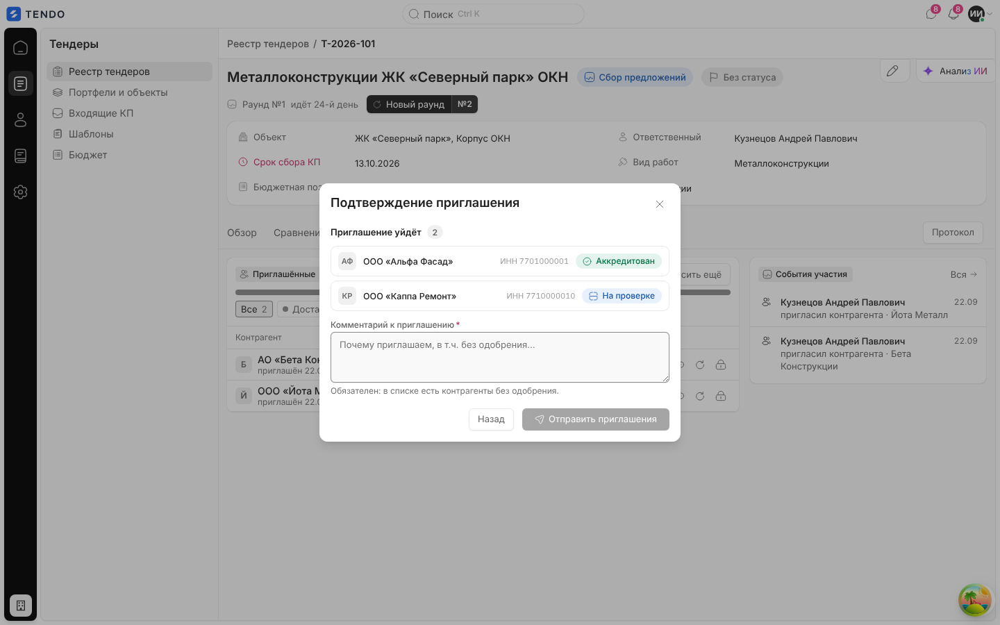
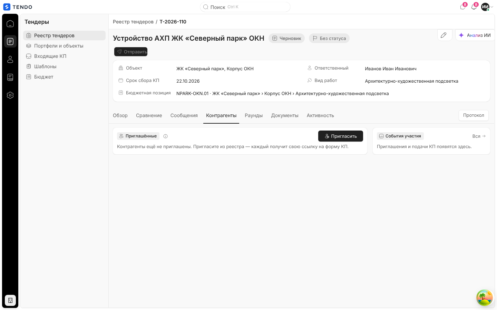
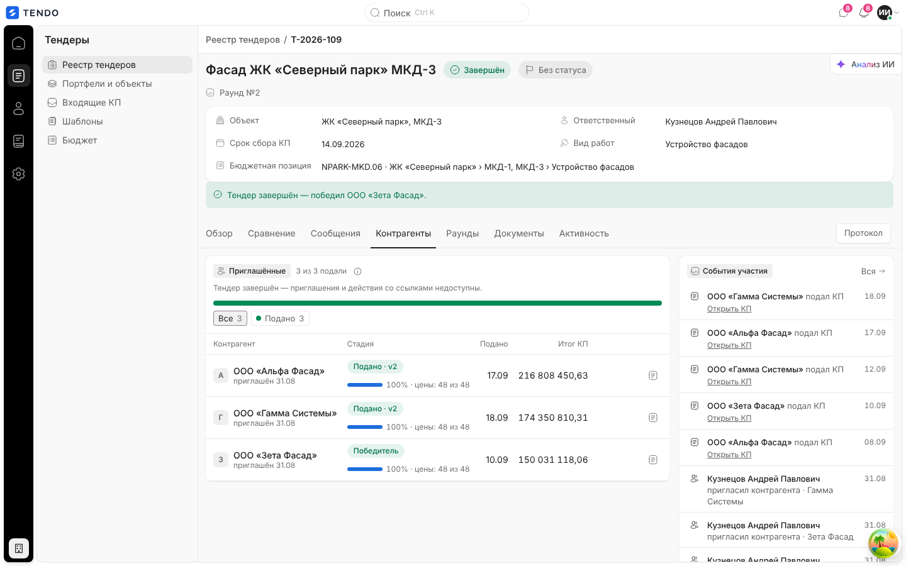

# Карточка тендера — вкладка «Контрагенты» и приглашение участников

Список приглашённых в тендер контрагентов со стадиями участия, персональными ссылками на форму КП и событиями участия; мастер «Пригласить участников» (подбор → неодобренные → подтверждение).

Связанные разделы: обзор экрана — [tender-card.md](tender-card.md); форма КП по ссылке и кабинет поставщика — экраны поставщика в [03-screens](./); API — [../04-api/endpoints-tenders.md](../04-api/endpoints-tenders.md) (`/invitations`), [../04-api/endpoints-quotes.md](../04-api/endpoints-quotes.md); данные — [../05-data-model/tables.md#tenders](../05-data-model/tables.md#tenders) (`tender_invitations`, `quotes`).

## Маршрут, роли, как попасть

- `/tenders/:id`, вкладка «Контрагенты». Окно приглашения открывается и с других вкладок: колонка «Пригласить в тендер» в СТ, пустое состояние СТ и раундов, пункт «Не приглашены контрагенты» при отправке черновика, «Все контрагенты →» на «Обзоре».
- Роли: тендерный специалист и администратор. Приглашение, перевыпуск и обнуление ссылки — право `tenders.manage`; перевыпуск и обнуление дополнительно требуют повторного ввода пароля.
- Данные: приглашения — из карточки `GET /tenders/{id}` (`invitations[]`: контрагент, статус приглашения, токен ссылки, даты, причина закрытия доступа, сводный статус аккредитации), стадии КП и полнота — из снимка сравнения.

## Снимок

| № | Элемент | Поведение |
|---|---|---|
| ① | Группа «Приглашённые» | Счётчик «N из M подали»; подсказка «Каждому приглашённому выдаётся своя ссылка на форму КП. Перевыпуск гасит действующую ссылку, обнуление закрывает доступ без новой.» |
| ② | «Пригласить» / «Пригласить ещё» | Основная кнопка, если приглашённых нет; иначе вторичная. Отсутствует у завершённого/отменённого |
| ③ | Воронка стадий | Полоса долей и фильтр-чипы «Все N», «Подано N», «На доработке N», «Заполняет N», «Доставлено N», «Отправлено N», «Отказались N» (показываются только непустые); клик фильтрует таблицу |
| ④ | Колонка «Стадия» | Капсула стадии + полоска заполнения «100 % · цены: 898 из 898» |
| ⑤ | «Открыть КП» | Переход на карточку КП `/quotes/:id` (если КП есть) |
| ⑥ | «Скопировать ссылку на форму» | Копирует персональную ссылку `{адрес приложения}/fill/{токен}`; уведомление «Ссылка скопирована» / «Не удалось скопировать ссылку» |
| ⑦ | «Перевыпустить ссылку» | Пароль → новая ссылка, старая перестаёт работать |
| — | «Обнулить ссылку — закрыть доступ» (замок, красный) | Пароль → доступ закрыт без новой ссылки. На ширине 1440 px при открытом левом меню значок на стенде обрезается краем таблицы — исполнитель обязан обеспечить видимость всех действий строки |
| ⑧ | «События участия» | Боковая лента: приглашения, подачи КП, смена статусов КП, перевыпуск/обнуление; «Вся →» — вкладка «Активность» с этим набором типов |

### Таблица приглашённых

| Колонка | Содержимое |
|---|---|
| Контрагент | Инициал, название (многоточие + подсказка), «приглашён ДД.ММ», «· с раунда №N» если присоединился позже первого раунда. При закрытом доступе — замок и причина: «Ссылка обнулена» / «Контрагент отключён» / «Доступ закрыт» · кто · ДД.ММ |
| Стадия | «Подано» / «Подано · vN», «Победитель», «На доработке», «Заполняет», «Доставлено», «Отправлено», «Отказался»; полоска заполнения при начатом заполнении |
| Подано | ДД.ММ подачи |
| Итог КП | ₽ (без права видеть финансы — пусто) |
| Действия | Открыть КП · Скопировать ссылку · Перевыпустить ссылку (у закрытого доступа — «Выдать новую ссылку») · Обнулить ссылку. Если контрагент отключён в справочнике — вместо выдачи ссылки значок карточки контрагента («Контрагент отключён в справочнике — новую ссылку здесь не выдать») |

Порядок определения стадии (от сильного факта к слабому): отказ от участия → КП принято (победитель) → КП подано → КП на доработке → черновик КП / форма заполняется → ссылка открыта → отправлено. Отзыв доступа стадию не меняет — его показывает замок у названия.

Если у тендера есть версии ФКП и часть КП подана по старой версии — над таблицей кнопка-фильтр «КП по старой версии ФКП: N» (подсказка «КП поданы до последней корректировки ФКП — цены могут её не учитывать»).

### Перевыпуск и обнуление ссылки

| Действие | Вопрос | Запрос | Результат |
|---|---|---|---|
| Перевыпустить / Выдать новую ссылку | «Перевыпустить ссылку? Старая перестанет работать. Отменить это действие нельзя — введите пароль.» | `POST /tenders/{id}/invitations/{inv}/regenerate` + `X-Reauth-Password` | Новый токен, статус приглашения «отправлено», доступ открыт, событие в ленте |
| Обнулить ссылку | «Обнулить ссылку приглашения? Новой не будет. …» | `POST /tenders/{id}/invitations/{inv}/revoke` + `X-Reauth-Password` | Статус `revoked`, токен заменён (старая ссылка мертва), участник исключается из черновых раундов; повтор — «Ссылка уже обнулена» |

Ошибки — окно с текстом сервера («Не удалось перевыпустить», «Не удалось обнулить»). Во время запроса действия строки недоступны.

## Пригласить участников

Мастер в большом модальном окне. Описание: «Тендер № … · {название}». Подпись внизу — «Приглашение придёт на почту контрагента и в личный кабинет» (или «Приглашённые ранее контрагенты недоступны для повторной отправки»).

### Шаг 1 — подбор

- Фильтры: поиск «Поиск по названию, ИНН или виду работ»; флажок «По видам работ тендера N» (совпадение видов работ контрагента с видами работ тендера, по названию без учёта регистра); «Квалификация» (сводные статусы, «Любая квалификация»); «Срок работы» («Меньше 1 года», «1–3 года», «3–5 лет», «5–10 лет», «Больше 10 лет», «Дата не указана», «Любой срок» — по дате регистрации контрагента); «Отметить N» / «Снять» — все строки текущего списка (приглашённые пропускаются).
- Таблица (сортируемые колонки, щелчок по заголовку — по возрастанию/убыванию): флажок, «Контрагент» (у приглашённых — серым и метка «Уже приглашён», флажок недоступен), «ИНН», «Виды работ» (через запятую; «не указаны»), «Квалификация» (капсула статуса; короткие синонимы «С лимитом», «Без анкеты», «На согласовании», «Проверяется», «На доработке», «Новая анкета»; полное — в подсказке; у «Одобрен с лимитом» — капсула лимита «200 000 000 ₽», подсказка «Лимит: N ₽ на один договор»). Сортировка по квалификации — по готовности к участию (аккредитован/одобрен → с лимитом → на проверке → …).
- Правая панель «Приглашения уйдут · N»: карточки выбранных (инициалы, название, «ИНН …», крестик «Убрать …»), крестик «Очистить список приглашённых».

 Пусто — «Пока отправлять некому. Отметьте контрагентов в списке слева — они соберутся здесь, и вы увидите, кому уйдут приглашения.».
- Источник: реестр контрагентов `GET /suppliers` (все страницы). Ошибка — «Не удалось загрузить контрагентов»; загрузка — «Загрузка справочника…».
- Кнопки: «Отмена» («Закроет окно. Отмеченные контрагенты не сохранятся.»), «Далее · N» (недоступна без выбора: «Отметьте хотя бы одного контрагента»; подсказка «Приглашения ещё не уходят: дальше будет подтверждение.»).

### Шаг 2 — неодобренные (только если среди выбранных есть контрагенты без статуса «Аккредитован/Одобрен/Одобрен с лимитом»)

Заголовок «Неодобренные контрагенты», плашка «Эти контрагенты не были одобрены — точно отправляем? Снимите галочки с тех, кому не хотите отправлять приглашение. «Продолжить» доступна, даже если сняты все.», таблица «Контрагент · ИНН · Квалификация» с флажками. Кнопки «Назад» («Вернёт к подбору. Отмеченные контрагенты сохранятся.»), «Далее». Если сняты все и выбранных не осталось — «Вы сняли всех участников с отправки. Выберите контрагентов снова — пустое приглашение не отправляется.».

### Шаг 3 — подтверждение

- «Приглашение уйдёт · N» — список: инициалы, название, ИНН, капсула квалификации.
- «Комментарий к приглашению» — многострочный; **обязателен**, если в списке есть неодобренные («Обязателен: в списке есть контрагенты без одобрения.», плейсхолдер «Почему приглашаем, в т.ч. без одобрения…»), иначе «Необязательно — комментарий к рассылке». Ошибка — «Укажите комментарий к приглашению».
- Кнопки: «Назад», «Отправить приглашения» («Отправляем…»; подсказка «Каждому контрагенту уйдёт письмо с персональной ссылкой на форму КП. Отозвать рассылку нельзя.» или «В списке есть неодобренные — заполните комментарий»).
- Запрос `POST /tenders/{id}/invitations` `{supplier_ids:[…], confirm_non_approved, non_approved_comment}`. Сервер: создаёт приглашения с токенами, отправляет письмо и уведомление в кабинет, переводит черновик тендера в «Сбор предложений», при первом приглашении заводит раунд №1, а доприглашённых присоединяет к идущему раунду (номер сохраняется как «с раунда №N»), пишет событие. Отказы: «Нельзя приглашать участников в закрытый или отменённый тендер», «Выберите хотя бы одного поставщика», `non_approved_confirmation_required` («Среди выбранных есть неодобренные контрагенты. Подтвердите приглашение явно и укажите комментарий.»), «Укажите комментарий к приглашению неодобренных контрагентов», «Все выбранные контрагенты уже приглашены в этот тендер». Ошибка — «Не удалось отправить приглашения» (окно остаётся открытым).
- Успех — окно закрывается, карточка перечитывается.

Снимки мастера сделаны на тендере с 2 участниками; статус одного контрагента («На проверке») подставлен в ответе реестра для иллюстрации шага 2. Приглашения не отправлялись.

## Состояния

| Состояние | Поведение | Снимок |
|---|---|---|
| Загрузка | Скелетон | — |
| Ошибка | «Контрагенты не загрузились» + текст + «Повторить» | — |
| Нет приглашённых | «Контрагенты ещё не приглашены. Пригласите из реестра — каждый получит свою ссылку на форму КП.» + основная кнопка «Пригласить»; лента — «Приглашения и подачи КП появятся здесь.» |  |
| Завершён / отменён | Плашка «Тендер завершён — приглашения и действия со ссылками недоступны.» («отменён»); нет кнопки приглашения и действий со ссылками; остаётся «Открыть КП»; у победителя стадия «Победитель» |  |

## Сложность

**L** — таблица со стадиями и воронкой, операции со ссылками под паролем, трёхшаговый мастер подбора с фильтрами, сортировкой и ветвлением по аккредитации; на сервере — рассылка писем/уведомлений и смена статуса тендера.
