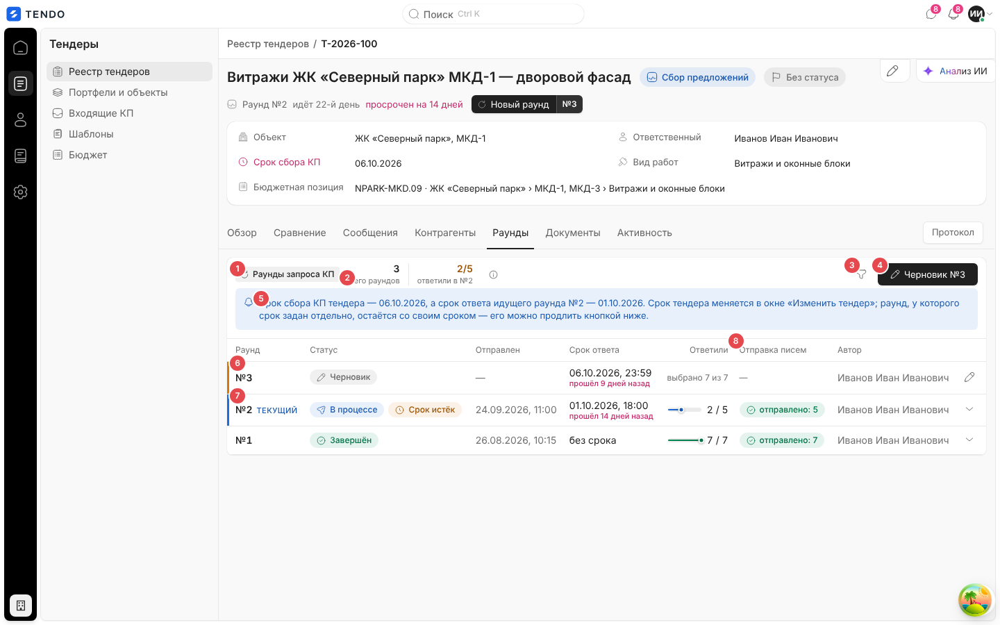
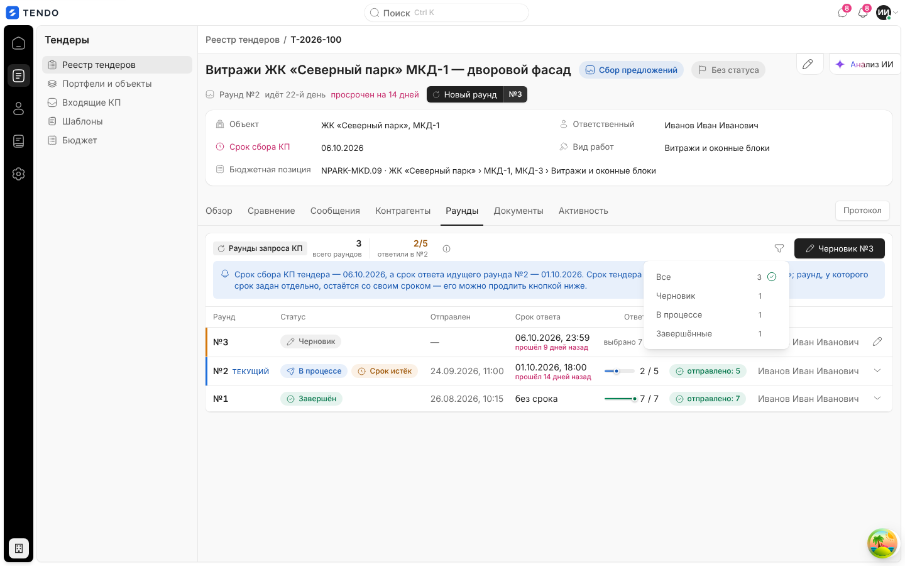
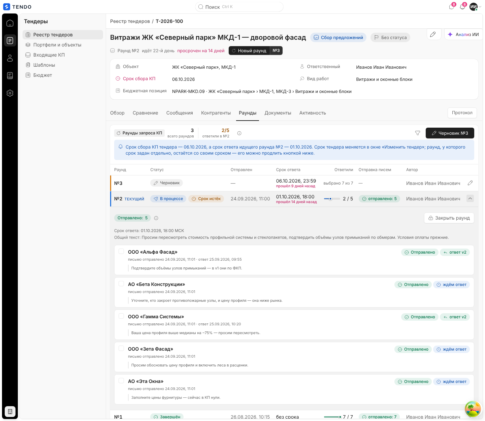
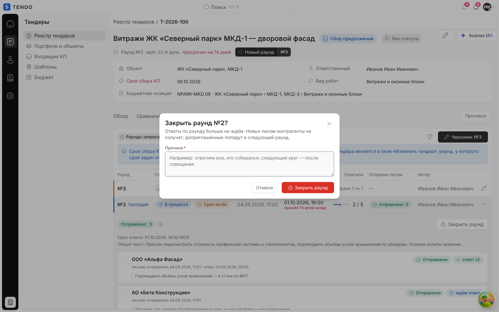
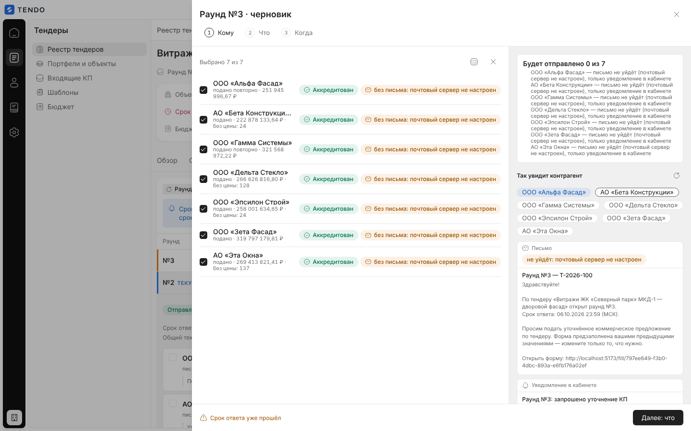
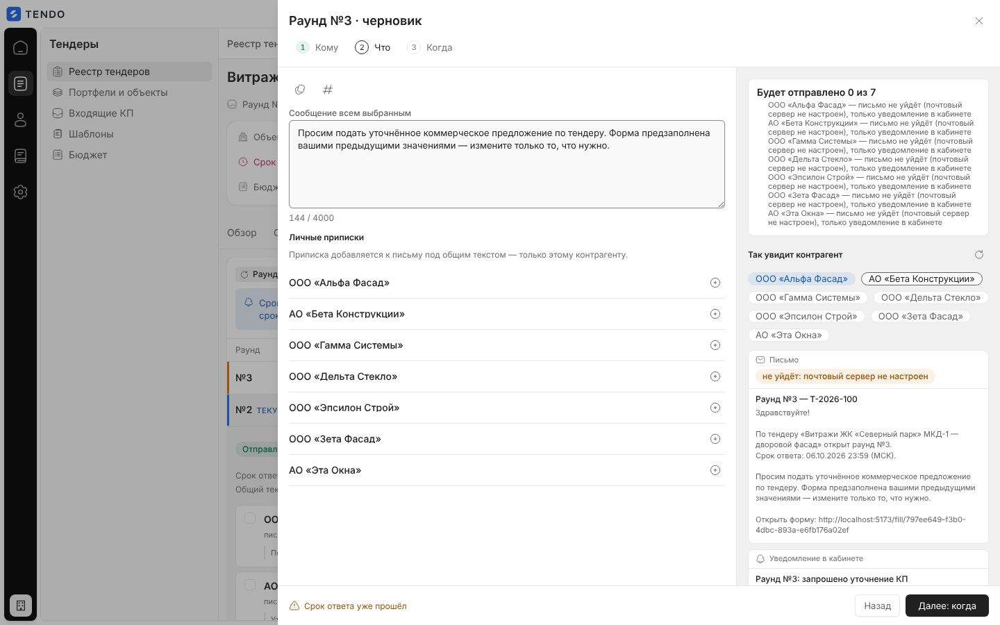
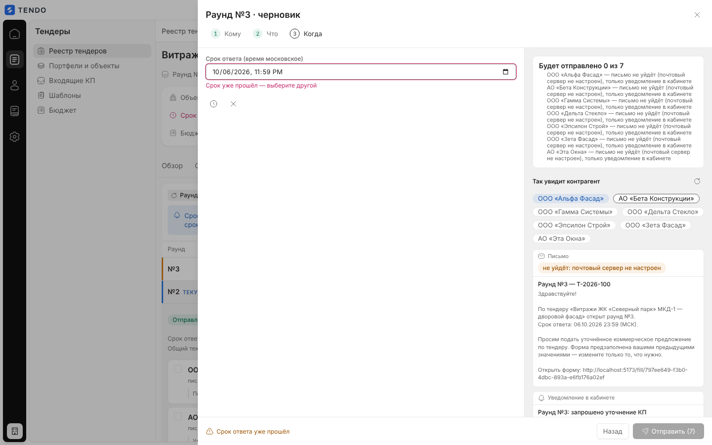
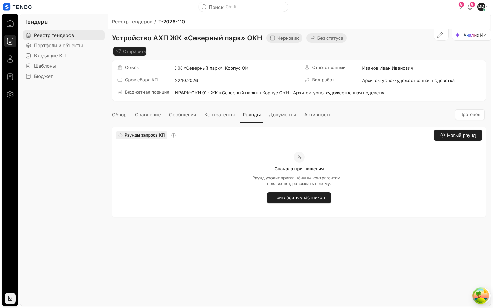
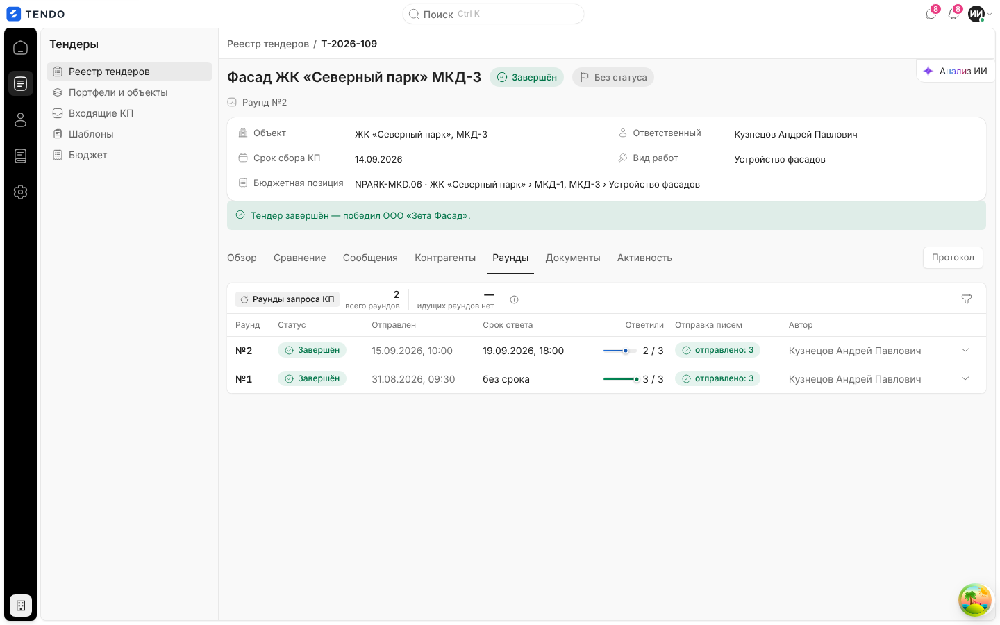

# Карточка тендера — вкладка «Раунды» и мастер раунда

Журнал раундов запроса КП (переторжек/уточнений) тендера и мастер нового раунда «Кому → Что → Когда» с серверным предпросмотром письма и уведомления. Раунд — одна рассылка выбранным участникам со своим сроком, общим текстом и личными приписками.

Связанные разделы: обзор экрана — [tender-card.md](tender-card.md) (кнопка «Новый раунд» в шапке, строка раунда); выбор раунда в СТ — [tender-card-comparison.md](tender-card-comparison.md#выбор-раунда); API — [../04-api/endpoints-rounds.md](../04-api/endpoints-rounds.md); данные — [../05-data-model/tables.md#tenders](../05-data-model/tables.md#tenders) (`tender_rounds`, `tender_round_recipients`); бизнес-правила раундов — [../02-business-logic/](../02-business-logic/).

## Маршрут, роли, как попасть

- `/tenders/:id`, вкладка «Раунды». Раунд — не отдельный экран: вкладка в том же ряду, что и сравнение; таблица при переходе состояния не теряет.
- Роли: тендерный специалист, администратор (эндпоинты раундов проверяют доступ сотрудника к тендеру).
- Попасть: вкладка; кнопка «Новый раунд №N» в шапке (сразу открывает черновик); уведомления о просрочке раунда.
- Данные: `GET /tenders/{id}/rounds` (список раундов с адресатами, статистикой ответов и доставки, `elapsed_label`, `overdue`), срок тендера — из карточки.

## Снимок

| № | Элемент | Поведение |
|---|---|---|
| ① | Группа «Раунды запроса КП» | Подсказка: «Каждый раунд — одна рассылка выбранным участникам: свой срок, общий текст с личными приписками и свои ответы. Отправленный раунд не редактируется.» |
| ② | Метрики | «N всего раундов»; «ответили / адресатов» в идущем раунде («2/5 ответили в №2») или «— идущих раундов нет»; красная «N не удалось отправить» (если есть сбои доставки) |
| ③ | Фильтр статуса (воронка) | Меню «Все · Черновик · В процессе · Завершённые» со счётчиками |
| ④ | «Черновик №N» / «Новый раунд» | Продолжить начатый черновик или завести новый; нет у завершённого/отменённого тендера |
| ⑤ | Плашка расхождения сроков | «Срок сбора КП тендера — ДД.ММ.ГГГГ, а срок ответа идущего раунда №N — ДД.ММ.ГГГГ. Срок тендера меняется в окне «Изменить тендер»; раунд, у которого срок задан отдельно, остаётся со своим сроком — его можно продлить кнопкой ниже.» + кнопка «Продлить раунд до ДД.ММ.ГГГГ» (если срок тендера позже срока раунда и не прошёл) |
| ⑥ | Строка черновика | Оранжевая кромка, статус «Черновик», «выбрано N из M», карандаш — открыть мастер |
| ⑦ | Строка идущего раунда | Синяя кромка, метка «текущий», статус «В процессе» + «Срок истёк» (если просрочен) |
| ⑧ | «Отправка писем» | Капсулы «отправлено: N», «не удалось: N», «нет данных: N» |

### Таблица раундов

| Колонка | Содержимое |
|---|---|
| Раунд | «№N», метка «текущий» у идущего |
| Статус | «Черновик» (карандаш), «В процессе» (самолётик), «Завершён» (галочка); «Срок истёк» |
| Отправлен | дата и время (МСК) или «—» |
| Срок ответа | дата и время или «без срока»; под ним «через N дней» / «сегодня» / красным «прошёл N дней назад» |
| Ответили | полоска + «ответили / адресатов»; у черновика — «выбрано N из M» |
| Отправка писем | капсулы доставки |
| Автор | ФИО создателя |
| (раскрыть) | шеврон раскрывает детали отправленного раунда; у черновика — карандаш |

Сортировка — по номеру по убыванию. Номер сквозной по тендеру; одновременно идёт не больше одного раунда: отправка нового закрывает предыдущий «В процессе».

## Детали отправленного раунда

- Сводка доставки «Отправлено: N», «Не удалось отправить: N», «Нет данных: N», «Не выбраны: N».
- «Срок ответа: ДД.ММ.ГГГГ, ЧЧ:ММ МСК», «Общий текст: …».
- Карточки адресатов: флажок (для повторной отправки), название, «письмо отправлено ДД.ММ.ГГГГ, ЧЧ:ММ» / «не отправлено: {причина}» / «отметки об отправке нет», «· ответ ДД.ММ.ГГГГ, ЧЧ:ММ»; капсулы «Отправлено» и ответа («ответ v2», «ждём ответ», «без ответа»); личная приписка цитатой.
- Действия: «Отправить ещё раз выбранным · N», «Повторить, кому не удалось · N» → `POST /tenders/{id}/rounds/{rid}/retry-delivery` (уведомление «Отправлено ещё раз: X из Y», «Кому не удалось — причина в строке адресата.» или «Повторять некому»); «Закрыть раунд» (только у идущего).
- Красная плашка «Не удалось отправить: N из M» при сбоях; у закрытого вручную — «Раунд закрыт вручную» с причиной.

### Закрыть раунд

Описание: «Ответы по раунду больше не ждём. Новых писем контрагенты не получат; доприглашённые попадут в следующий раунд.». Поле «Причина» — обязательно, ≤ 500 символов («Укажите причину», «Не длиннее 500 символов»), плейсхолдер «Например: ответили все, кто собирался; следующий круг — после совещания». Кнопки «Отмена», «Закрыть раунд» (красная, «Закрываем…»). Запрос `POST /tenders/{id}/rounds/{rid}/close` `{reason}`; успех — «Раунд №N закрыт». Сервер: «Закрыть можно только идущий раунд».

### Продлить раунд

Кнопка в плашке расхождения сроков → подтверждение «Продлить срок раунда №N до ДД.ММ.ГГГГ? Всем адресатам раунда уйдёт уведомление и письмо о новом сроке.» → `POST /tenders/{id}/rounds/{rid}/extend-deadline` (срок раунда = срок тендера) → «Срок продлён до …», «Адресаты уведомлены.». Сервер: «Продлить можно только идущий раунд», «У тендера не задан срок сбора КП», «Срок сбора КП тендера уже прошёл — сначала измените его в окне «Изменить тендер»», «Срок тендера не позже дедлайна раунда — продлевать нечего».

## Мастер раунда

Выезжающая справа панель «Раунд №N · черновик» с шагами «1 Кому · 2 Что · 3 Когда» (шаги кликабельны), левая часть — шаг, правая — предпросмотр. Черновик сохраняется сам (автосохранение через 800 мс после изменения, `PATCH /tenders/{id}/rounds/{rid}`; индикатор сохранения; ошибка «Не удалось сохранить раунд» с повтором); закрыть мастер и вернуться можно в любой момент.

Открытие: «Новый раунд» → `POST /tenders/{id}/rounds` (вернёт существующий черновик или создаст новый; сервер: «Сначала пригласите участников — без адресатов раунд завести нельзя», «Тендер в статусе «…» — новый раунд невозможен»).

### Шаг «Кому»

- «Выбрано N из M»; меню «Выбрать адресатов»: «Все» (все приглашённые), «Не ответившие» (кто ещё не подал КП), «С неполным КП» (подали, но не по всем позициям есть цена); «Снять выбор со всех».
- Строка адресата: флажок «Включить «…» в раунд», название, последний ответ («подано повторно · 251 945 996,67 ₽ · без цены: 24» / «{стадия}, КП нет»), капсула квалификации, капсула «без письма: {причина}» (например «почтовый сервер не настроен» — получит только уведомление в кабинете).

### Шаг «Что»

- «Вставить шаблон текста»: «Уточнение цены» («Просим подать уточнённое коммерческое предложение по тендеру {тендер} до {срок}. Форма предзаполнена вашими предыдущими значениями — измените только то, что нужно.»), «Продление срока» («Срок подачи КП по тендеру {тендер} продлён до {срок}. Если хотите улучшить предложение — форма открыта.»), «Корректировка ФКП» («В тендере {тендер} скорректирована ФКП (объёмы и состав позиций). Просим проверить изменённые позиции и подать КП по актуальной версии до {срок}.»).
- «Подставить переменную»: `{тендер}` (название и номер), `{срок}` (срок ответа), `{контрагент}` (название контрагента) — вставляются в позицию курсора, подставляются сервером при рассылке.
- «Сообщение всем выбранным» — многострочное поле, счётчик «N / 4000», ошибка «Слишком длинный текст», плейсхолдер «Например: просим уточнить цены по разделу «Отделка» до {срок}».
- «Личные приписки» — «Приписка добавляется к письму под общим текстом — только этому контрагенту.»; по строке на адресата с кнопкой «Добавить приписку для «…»», поле «Приписка для «…»».

### Шаг «Когда»

- «Срок ответа (время московское)» — поле даты и времени; подсказка «Контрагент видит срок в письме и в кабинете; после срока раунд помечается «Срок истёк».»; ошибка «Срок уже прошёл — выберите другой».
- «Быстрый срок»: «Конец рабочего дня» (сегодня 18:00), «+3 дня» (18:00), «+1 неделя» (18:00); «Убрать срок ответа» (раунд без срока).
- Предупреждение «Срок выпадает на выходной» (суббота/воскресенье по Москве).
- Новый черновик создаётся со сроком = срок сбора КП тендера, 23:59 МСК (если этот срок ещё не прошёл; иначе без срока), с общим текстом по умолчанию «Просим подать уточнённое коммерческое предложение по тендеру. Форма предзаполнена вашими предыдущими значениями — измените только то, что нужно.» и приглашёнными участниками в адресатах (все отмечены).

### Предпросмотр (правая колонка)

- «Будет отправлено X из N» + список «не выбраны: K» и тех, кому письмо не уйдёт («— письмо не уйдёт (причина), только уведомление в кабинете»).
- «Так увидит контрагент»: чипы адресатов (выбор, чей вариант показать), «Обновить предпросмотр»; карточка «Письмо» (капсула «не уйдёт: {причина}», тема «Раунд №N — {номер тендера}», текст с подставленными переменными, сроком и персональной ссылкой на форму) и «Уведомление в кабинете» (заголовок «Раунд №N: запрошено уточнение КП» и текст). Без выбранных — «Выберите хотя бы одного адресата — здесь появится письмо.». Собирает сервер: `POST /tenders/{id}/rounds/{rid}/preview`; ошибка — «Не удалось собрать предпросмотр».

### Низ панели и отправка

- Слева — срок («Срок ответа: …» / «Без срока ответа») или первая причина, мешающая отправке (жёлтый значок): «Не выбран ни один адресат», «Нет текста сообщения» / «Без текста: «…»» (если нет ни общего текста, ни приписки), «Текст длиннее 4000 символов», «Срок ответа уже прошёл».
- Кнопки «Назад», «Далее: что/когда», на последнем шаге «Отправить (N)» (недоступна при причинах; подсказка — текст причины).
- Отправка: сохранение черновика → подтверждение «Отправить раунд №N? Сообщение получат X из Y приглашённых. Отправленный раунд не редактируется.» → `POST /tenders/{id}/rounds/{rid}/send` → уведомление «Раунд №N отправлен» («Письма отправлены: N.» или «Письма отправлены: N, не удалось: M. Причины — в строке раунда.»). Сервер: «Отправить можно только черновик», «Срок ответа уже прошёл — выберите другой», «Выберите хотя бы одного адресата раунда», «Пустое сообщение для: «…». Напишите общий текст или приписку», «Сообщение длиннее 4000 символов». Предыдущий идущий раунд закрывается автоматически; адресатам открывается форма КП, предзаполненная прошлыми значениями.

## Состояния

| Состояние | Поведение | Снимок |
|---|---|---|
| Загрузка | Скелетон | — |
| Ошибка | «Раунды не загрузились» + текст + «Повторить» | — |
| Нет приглашённых | «Сначала приглашения» · «Раунд уходит приглашённым контрагентам — пока их нет, рассылать некому.» · «Пригласить участников» |  |
| Нет раундов (есть приглашённые) | «Раундов пока нет» · «Выберите адресатов, напишите текст и срок — и запросите уточнённые КП.» | — |
| Фильтр пуст | «Таких раундов нет» · «Ничего не нашлось по выбранному статусу.» · «Показать все» | — |
| Завершён / отменён | Только чтение: нет «Новый раунд», «Закрыть», «Продлить», повторной отправки; при отсутствии раундов — «Раундов не было» · «Тендер завершён или отменён — новые раунды не заводятся.» |  |

## Сложность

**L** — журнал с раскрываемыми деталями доставки, мастер из трёх шагов с автосохранением, шаблонами и переменными, серверный предпросмотр писем по адресатам, повторная отправка, закрытие и продление с уведомлениями.
