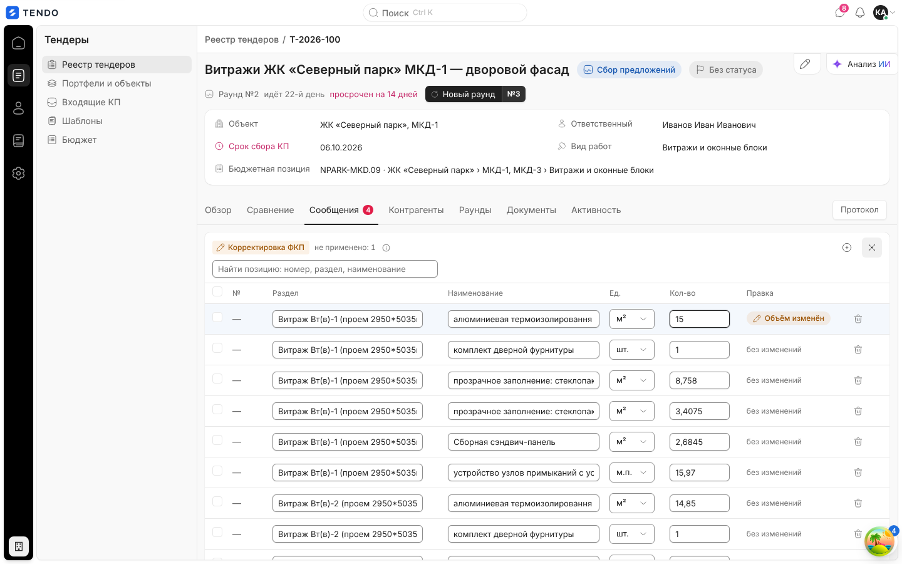
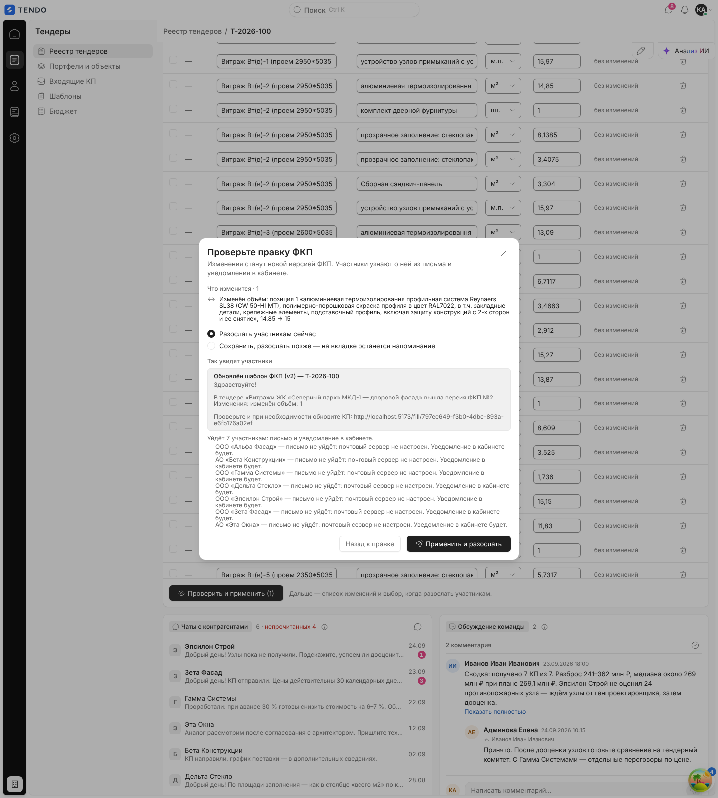
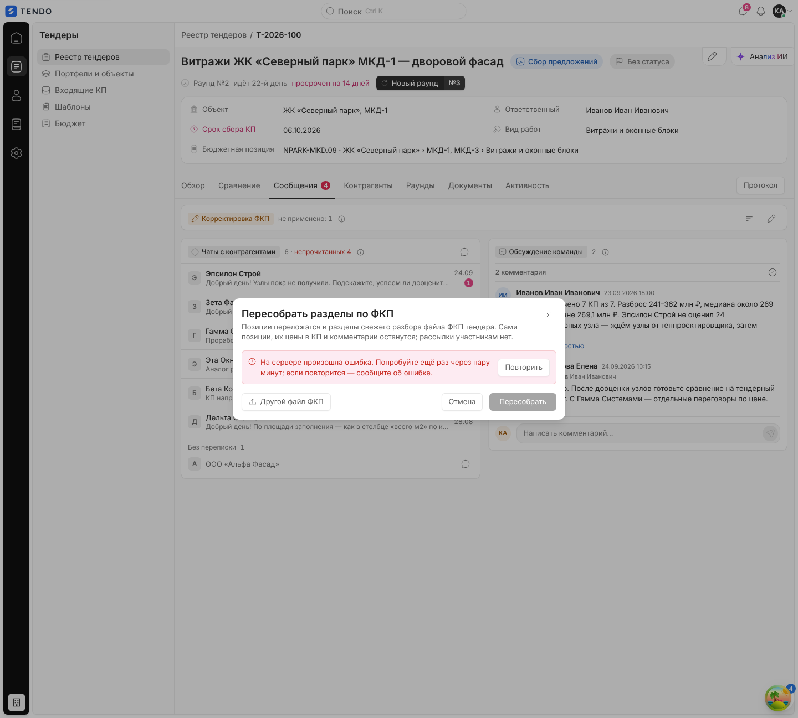

# Карточка тендера — блок «Корректировка ФКП» (структура тендера)

Правка состава ФКП уже опубликованного тендера: изменение объёма и единицы, снятие и добавление позиций, предпросмотр изменений, выпуск новой версии ФКП с рассылкой участникам сейчас или позже, а также пересборка дерева разделов по файлу ФКП. Блок стоит вверху вкладки «Сообщения».

Связанные разделы: вкладка «Сообщения» — [tender-card-messages.md](tender-card-messages.md); обзор экрана — [tender-card.md](tender-card.md); корректировки объёма от поставщиков (в СТ) — [tender-card-comparison.md](tender-card-comparison.md#корректировки-объёма); API — [../04-api/endpoints-tenders.md](../04-api/endpoints-tenders.md) (`/items`, `/structure`, `/structure/rebuild`), [../04-api/endpoints-rounds.md](../04-api/endpoints-rounds.md) (`/fkp-versions`); данные — [../05-data-model/tables.md#tenders](../05-data-model/tables.md#tenders) (`tender_items`, `tender_sections`, `tender_fkp_versions`).

## Маршрут, роли, как попасть

- `/tenders/:id`, вкладка «Сообщения», группа «Корректировка ФКП» (над чатами).
- Роли: тендерный специалист и администратор. Правка позиций (`PATCH /tenders/{id}/items`, `PUT /tenders/{id}/structure`) — любой сотрудник с доступом к тендеру; пересборка разделов — право `tenders.manage`.
- Интерфейс не скрывает блок у завершённого/отменённого тендера (см. [открытые вопросы](../_oq/SCR-2a.md)).

## Свёрнутое состояние

Заголовок «Корректировка ФКП», счётчик «N позиций в ФКП» (или «не применено: N», если в черновике правки есть изменения), подсказка «Объём, удаление и добавление позиций. Перед применением видно, что изменится, и решаете, разослать участникам сейчас или позже.», значки «Пересобрать разделы по файлу ФКП» и «Править ФКП». После применения под заголовком — итоговая строка, например «Добавлено: 1, изменено: 2, снято: 0. Участники уведомлены, писем отправлено: 7.» или «… Рассылка отложена — напоминание на этой вкладке.».

См. снимок вкладки: [tender-card--messages.png](assets/tender-card--messages.png) (метки ①–③).

## Режим правки

- Значки в заголовке: «Добавить позицию», «Закрыть правку ФКП».
- Поиск «Найти позицию: номер, раздел, наименование» и счётчик «Найдено: N из M».
- Таблица позиций (все позиции ФКП):

| Колонка | Тип | Правила |
|---|---|---|
| (флажок) | выбор строки; в заголовке — «Выделить все позиции» | для массовых действий |
| № | номер позиции ФКП | только чтение («—», если номера нет) |
| Раздел | текст | для существующих — только чтение; для новой позиции — ввод (пусто → раздел «Корректировки») |
| Наименование | текст | для новой позиции обязательно (позиции без названия не создаются) |
| Ед. | выбор **только** из действующих единиц справочника | устаревшее написание показывается как «{ед} — нет в справочнике» и недоступно для повторного выбора |
| Кол-во | число с запятой (точка заменяется на запятую, второй разделитель отбрасывается) | пусто = объём не задан |
| Правка | капсула «Объём изменён» (жёлтая), «Удаление» (красная), «Новая» (синяя) или «без изменений» | — |
| (действие) | «Удалить позицию» / «Вернуть позицию» / «Убрать новую позицию» | удаление — пометка, не мгновенное действие |

- **Массовые действия** при выбранных строках: «Выбрано: N», поле «Единица», поле «Объём» (применяются ко всем выбранным), «Удалить выбранные позиции · N», «Снять выделение».
- Кнопка «Проверить и применить (N)», где N — число содержательных изменений; если значения совпадают с исходными — недоступна («Значения совпадают с исходными — менять нечего»). Подпись: «Дальше — список изменений и выбор, когда разослать участникам.».
- Черновик правки хранится в памяти страницы до применения; перезагрузка страницы его сбрасывает.

## Окно «Проверьте правку ФКП»

- Описание: «Изменения станут новой версией ФКП. Участники узнают о ней из письма и уведомления в кабинете.».
- «Что изменится · N» — список строк: «Изменён объём: позиция N «…», 14,85 → 15», «Изменена единица: …», «Переименована позиция N: «…» → «…»», «Снята позиция N «…»», «Добавлена позиция «…» в раздел «…», 10 м²».
- Переключатель «Когда разослать участникам»: «Разослать участникам сейчас» (по умолчанию) / «Сохранить, разослать позже — на вкладке останется напоминание».
- «Так увидят участники» — предпросмотр письма (тема «Обновлён шаблон ФКП (vN) — {номер тендера}», текст с изменениями и персональной ссылкой на форму КП) и список адресатов «Уйдёт N участникам: письмо и уведомление в кабинете.» с причинами, по которым письмо кому-то не уйдёт (например «письмо не уйдёт: почтовый сервер не настроен. Уведомление в кабинете будет.»). Если приглашённых нет — «Приглашённых участников пока нет — уведомлять некого.». Ошибка сборки — «Не удалось собрать уведомление». Предпросмотр — `POST /tenders/{id}/fkp-versions/notice-preview`.
- Кнопки: «Назад к правке», «Применить и разослать» / «Применить без рассылки» (во время запроса — «Применяем…»).

Применение (последовательно):
1. новые позиции, сгруппированные по разделу, — `PUT /tenders/{id}/structure` `{sections:[{name, items:[{name, unit, quantity}]}], notify:false}`;
2. изменения объёма/единицы/названия и снятие — `PATCH /tenders/{id}/items` `[{id, quantity, unit, name} | {id, remove:true}]`, `notify:false`;
3. при «сейчас» — `GET /tenders/{id}/fkp-versions` → `POST /tenders/{id}/fkp-versions/{version_id}/notify`.

Сервер выпускает новую версию ФКП (номер растёт), поставщики, подавшие КП по старой версии, получают пометку «ФКП vN · актуальна vM» в СТ и «КП по старой версии ФКП» на вкладке «Контрагенты»; изменения объёмов пересчитывают суммы по ставкам. Ошибка — «Не удалось применить корректировки».

## Баннер неразосланной версии

Если версия ФКП выпущена без рассылки, вверху вкладки «Сообщения» висит баннер: «Есть неразосланная версия ФКП (vN)» (или «Есть неразосланные версии ФКП: vN, vM») и «Изменения: {сводка}. Участники о них ещё не знают.» с кнопкой «Разослать». Окно «Разослать версию ФКП vN» (для нескольких — «Неразосланные версии уйдут одним письмом со всеми изменениями.») показывает тот же предпросмотр; «Отмена» / «Разослать» («Рассылаем…»). Результат — «Уведомление разослано. Писем отправлено: N.» или «Уведомления в кабинетах отправлены. Писем не ушло ни одного — причины были видны в предпросмотре.». Ошибка — «Не удалось разослать уведомление». На стенде неразосланных версий нет — снимка нет.

## Пересборка разделов по файлу ФКП

Значок «Пересобрать разделы по файлу ФКП» открывает окно «Пересобрать разделы по ФКП»: «Позиции переложатся в разделы свежего разбора файла ФКП тендера. Сами позиции, их цены в КП и комментарии останутся; рассылки участникам нет.».

- При открытии строится **план без записи**: `POST /tenders/{id}/structure/rebuild?dry_run=true` (по сохранённому исходному файлу тендера) или, после «Другой файл ФКП» («Собрать план по другому файлу ФКП, а не по сохранённому исходнику тендера»), — multipart с полем `file`.
- «Что получится»: «Позиций в тендере», «Сопоставлено с файлом по порядку», «Разложено по номеру», «Разложено по соседней позиции», «Только в файле — в тендер не добавятся», «Разделов в новом дереве», число строк-заголовков, которые станут подразделами (отказы и пустые).
- «Комментарии подрядчиков к ним удалятся вместе со строками» — список таких строк с текстами комментариев.
- Предупреждение «Пересборка не удалит строки с ценами»: если у строк-заголовков есть цены в КП, «Пересобрать» недоступна («Сначала разберите в сравнении строки с ценами»); строки с ценами в прежних редакциях остаются снятыми позициями (подсказка «Цены есть в прежних редакциях КП: строка останется снятой позицией подраздела, история КП цела»).
- «Контрольные суммы ФКП · N» — расхождения формул/итогов в файле.
- Кнопки: «Другой файл ФКП», «Отмена», «Пересобрать» («Пересобираем…») → `…?dry_run=false`. Успех — уведомление «Разделы пересобраны по ФКП» («N разделов · M строк-заголовков стали подразделами») и строка «Разделы пересобраны по файлу ФКП: N, позиций перенесено: M. Рассылки не было.».
- Ошибки: «Не удалось собрать план пересборки» (с «Повторить»), «Не удалось пересобрать разделы».

## Сложность

**L** — редактируемая таблица с массовыми операциями и локальным черновиком, вычисление диффа, предпросмотр писем, версии ФКП с отложенной рассылкой; пересборка дерева разделов по Excel требует серверного сопоставления строк (по порядку, номеру, соседям) и dry-run-плана.
