# Карточка тендера (`/tenders/:id`)

Главный рабочий экран тендерного специалиста: шапка тендера, переключатель статуса, семь вкладок-разделов, правая панель «Анализ ИИ» и общие окна жизненного цикла. Этот файл — обзор экрана и оглавление подфайлов по вкладкам.

Связанные разделы: бизнес-логика сравнения — [../02-business-logic/tenders-comparison.md](../02-business-logic/tenders-comparison.md); API — [../04-api/endpoints-tenders.md](../04-api/endpoints-tenders.md), [../04-api/endpoints-rounds.md](../04-api/endpoints-rounds.md), [../04-api/endpoints-quotes.md](../04-api/endpoints-quotes.md), [../04-api/endpoints-comments.md](../04-api/endpoints-comments.md), [../04-api/endpoints-chat.md](../04-api/endpoints-chat.md); данные — [../05-data-model/tables.md#tenders](../05-data-model/tables.md#tenders); ИИ — [../06-ai/](../06-ai/).

## Оглавление подфайлов

| Файл | Что описывает |
|---|---|
| [tender-card-lifecycle.md](tender-card-lifecycle.md) | Смена статуса, выбор победителя (в т.ч. без аккредитации), повторный ввод пароля, «Изменить тендер» с предпросмотром последствий, отправка черновика, «Сохранить как шаблон» |
| [tender-card-overview.md](tender-card-overview.md) | Вкладка «Обзор»: сводка, участники, готовность к выбору победителя, вклад разделов, заметки специалиста, лента |
| [tender-card-comparison.md](tender-card-comparison.md) | Вкладка «Сравнение» — сравнительная таблица (СТ): колонки, ячейки, панель инструментов, пресеты, фильтры, закрепление, выделение, корректировки, комментарии, выгрузка в Excel |
| [tender-card-messages.md](tender-card-messages.md) | Вкладка «Сообщения»: чаты с контрагентами, обсуждение команды, плавающая кнопка чата |
| [tender-card-structure.md](tender-card-structure.md) | Блок «Корректировка ФКП» на вкладке «Сообщения»: правка позиций, версии ФКП и их рассылка, пересборка разделов |
| [tender-card-participants.md](tender-card-participants.md) | Вкладка «Контрагенты» и мастер «Пригласить участников» |
| [tender-card-rounds.md](tender-card-rounds.md) | Вкладка «Раунды» и мастер раунда «Кому → Что → Когда» с предпросмотром письма |
| [tender-card-documents.md](tender-card-documents.md) | Вкладка «Документы» и окно «Тендерный протокол» (выгрузка .docx) |
| [tender-card-activity.md](tender-card-activity.md) | Вкладка «Активность»: лента событий с фильтрами |
| [tender-card-analysis.md](tender-card-analysis.md) | Панель «Анализ ИИ»: запуск, прогресс, результат, чат по таблице, письмо поставщику, режим «ИИ выключен» |

> На всех снимках в правом нижнем углу виден круглый значок — это инструмент отладки dev-сборки стенда, в продукт не входит и в ТЗ не описывается.

## Маршрут

- `/tenders/:id`, где `:id` — числовой идентификатор тендера (не номер `T-2026-100`).
- Активная вкладка — **состояние страницы, а не маршрута**: адрес указывает на тендер; при каждом открытии карточка открывается на вкладке «Обзор».
- В адресе живёт только состояние вида сравнительной таблицы (query-параметры `p`, `m`, `dev`, `dyn`, `pot`, `sort`, `f`, `slice` — см. [tender-card-comparison.md](tender-card-comparison.md#ссылка-на-вид)). Пустой вид пишется как `?p=overview`.
- Служебный параметр `?dossier=<id контрагента>` — открыть досье подрядчика в СТ (используется переходом из карточки КП); после открытия параметр снимается.
- Заголовок вкладки браузера — **название** тендера; до загрузки — «Тендер {id}».

## Назначение

Одно рабочее место, где специалист ведёт тендер от черновика до выбора победителя: видит сводку, сравнивает КП построчно, переписывается с контрагентами, приглашает участников, запускает раунды переторжки, управляет пакетом документов и оформляет протокол. Тендер — **рабочее место с вкладками**, а не набор экранов: всё, кроме модальных окон и выезжающих панелей, живёт на одной странице.

## Роли и права

| Роль | Доступ к карточке | Что меняется |
|---|---|---|
| Тендерный специалист | Да — к тендерам объектов (проектов), к которым выдан доступ | Полный набор действий при праве `tenders.manage` (смена статуса, правка тендера, приглашения, протокол). Цены — при флаге пользователя «Видит финансы» или праве `finance.view` |
| Администратор | Да — ко всем тендерам (проверка доступа к объекту не применяется) | Всё, что у специалиста; плюс в окне «Параметры анализа» СТ — ссылка «Изменить в настройках» |
| Служба безопасности, Юрист | **Нет**: раздел «Тендеры» скрыт в навигации, прямой переход на `/tenders/:id` уводит на главную роли (`/home`); API карточки отвечает 403 | — |
| Поставщик (пользователь контрагента), Лид, Владелец площадки | Нет (закрытые роли; маршрут вне их белого списка) | — |

Правила, влияющие на отображение:

- **Доступ к объекту.** Если тендер принадлежит проекту, к которому у пользователя нет доступа, API отвечает 403 «Нет доступа к тендерам этого проекта»; экран показывает состояние «Тендер не загрузился» с этим текстом (см. [Состояния](#состояния)).
- **Финансы (`can_view_finance`).** Без права видеть цены сервер обнуляет все денежные поля сравнения и плановую сумму бюджета; в колонках СТ вместо итога — «Цена скрыта»; кнопка «Протокол» не показывается вовсе (протокол содержит суммы); срез «Материалы/Работы» недоступен. Подробно — [tender-card-comparison.md](tender-card-comparison.md#маска-финансов).
- **Маска контактов (`suppliers.contacts.view`).** Включается настройкой сервера `CONTACTS_MASK_ENABLED` (по умолчанию выключена — контакты видят все сотрудники). При включённой маске без права ИНН, e-mail и телефон участников в досье и выгрузке СТ маскируются; в досье — подсказка «Полные контакты доступны по праву «Контакты подрядчиков»».
- **Запись.** Мутации тендера (`PATCH /tenders/{id}`, приглашения, протокол, пересборка разделов) требуют права `tenders.manage`; решения по КП — `quotes.manage`. Интерфейс кнопки не прячет по этим правам — отказ сервера показывается сообщением (см. [открытые вопросы](../_oq/SCR-2a.md)).

## Как попасть

- Клик по строке реестра тендеров (`/tenders`).
- Из уведомлений, ленты активности на главной, карточки КП (кнопка «Досье» ведёт сюда с `?dossier=`), из чата (переход к ячейке СТ), из глобального поиска.
- Сразу после создания тендера мастером.

## Общая компоновка

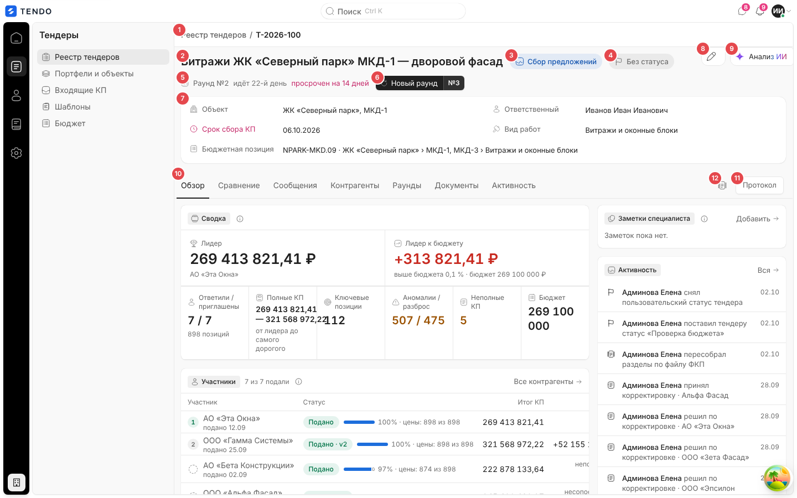

| № | Блок | Поведение |
|---|---|---|
| ① | Хлебные крошки «Реестр тендеров / T-2026-100» | Первый сегмент — ссылка на `/tenders`; второй — **номер** тендера (не название), не ссылка |
| ② | Название тендера (`h1`) | Единственный заголовок страницы; полное название без обрезки (переносится) |
| ③ | Капсула системного статуса | Цвет + значок + подпись. Если есть допустимые переходы — это кнопка, открывающая меню смены статуса ([tender-card-lifecycle.md](tender-card-lifecycle.md#смена-статуса)). У завершённого/отменённого — неинтерактивна, подсказка «Тендер завершён или отменён — смена статуса только административным восстановлением» |
| ④ | Капсула пользовательского статуса | «Без статуса» (нейтральная, с флажком) или выбранный статус справочника. Клик — меню. Если справочник пуст и статус не задан — капсулы нет |
| ⑤ | Строка раунда | «Раунд №N» + готовая фраза сервера о длительности («идёт 22-й день») + красная пометка просрочки «просрочен на 14 дней». Черновой раунд не учитывается; пока ни один раунд не отправлен — строки нет. У закрытого раунда фразы о длительности нет |
| ⑥ | Кнопка «Новый раунд №N+1» | Только если есть сравнение и тендер не завершён/не отменён. Переключает на вкладку «Раунды» и заводит (или открывает) черновик следующего раунда |
| ⑦ | Сводка (4–5 полей) | «Объект» (портфель, проект), «Срок сбора КП» (ДД.ММ.ГГГГ), «Ответственный», «Вид работ», «Бюджетная позиция» (`код · путь`, прочерк если не привязана). Поля только для чтения |
| ⑧ | Кнопка-карандаш «Изменить тендер» | В правом верхнем углу на линии крошек, на любой вкладке. Открывает окно правки ([tender-card-lifecycle.md](tender-card-lifecycle.md#изменить-тендер)). У завершённого/отменённого тендера отсутствует |
| ⑨ | Бирка «Анализ ИИ» | Открывает/закрывает правую панель ИИ ([tender-card-analysis.md](tender-card-analysis.md)). Когда липкая шапка СТ поднимается к верхней линии, бирка сворачивается до значка |
| ⑩ | Вкладки | «Обзор · Сравнение · Сообщения (N) · Контрагенты · Раунды · Документы · Активность». У «Сообщений» — счётчик непрочитанных сообщений контрагентов по этому тендеру |
| ⑪ | «Протокол» | На строке вкладок, на любой вкладке; только при праве видеть финансы. Окно протокола — [tender-card-documents.md](tender-card-documents.md#тендерный-протокол) |
| ⑫ | Действия вкладки | Набор зависит от вкладки: «Обзор» — «Сохранить как шаблон» (значок) + «Протокол»; «Сравнение» — выбор раунда, «Выгрузить сравнение в Excel», «Протокол»; остальные — только «Протокол» |

### Срок сбора КП — подсветка

Режим даты считается от поля «Окончание сбора КП» и только у тендера в статусе «Сбор предложений»; подсказка по наведению на всю строку поля:

| Условие | Вид | Подсказка |
|---|---|---|
| Статус не «Сбор предложений» (черновик) | обычный, значок календаря | «Черновик не опубликован — отсчёт до срока сбора КП ещё не начат.» |
| Завершён / отменён | обычный | «Тендер завершён — приём коммерческих предложений завершён.» (подставляется название статуса) |
| Срок прошёл | красный, значок часов | «Срок истёк N дней назад. Приём коммерческих предложений закрыт.» |
| Сегодня | красный | «Сегодня последний день приёма коммерческих предложений.» |
| ≤ 7 дней | красный | «Осталось N дней. Приём коммерческих предложений скоро закроется.» |
| 8–30 дней / > 30 дней | обычный | «Осталось N дней до конца приёма коммерческих предложений.» |

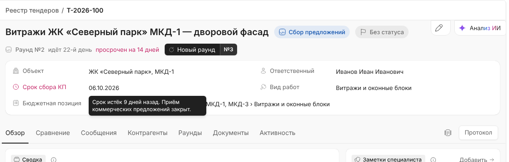

### Системные статусы

| Код | Подпись | Тон / значок | Переходы из статуса (меню) |
|---|---|---|---|
| `draft` | Черновик | нейтральный, документ | «Сбор предложений», «Отменён» |
| `open` | Сбор предложений | info, активность | «Завершён» (подсказка «выбор победителя и пароль»), «Отменён» («пароль, отменить нельзя») |
| `closed` | Завершён | success, галочка | нет (меню не показывается) |
| `cancelled` | Отменён | danger, крестик | нет |

Обратный ход `open → draft` не предлагается. Переход `draft → open` система выполняет и сама — первым приглашением.

### Баннер итога закрытия

У завершённого тендера под сводкой постоянно висит баннер: «Тендер завершён — победил ООО «…».» (зелёный). Если победитель выбран без аккредитации — жёлтый, с текстом «… Победитель без аккредитации: {статус}.». Если победитель неизвестен — «Тендер завершён.».

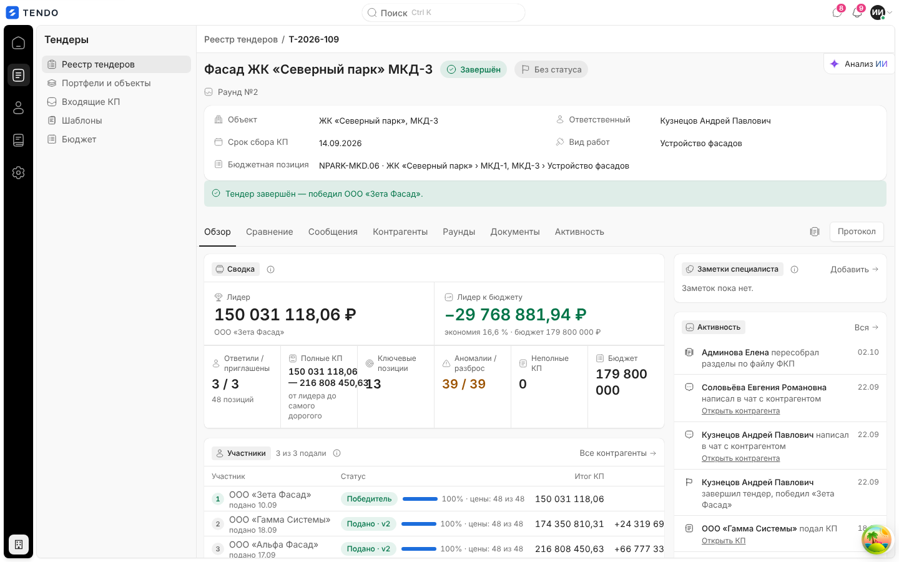

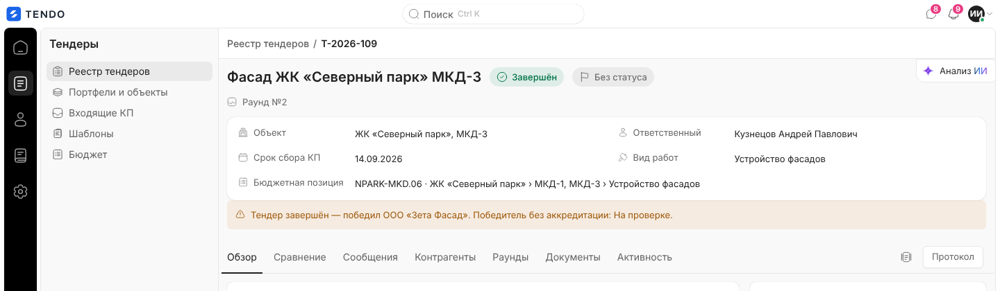

### Черновик

У тендера в статусе «Черновик» под названием стоит основная кнопка **«Отправить»**. Она проверяет готовность и либо переводит тендер в «Сбор предложений» (`PATCH /tenders/{id}` `{status:"open"}`), либо открывает окно «Недостающие данные для отправки тендера» — см. [tender-card-lifecycle.md](tender-card-lifecycle.md#отправка-черновика).

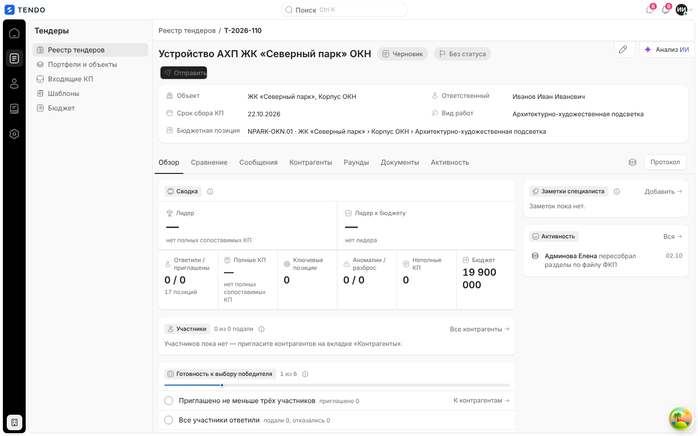

## Постоянные элементы вне вкладок

- **Плавающая кнопка чата** (правый нижний угол, на всех вкладках) — открывает панель «Чаты» с контекстом этого тендера; счётчик непрочитанных; скрывается, пока открыта панель «Анализ ИИ». См. [tender-card-messages.md](tender-card-messages.md#плавающая-кнопка-и-панель-чатов).
- **Панель «Анализ ИИ»** — правая колонка каркаса; при открытии сжимает основную область (не накрывает её); переживает переключение вкладок, сбрасывается при уходе со страницы. Монтируется при первом открытии и только когда загружены данные сравнения.

## Загрузка данных

Карточка делает два независимых запроса: `GET /tenders/{id}` (шапка, сводка, приглашения, разделы) и `GET /tenders/{id}/comparison` (снимок сравнения, нужен «Обзору», «Сравнению», «Сообщениям», «Контрагентам»), плюс `GET /tenders/{id}/rounds` (строка раунда, выбор раунда). Шапка не ждёт сравнения. После любой мутации (статус, приглашение, раунд, корректировка) все ресурсы тендера перечитываются одним вызовом. Ответ сравнения поддерживает условный запрос (ETag) и ограничен по частоте (лимит «тяжёлых чтений», по умолчанию 60 запросов в 60 с на пользователя).

## Состояния

| Состояние | Что видит пользователь | Снимок |
|---|---|---|
| Загрузка | Скелетоны: полоса крошек, заголовок, строка, блок | 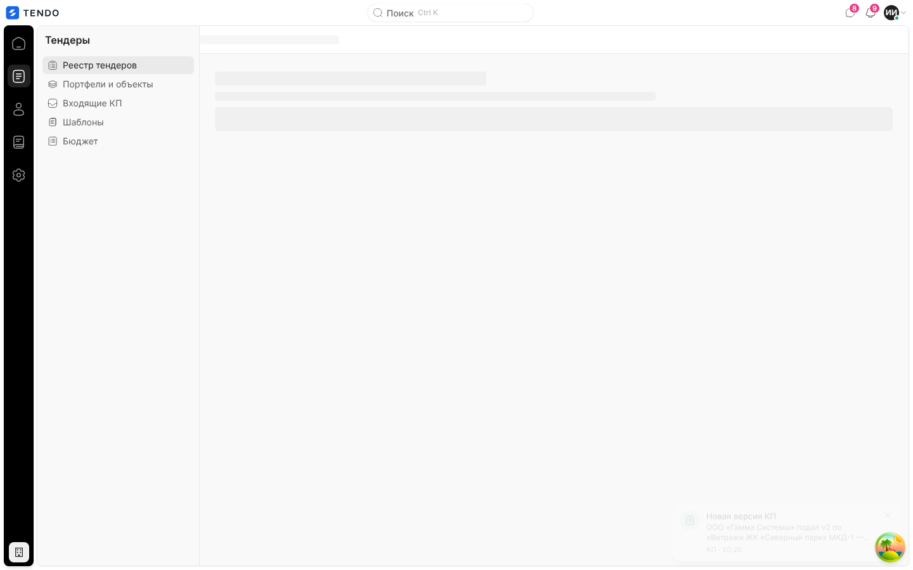 |
| Тендер не найден (404) | Иллюстрация, «Тендера № {id} нет», «Его удалили, или в ссылке ошибка. Найдите тендер в реестре — по номеру или названию.», кнопка «В реестр тендеров», строка «Код 404 · {путь}» | 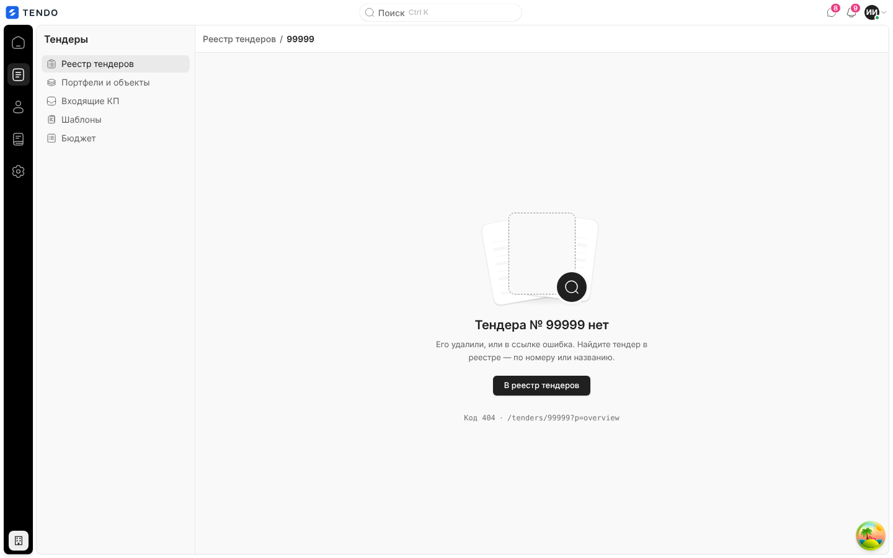 |
| Ошибка загрузки / нет доступа к объекту (403, 5xx, сеть) | «Тендер не загрузился» + текст ошибки сервера (например, «Нет доступа к тендерам этого проекта» или «На сервере произошла ошибка. Попробуйте ещё раз через пару минут; если повторится — сообщите об ошибке.»), кнопки «Повторить» и «В реестр тендеров». При обрыве сети — иллюстрация «нет связи» | 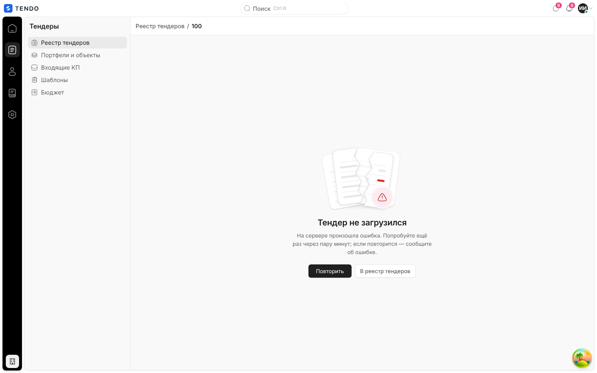 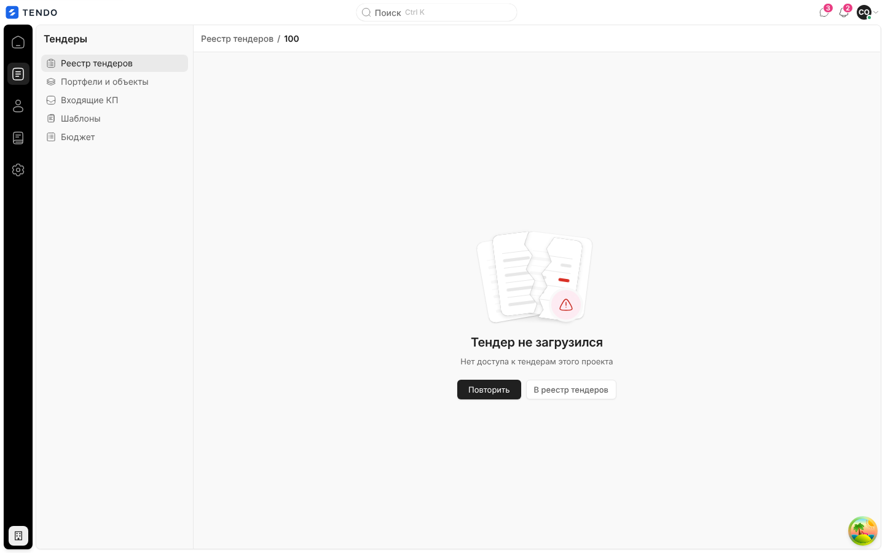 |
| Роль без доступа к разделу (СБ, юрист) | Переход на `/tenders/:id` уводит на главную роли | 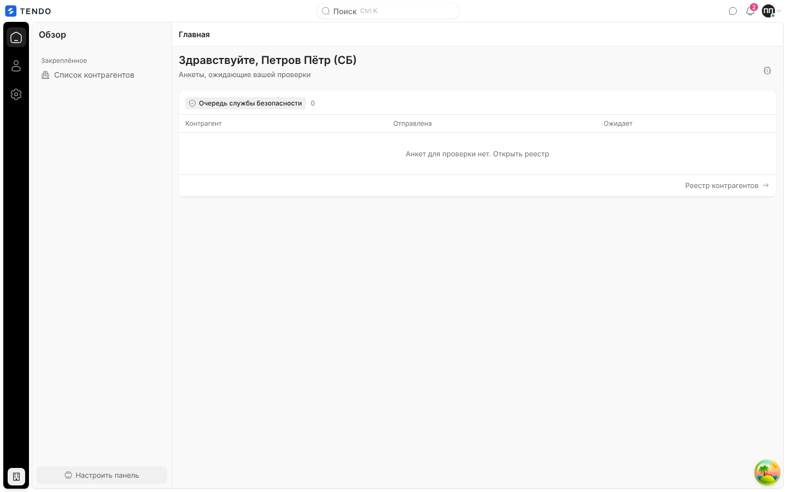 |
| Только чтение (завершён / отменён) | Нет карандаша «Изменить тендер», нет «Новый раунд», капсула статуса не открывает меню, нет колонки «Пригласить в тендер» в СТ, на «Контрагентах» — «Тендер завершён — приглашения и действия со ссылками недоступны.», раунды только для чтения | 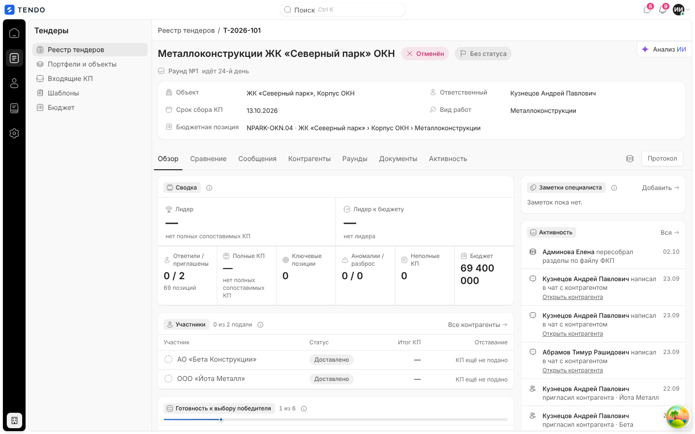 |
| Ошибка одной вкладки | Остальные вкладки работают; на вкладке — «{Раздел} не загрузился» + «Повторить» | см. подфайлы |

## Переходы

| Откуда | Куда |
|---|---|
| Крошка «Реестр тендеров», кнопка «В реестр тендеров» | `/tenders` |
| «Открыть КП» (Контрагенты), ссылки ленты «Открыть КП» | карточка КП `/quotes/:id` |
| «Открыть контрагента», иконка карточки контрагента | `/suppliers/:id` |
| «Изменить в настройках» (админ, параметры СТ) | `/settings?section=compare` |
| «Запросить пополнение» (админ, панель ИИ) | `/expenses` |
| Цифры «Обзора» | вкладка «Сравнение» с нужным пресетом и чипом «Вернуть мой вид» |

## Сложность

**XL** в целом (крупнейший экран продукта). Разбивка: шапка и жизненный цикл — M; Обзор — M; Сравнение — XL; Сообщения + чат — L; Корректировка ФКП — L; Контрагенты + приглашение — L; Раунды + мастер — L; Документы + протокол — M; Активность — S; панель ИИ (UI) — L.
