# Мастер создания тендера (`/tenders/new`)

Четырёхшаговый мастер: **1 «Загрузка файла»** (Excel-форма ФКП и её разбор) → **2 «Проверка структуры»** (подтверждение колонок, поля тендера, таблица позиций, единицы, доп. условия, отправка) → **3 «Загрузка документов»** → **4 «Контрагенты и ссылки»**. Тендер создаётся в статусе «Черновик» в конце шага 2; до этого весь ввод живёт в серверном черновике мастера и переживает закрытие вкладки. Альтернативные входы — запуск из шаблона и встроенный пример файла (только демо).

Связанные разделы: правила мастера, черновиков и шаблонов — [../02-business-logic/tenders-lifecycle.md](../02-business-logic/tenders-lifecycle.md#2-создание-тендера--мастер-из-четырёх-шагов); поля и серверные проверки — [там же §5](../02-business-logic/tenders-lifecycle.md#5-поля-тендера-и-проверки); ИИ в распознавании — [../06-ai/ai-features.md](../06-ai/ai-features.md#36-ии-в-распознавании-фкп); API — [../04-api/endpoints-tenders.md](../04-api/endpoints-tenders.md) (`/tenders/parse-excel*`, `/creation-drafts*`, `POST /tenders`, `/templates*`), справочники — [../04-api/endpoints-catalog.md](../04-api/endpoints-catalog.md), портфели — [../04-api/endpoints-portfolios.md](../04-api/endpoints-portfolios.md), документы — [tender-card-documents.md](tender-card-documents.md), приглашение — [tender-card-participants.md](tender-card-participants.md#пригласить-участников); список незавершённых — [tenders-registry.md](tenders-registry.md#вкладка-незавершённые); шаблоны — [templates.md](templates.md).

> На стенде ИИ выключен: подсказки по полям строятся только правилами (без модели), резервный ИИ-разбор и ИИ-подбор единиц не работают. Где участвует ИИ — описано по коду в разделе [«Где участвует ИИ»](#где-участвует-ии). Круглый значок в правом нижнем углу снимков — инструмент отладки dev-сборки стенда.

Пример прохода на стенде: файл «ТЗ-демо_ФКП_стяжки.xlsx» (4 раздела, 10 позиций, 5 доп. условий, одна незнакомая единица «пог. м») → создан тендер **T-2026-111 «ТЗ-демо: Стяжки полов в ОКН (мастер создания)»** (статус «Черновик», без приглашений).

## Маршрут и параметры

| Адрес | Что происходит |
|---|---|
| `/tenders/new` | Чистый мастер, шаг 1. Никакие чужие черновики не подхватываются |
| `/tenders/new?draftId={uuid}` | Продолжение черновика мастера (из вкладки «Незавершённые» реестра или после обновления страницы) — см. [Черновики](#черновики-создания-и-восстановление) |
| `/tenders/new?fromTemplate={id}` | Запуск из шаблона — сразу шаг 2 с подставленным составом, см. [Создание из шаблона](#создание-из-шаблона) |
| `/tenders/new?projectId={id}` | Предвыбор объекта (используется переходом с экрана объекта) |

- Как только пользователь начал работу (ввёл любое поле шага 2 или загрузил файл), создаётся серверный черновик и его id дописывается в адрес (`?draftId=`) без новой записи истории — обновление страницы продолжает тот же черновик.
- Шаг мастера — состояние страницы (в адрес не пишется; в черновике хранится).
- Крошки: «Реестр тендеров / Новый тендер».

## Назначение

Превратить Excel-форму коммерческого предложения (ФКП), которую закупщик готовит для подрядчиков, в онлайн-тендер: распознать разделы, позиции, единицы и объёмы, дать проверить и поправить распознанное, заполнить паспорт тендера (объект, виды работ, бюджетная позиция, сроки, плановая сумма), приложить пакет документов и разослать приглашения.

## Роли и права

| Роль | Доступ |
|---|---|
| Тендерный специалист | Да. Создание тендера (`POST /tenders`) требует права `tenders.manage` (по умолчанию у специалиста есть) и доступа к выбранному объекту |
| Администратор | Да, любые объекты |
| СБ, юрист | Нет: маршрут закрыт → `/home` |
| Поставщик, лид, владелец площадки | Нет → стартовый экран роли |

Отказ сервера в правах приходит текстом ошибки под кнопкой «Отправить».

## Как попасть

- «Новый тендер» в шапке реестра тендеров и главной, «+ Новый тендер» в таблице «Требуют внимания», «Создать тендер» в пустой полосе сроков на главной.
- «Продолжить» во вкладке «Незавершённые» реестра.
- «Запустить тендер» в библиотеке шаблонов.

## Полоса шагов

Над содержимым всегда стоит полоса из четырёх равных шагов: кружок (номер или галочка у пройденного), название и пояснение (для текущего/будущего — что делать, для пройденного — что сделано).

| Шаг | Название | Пояснение (не пройден) | Пояснение (пройден) |
|---|---|---|---|
| 1 | Загрузка файла | «Загрузите файл КП» | «Файл загружен и разобран» |
| 2 | Проверка структуры | «Проверьте данные из файла» | «Данные подтверждены» |
| 3 | Загрузка документов | «Добавьте пакет условий» | «Документы приложены» (пишется и при «Пропустить») |
| 4 | Контрагенты и ссылки | «Пригласите участников» | «Приглашения отправлены» |

Линия между кружками: пройденные участки — зелёные, участок перед текущим шагом — синий. Кружки не кликабельны: назад ходят кнопкой «Назад».

## Шаг 1. Загрузка файла

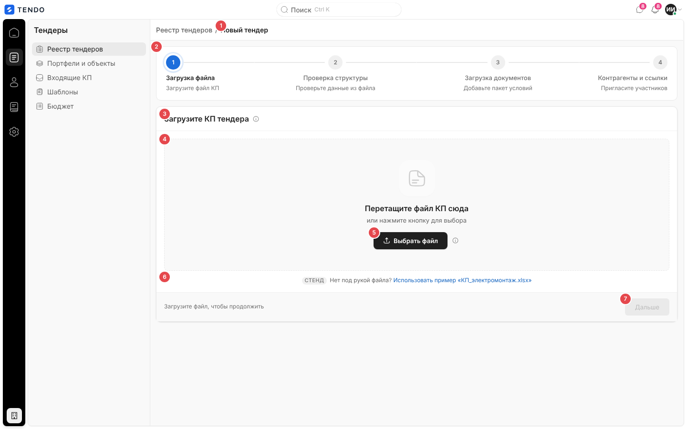

| № | Элемент | Поведение |
|---|---|---|
| ① | Крошки «Реестр тендеров / Новый тендер» | Первый сегмент — ссылка на реестр |
| ② | Полоса шагов | Шаг 1 текущий |
| ③ | «Загрузите КП тендера» + «i» | Подсказка: «Excel-файл с позициями: .xlsx или .xls, до 50 МБ.» |
| ④ | Зона перетаскивания | «Перетащите файл КП сюда / или нажмите кнопку для выбора»; при наведении файла подсвечивается; бросок файла = выбор |
| ⑤ | «Выбрать файл» + «i» | Системный выбор файла (`.xlsx, .xls`); подсказка: «Распознаём шапку («Наименование», «Ед.», «Количество») — колонки не обязаны быть A/B/C. Компактный шаблон «раздел / позиция / ед. / кол-во» тоже подходит. Второй лист (если есть) — доп. условия.» |
| ⑥ | «СТЕНД · Нет под рукой файла? Использовать пример «КП_электромонтаж.xlsx»» | **Только при флаге демо-инструментов** (`VITE_DEMO_TOOLS=1`); подгружает встроенный пример и запускает разбор («Загружаем пример…»). В боевой сборке строки нет |
| ⑦ | Подвал: «Загрузите файл, чтобы продолжить» / «Файл распознан — можно двигаться дальше» и «Дальше» | «Дальше» активна только после успешного разбора; подсказка «Сначала загрузите файл КП — проверять пока нечего.» / «Откроет разбор файла: какая колонка чем стала и что из неё заберётся в тендер. Ничего ещё не создаётся.» |

После выбора файла под зоной — плашка файла (имя, размер в КБ, «Убрать файл») и карточка файла над шагом.

### Проверки файла до разбора

| Условие | Поведение / текст |
|---|---|
| Файл больше 50 МБ (`MAX_EXCEL_UPLOAD_SIZE_MB`) | Разбор не начинается: «Файл больше 50 МБ — уменьшите или удалите лишние листы.»; файл сбрасывается |
| Не читается список листов | «Не удалось прочитать файл» (или текст сервера) |
| Листов больше двух | Выбор листа — см. ниже |
| Один-два листа | Разбор сразу: первый лист — таблица, второй — доп. условия |

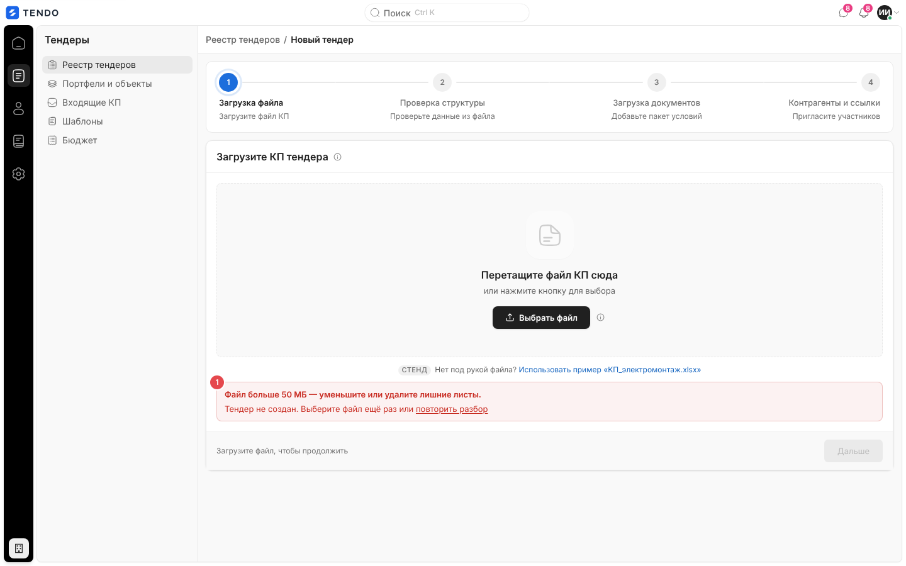

### Выбор листа

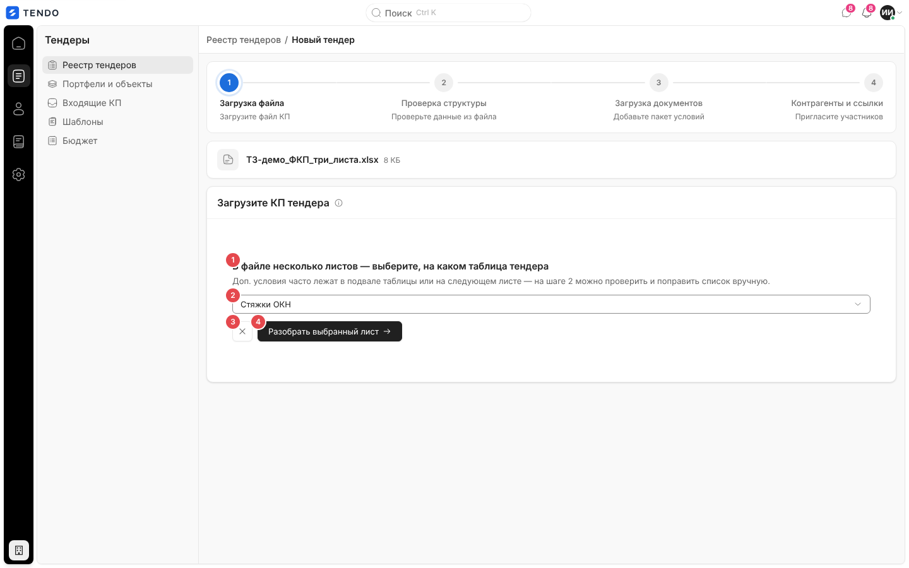

- Текст: «В файле несколько листов — выберите, на каком таблица тендера» и пояснение «Доп. условия часто лежат в подвале таблицы или на следующем листе — на шаге 2 можно проверить и поправить список вручную.»
- Список листов (`POST /tenders/parse-excel/sheets`), по умолчанию — первый.
- «Отменить файл» (крестик) — сбрасывает файл; «Разобрать выбранный лист →» — запускает разбор этого листа.

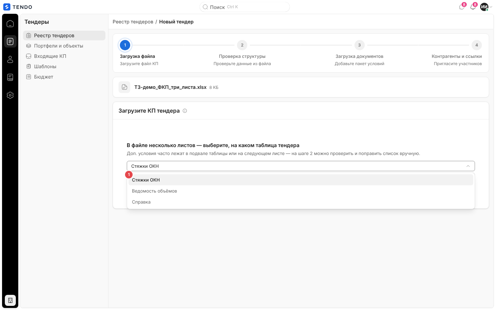

### Разбор: прогресс

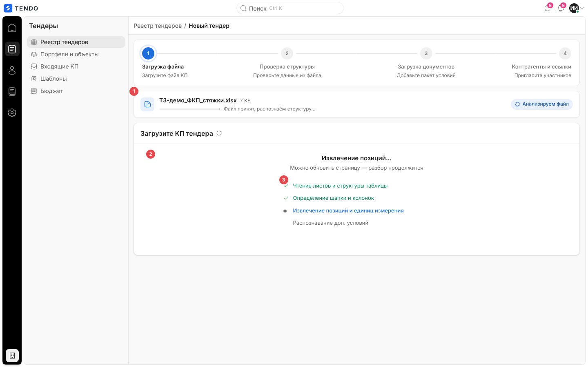

| № | Элемент | Поведение |
|---|---|---|
| ① | Карточка файла | Значок, имя, размер; бегущая (неопределённая) полоса прогресса и строка статуса; справа — «Анализируем файл» с вращающимся значком |
| ② | Заголовок статуса | «Файл принят, ждём очередь…» → «Файл принят, распознаём структуру…» → этапы; подзаголовок «Это может занять от нескольких секунд до пары минут» или, когда задание уже выполняется на сервере, «Можно обновить страницу — разбор продолжится» |
| ③ | Этапы | «Чтение листов и структуры таблицы», «Определение шапки и колонок», «Извлечение позиций и единиц измерения», «Распознавание доп. условий» — текущий отмечен точкой, пройденные — галочкой; этапы переключаются по таймеру раз в 1,2 с (это индикация, а не реальный ход задания) |

Механика (подробно — [tenders-lifecycle.md §2.1](../02-business-logic/tenders-lifecycle.md#21-шаг-1--источник-состава)):

1. Клиент считает SHA-256 файла, создаёт черновик мастера (`POST /creation-drafts` с именем, размером и хешем файла).
2. `POST /tenders/parse-excel` (файл, лист, хеш, id черновика) — сервер сохраняет исходник во вложение черновика и ставит фоновое задание; одинаковый файл и лист за последние 30 дней возвращают готовое задание.
3. Параллельно и **без ожидания** — ИИ-анализ файла `POST /tenders/parse-excel/enrich` (см. [Где участвует ИИ](#где-участвует-ии)).
4. Опрос `GET /tenders/parse-excel/jobs/{job_id}` раз в 1,5 с, не дольше 6 минут; id задания сразу пишется в черновик (чтобы после обновления страницы продолжить опрос того же задания).
5. Готово — переход на шаг 2 (сразу на подтверждение колонок, если оно нужно).

Смена файла или уход со страницы обрывают только опрос, задание на сервере продолжается; явная отмена (смена файла, «Убрать файл») вызывает `POST /tenders/parse-excel/jobs/{id}/cancel`.

### Ошибки разбора

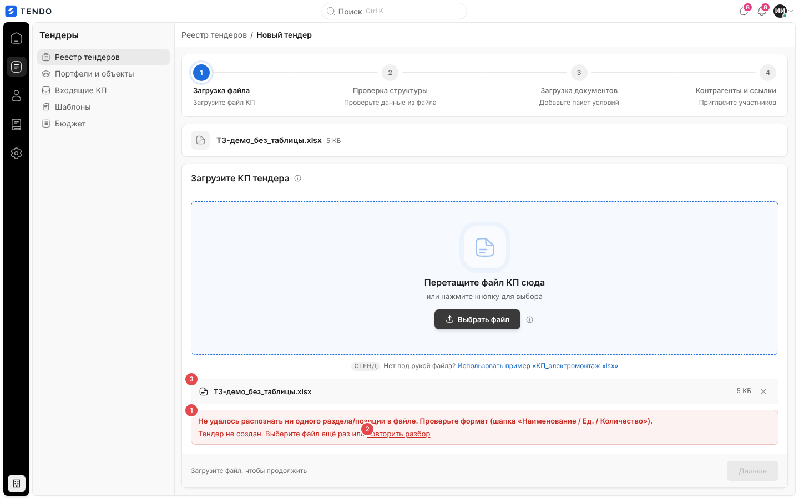

| Ситуация | Текст |
|---|---|
| Ни одного раздела/позиции (ИИ выключен) | «Не удалось распознать ни одного раздела/позиции в файле. Проверьте формат (шапка «Наименование / Ед. / Количество»).» |
| Разбор прошёл, но позиций 0 | «Не удалось распознать позиции в файле — тендер не создан. Попробуйте другой файл.» |
| Задание упало / отменено | Текст ошибки задания или «Не удалось распознать файл» |
| Дольше 6 минут | «Разбор занимает слишком много времени. Обновите страницу — задание продолжится, или загрузите файл ещё раз.» |
| ИИ-резерв недоступен / нет баланса | Тексты сервера — см. [ai-features.md §3.6](../06-ai/ai-features.md#36-ии-в-распознавании-фкп) |

Под текстом ошибки: «Тендер не создан. Выберите файл ещё раз или **повторить разбор**» (ссылка перезапускает разбор того же файла и листа).

## Шаг 2. Проверка структуры

Шаг 2 состоит из (а) необязательного экрана подтверждения колонок и (б) трёх блоков: «Данные тендера», «Таблица позиций», «Дополнительные условия». Над ними — плашка «Файл разобран ИИ. Проверьте данные и заполните форму — контрагенты увидят её как задание. Если открыть мастер в двух вкладках, сохранится последняя запись.» и карточка файла.

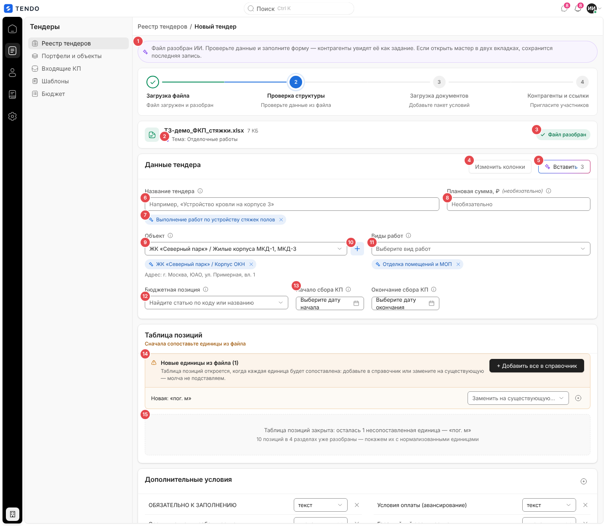

| № | Элемент | Поведение |
|---|---|---|
| ① | Плашка «Файл разобран ИИ…» | Показывается, когда разбор готов, на шагах 1–2 (текст один и тот же, даже если ИИ не участвовал — см. [открытые вопросы](../_oq/SCR-2b.md)) |
| ② | Тема в карточке файла | «Тема: {тема}» со значком ИИ — вывод анализа файла (у файла стенда — «Отделочные работы») |
| ③ | «Файл разобран» | Зелёная капсула; подсказка-отчёт: «Разобрано: N позиций в M разделах · K доп. условий», паспорт файла («Бюджет … ₽ · цены с НДС 22% · материалы и работы отдельно»), «КП от: {компания} (ИНН …)», если найдено. Пока идёт ИИ-анализ — «Анализируем файл» и строка «Подсказки по полям…» |
| ④ | «Изменить колонки» | Возврат к подтверждению колонок (если у разбора есть карта колонок и разбор не ИИ-резервный) |
| ⑤ | «Вставить N» | Подставить все подсказки из файла сразу (см. [Подсказки из файла](#подсказки-из-файла)); подсказка кнопки — состояние анализа |
| ⑥–⑬ | Поля тендера | См. [Поля тендера](#поля-тендера) |
| ⑦ | Чип-подсказка под полем | Пунктирная строка со значком ИИ: клик — подставить значение, крестик «Скрыть подсказку» |
| ⑩ | «+» у объекта | Окно [«Новый портфель или проект»](#окно-новый-портфель-или-проект) |
| ⑭ | Ворота единиц | Таблица позиций закрыта, пока все единицы из файла не сопоставлены со справочником — см. [Единицы измерения](#единицы-измерения) |
| ⑮ | Сводка за воротами | «Таблица позиций закрыта: осталась 1 несопоставленная единица — «пог. м»» / «…осталось несопоставленных единиц: N» и «N позиций в M разделах уже разобраны — покажем их с нормализованными единицами» |

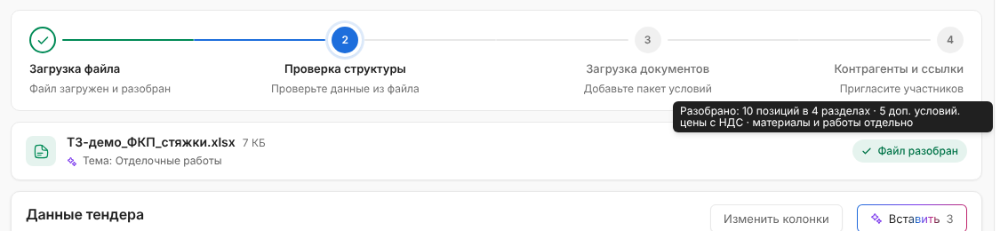

Предупреждения разбора (если есть) показываются жёлтой плашкой «Проверьте качество разбора» в начале блока «Данные тендера»: список общих предупреждений и отдельным подсписком «Контрольные суммы ФКП» — расхождения итогов файла с разобранным деревом. Если позиции распознаны ИИ-резервом — красная плашка «Стандартный разбор не справился с этим файлом (нестандартная структура таблицы) — позиции ниже распознаны через ИИ. Внимательно проверьте наименования, единицы и количество перед созданием тендера.»

### Подтверждение колонок

Показывается автоматически, если система не уверена в разметке (не назначено «Наименование», «Единица» или «Количество», либо есть неопознанные колонки с данными «Доп. информация»), и по кнопке «Изменить колонки». Если тендер запущен из шаблона и у шаблона сохранена карта колонок с такой же шапкой — разметка применяется молча, экран не показывается.

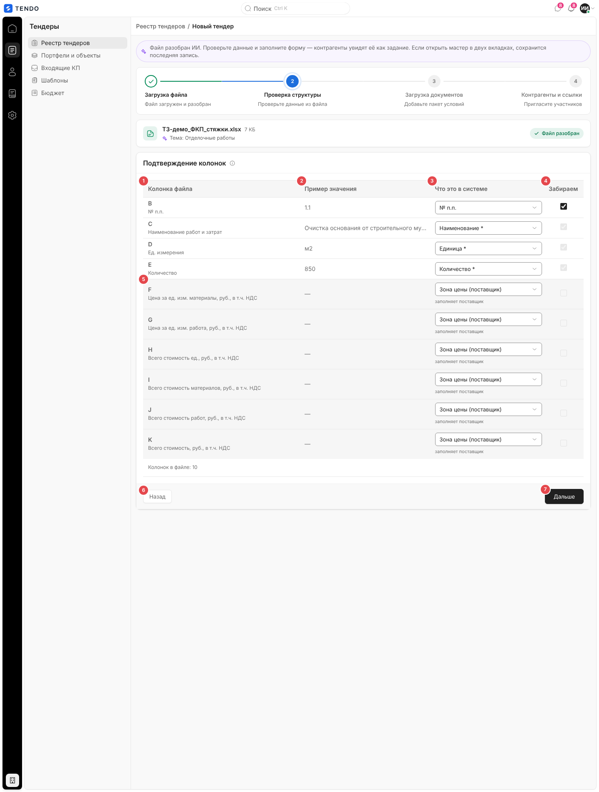

| № | Колонка таблицы | Содержимое |
|---|---|---|
| ① | Колонка файла | Буква колонки (B, C…), заголовок из шапки, подзаголовки групп («Материалы · СМР · Всего») |
| ② | Пример значения | Первое значение колонки (обрезается, полностью — в подсказке) или «—» |
| ③ | Что это в системе | Выбор роли (см. ниже). Под ролью — «заполняет поставщик» для зоны цены, «пометка вне таблицы — не забираем» для «Не забирать» без данных |
| ④ | Забираем | Флажок «Забирать колонку «…»»: у обязательных ролей стоит и заблокирован («Обязательное поле разбора — снять нельзя»), у зоны цены снят и заблокирован («Зона цены: её заполняет контрагент, в структуру тендера она не попадает»), у прочих — по выбору («Забрать эту колонку в позиции тендера») |
| ⑤ | Строки зоны цены | Подсвечены серым |
| ⑥ | «Назад» | Подсказка «Вернёт к выбору файла. Разметка колонок сохранится.» — переход на шаг 1 |
| ⑦ | «Дальше» | Подсказка «Пересоберёт позиции по этой разметке и покажет состав тендера. Тендер ещё не создаётся — к колонкам можно вернуться.»; во время пересборки — «Пересобираем…». Неактивна, если колонок нет |

Роли колонки: «Наименование *», «Единица *», «Количество *», «№ п.п.», «Код статьи бюджета», «Тип / марка», «Код оборудования», «Завод-изготовитель», «Доп. информация», «Зона цены (поставщик)», «Не забирать». Звёздочка — обязательная роль.

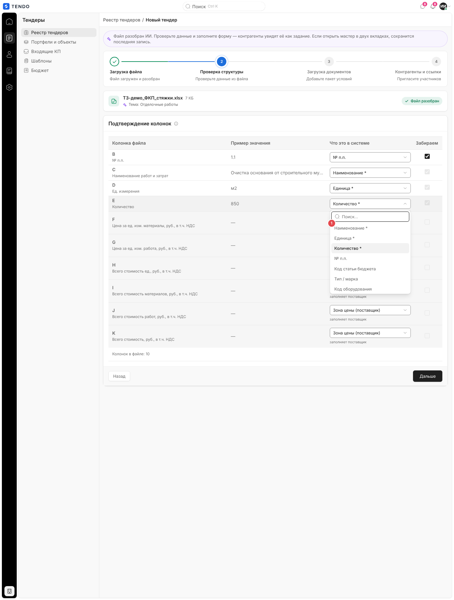

- Проверка: если какая-то обязательная роль не назначена ни одной забираемой колонке — «Назначьте обязательные поля: Количество» (перечисляются недостающие).
- Пересборка: `POST /tenders/parse-excel/remap` с файлом и картой колонок; если файл в браузере недоступен (страница обновлялась), но исходник есть в черновике — `POST /creation-drafts/{id}/remap`. Если исходника нет — карта принимается как есть, а на шаге 2 показывается плашка «Файл после закрытия вкладки недоступен: карта колонок принята как есть. Чтобы пересобрать состав, загрузите файл снова.» Ошибка — «Не удалось пересобрать позиции». Если тендер из шаблона — подтверждённая карта сохраняется в шаблон (`PATCH /templates/{id}/column-map`, без сообщений).

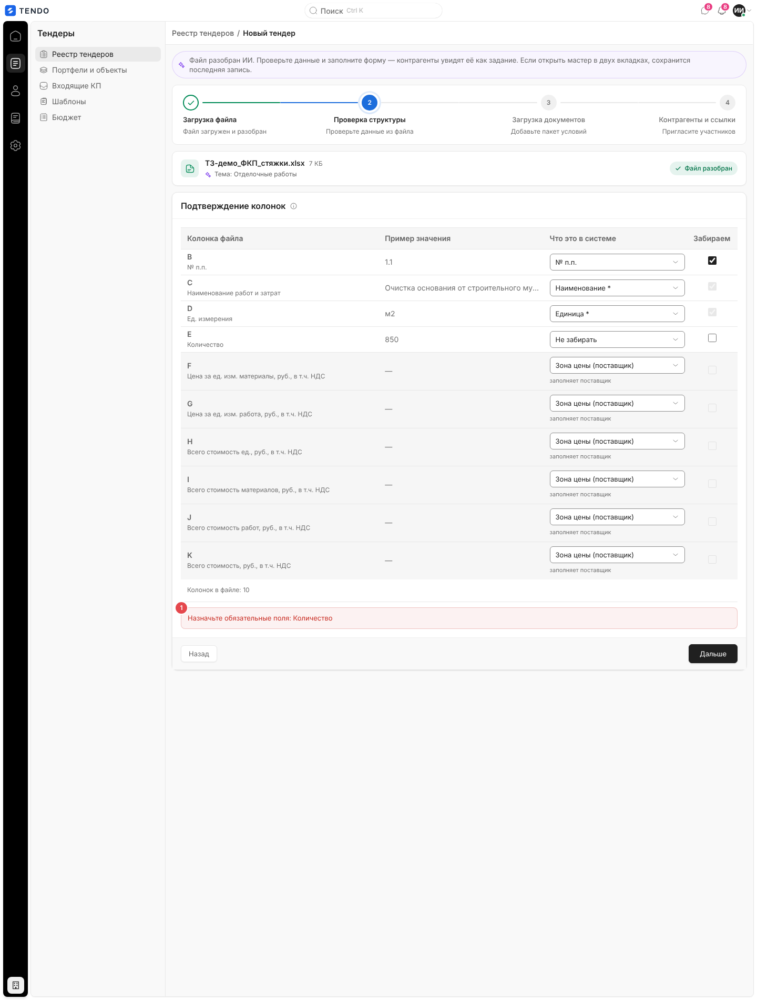

### Поля тендера

| Поле | Тип | Обяз. | Формат / умолчание / поведение | Подсказка «i» | Ошибка (клиент) |
|---|---|---|---|---|---|
| Название тендера | Текст | да | Плейсхолдер «Например, «Устройство кровли на корпусе 3»»; сервер обрезает пробелы, ≤ 500 символов. Из шаблона — «{название шаблона} (копия)» | «Контрагенты увидят это название в приглашении и в списке своих тендеров.» | «Укажите название тендера» |
| Плановая сумма, ₽ | Число ≥ 0 | нет (подпись «необязательно») | Плейсхолдер «Необязательно» | «Ваш ориентир для сравнения предложений. Контрагентам не показывается.» | — (серверные — [tenders-lifecycle.md §5](../02-business-logic/tenders-lifecycle.md#5-поля-тендера-и-проверки)) |
| Объект | Выпадающий список с поиском «Портфель / проект» | да | **По умолчанию выбран первый объект списка** (или объект из `?projectId=`); под полем — «Адрес: {адрес объекта}». Пока список грузится — «Загружаем объекты…», при сбое — «Объекты не загрузились» и красная плашка с текстом ошибки и «Повторить» | «Портфель, проект и объект стройки. Задаёт адрес и привязку к бюджету.» | «Укажите объект» |
| Виды работ | Выпадающий список активных видов работ (с иерархией) + чипы выбранных | да, ≥ 1 | Выбор **добавляет** вид работ в набор (чип с «×» — убрать), сам список остаётся пустым («Выберите вид работ» / «Добавить ещё вид работ»). Первый выбранный — «основной»: по паре «объект × основной вид работ» подтягиваются даты сбора КП и шаблон по умолчанию | «По ним подбираются участники: приглашение получат только контрагенты, прошедшие квалификацию по этим работам.» | «Укажите хотя бы один вид работ» |
| Бюджетная позиция | Выпадающий список с поиском | да | Плейсхолдер «Найдите статью по коду или названию», пустая строка «— выберите позицию —»; пункт — «путь [код] · выделено N ₽». Список и проверка остатка — на **год даты начала сбора КП** | «Статья бюджета, из которой оплачивается тендер. Под полем — остаток на период, в который попадает срок сбора КП.» | «Укажите бюджетную позицию» |
| Начало сбора КП | Выбор даты (календарь), показ `ДД.ММ.ГГГГ` | да | Плейсхолдер «Выберите дату начала»; при выборе даты позже окончания окончание сбрасывается | «С этой даты контрагенты смогут подавать предложения по тендеру.» | «Укажите даты начала и окончания сбора КП» |
| Окончание сбора КП | Выбор даты | да | Плейсхолдер «Выберите дату окончания»; дни раньше начала недоступны | «После этой даты приём предложений закрывается автоматически.» | «Дата окончания сбора КП должна быть позже даты начала» |

Звёздочек обязательности нет: помечено словом «необязательно» единственное необязательное поле; требование несут проверка отправки и подпись у кнопки.

Сообщения под бюджетной позицией (по году даты начала):

| Ситуация | Текст | Вид |
|---|---|---|
| Дата начала не задана | «Укажите срок сбора КП ниже — тогда проверим бюджет позиции на нужный период.» | обычный |
| Бюджета на год нет | «На {год} год бюджет по этой позиции не назначен — тендер создать можно, но средств под него нет.» | жёлтый |
| Есть свободные средства | «Сумма позиции на {год}: N ₽» + «Свободно в периоде {год}: N ₽» | обычный |
| Свободных средств нет | «Сумма позиции на {год}: N ₽» + «На позиции нет свободных средств в периоде {год}» | жёлтый (предупреждение, не запрет) |

Подстановки по объекту и виду работ (если для пары «объект × вид работ» заданы умолчания на экране объектов): пустые даты сбора КП заполняются датами по умолчанию; если у пары есть шаблон по умолчанию и состав ещё пуст — состав подставляется из шаблона («Состав подставлен из шаблона «…» — его можно править ниже»), если состав уже есть — подсказка «Есть шаблон по умолчанию «…»».

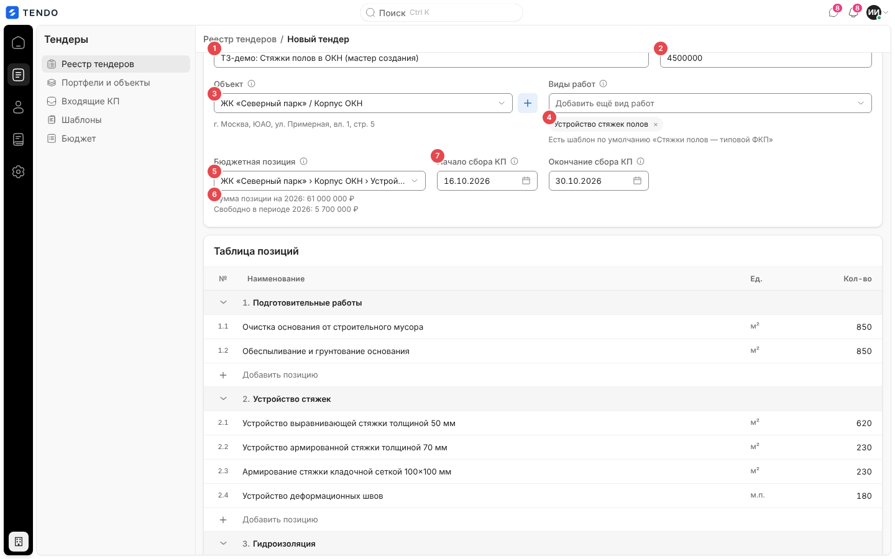

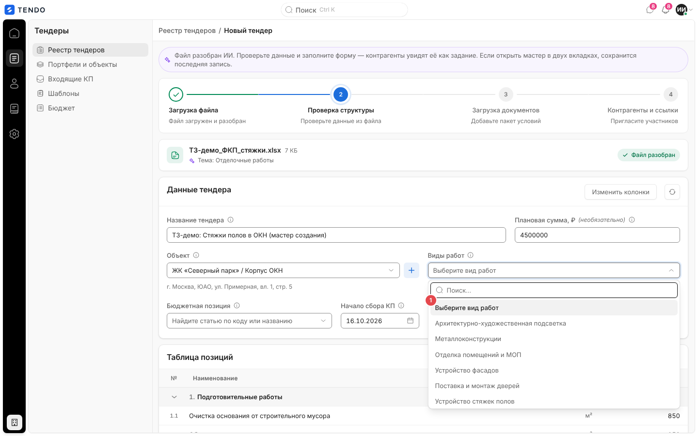

![Список бюджетных позиций: «путь [код] · сумма»](assets/tender-create--budget-menu.png)

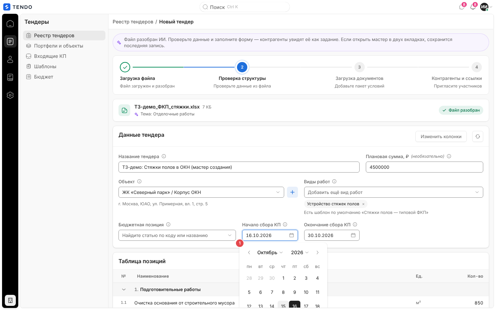

### Подсказки из файла

ИИ-анализ файла (а без модели — правила) предлагает значения для полей: название, объект (по адресу/названию из титула файла), вид работ (по имени из справочника), бюджетная позиция (по коду), плановая сумма.

- Пока анализ идёт, под полями — мерцающие заглушки подсказок; подсказка кнопки «Вставить»: «Значения из файла подставим в поля, когда анализ закончится — можно заполнять вручную уже сейчас».
- Готовые подсказки — пунктирные чипы под полями (клик — подставить, «×» — скрыть). Кнопка «Вставить N» подставляет все сразу **по очереди сверху вниз**, текстовые значения «набираются» посимвольно (~45 знаков/с; при системной настройке «уменьшить движение» — мгновенно); собственный ввод пользователя прерывает набор.
- После подстановки чип исчезает; под объектом вместо чипа — адрес объекта, под бюджетом — остаток.
- Вид работ, которого нет в справочнике: «Подсказка: {вид} — нет точного совпадения в справочнике». Объект из файла, которого нет в справочнике: «В файле: {адрес} — в справочнике такого нет. / — это другой объект.» + «Создать объект» (окно нового проекта с именем и адресом из файла).
- Анализ недоступен: «Автоподсказки по теме/названию не собраны — проверьте таблицу и заполните поля вручную.»; исчерпан баланс ИИ (ответ 402) — «Автоподсказки не собраны: баланс токенов для ИИ исчерпан. Заполните поля вручную или обратитесь к администратору.»
- Для черновика с сохранённым исходником есть кнопка-значок «Перезапустить ИИ-анализ файла» (`POST /creation-drafts/{id}/enrich` с `force`); при возврате к черновику без подсказок они забираются из уже посчитанных (без повторного вызова модели).

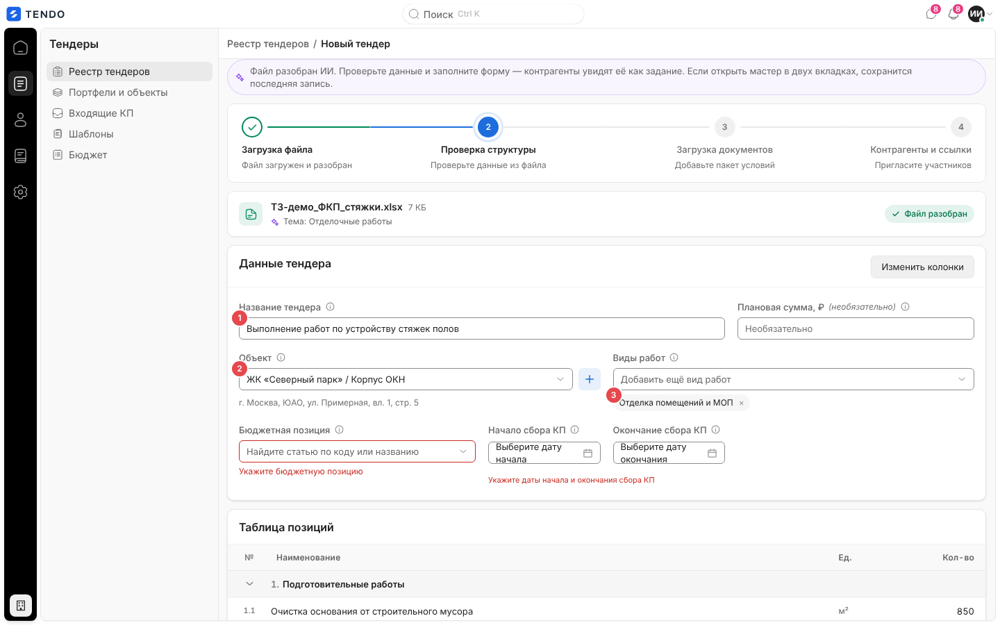

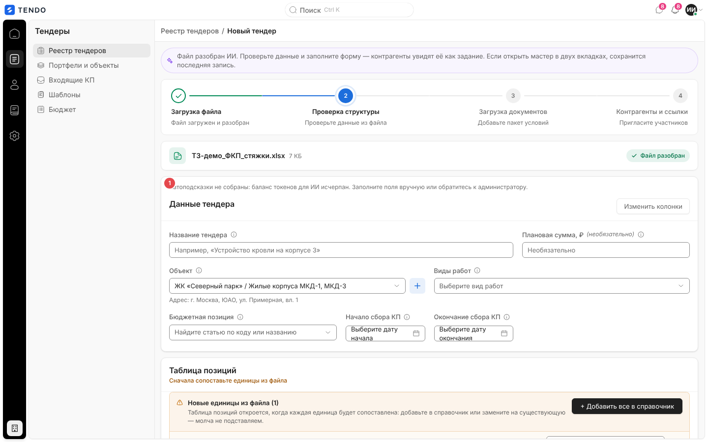

### Окно «Новый портфель или проект»

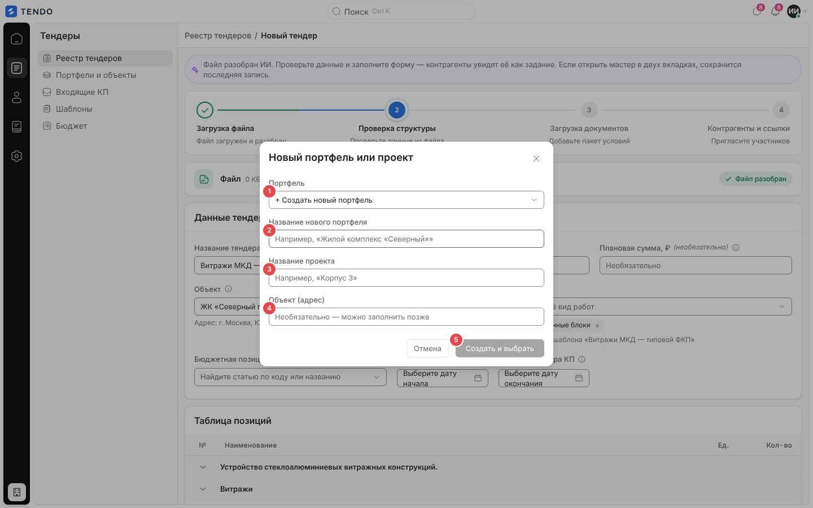

| № | Поле | Правила |
|---|---|---|
| ① | Портфель | Выпадающий список: «+ Создать новый портфель» и существующие портфели (по умолчанию — первый существующий) |
| ② | Название нового портфеля | Только при «+ Создать новый портфель»; обязательно («Укажите название портфеля»); плейсхолдер «Например, «Жилой комплекс «Северный»»» |
| ③ | Название проекта | Обязательно («Укажите название проекта»); плейсхолдер «Например, «Корпус 3»» |
| ④ | Объект (адрес) | Необязательно, «Необязательно — можно заполнить позже» |
| ⑤ | «Создать и выбрать» | Неактивна, пока не заполнены обязательные поля; «Отмена», крестик и Esc закрывают |

Создание: при новом портфеле — `POST /portfolios`, затем `POST /projects` (портфель, название, адрес) → список объектов перечитывается, новый проект выбирается в поле «Объект». Ошибка — красный текст в окне («Не удалось создать портфель/проект» или текст сервера).

### Единицы измерения

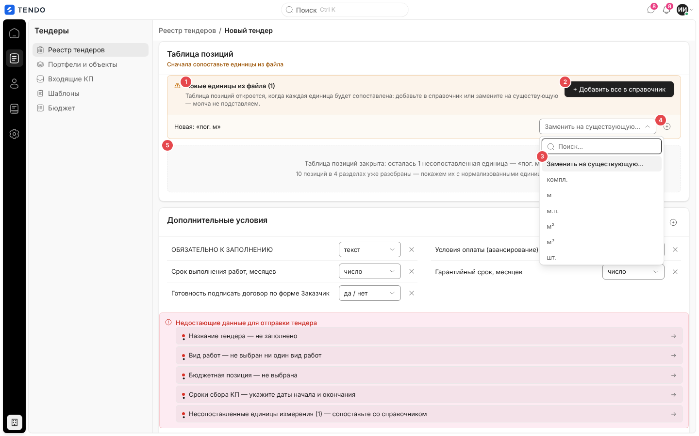

- Единица позиции сравнивается со справочником единиц с учётом синонимов и нормализации написания («м.» ≡ «м», «м2» → «м²»); совпавшие сразу подставляются каноническим названием.
- Незнакомые единицы (на стенде — «пог. м») открывают **ворота**: таблица позиций скрыта, пока каждая незнакомая единица не сопоставлена («молча не подставляем»). Для каждой:
  - «Заменить на существующую…» — выбор единицы справочника: замена во всех позициях; выбранное соответствие запоминается синонимом в справочнике (`POST /units/{id}/aliases`), чтобы в следующих файлах подставлялось само;
  - «Добавить «…» в справочник единиц» (плюс) — `POST /units`;
  - кнопка-подсказка ИИ со значком (если ИИ предложил нормализацию) — замена одним кликом;
  - «+ Добавить все в справочник» — для всех незнакомых сразу. Ошибка — окно-сообщение «Не удалось добавить единицу измерения».
- Если ИИ сопоставил единицы без полной уверенности, над таблицей — строка «ИИ сопоставил единицы со справочником — проверьте: «from» → «to», …».
- В открытой таблице единица, которой нет в справочнике, выделяется цветом с подсказкой «Нет в справочнике».

### Таблица позиций

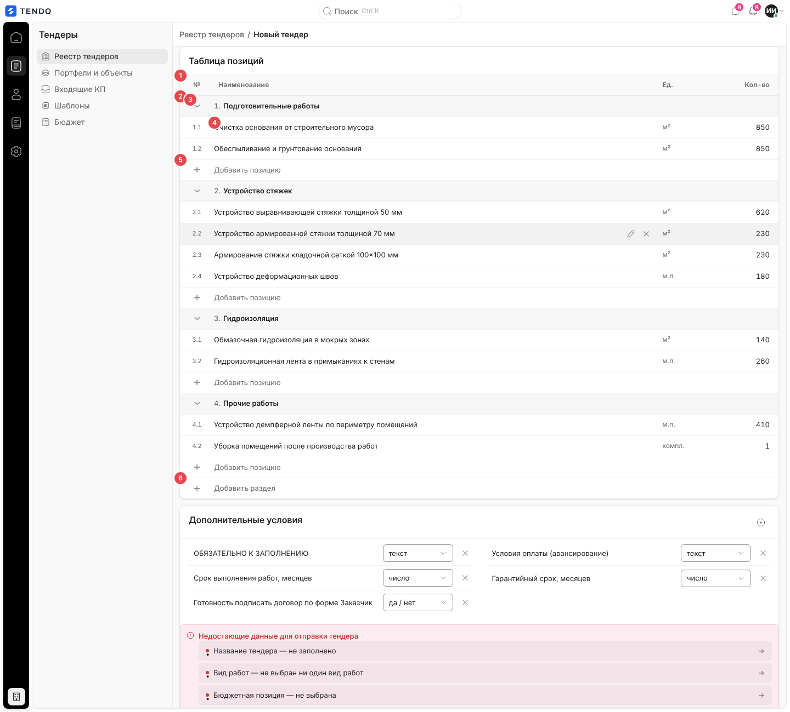

| № | Элемент | Поведение |
|---|---|---|
| ① | Шапка «№ · Наименование · Ед. · Кол-во» | Липкая при прокрутке страницы; таблица выводится целиком (без своей прокрутки) |
| ② | Строка раздела | Название на всю ширину с номером из файла («1.»); у подраздела с объёмом из ФКП — единица и объём серым («Объём подраздела по ФКП — справка»), в итоги не входят. Разделы любой глубины, с отступом по уровню; пустые разделы не показываются |
| ③ | Шеврон | Свернуть/развернуть раздел (состояние не сбрасывается при правке) |
| ④ | Название позиции | Клик — правка строки (см. ниже); второй строкой мелко — «марка · завод-изготовитель», если есть. Номер позиции — из файла или по порядку («1.1») |
| ⑤ | «Добавить позицию» | Строка-призрак после последней позиции раздела: добавляет пустую позицию и сразу открывает её правку |
| ⑥ | «Добавить раздел» | Последняя строка таблицы: новый раздел «Новый раздел» с одной пустой позицией |

Позиции и подразделы показываются в порядке ФКП (подраздел может стоять между позициями родителя).

У строки при наведении — «Изменить позицию» (карандаш) и «Удалить позицию» (крестик); у раздела — «Изменить раздел» и «Удалить раздел» (раздел удаляется вместе с подразделами и позициями).

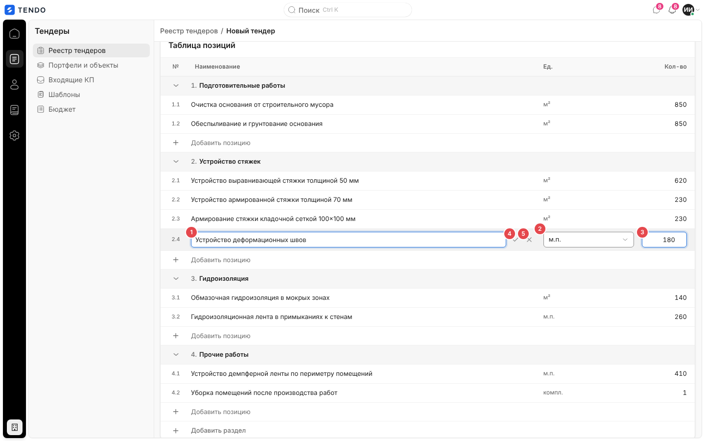

- Значения сохраняются на каждое нажатие; Enter или уход фокуса из строки — завершение правки; Esc или крестик — откат к значению до правки; у только что добавленной строки отмена удаляет строку.
- Количество — числовое поле (пусто = не указано).
- Название раздела правится так же (клик по названию, Enter/Esc).

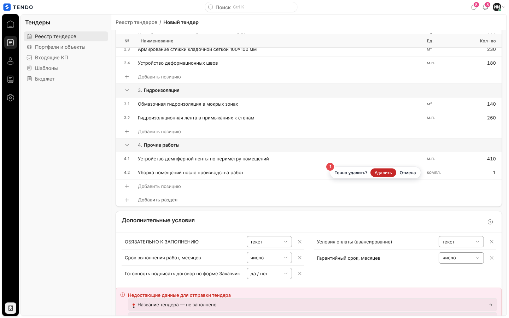

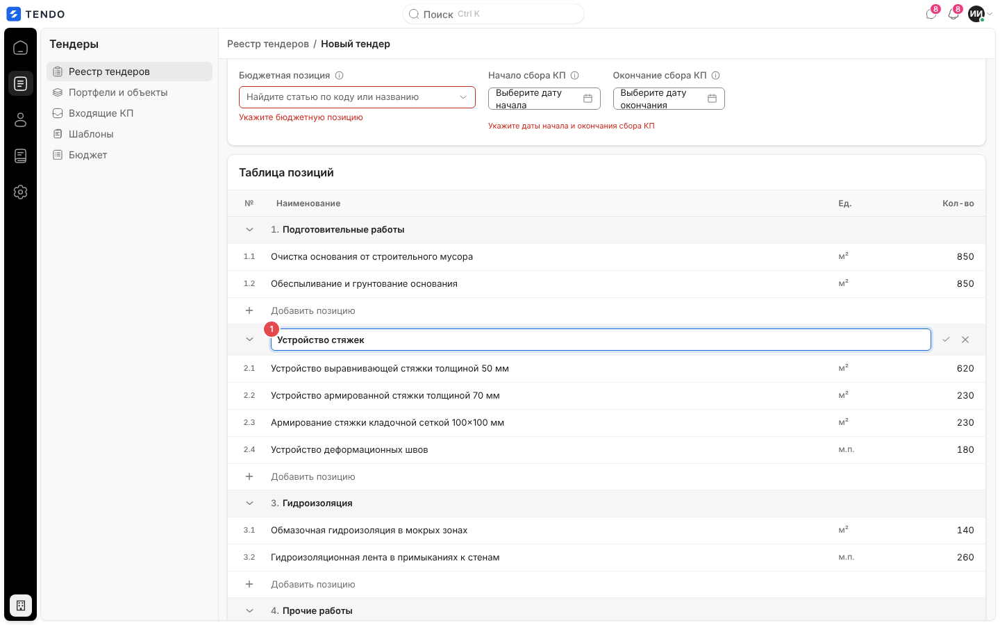

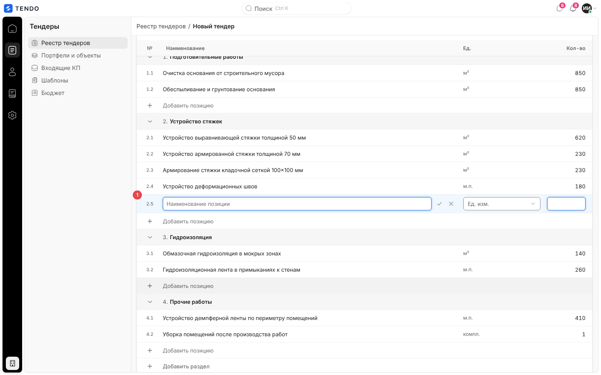

Подпись под заголовком «Таблица позиций» (оранжевая) — что мешает отправке: «Сначала сопоставьте единицы из файла», «Без единицы измерения: N», «Без количества: N» или текст ошибки позиций.

### Дополнительные условия

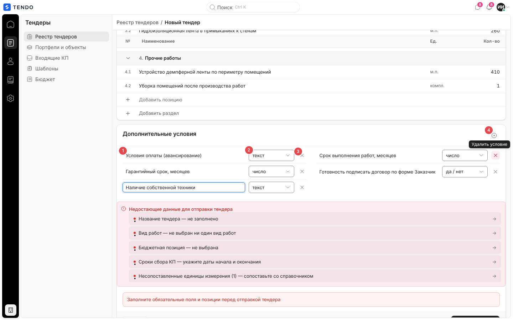

- Список вопросов к поставщику, распознанных в подвале таблицы или на втором листе (артефакты разбора вроде «ОБЯЗАТЕЛЬНО К ЗАПОЛНЕНИЮ» удаляются вручную).
- Каждое условие: название (текст), тип — «текст», «число», «дата», «да / нет», удаление. «+» в шапке блока — новое пустое условие.
- Пусто — «Пока нет — контрагент не увидит блок условий». Условия с пустым названием при отправке отбрасываются.

### Отправка (создание тендера)

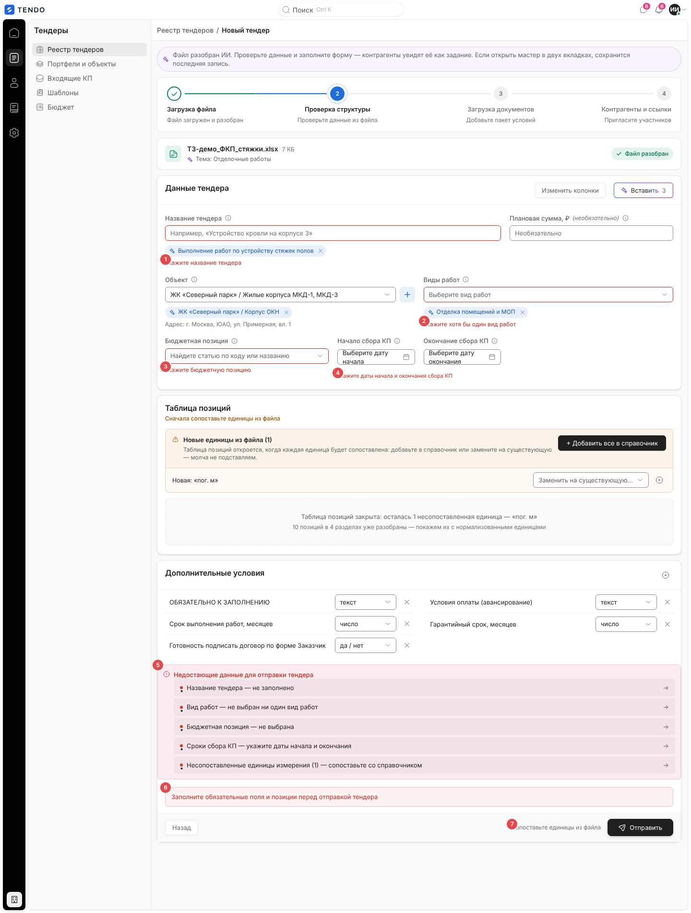

| № | Элемент | Поведение |
|---|---|---|
| ①–④ | Ошибки у полей | Красный текст под полем, рамка поля красная |
| ⑤ | «Недостающие данные для отправки тендера» | Список кнопок «{поле} — {что не так} →»; клик прокручивает к полю, ставит фокус и подсвечивает его на 2,5 с |
| ⑥ | Общая ошибка | «Заполните обязательные поля и позиции перед отправкой тендера» (или ошибка сервера) |
| ⑦ | Подпись у кнопки | Что мешает: «Сопоставьте единицы из файла» → «Укажите единицу у N поз.» → «Укажите количество у N поз.» → «Проверьте обязательные поля» → «Всё готово» |

Пункты списка недостающего:

| Пункт | Когда |
|---|---|
| «Название тендера — не заполнено» | пустое название |
| «Объект — не выбран» | нет объекта |
| «Вид работ — не выбран ни один вид работ» | нет видов работ |
| «Бюджетная позиция — не выбрана» | нет позиции |
| «Сроки сбора КП — укажите даты начала и окончания» / «…— дата окончания должна быть позже даты начала» | даты |
| «Позиции тендера — добавьте хотя бы одну позицию с названием» | нет позиций с названием (ошибка у таблицы: «Добавьте хотя бы одну позицию с названием — пустой тендер не создаётся») |
| «Несопоставленные единицы измерения (N) — сопоставьте со справочником» | открыты ворота единиц |
| «Единицы измерения — не указаны у N позиций» | позиции без единицы |
| «Количество — не указано у N позиций» | позиции без количества |

- Кнопка «Отправить» (самолётик) всегда активна (кроме момента отправки — «Отправляем…»): при недостающем она показывает список и прокручивает к первому полю. Подсказка: «Проверит обязательные поля и позиции тендера — покажет список недостающего, если что-то не заполнено.» / «Отправит тендер по этой форме и составу позиций. Дальше — документы и приглашения; контрагенты ничего не увидят, пока тендер не открыт.»
- Запрос: `POST /tenders` `{project_id, work_type_ids, budget_position_id, budget_amount, title, start_date, end_date, sections (дерево: имя, номер, справка подраздела, место среди позиций, позиции с номером, единицей, количеством и атрибутами), condition_fields, template_id, draft_id}`. Сервер повторяет проверки ([tenders-lifecycle.md §5](../02-business-logic/tenders-lifecycle.md#5-поля-тендера-и-проверки)), создаёт тендер «Черновик», ответственный — автор; черновик мастера → `converted`, исходный файл становится документом «Шаблон ФКП».
- Успех — шаг 3. Ошибка — текст сервера красной плашкой под условиями («Не удалось создать тендер» по умолчанию).
- Если черновик мастера создать не удалось (нет `draftId`), после создания мастер сразу уводит в карточку тендера, минуя шаги 3–4.
- «Назад» (подсказка зависит от источника): из шаблона — к списку шаблонов `/templates`; при наличии карты колонок — к подтверждению колонок; иначе — к шагу 1. Введённое остаётся в черновике.

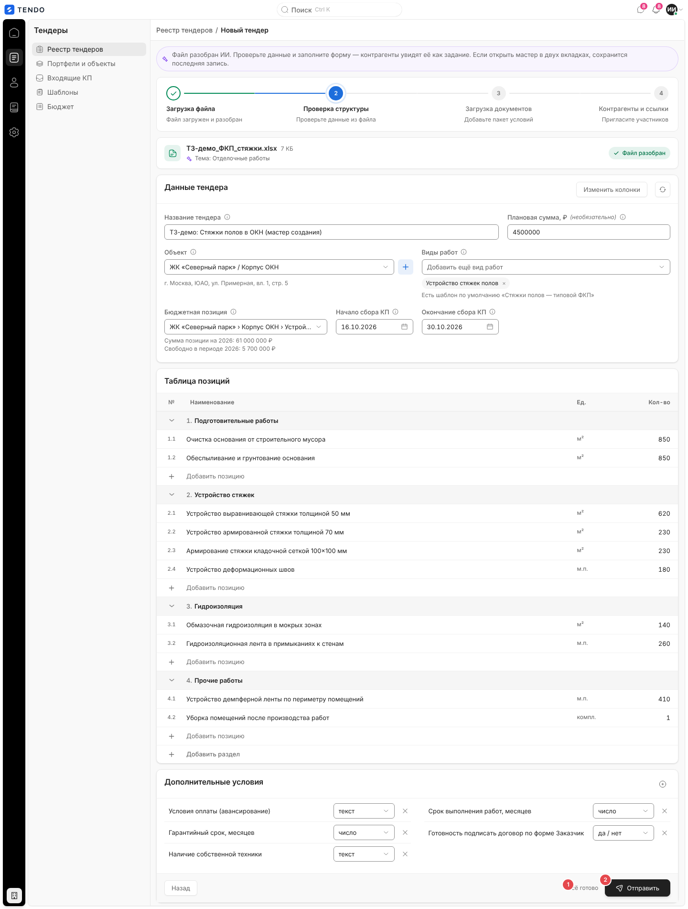

## Шаг 3. Загрузка документов

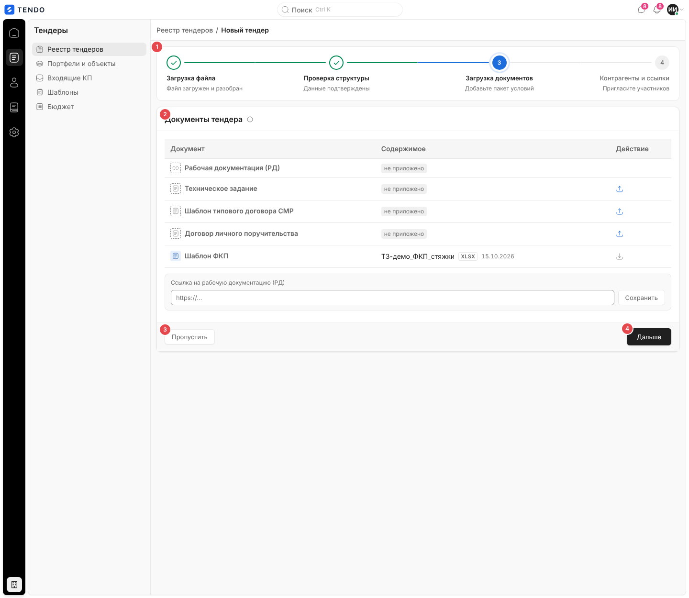

| № | Элемент | Поведение |
|---|---|---|
| ① | Полоса шагов | Шаги 1–2 пройдены |
| ② | «Документы тендера» + «i» | Подсказка: «Приложите то, по чему контрагенты будут считать цену. Можно пропустить и добавить позже — тендер от этого не закроется.» Внутри — та же панель пакета документов, что на вкладке «Документы» карточки тендера (слоты «Рабочая документация (РД)» — ссылкой, «Техническое задание», «Шаблон типового договора СМР», «Договор личного поручительства», «Шаблон ФКП» — уже заполнен исходным файлом из шага 1); описание — [tender-card-documents.md](tender-card-documents.md#вкладка-документы) |
| ③ | «Пропустить» | Подсказка «Оставит пакет пустым и уведёт к приглашениям. Документы можно приложить позже на странице тендера.» |
| ④ | «Дальше» | Подсказка «Пакет собран — переходим к выбору контрагентов.» |

Обе кнопки переводят на шаг 4 и сразу открывают окно приглашения.

## Шаг 4. Контрагенты и ссылки

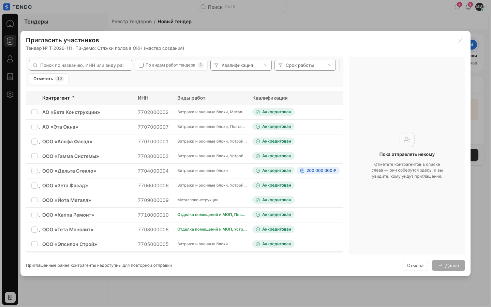

Окно «Пригласить участников» — общий мастер приглашения (подбор с фильтрами «По видам работ тендера», «Квалификация», «Срок работы», шаг неодобренных с комментарием, подтверждение) — описан в [tender-card-participants.md](tender-card-participants.md#пригласить-участников); в мастер создания он приходит с номером, названием и видами работ нового тендера.

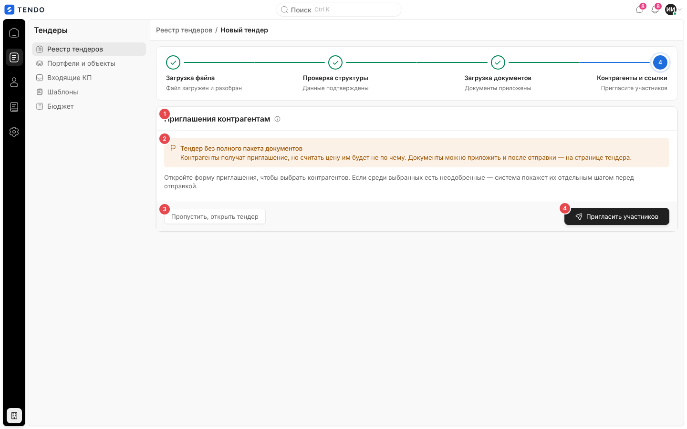

| № | Элемент | Поведение |
|---|---|---|
| ① | «Приглашения контрагентам» + «i» | Подсказка: «В списке — контрагенты, прошедшие квалификацию по выбранным видам работ. Неодобренного пригласить можно, но система спросит об этом отдельным шагом и потребует комментарий.» |
| ② | «Тендер без полного пакета документов» | Жёлтая плашка, если в пакете есть неприложенные слоты: «Контрагенты получат приглашение, но считать цену им будет не по чему. Документы можно приложить и после отправки — на странице тендера.» |
| ③ | «Пропустить, открыть тендер» | Подсказка «Тендер уже создан. Откроет его страницу — пригласить контрагентов можно оттуда в любой момент.» → `/tenders/{id}` |
| ④ | «Пригласить участников» | Снова открывает окно приглашения; подсказка «Откроет подбор контрагентов. Приглашения уйдут только после подтверждения на последнем шаге — с этой кнопки ничего не отправляется.» |

Пока ничего не отправлено — текст «Откройте форму приглашения, чтобы выбрать контрагентов. Если среди выбранных есть неодобренные — система покажет их отдельным шагом перед отправкой.»

После отправки приглашений (первое приглашение переводит тендер в «Сбор предложений»):

- метка «Приглашения отправлены» и «Каждому контрагенту — уникальная ссылка на личный кабинет.»;
- список: аватар-инициалы, название контрагента, ссылка `{адрес сайта}/fill/{токен}` — сама строка-ссылка копирует адрес в буфер (отдельной кнопки нет);
- кнопки «Открыть реестр тендеров» → `/tenders` и «Открыть тендер →» → `/tenders/{id}`.

(Состояние «после отправки» на стенде не снималось: рассылка приглашений демо-подрядчикам изменила бы их кабинеты.)

## Создание из шаблона

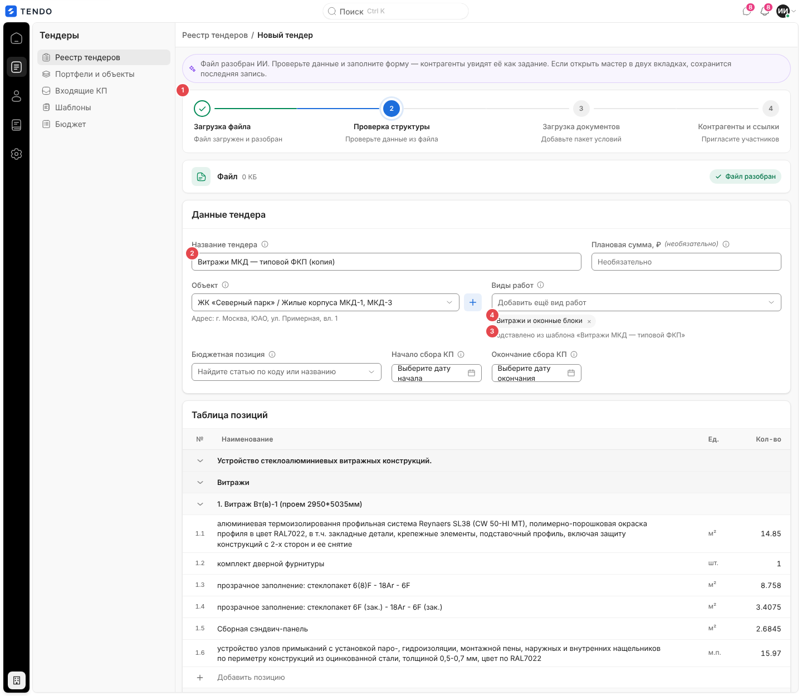

- Вход: «Запустить тендер» в библиотеке шаблонов → `/tenders/new?fromTemplate={id}`. Снимок шаблона берётся из временного хранилища вкладки (кладёт библиотека), иначе шаблон перечитывается с сервера.
- Подставляются: название «{шаблон} (копия)», вид работ (по названию из справочника), разделы деревом, доп. условия; подтверждение колонок пропускается; под видами работ — «Подставлено из шаблона «…»»; шаблон запоминается как источник тендера (`template_id`).
- Шаг 1 не показывается; «Назад» ведёт к списку шаблонов. Карточка файла показывает «Файл 0 КБ», плашка «Файл разобран ИИ…» тоже видна (файла нет — см. [открытые вопросы](../_oq/SCR-2b.md)).
- Ошибки: «Некорректная ссылка на шаблон», «Шаблон не найден или удалён», «Не удалось загрузить шаблон», «В шаблоне нет позиций КП» (показываются на шаге 1 как ошибка разбора).

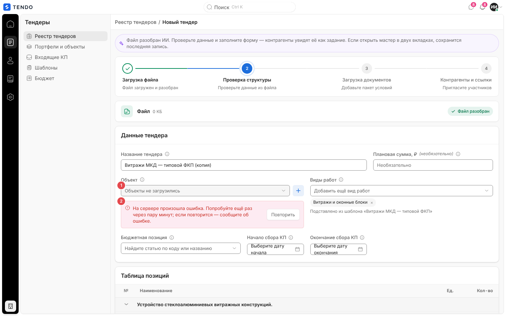

## Черновики создания и восстановление

- **Когда создаётся.** Лениво: при первой загрузке файла (до разбора, чтобы сервер привязал исходник) или при первом вводе поля шага 2 (название, бюджет, сумма, виды работ, даты). `POST /creation-drafts` → id в адрес (`?draftId=`).
- **Автосохранение.** Через 1,2 с после последнего изменения, двумя независимыми запросами `PUT /creation-drafts/{id}`: «лёгкий» (шаг, файл, хеш, задание, поля тендера) и «тяжёлый» (структура, карта колонок, выбранный лист, результат ИИ-анализа, принятые/скрытые подсказки) — каждый уходит, только если менялась его часть. Сбой автосохранения мастер не блокирует (повтор при следующем изменении). Сервер сливает присланные части с сохранёнными.
- **Восстановление** по `?draftId=`: `GET /creation-drafts/{id}` → поля, структура, карта колонок, лист, подсказки и файл (как имя и размер; сами байты — на сервере) возвращаются; шаг восстанавливается не дальше 2. Если в черновике незавершённое задание разбора — мастер возобновляет опрос того же задания («Восстанавливаем разбор после обновления страницы…»). Если исходник сохранён, «Изменить колонки» пересобирает состав по нему и доступен перезапуск ИИ-анализа.
- Черновик уже превращён в тендер — мастер сразу уводит в карточку `/tenders/{id}` (так же работает обновление страницы на шагах 3–4).
- Просроченный черновик (не менялся дольше срока хранения, по умолчанию 30 дней) открывается по прямой ссылке с плашкой «Этот черновик просрочен по сроку хранения, но открыт по прямой ссылке.»
- Черновик не найден, удалён или чужой — плашка «Черновик удалён», мастер — с чистого шага 1.
- Два открытых окна одного черновика: сохраняется последняя запись (об этом говорит плашка шага 2).
- Список и удаление черновиков — вкладка «Незавершённые» реестра ([tenders-registry.md](tenders-registry.md#вкладка-незавершённые)).

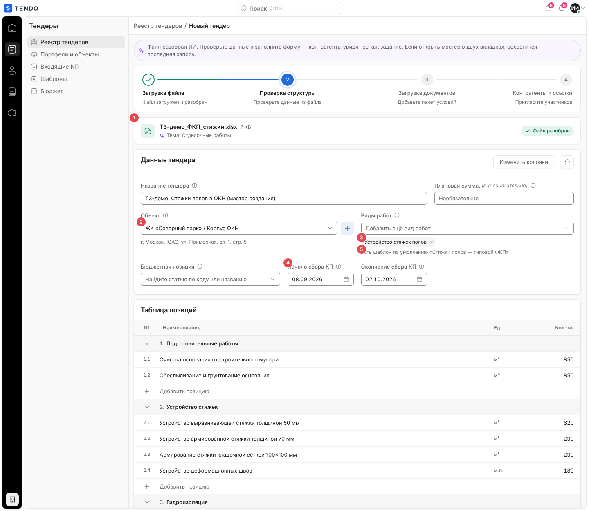

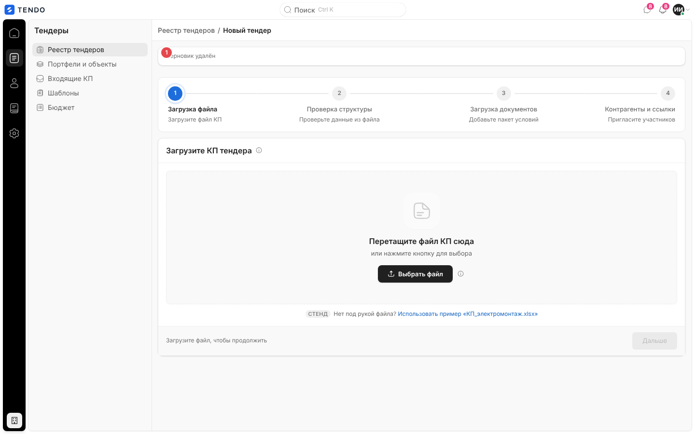

## Где участвует ИИ

На стенде модель недоступна — ниже поведение по коду (подробно — [ai-features.md §3.6](../06-ai/ai-features.md#36-ии-в-распознавании-фкп)):

| Где | Что делает ИИ | Без ИИ |
|---|---|---|
| Анализ файла (`POST /tenders/parse-excel/enrich`, параллельно разбору; для черновика — `POST /creation-drafts/{id}/enrich`) | Название тендера, тема закупки, вид работ, объект и его адрес из титула, код бюджетной позиции, плановая сумма, компания-отправитель и ИНН, подсказки нормализации единиц | Подсказки только правил (на стенде так и есть: название, объект, вид работ, тема); если нет и их — плашка «Автоподсказки … не собраны» |
| Резервный разбор структуры (фоновое задание) | Если эвристика не нашла ни одной позиции — разделы и позиции распознаёт модель; на шаге 2 красная плашка «…распознаны через ИИ…» | Ошибка «Не удалось распознать ни одного раздела/позиции в файле…» |
| Подбор единиц | Неуверенные соответствия единиц подставляются и выносятся строкой «ИИ сопоставил единицы со справочником — проверьте…»; в воротах единиц — кнопка-подсказка со значком | Все незнакомые единицы — в ворота на ручной выбор |
| Биллинг | Вызовы модели тарифицируются; исчерпан баланс — 402 и плашка «баланс токенов для ИИ исчерпан» | — |

Значок ИИ (звёздочки) помечает всё, что вывела машина: тему в карточке файла, чипы подсказок, кнопку «Вставить», подсказку единицы.

## Состояния (сводка)

| Состояние | Где | Снимок |
|---|---|---|
| Пустой шаг 1 | Шаг 1 | `tender-create--step1` |
| Разбор идёт | Шаг 1 | `tender-create--parsing` |
| Ошибка разбора / большой файл | Шаг 1 | `tender-create--parse-error`, `tender-create--file-too-big` |
| Выбор листа | Шаг 1 | `tender-create--sheet-picker` |
| Подтверждение колонок / ошибка ролей | Шаг 2 | `tender-create--columns`, `tender-create--columns-error` |
| Ворота единиц | Шаг 2 | `tender-create--units-gate` |
| Список недостающего | Шаг 2 | `tender-create--validation` |
| Объекты не загрузились | Шаг 2 | `tender-create--objects-error` |
| Подсказки недоступны | Шаг 2 | `tender-create--ai-unavailable` |
| Черновик восстановлен / удалён | любой | `tender-create--draft-restored`, `tender-create--draft-gone` |
| Документы / приглашения | Шаги 3–4 | `tender-create--step3`, `tender-create--invite-modal`, `tender-create--step4` |
| Нет доступа (СБ, юрист) | — | перенаправление на `/home` |

## Переходы

| Откуда | Куда |
|---|---|
| Крошка «Реестр тендеров» | `/tenders` |
| «Назад» на шаге 2 (из шаблона) | `/templates` |
| «Пропустить, открыть тендер», «Открыть тендер» | `/tenders/{id}` |
| «Открыть реестр тендеров» | `/tenders` |
| Черновик уже превращён в тендер | `/tenders/{id}` |

## Сложность

**XL** в целом (крупнейшая форма продукта, ~4,6 тыс. строк клиентского кода): шаг 1 с фоновым разбором, выбором листа, восстановлением задания — M; подтверждение колонок с пересборкой — M; поля тендера с подсказками, «набором», бюджетными проверками и умолчаниями — L; таблица позиций с деревом, правкой строк и разделов, порядком ФКП — L; ворота единиц — M; доп. условия — S; отправка со списком недостающего — S; серверный черновик с автосохранением и восстановлением — M; шаги 3–4 (переиспользуют панель документов и мастер приглашения) — S; запуск из шаблона — S.
