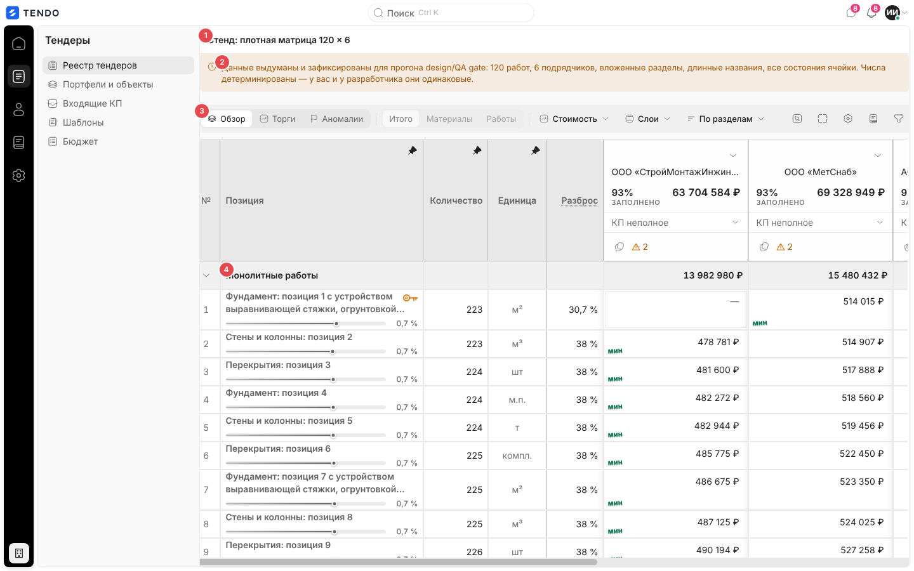
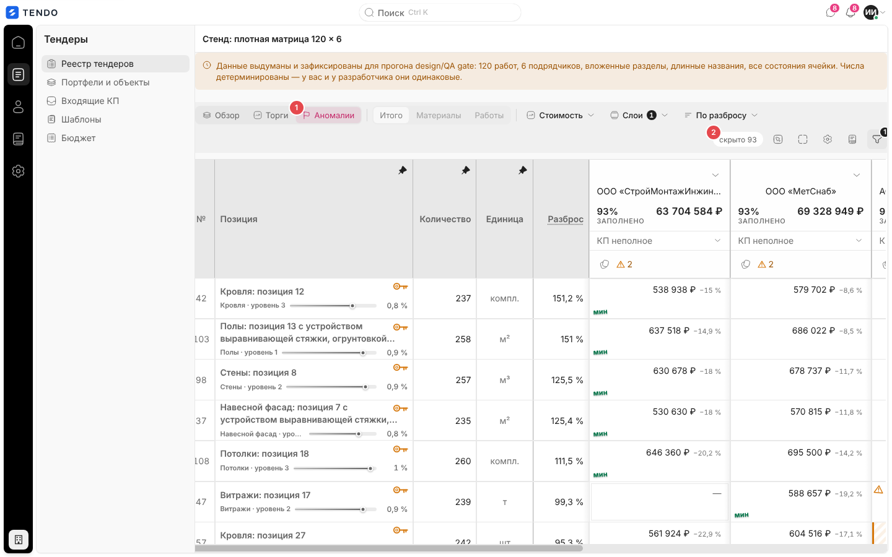

# Стенд плотной матрицы (`/tenders/dense-gate`) — служебный, в продукт не входит

> **Не является экраном продукта.** Служебная страница для проверки (design/QA) сравнительной таблицы на «тяжёлых» данных. Доступна только в сборке с включённым флагом инструментов демонстрации (`VITE_DEMO_TOOLS=1` — локальный и демо-стенд); в боевой сборке по этому адресу показывается заглушка. При оценке объёма работ по продукту экран можно не учитывать или оценить отдельно как инструмент разработки.

Связанные разделы: сравнительная таблица, которую стенд показывает, — [tender-card-comparison.md](tender-card-comparison.md); формулы аналитики — [../02-business-logic/tenders-comparison.md](../02-business-logic/tenders-comparison.md).

## Маршрут

- `/tenders/dense-gate` (статический маршрут, имеет приоритет над `/tenders/:id`).
- Вид таблицы пишется в адрес так же, как на карточке тендера (`?p=overview`, `?p=anomalies` и т. д. — см. [tender-card-comparison.md](tender-card-comparison.md#ссылка-на-вид)).

## Назначение

Дать дизайнеру, тестировщику и разработчику одинаковую воспроизводимую «плотную» матрицу, чтобы проверять ширины колонок, липкие шапки, горизонтальную прокрутку, обрезку длинных названий и все состояния ячейки, не трогая реальные тендеры:

- 120 выдуманных работ × 6 выдуманных подрядчиков, вложенные разделы (три уровня), длинные названия (не менее 10, но меньше половины), все состояния ячейки сразу: пробел, отказ, аномалия, корректировка, потенциал, ключевая позиция, оба яруса разброса;
- числа **детерминированы**: набор строится одинаково при каждом открытии, замечание «вот здесь плохо» воспроизводится у всех;
- показывается **та же** компонента сравнительной таблицы, что на карточке тендера (не копия), с теми же пресетами, слоями, фильтрами и окнами; отличие — только источник данных (встроенный набор вместо API) и системные пороги аналитики по умолчанию.

Автоматическая часть проверки (набор действительно плотный; ни одна пометка не кодируется только цветом) выполняется тестом сборки; контраст, фокус и раскладка проверяются на этой странице вручную.

## Роли

Маршрут относится к разделу «Тендеры»: доступен специалисту и администратору; СБ и юрист перенаправляются на `/home`, поставщик — в кабинет.

## Экран

| № | Элемент | Поведение |
|---|---|---|
| ① | Заголовок «Стенд: плотная матрица 120 × 6» | — |
| ② | Предупреждение (янтарное, первым экраном) | «Данные выдуманы и зафиксированы для прогона design/QA gate: 120 работ, 6 подрядчиков, вложенные разделы, длинные названия, все состояния ячейки. Числа детерминированы — у вас и у разработчика они одинаковые.» |
| ③ | Панель вида сравнительной таблицы | Пресеты «Обзор · Торги · Аномалии», срез цены, показатель, слои, сортировка, служебные кнопки — как на карточке тендера |
| ④ | Таблица | Сравнительная таблица по встроенному набору |

Действия, требующие сервера (приглашение, корректировки, комментарии, выгрузка и т. п.), на стенде не имеют реального тендера (идентификатор `DENSE-GATE`) и для проверки не предназначены.

## Без флага

Если флаг инструментов демонстрации выключен, страница показывает заглушку со значком и текстом «Стенд плотной матрицы доступен только в dev/demo/test.» (снимок не делался — на стенде флаг включён).

## Сложность

**S** (при наличии сравнительной таблицы): генератор детерминированного набора и страница-обёртка; автоматическая проверка набора — S.
