# Реестр тендеров (`/tenders`)

Список всех тендеров, доступных пользователю, с вкладками-срезами по статусу, поиском, фильтрами (даты, статусы, «требует внимания», расширенный фильтр), настройкой колонок и группировки, сортировкой по колонкам и выгрузкой среза в Excel. Отдельная вкладка «Незавершённые» — черновики мастера создания, которые ещё не стали тендерами.

Связанные разделы: статусы, «требует внимания», «соблюдение сроков» — [../02-business-logic/tenders.md](../02-business-logic/tenders.md#4-статусная-модель-тендера); черновики мастера — [../02-business-logic/tenders-lifecycle.md](../02-business-logic/tenders-lifecycle.md#3-черновики-мастера-создания); строки реестра — [../04-api/endpoints-portfolios.md](../04-api/endpoints-portfolios.md#get-portfolios); выгрузка — [../04-api/endpoints-reports.md](../04-api/endpoints-reports.md#post-reportsregistryxlsx); черновики — [../04-api/endpoints-tenders.md](../04-api/endpoints-tenders.md) (`/creation-drafts`); пользовательские статусы — [../04-api/endpoints-catalog.md](../04-api/endpoints-catalog.md#статусы-тендеров-и-кп); соседние экраны — [tender-card.md](tender-card.md), [tender-create.md](tender-create.md), [home.md](home.md).

> В правом нижнем углу снимков бывает круглый значок — инструмент отладки dev-сборки стенда, в продукт не входит.

## Маршрут

- `/tenders`. Вкладка, фильтры, поиск и сортировка — **состояние страницы**, в адрес не пишутся (после перезагрузки — вкладка «Активные», сортировка «новые сверху», фильтры пусты).
- Вид таблицы (состав и порядок колонок, группировка) запоминается **в браузере** пользователя и переживает перезаход.
- Заголовок экрана — «Реестр тендеров».

## Назначение

Найти нужный тендер (по номеру, названию, объекту, виду работ, ответственному, контрагенту, датам, статусу), увидеть ход сбора КП по всем тендерам сразу (приглашено/откликнулись, лучшая цена, соблюдение срока) и выгрузить ровно тот срез, что на экране, в Excel. Отсюда же начинают новый тендер и продолжают брошенный мастер создания.

## Роли и права

| Роль | Доступ | Что меняется |
|---|---|---|
| Тендерный специалист | Да | Видит тендеры только тех объектов (проектов), к которым ему выдан доступ |
| Администратор | Да | Видит все тендеры; на вкладке «Незавершённые» — черновики мастера **всех** пользователей |
| СБ, юрист | Нет | Раздел «Тендеры» скрыт в рейле; прямой переход на `/tenders` перенаправляет на `/home` |
| Поставщик, лид, владелец площадки | Нет | Перенаправление на стартовый экран своей роли |

- Колонки с ценами («Лучшая цена», «Мин. неполного КП») приходят пустыми, если у пользователя нет права видеть финансы: сервер не отдаёт суммы, ячейки пусты.
- Выгрузка среза требует права `reports.view`; кнопка показывается всем, отказ приходит с сервера (см. [открытые вопросы](../_oq/SCR-2b.md)).

## Как попасть

- Рейл «Тендеры» → пункт «Реестр тендеров» (первый пункт раздела, раздел открывается на нём).
- «Реестр тендеров →» / «Все N →» на главной, крошка «Реестр тендеров» в карточке тендера и в мастере создания, кнопка «В реестр тендеров» на экранах ошибки карточки.
- «Открыть реестр тендеров» на последнем шаге мастера.

## Общая компоновка

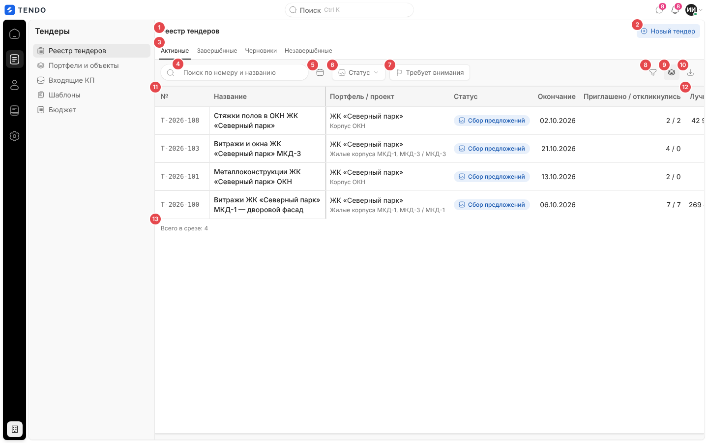

| № | Элемент | Поведение |
|---|---|---|
| ① | Заголовок «Реестр тендеров» | — |
| ② | «Новый тендер» | Открывает мастер `/tenders/new` ([tender-create.md](tender-create.md)) |
| ③ | Вкладки «Активные · Завершённые · Черновики · Незавершённые (N)» | Статусный срез поверх фильтров; у «Незавершённые» — счётчик черновиков мастера (красная капсула, если > 0) |
| ④ | Поиск «Поиск по номеру и названию» | Подстрока без учёта регистра по номеру (`T-2026-108`), внутреннему id и названию; применяется на каждый символ, крестик очищает |
| ⑤ | «Даты» (значок календаря) | Окно четырёх независимых диапазонов дат — см. [Фильтр дат](#фильтр-дат) |
| ⑥ | «Статус» | Мультивыбор системных и пользовательских статусов — см. [Фильтр статусов](#фильтр-статусов) |
| ⑦ | «Требует внимания» | Переключатель: только тендеры с флагом «Требует внимания» |
| ⑧ | «Фильтры» (воронка) | Окно расширенного фильтра — см. [Расширенный фильтр](#расширенный-фильтр) |
| ⑨ | «Вид таблицы: колонки и группировка» | Меню вида — см. [Вид таблицы](#вид-таблицы-колонки-порядок-группировка) |
| ⑩ | «Выгрузить срез в Excel · N» (значок загрузки) | Скачивает .xlsx с тем, что сейчас на экране — см. [Выгрузка](#выгрузка-среза-в-excel) |
| ⑪ | Шапка таблицы | Клик по подписи колонки — сортировка; колонки «№» и «Название» закреплены слева при горизонтальной прокрутке |
| ⑫ | Значок «i» у «Лучшая цена» и «Мин. неполного КП» | Справка о правиле расчёта (тултип по наведению и фокусу) |
| ⑬ | Подпись таблицы | «Всего в срезе: N» или «Показано N из M», когда фильтры сузили вкладку |

Полоса фильтров стоит над прокручиваемой областью и не уезжает; при активных фильтрах слева от «Фильтры» появляется крестик «Сбросить фильтры · N» (N — число активных фильтров). На ширине 1440 px при раскрытой боковой панели раздела часть колонок уходит вправо — таблица прокручивается по горизонтали, «№» и «Название» остаются на месте:

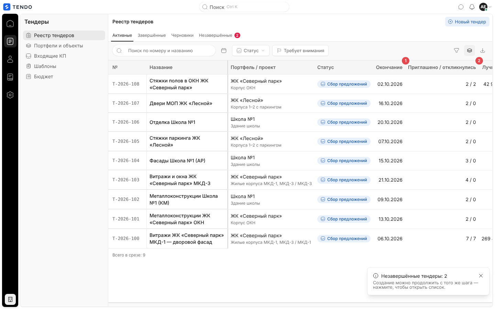

## Вкладки

| Вкладка | Статусы | Пусто |
|---|---|---|
| Активные (по умолчанию) | «Сбор предложений» (`open`) | «Под фильтры не подошёл ни один тендер.» + «Сбросить фильтры» |
| Завершённые | «Завершён» и «Отменён» | то же |
| Черновики | «Черновик» (тендер создан, но не опубликован) | то же |
| Незавершённые | Не тендеры, а черновики мастера создания (`/creation-drafts`) | «Незавершённых черновиков нет — начатое создание тендера появится здесь.» |

Если в фильтре статусов уже выбраны статусы, вкладка показывает их **пересечение** со своим набором (например, «Черновики» + «Сбор предложений» дают пустую таблицу, а не чужие строки). Фильтры при смене вкладки сохраняются.

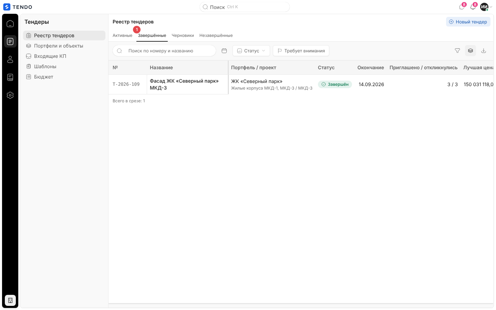

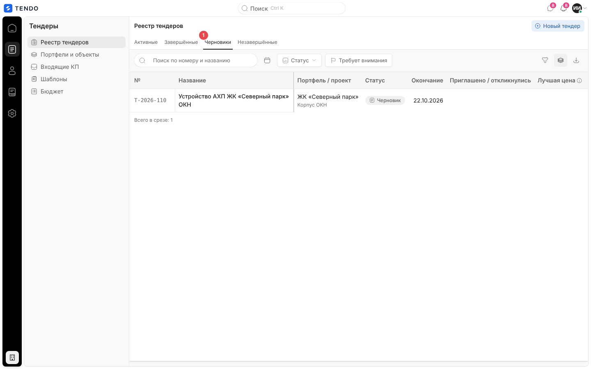

## Колонки

Ключи колонок совпадают с ключами выгрузки `POST /reports/registry.xlsx`.

| Колонка (ключ) | По умолчанию | Содержимое | Сортировка: первый клик |
|---|---|---|---|
| № (`id`) | да | Номер тендера моноширинным (`T-2026-187`), ссылка на карточку; без номера — внутренний id. Ширина фиксирована (112 px), колонка закреплена | по убыванию номера |
| Название (`title`) | да | Полужирное, до 2 строк, дальше многоточие; полное — во всплывающей подсказке. Закреплена слева вместе с «№» | по алфавиту |
| Портфель / проект (`project`) | да | Портфель; второй строкой серым — путь проекта («Корпус 1 / Отделка МОП») | по алфавиту «портфель / проект» |
| Вид работ (`kind`) | нет | Виды работ через запятую | по алфавиту |
| Статус (`status`) | да | Капсула системного статуса + (если задан) капсула пользовательского статуса с цветом из справочника | по подписи статуса |
| Дата изменения статуса (`statusChanged`) | нет | `ДД.ММ.ГГГГ` (московский день) | по убыванию (свежие сверху) |
| Ответственный (`owner`) | нет | ФИО | по алфавиту |
| Начало (`start`) | нет | Дата начала сбора КП | по убыванию |
| Окончание (`end`) | да | Дата окончания сбора КП | по убыванию |
| Соблюдение сроков (`deadline`) | нет | Капсула «В срок» (зелёная) / «С опозданием» (янтарная) / «Просрочен» (красная); пусто — оценивать нечего. Правило — [tenders.md §4.4](../02-business-logic/tenders.md#44-соблюдение-сроков-вычисляемо) | по подписи |
| Приглашено / откликнулись (`invited`) | да | «8 / 3»: действующие приглашения / поданные КП; у тендера без приглашений — пусто (а не «0 / 0») | по числу откликнувшихся |
| Лучшая цена (`bestPrice`) | да | Итог лидера среди **полных** КП, `42 997 616,74 ₽`; справка «i»: «Самый низкий итог среди полных КП — с ценой по каждой позиции. Совпадает с лидером на вкладке «Обзор». Неполные КП сюда не входят: их итог занижен на позиции без цены.» | по сумме |
| Мин. неполного КП (`incompleteMinPrice`) | нет | Минимальный итог среди неполных КП; второй строкой «нет ставок: N» или «разные объёмы» (если позиций без цены 0); справка «i»: «Самый низкий итог среди неполных КП и число позиций, по которым цены нет (отказ тоже не цена). С полными КП такой итог сравнивать нельзя.» | по сумме |
| Создан (`created`) | нет | Дата создания, серым | по убыванию |

Набор по умолчанию — 7 колонок, которые помещаются в окно 1536 px без прокрутки: №, Название, Портфель / проект, Статус, Окончание, Приглашено / откликнулись, Лучшая цена.

### Сортировка

- По умолчанию — «Создан, по убыванию» (новые сверху), даже если колонка «Создан» скрыта. Сортировка не запоминается: при каждом открытии реестр снова показывает новые сверху.
- Клик по подписи колонки: первый — направление по умолчанию для колонки (номер и даты — по убыванию, текст — по алфавиту), повторный — разворот. У активной колонки — стрелка ↑/↓ (подсказка «Сортировать по возрастанию/убыванию»), у прочих — подсказка «Сортировать по этой колонке». Подпись — настоящая кнопка (работает с клавиатуры); значок «i» рядом не сортирует.
- Пустые значения всегда в конце при любом направлении. Равные значения досортировываются по номеру тендера (больший выше).
- Сортировка выполняется в браузере: реестр приходит целиком (см. [Данные](#данные)).

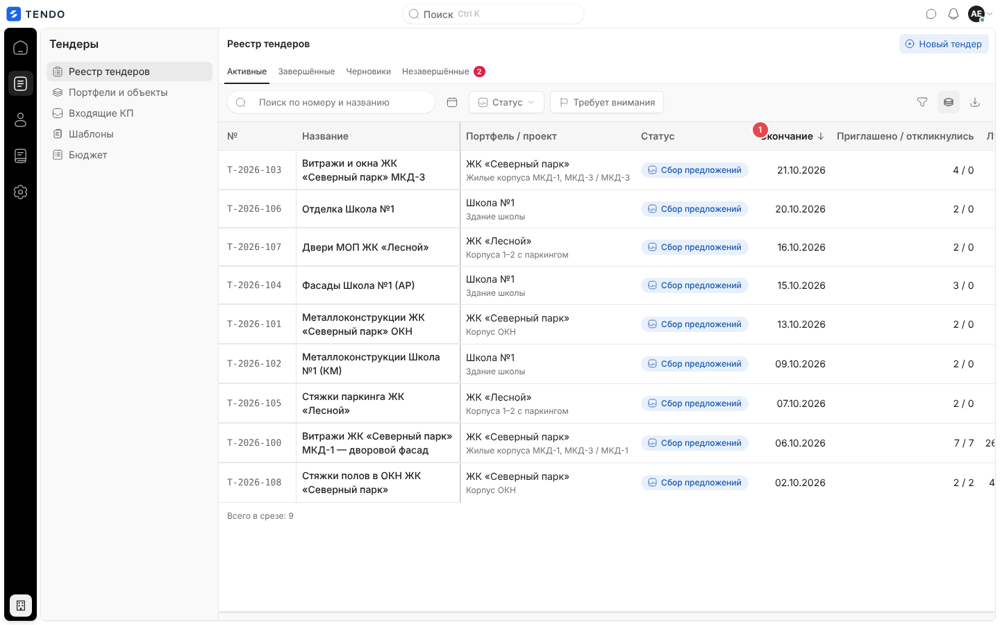

### Строки

- Кликабельна вся строка — переход в карточку `/tenders/{id}`; настоящая ссылка — на номере (средняя кнопка, «открыть в новой вкладке»).
- Строки не выделяются чекбоксами; **массовых действий нет** (единственная операция над набором — выгрузка среза).
- Пагинации и подгрузки нет: показываются все строки среза.

## Фильтры

Все фильтры складываются через «И»; пустой список фильтром не является. Фильтрация мгновенная, на клиенте; поле поиска не ждёт таблицу (таблица догоняет следующим проходом).

### Фильтр статусов

| № | Элемент | Поведение |
|---|---|---|
| ① | Системные статусы | «Сбор предложений», «Завершён», «Отменён», «Черновик» — с тем же цветом и значком, что в таблице; мультивыбор, меню не закрывается по клику |
| ② | Группа «Пользовательские» | Действующие статусы справочника тендеров (флажок-значок, цвет из справочника); статус из архива показывается, только если он уже выбран, с пометкой «(в архиве)». Группа видна, только если в справочнике есть статусы |
| ③ | «Без пользовательского» | Тендеры без пользовательского статуса |

- Системные и пользовательские статусы отбираются **независимо** (тендер может быть «Сбор предложений» и «Ждём документы» одновременно).
- Подпись кнопки: «Статус», «Статус · N»; если выбран ровно один статус — кнопка показывает его капсулу.
- В подвале меню — «Очистить статусы · N».

### Фильтр дат

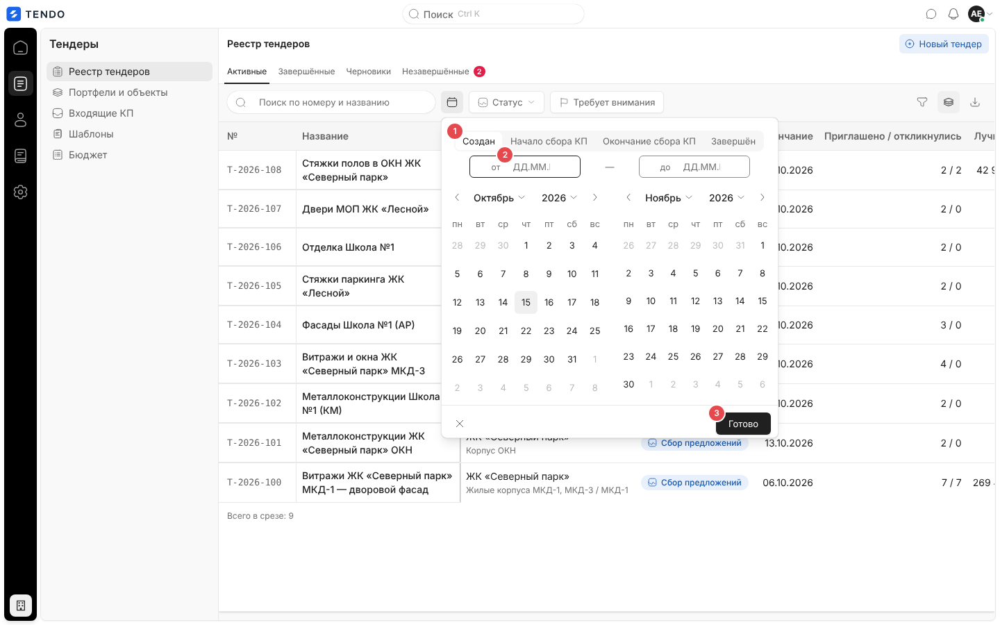

| № | Элемент | Поведение |
|---|---|---|
| ① | Переключатель даты | «Создан · Начало сбора КП · Окончание сбора КП · Завершён» — какую дату задаём; у заданных — значок календаря |
| ② | Поля «от» / «до» `ДД.ММ.ГГГГ` | Можно набрать руками; клик в поле выбирает, какую границу правит клик в календаре |
| ③ | «Готово» | Закрывает окно; крестик слева — «Очистить диапазон» текущей даты |

- Четыре **независимых** диапазона; заданные складываются через «И». Границы включительные; открытая граница допустима («с 01.09», «по 30.09»).
- Заданный диапазон отсекает строки без этой даты (незавершённый тендер не попадает в срез «Завершён с 01.09»).
- Календарь: два месяца, каждый листается отдельно (свои стрелки и выпадающие месяц/год); границы правятся независимо; перевёрнутая пара меняется местами; после выбора начала (при пустом конце) следующий клик ставит конец.
- Кнопка-значок «Даты» несёт счётчик заданных диапазонов и подпись с перечнем («Даты: Создан 01.09 – 30.09; Завершён с 01.10»).

### «Требует внимания»

Переключатель на полосе (нажат — подсвечен, `aria-pressed`): оставляет тендеры с флагом «Требует внимания» (смысл флага — [tenders.md §4.3](../02-business-logic/tenders.md#43-флаг-требует-внимания)).

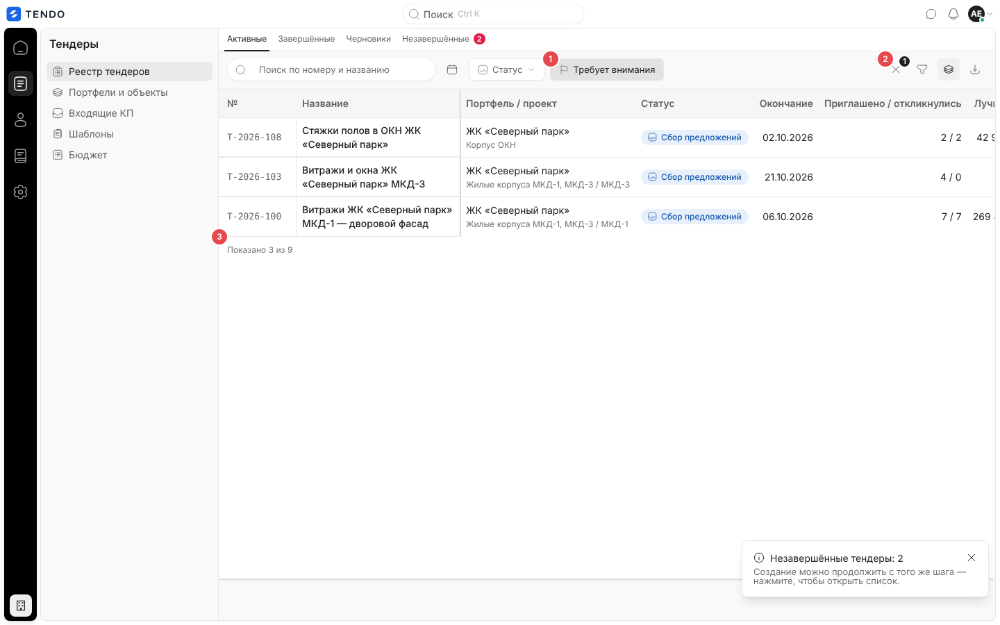

### Расширенный фильтр

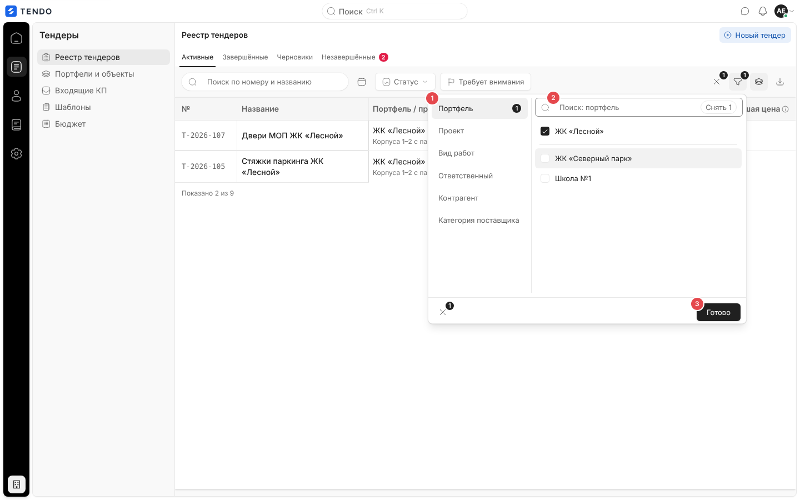

| № | Элемент | Поведение |
|---|---|---|
| ① | Критерии | «Портфель», «Проект», «Вид работ», «Ответственный», «Контрагент», «Категория поставщика»; у критерия с выбором — счётчик |
| ② | Значения критерия | Поиск «Поиск: {критерий}» (при пустом результате — «Ничего не найдено по «…»»), пилюля «Снять N», список с флажками (мультивыбор) |
| ③ | «Готово» | Закрывает окно; крестик слева в подвале — «Очистить всё · N» |

- Значения критериев **выводятся из строк реестра** (а не из справочников): в списке нет значений, которые ничего не найдут.
- «Проект» зависит от «Портфеля»: при выбранных портфелях в списке только их проекты (уже отмеченные проекты остаются, чтобы их можно было снять).
- «Вид работ» — тендер попадает в срез, если **любой** из его видов работ выбран (у тендера их может быть несколько).
- «Контрагент» — тендер попадает, если приглашён хотя бы один из выбранных контрагентов; «Категория поставщика» — если хоть у одного приглашённого есть выбранный вид работ.
- Кнопка-воронка: подсветка и счётчик задействованных критериев («Фильтры · 2»).
- Нет доступных критериев — «Нет доступных фильтров».

### Сброс и пустой результат

- Крестик «Сбросить фильтры · N» на полосе — сбрасывает всё (поиск, даты, статусы, внимание, расширенный фильтр). N — число активных фильтров: каждый диапазон дат — один фильтр, группа статусов — один, поиск — один.
- Пустой результат — строка таблицы «Под фильтры не подошёл ни один тендер.» и кнопка «Сбросить фильтры».

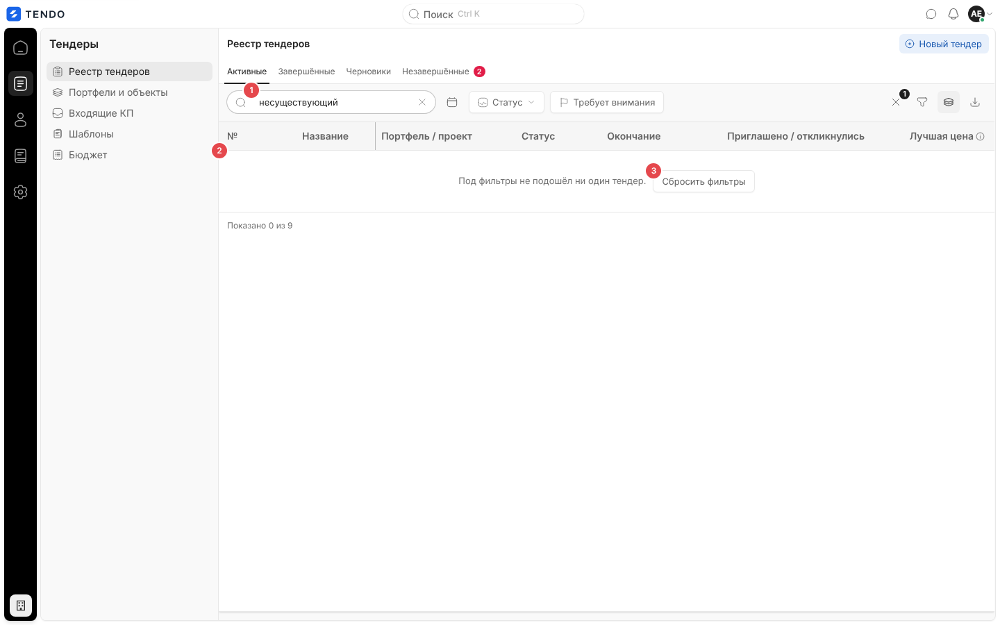

## Вид таблицы: колонки, порядок, группировка

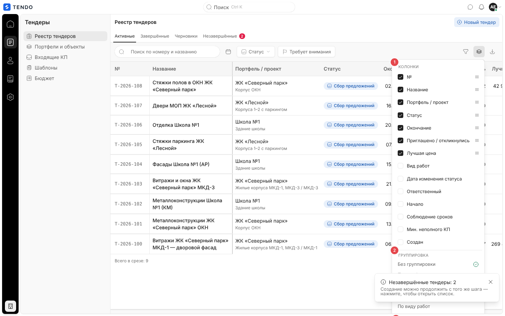

| № | Раздел меню | Поведение |
|---|---|---|
| ① | «Колонки» | Все 14 колонок: сначала показанные (в порядке таблицы), затем скрытые. Флажок — показать/скрыть; последнюю показанную колонку скрыть нельзя. Возвращённая колонка встаёт последней. Порядок меняется перетаскиванием за ручку (линия вставки показывает место) или с клавиатуры Alt+↑/↓ на пункте |
| ② | «Группировка» | Одиночный выбор: «Без группировки», «По портфелю», «По статусу», «По пользовательскому статусу», «По виду работ» |
| ③ | «Вернуть вид по умолчанию» | Колонки по умолчанию, без группировки |

- Меню не закрывается по клику (настройку делают серией изменений).
- Кнопка вида подсвечена, если какая-то колонка скрыта или включена группировка (при виде по умолчанию 7 из 14 колонок скрыты, поэтому кнопка подсвечена и в исходном состоянии).
- Вид хранится в браузере; сохранённый состав сверяется со списком колонок (неизвестные ключи отбрасываются).

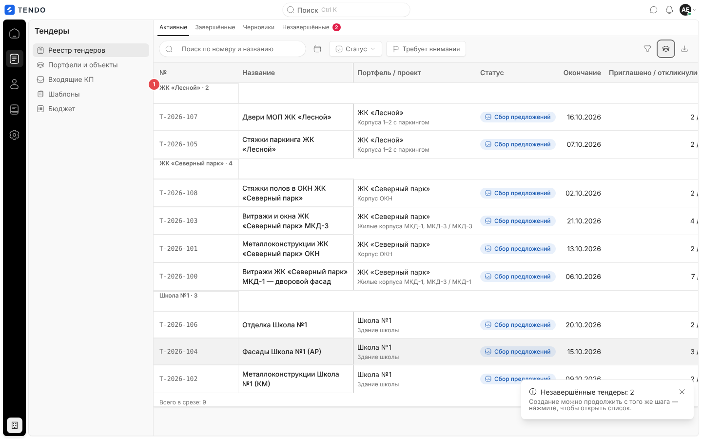

Группировка:

- Заголовок группы — строка таблицы «{название} · {число строк}»; порядок строк внутри группы сохраняется (как отсортировано).
- Группы — по алфавиту; «По статусу» — подписи системных статусов; «По пользовательскому статусу» — в порядке справочника, «Без пользовательского статуса» последней; пустое значение получает явную подпись («Без портфеля», «Без вида работ»).
- Тендер с несколькими видами работ при группировке «По виду работ» попадает в группу по строке видов работ целиком.

## Выгрузка среза в Excel

- Кнопка-значок «Выгрузить срез в Excel · N» (N — число строк среза). Неактивна, если строк 0; во время подготовки — «Готовим файл…».
- Выгружается **ровно то, что на экране**: id строк после фильтров и ключи показанных колонок в порядке экрана → `POST /reports/registry.xlsx` `{"ids": [...], "columns": [...]}`.
- Имя файла: `Тендеры_ГГГГ-ММ-ДД__ЧЧ-ММ.xlsx` (московское время).
- Файл: лист «Тендеры», первая строка — гриф «Коммерческая тайна / конфиденциально», затем шапка с подписями колонок как на экране, далее строки (даты — датами Excel, суммы — числами).
- Без права видеть финансы ценовые колонки в файл не попадают.
- Ошибка выгрузки сейчас пользователю не показывается (см. [открытые вопросы](../_oq/SCR-2b.md)).

## Вкладка «Незавершённые»

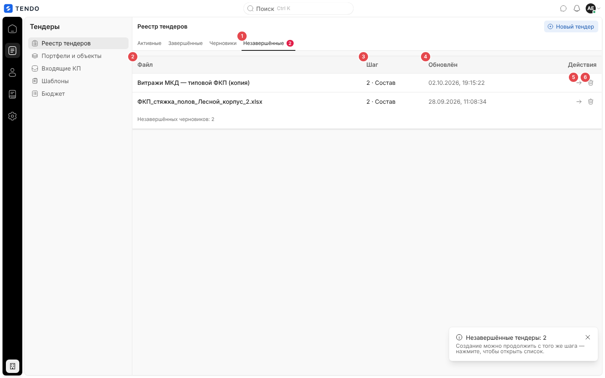

| № | Колонка / элемент | Содержимое |
|---|---|---|
| ① | Вкладка с красным счётчиком | Число черновиков мастера в статусе `draft` (не более 20 — столько запрашивается) |
| ② | Файл | Имя загруженного Excel; если файла нет (запуск из шаблона) — название тендера из черновика; иначе «Без файла» |
| ③ | Шаг | «1 · Файл», «2 · Состав», «3 · Параметры», «4 · Контрагенты» |
| ④ | Обновлён | Дата и время последнего автосохранения (московское) |
| ⑤ | «Продолжить» (стрелка) | Открывает мастер `/tenders/new?draftId={id}` с восстановлением (см. [tender-create.md](tender-create.md#черновики-создания-и-восстановление)); так же действует клик по строке |
| ⑥ | «Удалить» (корзина) | Подтверждение «Удалить незавершённый черновик?» → `DELETE /creation-drafts/{id}` (черновик помечается удалённым) → список перечитывается |

- Полосы фильтров на этой вкладке нет.
- Источник — `GET /creation-drafts?status=draft&limit=20`: свои черновики (администратор — все), просроченные (не менявшиеся дольше срока хранения, по умолчанию 30 дней) не показываются.
- Ошибка загрузки — «Незавершённые не загрузились» + текст + «Повторить» (если список ещё пуст; при сбое перечитывания прошлый список не стирается).

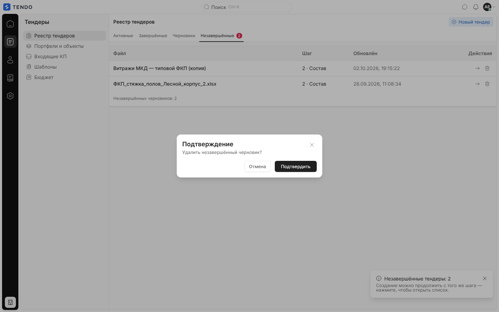

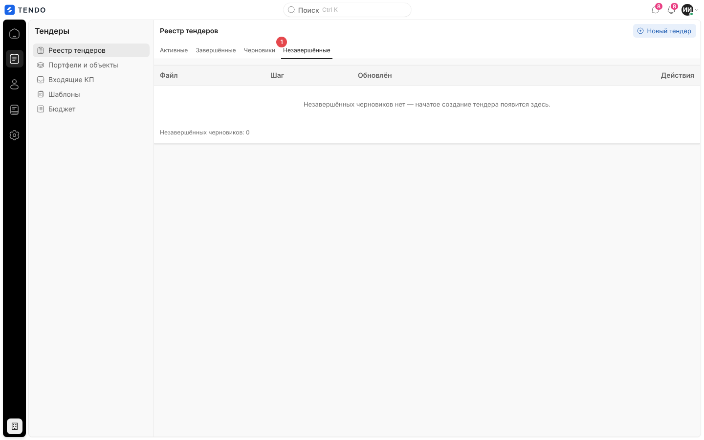

### Напоминание о незавершённых

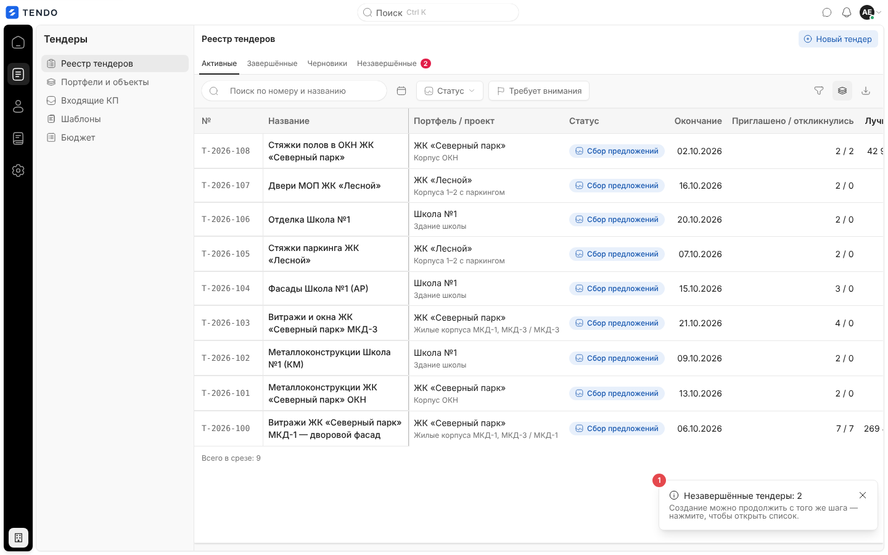

- При заходе в реестр, если есть черновики мастера, один раз за заход показывается всплывающее окно в правом нижнем углу: «Незавершённые тендеры: N» и «Создание можно продолжить с того же шага — нажмите, чтобы открыть список.»
- Окно не исчезает само (в нём действие); клик по нему (или по заголовку) переключает на вкладку «Незавершённые» и закрывает окно; крестик «Закрыть» — просто закрывает. Уход с реестра закрывает окно автоматически.

## Данные

- `GET /portfolios` — дерево «портфель → проект → подпроект → тендеры» по доступным пользователю объектам; клиент разворачивает его в плоский список строк (поля строки — [endpoints-portfolios.md](../04-api/endpoints-portfolios.md#объект-portfoliotender-строка-реестра-тендеров-в-дереве)). Один запрос на весь реестр; кэш общий с главной, свежесть 10 с. Серверной пагинации, сортировки и фильтрации нет (см. [открытые вопросы](../_oq/SCR-2b.md)).
- Словарь пользовательских статусов тендеров (`GET /statuses?entity_type=tender&include_archived=…`) — подписи и цвета капсул, группы меню; его сбой реестр не ломает (капсула показывает код).
- `GET /creation-drafts?status=draft&limit=20` — вкладка «Незавершённые» и напоминание.
- Даты из API приводятся к московскому дню и показываются `ДД.ММ.ГГГГ`.

## Состояния

| Состояние | Что видит пользователь | Снимок |
|---|---|---|
| Загрузка | Шесть полос-скелетонов на месте строк; полоса фильтров уже на месте | 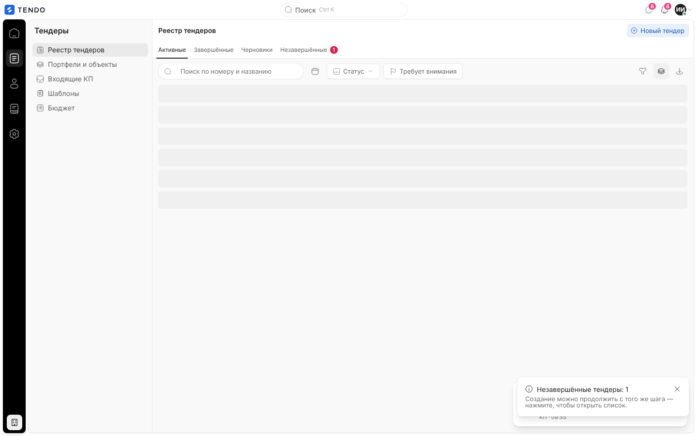 |
| Пусто по фильтрам | «Под фильтры не подошёл ни один тендер.» + «Сбросить фильтры» | см. выше |
| Ошибка | «Реестр не загрузился», «Список тендеров не пришёл. Фильтры и поиск при этом настроены.», «Повторить» | 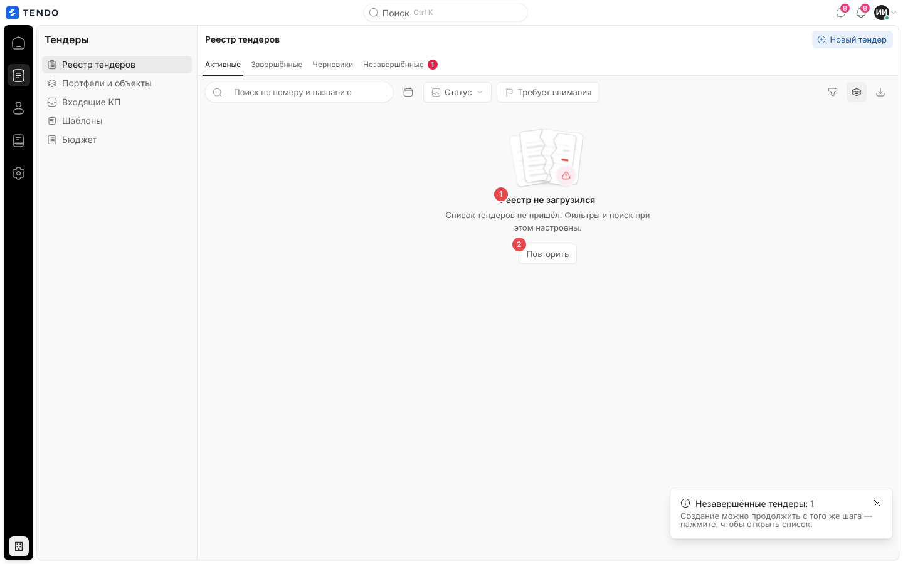 |
| Нет доступа (СБ, юрист) | Перенаправление на `/home` (см. [home.md](home.md#очередь-аккредитации-сб-и-юрист)) | — |

## Переходы

| Откуда | Куда |
|---|---|
| Строка, номер тендера | `/tenders/{id}` |
| «Новый тендер» | `/tenders/new` |
| «Продолжить» / строка на вкладке «Незавершённые» | `/tenders/new?draftId={id}` |
| Напоминание о незавершённых | вкладка «Незавершённые» этого же экрана |

## Сложность

**L** в целом: таблица с закреплёнными колонками, сортировкой и группировкой — M; полоса фильтров (статусы, четыре диапазона дат с календарём, расширенный фильтр с зависимыми критериями) — M; меню вида с перетаскиванием и хранением — S; выгрузка среза — S (серверная часть — в отчётах); вкладка «Незавершённые» и напоминание — S.
