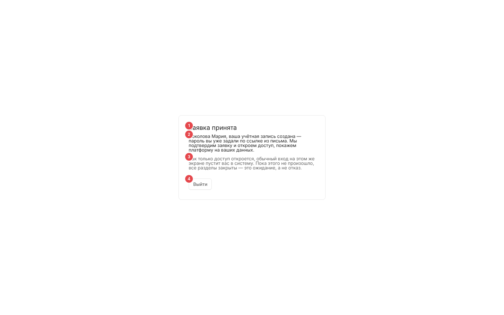

# Заявка принята (`/welcome`) — экран лида

Единственный экран роли «Лид»: человек оставил заявку на демонстрацию на маркетинговом лендинге, получил письмо со ссылкой активации, задал пароль — и ждёт, пока администратор назначит ему настоящую роль. Все остальные разделы ему закрыты.

Связанные разделы: роль «Лид» и её права — [../01-product/users-and-roles.md](../01-product/users-and-roles.md) (§1, §6, §7 п. 5); заявка и активация — [../02-business-logic/identity.md](../02-business-logic/identity.md) (§3.4, §4.8); API заявки — [../04-api/endpoints-identity.md](../04-api/endpoints-identity.md#post-leads); вход — [login.md](login.md#первый-вход--задание-пароля). Сам лендинг в объём работ не входит.

## Маршрут и условие существования

- `/welcome` — публичный маршрут **без каркаса и без гейта входа**: проверку «кто пришёл» выполняет сам экран.
- Маршрут регистрируется **только** при флаге сборки `VITE_LEADS=1` (пара серверному флагу `LEADS_ENABLED`). Без флага адреса нет — открывается экран «Такой страницы нет» ([shell.md](shell.md#ошибки-и-служебные-экраны)).
- Заголовок вкладки — «Заявка принята».

## Роли и переходы

| Кто открыл | Что происходит |
|---|---|
| Нет метки входа в браузере | Переход на `/login` |
| Лид | Экран «Заявка принята» |
| Любая другая роль | Переход на стартовый экран этой роли (после ответа `/auth/me`) |
| Лид на любом другом адресе за входом | Гейт уводит сюда (стартовый экран лида — `/welcome`) |

Как попадает лид: заявка с лендинга → письмо со ссылкой активации `/login?activation_token=…&email=…` → «Задайте пароль» → вход → `/welcome`. Последующие входы — обычной формой, сразу сюда. Когда администратор сменит роль в реестре пользователей ([users.md](users.md)), следующий вход приведёт на стартовый экран новой роли.

## Экран

| № | Элемент | Содержание |
|---|---|---|
| ① | Заголовок | «Заявка принята» |
| ② | Основной текст | «<ФИО>, ваша учётная запись создана — пароль вы уже задали по ссылке из письма. Мы подтвердим заявку и откроем доступ, покажем платформу на ваших данных.» (без имени — «Ваша учётная запись…») |
| ③ | Пояснение | «Как только доступ откроется, обычный вход на этом же экране пустит вас в систему. Пока этого не произошло, все разделы закрыты — это ожидание, а не отказ.» |
| ④ | «Выйти» | Переход на `/login` |

Дополнительная строка, если метка входа есть, а сервер пользователя не вернул: «Сессия истекла — войдите заново, заявка никуда не делась.».

Кнопка «Выйти» только переводит на страницу входа и **не закрывает сессию на сервере** (в отличие от «Выйти» в меню профиля каркаса) — см. [открытые вопросы](../_oq/SCR-1.md). При воссоздании кнопка должна вызывать `POST /auth/logout`.

## Состояния

| Состояние | Поведение |
|---|---|
| Ожидание `/auth/me` | Карточка рисуется без имени |
| Сессия истекла | См. строку выше; на практике первый же отказ сессии уводит на `/login?reason=…` ([shell.md](shell.md#сессия-продление-и-завершение)) |

## Сложность

**S**.
