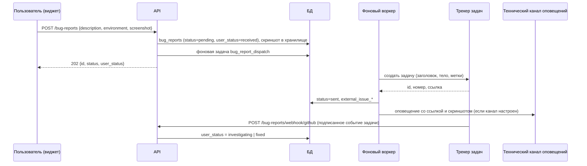

# API: баг-репорты (bug-reports)

Ручки виджета «Сообщить об ошибке»: приём репорта от любого вошедшего пользователя, список «Мои репорты» и входящий вебхук внешнего трекера задач, который возвращает статус обратно в систему. Общие соглашения (cookie-аутентификация, проверка `Origin`, формат ошибок `{"detail": …}`, 422 валидации, лимиты частоты) — в [overview.md](overview.md); здесь не повторяются.

Связанные разделы: бизнес-логика — [../02-business-logic/bug-reports.md](../02-business-logic/bug-reports.md); модель данных — [../05-data-model/](../05-data-model/) (таблица `bug_reports`).

## Сводка

| Метод | Путь | Кратко | Доступ |
|---|---|---|---|
| POST | `/bug-reports` | Отправить баг-репорт (с автособранным окружением и скриншотом) | любой вошедший пользователь |
| GET | `/bug-reports/mine` | Мои репорты и их статусы | любой вошедший пользователь (только свои) |
| POST | `/bug-reports/webhook/github` | Вебхук трекера задач: смена статуса репорта | без сессии; подпись HMAC-SHA256 общим секретом |

Сложность блока: **M** (приём + фоновая отправка во внешний трекер с повторами + вебхук).

### Жизненный цикл репорта

Два независимых статуса:

| Поле | Значения | Смысл |
|---|---|---|
| `status` | `pending` → `sent` \| `failed` | внутренний конвейер отправки во внешний трекер |
| `user_status` | `received` → `investigating` → `fixed` | то, что видит автор в «Моих репортах»; меняет вебхук трекера |



---

### POST /bug-reports

**Назначение.** Принять баг-репорт из виджета. Заголовок задачи сервер выводит сам из первой непустой строки описания (обрезка до 120 символов с «…»). Отправка во внешний трекер выполняется асинхронно фоновой задачей, поэтому ответ — `202 Accepted`.

**Доступ.** Любой пользователь с действующей сессией (сотрудник, поставщик, лид). Проверка — зависимость «текущий пользователь».

**Лимит.** 5 репортов в час на пользователя (ключ — id пользователя, не IP). Превышение — `429`.

**Параметры пути/запроса.** Нет.

**Тело запроса** (`application/json`):

| Поле | Тип | Обяз. | Ограничения / смысл |
|---|---|---|---|
| `description` | string | да | минимум 1 символ; после обрезки пробелов не пустое; сохраняется не более 10 000 символов |
| `page_url` | string \| null | нет | адрес страницы; сохраняется не более 2000 символов |
| `environment` | object \| null | нет | автособранное окружение (см. ниже), хранится как JSON |
| `screenshot` | string \| null | нет | data URL (`data:image/png;base64,…`, поддерживаются png/jpeg/webp) или «сырой» base64 (считается png); после декодирования ≤ 5 МБ |

Ключи `environment`, которые собирает фронт и которые попадают в тело задачи трекера: `url`, `browser` (User-Agent, до 200 символов), `os` (Windows/macOS/Linux/Android/iOS/unknown), `viewport` (`ШxВ`), `app_version`, `timestamp` (ISO 8601), `correlation_id` (последний `X-Request-Id`), `console_errors` (кольцевой буфер последних 20 ошибок консоли, каждая ≤ 500 символов; в задачу уходит не более 50).

**Ответ `202`:**

| Поле | Тип | Смысл |
|---|---|---|
| `id` | integer | id репорта |
| `status` | string | всегда `pending` |
| `user_status` | string | всегда `received` |

**Ошибки:**

| Код | Когда | `detail` |
|---|---|---|
| 400 | описание пустое после обрезки пробелов | «Опишите, что сломалось» |
| 400 | скриншот не декодируется из base64 | «Некорректный screenshot» |
| 401 | нет сессии | «Не авторизован» |
| 413 | скриншот больше 5 МБ | «Скриншот больше 5 МБ» |
| 422 | `description` отсутствует или пустая строка | стандартная ошибка валидации |
| 429 | больше 5 репортов за час | «Слишком много запросов — попробуйте немного позже» |

**Пример.**

```http
POST /api/bug-reports
Content-Type: application/json

{
  "description": "Не открывается сравнительная таблица\nПосле нажатия «Сравнить» крутится индикатор",
  "page_url": "https://app.example.com/tenders/42",
  "environment": {"url": "https://app.example.com/tenders/42", "os": "Windows", "viewport": "1920x1080",
                  "app_version": "2026.10.01", "timestamp": "2026-10-15T09:12:00Z",
                  "correlation_id": "a1b2c3", "console_errors": ["TypeError: x is undefined"]},
  "screenshot": "data:image/png;base64,iVBORw0KGgo..."
}
```

```json
{"id": 17, "status": "pending", "user_status": "received"}
```

**Побочные эффекты.**
- Скриншот сохраняется в файловое хранилище как файл сущности `bug_report` (локальный диск или S3 — см. [../07-architecture/](../07-architecture/)).
- Создаётся фоновая задача `bug_report_dispatch` (до `BUGREPORT_JOB_MAX_ATTEMPTS`, по умолчанию 5 попыток). Воркер:
  - если отправка выключена (`BUGREPORT_GITHUB_ENABLED=false`) — ставит `status=failed`, `fail_reason` = причина;
  - создаёт задачу в трекере: заголовок = `title`, тело в Markdown с разделами «Reporter» (id и e-mail автора), «Environment», «Description», «Console errors», «Screenshot» (при S3 — presigned-ссылка на 7 дней, публичный объект не создаётся), метки из `BUGREPORT_GITHUB_LABELS` (по умолчанию `bug`);
  - при успехе — `status=sent`, сохраняет `external_issue_id`, `external_issue_key` (`#<номер>`), `external_issue_url`;
  - отправляет оповещение в технический канал (если настроен) с заголовком, автором, ссылкой и скриншотом; дедупликация по репорту;
  - идемпотентен: повтор задачи для уже отправленного репорта ничего не создаёт;
  - сетевые сбои — повтор задачи; иные ошибки — `status=failed` с причиной (до 1000 символов) и повтор по общим правилам очереди.
- Токен доступа к трекеру хранится только на бэкенде (переменная окружения), во фронт не попадает.

---

### GET /bug-reports/mine

**Назначение.** Список репортов текущего пользователя для экрана «Мои репорты», новые сверху.

**Доступ.** Любой вошедший пользователь; возвращаются только его собственные репорты.

**Параметры запроса:**

| Параметр | Тип | По умолчанию | Ограничения |
|---|---|---|---|
| `limit` | integer | 50 | 1–100 |
| `offset` | integer | 0 | ≥ 0 |

**Тело запроса.** Нет.

**Ответ `200`:** `{"items": [BugReport]}` (без общего счётчика), где элемент:

| Поле | Тип | Смысл |
|---|---|---|
| `id` | integer | id репорта |
| `title` | string | заголовок, выведенный из описания |
| `status` | string | `pending` \| `sent` \| `failed` |
| `user_status` | string | `received` \| `investigating` \| `fixed` |
| `external_issue_key` | string \| null | номер задачи в трекере, `#123` |
| `external_issue_url` | string \| null | ссылка на задачу |
| `created_at` | string (ISO 8601) \| null | создан |
| `updated_at` | string (ISO 8601) \| null | изменён |

**Ошибки:** 401 — нет сессии; 422 — `limit`/`offset` вне диапазона.

**Пример.**

```http
GET /api/bug-reports/mine?limit=20
```

```json
{"items": [{"id": 17, "title": "Не открывается сравнительная таблица", "status": "sent",
            "user_status": "investigating", "external_issue_key": "#311",
            "external_issue_url": "https://tracker.example.com/issues/311",
            "created_at": "2026-10-15T09:12:03+00:00", "updated_at": "2026-10-15T10:40:00+00:00"}]}
```

**Побочные эффекты.** Нет.

---

### POST /bug-reports/webhook/github

**Назначение.** Входящий вебхук внешнего трекера задач (в текущей реализации — GitHub Issues, отсюда имя провайдера в пути). По событию задачи система обновляет `user_status` связанного репорта, чтобы автор видел прогресс в «Моих репортах».

**Доступ.** Без cookie-сессии. Аутентификация — подпись тела: заголовок `X-Hub-Signature-256: sha256=<hex>`, где `<hex>` — HMAC-SHA256 от «сырого» тела запроса с общим секретом из переменной окружения `GITHUB_BUGREPORT_WEBHOOK_SECRET`. Сравнение — в постоянное время. Если секрет не задан, любая подпись отклоняется (ручка фактически выключена).

**Параметры пути/запроса.** Нет.

**Тело запроса** — JSON события трекера; используются только поля:

| Поле | Тип | Смысл |
|---|---|---|
| `action` | string | `opened`, `closed`, `reopened`, `labeled`, `unlabeled` и др. |
| `issue.id` | string/number | id задачи; по нему ищется репорт (`external_issue_id`) |
| `issue.number` | number | запасной ключ поиска (`external_issue_key = "#<number>"`) |
| `issue.state` | string | `open` \| `closed` |
| `issue.labels[].name` | string | метки задачи |
| `issue.html_url` | string | новая ссылка на задачу (если есть — перезаписывается) |

Правила сопоставления (первое сработавшее):

| Условие | Новый `user_status` |
|---|---|
| `action = closed` или `state = closed` | `fixed` |
| `action = reopened` | `investigating` |
| `action ∈ {opened, labeled, unlabeled}` или `state = open`, и есть метка `in progress` / `triage` / `investigating` (без учёта регистра) | `investigating` |
| `action = opened` без таких меток | `received` |
| иначе | не меняется |

**Ответ:**
- `200` `{"ok": true, "id": <id репорта>, "user_status": "<новый статус>"}` — статус обновлён;
- `204` без тела — событие не про задачу, задача не связана ни с одним репортом или событие не меняет статус.

**Ошибки:**

| Код | Когда | `detail` |
|---|---|---|
| 401 | нет заголовка подписи, алгоритм не `sha256`, подпись не совпала или секрет не задан | «Неверная подпись webhook» |
| 400 | тело не JSON | «Некорректный JSON» |

**Пример.**

```http
POST /api/bug-reports/webhook/github
Content-Type: application/json
X-Hub-Signature-256: sha256=5d0c…e9

{"action": "closed", "issue": {"id": 99001, "number": 311, "state": "closed",
 "labels": [{"name": "bug"}], "html_url": "https://tracker.example.com/issues/311"}}
```

```json
{"ok": true, "id": 17, "user_status": "fixed"}
```

**Побочные эффекты.** Обновление `bug_reports.user_status` (и `external_issue_url`). Уведомлений и записей в журнал ИБ нет.
