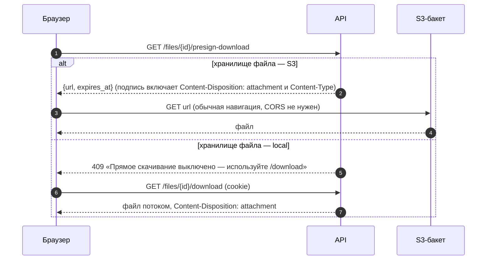

# API: файлы вложений (files)

Ручки вложений, привязанных к сущностям (карточка контрагента, тендер, КП, приглашение, сообщение чата, объект): конфигурация хранилища для фронта, загрузка через API (multipart), прямая загрузка в S3-совместимый бакет по подписанной ссылке (presign → PUT → confirm) с отменой, скачивание через API и по подписанной ссылке, удаление своего файла, список файлов сущности. Общие соглашения — в [overview.md](overview.md); лимиты — [overview.md §13](overview.md#13-лимиты-загрузки).

Связанные разделы: бизнес-логика — [../02-business-logic/files.md](../02-business-logic/files.md); архитектура хранилища — [../07-architecture/architecture.md](../07-architecture/architecture.md); экраны, где грузят файлы, — карточка контрагента, анкета, карточка тендера (документы), форма КП, чат, [../03-screens/object-card.md](../03-screens/object-card.md). Такие же пары ручек есть у формы КП по ссылке (`/invite/{token}/files/*`, [endpoints-tenders.md](endpoints-tenders.md)), у анкеты контрагента (`/suppliers/register/{id}/attachments/*`, [endpoints-suppliers.md](endpoints-suppliers.md)) и у чата ([endpoints-chat.md](endpoints-chat.md)) — правила проверки у всех общие.

## Сводка

| Метод | Путь | Кратко | Доступ |
|---|---|---|---|
| GET | `/files/config` | Режим хранилища, лимиты, допустимые расширения | публично |
| POST | `/files/upload` | Загрузить файл через API (multipart) | вошедший + доступ к сущности |
| POST | `/files/presign-upload` | Получить подписанную ссылку на прямую загрузку | вошедший + доступ к сущности; 20/мин |
| POST | `/files/confirm` | Подтвердить прямую загрузку (проверка и регистрация) | автор загрузки |
| DELETE | `/files/uploads/{upload_id}` | Отменить незавершённую прямую загрузку | автор загрузки |
| GET | `/files/{attachment_id}/download` | Скачать файл через API | доступ к сущности |
| GET | `/files/{attachment_id}/presign-download` | Подписанная ссылка на скачивание из бакета | доступ к сущности |
| DELETE | `/files/{attachment_id}` | Удалить свой файл | загрузивший |
| GET | `/files` | Список файлов сущности | доступ к сущности |

Сложность блока: **L** — два бэкенда хранилища за одним интерфейсом (M), прямая загрузка с подтверждением, проверками и уборкой (M), проверка доступа к полиморфным сущностям (S), антивирус как опция (S).

## Модель и правила

- **Вложение** (`attachments`) — файл, привязанный полиморфно: `entity_type` + `entity_id`. Поля: имя файла (санированное, ≤ 200 символов при приёме), ключ объекта в хранилище, бэкенд хранилища (`local` | `s3` — у каждого файла свой, поэтому смена режима на живой системе безопасна), тип документа `doc_type` (свободный код ≤ 100, например `charter`, `inn_extract` в анкете), канонический MIME-тип, размер, sha256 (у части источников), кто и когда загрузил.
- **Сущности** (`entity_type`) для загрузки: `supplier`, `tender`, `quote`, `tender_invite`, `chat_message`, `project`; для списка дополнительно `tender_item`. Иное — 400 «Неизвестный entity_type».
- **Хранилище** — `STORAGE_BACKEND`:
  - `local` — каталог `UPLOAD_DIR` на диске процесса; прямой загрузки и подписанных ссылок нет;
  - `s3` — любой S3-совместимый бакет (`S3_ENDPOINT`, `S3_BUCKET`, `S3_REGION`, ключи `S3_ACCESS_KEY`/`S3_SECRET_KEY`); адрес для подписи браузерных ссылок — `S3_PRESIGN_ENDPOINT` (если отличается от внутреннего); срок жизни ссылок — `S3_PRESIGN_TTL_SEC` (900 с, допустимо 60–3600); бакет должен разрешать CORS `PUT/GET/HEAD` с домена приложения и заголовок `Content-Type`.
- **Ключ объекта**: `<entity_type>/<entity_id>/<uuid>_<безопасное имя>` — одноимённые файлы не затирают друг друга.
- **Проверки при приёме** (одни для всех путей загрузки):
  1. имя: срезается путь (`../`, `C:\`), управляющие символы и ведущие точки, NFC; пустое → `file.bin`; длиннее 200 — обрезается с сохранением расширения;
  2. расширение из белого списка: `.pdf .png .jpg .jpeg .gif .webp .doc .docx .xls .xlsx .xlsm .zip .rar .7z .txt .csv`;
  3. заявленный MIME совпадает с расширением (или не заявлен / `application/octet-stream`); для `.csv` допускаются `text/csv`, `application/vnd.ms-excel`, `text/plain`, для `.zip` — `application/x-zip-compressed`, для `.rar` — `application/x-rar(-compressed)`, для `.jpg` — `image/pjpeg`;
  4. размер > 0 и ≤ `MAX_UPLOAD_MB` (25 МБ);
  5. сигнатура первых байт совпадает с форматом (PDF `%PDF-`, PNG, JPEG, GIF, WEBP `RIFF`, OLE для DOC/XLS, ZIP для DOCX/XLSX/XLSM/ZIP, RAR, 7Z; у TXT и CSV сигнатуры нет);
  6. антивирус (`VIRUS_SCANNER=clamav`, сервис clamd по TCP `CLAMAV_HOST`/`CLAMAV_PORT`, потоковая проверка); `noop` — без проверки. Недоступный антивирус — отказ загрузки, а не пропуск.
- Сохраняется **канонический** MIME-тип расширения, а не присланный клиентом: подписанная ссылка отдаёт его браузеру, и подсунуть `text/html` под именем `x.pdf` нельзя.
- Отказ по имени/типу/размеру **до** приёма байт — обычная 400/413 без журнала; отказ **после** приёма (сигнатура при прямой загрузке, вирус, несовпадение размера, сбой хранилища) — событие журнала ИБ `file_upload_rejected` и счётчик хранилища.
- Незавершённые прямые загрузки (`pending_uploads`) старше `UPLOAD_PENDING_TTL_HOURS` (24 ч) удаляет периодическая задача раз в час вместе с объектом. До подтверждения файла во вложениях нет.

### Доступ к сущности

| `entity_type` | Сотрудник | Пользователь контрагента | Отказы |
|---|---|---|---|
| `supplier` | любой сотрудник | только своя организация | 403 «Доступно только сотрудникам компании» / «Нет доступа к карточке контрагента» |
| `tender` | доступ к объекту тендера | действующее приглашение организации в тендер | 404 «Тендер не найден»; 403 «Нет доступа к проекту этого тендера» / «Нет доступа к тендеру» / «Нет доступа» |
| `quote` | доступ к объекту тендера КП | только КП своей организации | 404 «КП не найдено» / «Приглашение не найдено»; 403 «Нет доступа к КП» / «Нет доступа к проекту этого тендера» |
| `tender_item` (список) | как у тендера позиции | как у тендера позиции | 404 «Позиция не найдена» |
| `tender_invite`, `chat_message`, `project` | администратор; иначе — при наличии хотя бы одного доступного объекта | запрещено | 403 «Нет доступа» |

### Объект `AttachmentItem` (ответ загрузки)

| Поле | Тип | Смысл |
|---|---|---|
| `id` | integer | id вложения |
| `name` | string | санированное имя |
| `doc_type` | string \| null | тип документа |
| `size` | integer | байт |
| `content_type` | string | канонический MIME |

### Прямая загрузка в бакет (S3)

```mermaid
sequenceDiagram
    autonumber
    participant B as Браузер
    participant API as API
    participant DB as PostgreSQL
    participant S3 as S3-бакет
    B->>API: GET /files/config (один раз на вкладку)
    API-->>B: {storage_backend:"s3", direct_upload:true, max_upload_mb:25, ...}
    B->>API: POST /files/presign-upload {entity_type, entity_id, doc_type, filename, content_type, file_size}
    API->>API: доступ к сущности; имя, расширение, тип, размер
    API->>DB: pending_uploads (upload_id, ключ, тип, размер, автор)
    API-->>B: {upload_id, url, method:"PUT", headers:{Content-Type}, expires_at}
    B->>S3: PUT url (тело файла, ровно этот Content-Type, без cookie и Authorization)
    alt сеть/CORS (статус 0) или 5xx
        B->>S3: повтор PUT (один раз)
    end
    alt PUT не удался
        B->>API: DELETE /files/uploads/{upload_id}
        B->>API: запасной путь — POST /files/upload (multipart)
    else PUT 2xx
        S3-->>B: 200
        B->>API: POST /files/confirm {upload_id}
        API->>S3: HEAD ключа (размер)
        alt объекта ещё нет
            API-->>B: 409 «Файл ещё не загружен в хранилище» (можно повторить)
        else размер ≠ заявленному / сигнатура / вирус
            API->>S3: DELETE объекта
            API->>DB: удалить pending; журнал file_upload_rejected
            API-->>B: 400 с причиной
        else всё совпало
            API->>S3: первые 16 байт, поток в антивирус
            API->>DB: attachments (+ удалить pending); журнал file_uploaded
            API-->>B: 200 {item:{id, name, doc_type, size, content_type}}
        end
    end
```

### Загрузка через API (локальное хранилище и запасной путь)

```mermaid
sequenceDiagram
    autonumber
    participant B as Браузер
    participant API as API
    participant ST as Хранилище (диск или S3)
    participant DB as PostgreSQL
    B->>API: POST /files/presign-upload
    API-->>B: 409 «Прямая загрузка выключена — используйте /files/upload» (режим local)
    B->>API: POST /files/upload (multipart: entity_type, entity_id, doc_type, file)
    API->>API: доступ к сущности; имя, расширение, тип, размер, сигнатура
    API->>API: антивирус (потоком)
    API->>ST: запись потоком (без чтения файла целиком в память)
    API->>DB: attachments; журнал file_uploaded
    API-->>B: 200 {item:{id, name, doc_type, size, content_type, file_path}}
```

### Скачивание



---

### GET /files/config

**Назначение.** Что фронту нужно знать о хранилище — без адресов и ключей: доступна ли прямая загрузка, лимиты, допустимые расширения. Читается и формой по ссылке-приглашению (без учётной записи).

**Доступ.** Публично.

**Параметры.** Нет.

**Ответ `200`:**

| Поле | Тип | Смысл |
|---|---|---|
| `storage_backend` | string | `local` \| `s3` |
| `direct_upload` | boolean | доступна прямая загрузка в бакет |
| `max_upload_mb` | integer | лимит вложения, МБ |
| `max_excel_upload_mb` | integer | лимит Excel ведомости, МБ |
| `allowed_extensions` | string[] | допустимые расширения с точкой |

**Ошибки.** Нет.

**Пример.** → `{"storage_backend": "s3", "direct_upload": true, "max_upload_mb": 25, "max_excel_upload_mb": 50, "allowed_extensions": [".pdf", ".png", ".jpg", ".jpeg", ".gif", ".webp", ".doc", ".docx", ".xls", ".xlsx", ".xlsm", ".zip", ".rar", ".7z", ".txt", ".csv"]}`.

**Побочные эффекты.** Нет.

---

### POST /files/upload

**Назначение.** Загрузка файла через API — работает при любом режиме хранилища; тело уходит в хранилище потоком.

**Доступ.** Вошедший с доступом к сущности (таблица выше).

**Параметры.** Нет.

**Тело запроса** (`multipart/form-data`):

| Поле | Тип | Обяз. | Ограничения |
|---|---|---|---|
| `entity_type` | string | да | из списка сущностей загрузки |
| `entity_id` | integer | да | |
| `doc_type` | string | нет | ≤ 100 |
| `file` | файл | да | проверки при приёме |

**Ответ `200`:** `{"item": AttachmentItem + {"file_path": string}}` — `file_path` — ключ объекта в хранилище.

**Ошибки.**

| Код | Когда | `detail` |
|---|---|---|
| 400 | неизвестная сущность | «Неизвестный entity_type» |
| 403/404 | нет доступа / сущности нет | по таблице доступа |
| 400 | расширение не из списка | «Такой тип файла не принимается. Можно: PDF, PNG, JPG, JPEG, GIF, WEBP, DOC, DOCX, XLS, XLSX, XLSM, ZIP, RAR, 7Z, TXT, CSV» |
| 400 | MIME не совпал с расширением | «Тип файла не совпадает с его расширением» |
| 400 | пустой файл | «Пустой файл» |
| 413 | больше лимита | «Файл больше 25 МБ» |
| 400 | сигнатура не совпала | «Содержимое файла не совпадает с его типом» |
| 400 | вирус | «Файл не принят: антивирус нашёл угрозу» |
| 503 | хранилище не ответило | «Хранилище файлов сейчас недоступно — попробуйте ещё раз через минуту» |
| 422 | нет полей формы | |

**Пример.** `POST /api/files/upload` (multipart: `entity_type=supplier`, `entity_id=201`, `doc_type=charter`, `file=Устав.pdf`) → `{"item": {"id": 245, "name": "Устав.pdf", "doc_type": "charter", "size": 421137, "content_type": "application/pdf", "file_path": "supplier/201/3f2a…_Устав.pdf"}}`.

**Побочные эффекты.** Объект в хранилище, строка `attachments`. Журнал ИБ `file_uploaded` (id вложения, имя, размер); при вирусе или сбое хранилища — `file_upload_rejected` (причина `virus` | `storage_error`).

---

### POST /files/presign-upload

**Назначение.** Подписанная ссылка на прямую загрузку в бакет. Имя, тип и размер проверяются здесь, до выдачи ссылки; содержимое — при подтверждении.

**Доступ.** Вошедший с доступом к сущности. Лимит 20 запросов / 60 с на пользователя.

**Параметры.** Нет.

**Тело запроса:**

| Поле | Тип | Обяз. | Ограничения |
|---|---|---|---|
| `entity_type` | string | да | из списка сущностей загрузки |
| `entity_id` | integer | да | |
| `doc_type` | string \| null | нет | |
| `filename` | string | да | 1–500 символов (санируется) |
| `content_type` | string \| null | нет | заявленный MIME |
| `file_size` | integer | да | > 0, ≤ лимита |

**Ответ `200`:**

| Поле | Тип | Смысл |
|---|---|---|
| `upload_id` | string (UUID) | id незавершённой загрузки |
| `url` | string | подписанный адрес PUT в бакет |
| `method` | string | `PUT` |
| `headers` | object | заголовки, которые браузер **обязан** прислать: `{"Content-Type": "<канонический MIME>"}` (входит в подпись; другой тип бакет отвергнет 403) |
| `expires_at` | string | ISO 8601, срок ссылки |

**Ошибки.**

| Код | Когда | `detail` |
|---|---|---|
| 409 | хранилище `local` (прямой загрузки нет) — фронт уходит на `POST /files/upload` | «Прямая загрузка выключена — используйте /files/upload» |
| 400/403/404/413 | сущность, доступ, тип, размер | как у `/files/upload` |
| 429 | лимит | «Слишком много запросов — попробуйте немного позже» |
| 422 | схема (`file_size` ≤ 0, пустое имя) | |

**Пример.** `{"entity_type": "tender", "entity_id": 100, "doc_type": "spec", "filename": "ТЗ на фасад.pdf", "content_type": "application/pdf", "file_size": 1048576}` → `{"upload_id": "6f1c…", "url": "https://<бакет>/tender/100/…?X-Amz-Signature=…", "method": "PUT", "headers": {"Content-Type": "application/pdf"}, "expires_at": "2026-10-15T08:15:00+00:00"}`.

**Побочные эффекты.** Строка `pending_uploads`. Журнал ИБ `file_presigned` (`upload_id`, имя, размер).

---

### POST /files/confirm

**Назначение.** Подтвердить прямую загрузку: сверить объект в бакете с заявленным (размер, сигнатура, антивирус) и зарегистрировать вложение. Любой отказ (кроме «ещё не загружен») удаляет объект и незавершённую загрузку — повторять PUT тем же ключом бессмысленно.

**Доступ.** Вошедший — только автор незавершённой загрузки (чужая выглядит несуществующей). Доступ к сущности повторно не проверяется (проверен при выдаче ссылки).

**Параметры.** Нет.

**Тело запроса:**

| Поле | Тип | Обяз. | Смысл |
|---|---|---|---|
| `upload_id` | string | да | из ответа presign |

**Ответ `200`:** `{"item": AttachmentItem}`.

**Ошибки.**

| Код | Когда | `detail` |
|---|---|---|
| 404 | `upload_id` не UUID | «Загрузка не найдена» |
| 404 | нет такой незавершённой загрузки, уже подтверждена или чужая | «Загрузка не найдена или уже подтверждена» |
| 409 | объекта в бакете ещё нет (запись сохраняется, можно повторить) | «Файл ещё не загружен в хранилище» |
| 400 | размер не совпал | «Размер загруженного файла не совпал с заявленным» |
| 400 | сигнатура | «Содержимое файла не совпадает с его типом» |
| 400 | вирус | «Файл не принят: антивирус нашёл угрозу» |
| 503 | бакет не ответил | «Хранилище файлов сейчас недоступно — попробуйте ещё раз через минуту» |

**Пример.** `{"upload_id": "6f1c…"}` → `{"item": {"id": 246, "name": "ТЗ на фасад.pdf", "doc_type": "spec", "size": 1048576, "content_type": "application/pdf"}}`.

**Побочные эффекты.** Строка `attachments`, удаление `pending_uploads`. Журнал ИБ `file_uploaded` (`direct: true`) или `file_upload_rejected` (`size_mismatch` с заявленным и фактическим размером, `signature`, `virus`, `storage_error`).

---

### DELETE /files/uploads/{upload_id}

**Назначение.** Отменить незавершённую прямую загрузку (кнопка «Отмена», обрыв PUT): удалить объект (если PUT успел) и запись.

**Доступ.** Автор незавершённой загрузки.

**Параметры пути:** `upload_id` — string (UUID).

**Ответ `200`:** `{"ok": true}`.

**Ошибки.** 404 «Загрузка не найдена» (не UUID); 404 «Загрузка не найдена или уже подтверждена».

**Пример.** `DELETE /api/files/uploads/6f1c…` → `{"ok": true}`.

**Побочные эффекты.** Объект в бакете и строка `pending_uploads` удалены.

---

### GET /files/{attachment_id}/download

**Назначение.** Скачать файл через API — работает в обоих режимах хранилища (для S3 — потоком из бакета).

**Доступ.** Доступ к сущности вложения (таблица выше).

**Параметры пути:** `attachment_id` — integer.

**Ответ `200`:** тело файла; `Content-Type` — сохранённый MIME (или `application/octet-stream`); `Content-Disposition: attachment` с исходным именем по RFC 5987: ASCII-имя — `filename="<имя>"`, имя с кириллицей — `filename*=UTF-8''<имя в URL-кодировке>` (при отдаче из S3 — оба параметра, ASCII-вариант с заменой недопустимых символов на `_`); для S3 — `Content-Length`.

**Ошибки.**

| Код | Когда | `detail` |
|---|---|---|
| 404 | вложения нет | «Файл не найден» |
| 403/404 | нет доступа к сущности | по таблице доступа |
| 404 | объекта нет в хранилище (не загружен, незавершённая загрузка) | «Файл ещё не загружен в хранилище» |

**Пример.** `GET /api/files/195/download` → `200`, `Content-Type: application/pdf`, `Content-Disposition: attachment; filename="_____.pdf"; filename*=UTF-8''%D0%A3%D1%81%D1%82%D0%B0%D0%B2.pdf`.

**Побочные эффекты.** Нет.

---

### GET /files/{attachment_id}/presign-download

**Назначение.** Короткоживущая подписанная ссылка прямо в бакет: браузер скачивает файл обычной навигацией, мимо API.

**Доступ.** Доступ к сущности вложения.

**Параметры пути:** `attachment_id` — integer.

**Ответ `200`:** `{"url": string, "expires_at": string}` — ссылка живёт `S3_PRESIGN_TTL_SEC`; в подпись входят `Content-Disposition: attachment` с именем файла и `Content-Type`.

**Ошибки.**

| Код | Когда | `detail` |
|---|---|---|
| 404 | вложения нет | «Файл не найден» |
| 403/404 | нет доступа | по таблице доступа |
| 409 | файл лежит в локальном хранилище — фронт идёт в `/download` | «Прямое скачивание выключено — используйте /download» |
| 404 | объекта нет | «Файл ещё не загружен в хранилище» |

**Пример.** → `{"url": "https://<бакет>/supplier/201/…?response-content-disposition=attachment…&X-Amz-Signature=…", "expires_at": "2026-10-15T08:15:00+00:00"}`.

**Побочные эффекты.** Нет.

---

### DELETE /files/{attachment_id}

**Назначение.** Удалить своё вложение — строку и объект в хранилище. Чужой документ этой ручкой не снимается (документы карточек снимают ручки соответствующих разделов).

**Доступ.** Доступ к сущности **и** пользователь — загрузивший файл.

**Параметры пути:** `attachment_id` — integer.

**Ответ `200`:** `{"ok": true, "id": integer}`.

**Ошибки.** 404 «Файл не найден»; 403/404 по таблице доступа; 403 «Удалить можно только загруженный вами файл».

**Пример.** `DELETE /api/files/246` → `{"ok": true, "id": 246}`.

**Побочные эффекты.** Строка удалена; объект в хранилище удаляется, если на тот же ключ не ссылается другое вложение (исходные ведомости черновиков делят файл по sha256); сбой удаления объекта не откатывает удаление строки (пишется в лог). Записи в журнал ИБ нет (см. открытые вопросы).

---

### GET /files

**Назначение.** Список файлов сущности (для блока документов карточки), по времени загрузки.

**Доступ.** Доступ к сущности.

**Параметры запроса:**

| Параметр | Тип | Обяз. | Смысл |
|---|---|---|---|
| `entity_type` | string | да | тип сущности (включая `tender_item`) |
| `entity_id` | integer | да | id сущности |
| `limit`, `offset` | integer | нет | пагинация |

**Ответ `200`:** `{items, total, limit, offset}`, элемент:

| Поле | Тип | Смысл |
|---|---|---|
| `id` | integer | |
| `name` | string | имя файла |
| `doc_type` | string \| null | тип документа |
| `size` | integer \| null | байт |
| `date` | string \| null | время загрузки, ISO 8601 |
| `has_file` | boolean | `false` — запись о документе есть, а объекта нет (незавершённая загрузка, перенос из анкеты без файла) |

**Ошибки.** 400 «Неизвестный entity_type»; 403/404 по таблице доступа; 422 (нет обязательных параметров).

**Пример.** `GET /api/files?entity_type=supplier&entity_id=201&limit=2` → `{"items": [{"id": 195, "name": "Устав ООО «Альфа Фасад».pdf", "doc_type": "charter", "size": 421137, "date": "2025-11-12T07:05:00+00:00", "has_file": true}, {"id": 196, "name": "Выписка из ЕГРЮЛ.pdf", "doc_type": "inn_extract", "size": 192211, "date": "2025-11-12T07:05:00+00:00", "has_file": true}], "total": 3, "limit": 2, "offset": 0}`.

**Побочные эффекты.** Нет.
