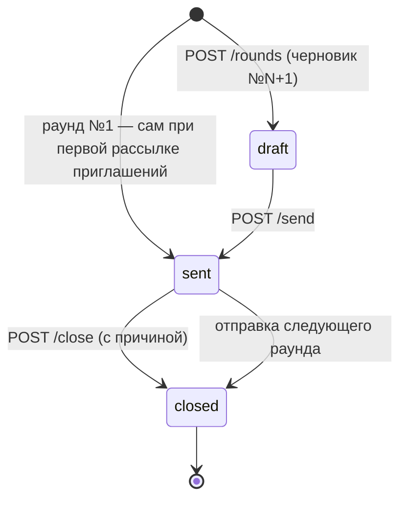

# API: раунды, версии ФКП и документы тендера (rounds)

Ручки карточки тендера для работы с кругами запроса КП (раунд №1 — исходный сбор, раунды №2… — переторжка/уточнение), версиями шаблона ФКП с рассылкой участникам и пакетом документов тендера. Общие соглашения (аутентификация, `Origin`, формат ошибок) — в [overview.md](overview.md); шаблоны писем раунда и ФКП — в [endpoints-settings.md](endpoints-settings.md).

Связанные разделы: бизнес-логика — [../02-business-logic/tenders-rounds.md](../02-business-logic/tenders-rounds.md); экран — [../03-screens/tender-card.md](../03-screens/tender-card.md) (вкладки «Раунды», «Документы», баннер неразосланной версии ФКП).

## Сводка

| Метод | Путь | Кратко | Доступ |
|---|---|---|---|
| GET | `/tenders/{tender_id}/rounds` | Раунды тендера с адресатами и доставкой | сотрудник с доступом к объекту тендера |
| POST | `/tenders/{tender_id}/rounds` | Получить или завести черновик следующего раунда | то же |
| PATCH | `/tenders/{tender_id}/rounds/{round_id}` | Править черновик: текст, срок, состав, приписки | то же |
| POST | `/tenders/{tender_id}/rounds/{round_id}/preview` | Предпросмотр писем и уведомлений каждому адресату | то же |
| POST | `/tenders/{tender_id}/rounds/{round_id}/send` | Разослать раунд | то же |
| POST | `/tenders/{tender_id}/rounds/{round_id}/extend-deadline` | Продлить срок идущего раунда до срока тендера | то же |
| POST | `/tenders/{tender_id}/rounds/{round_id}/close` | Закрыть идущий раунд с причиной | то же |
| POST | `/tenders/{tender_id}/rounds/{round_id}/retry-delivery` | Повторная отправка не получившим | то же |
| GET | `/tenders/{tender_id}/fkp-versions` | Версии ФКП и неразосланное уведомление | то же |
| POST | `/tenders/{tender_id}/fkp-versions/notice-preview` | Предпросмотр уведомления о правке ФКП до её применения | то же |
| POST | `/tenders/{tender_id}/fkp-versions/{version_id}/notify` | Разослать версию ФКП участникам | то же |
| GET | `/tenders/{tender_id}/documents` | Пакет документов тендера | то же |
| PATCH | `/tenders/{tender_id}/documents` | Заменить документы пакета с уведомлением участников | то же |

**Доступ — общее.** Любой вошедший пользователь, у которого объект тендера входит в доступные (гранты на портфель/объект; администратор — все). Отдельное право матрицы (`tenders.manage`) этими ручками **не** проверяется (см. открытые вопросы). Поставщику и пользователю без грантов — `403`.

| Код | Когда | `detail` |
|---|---|---|
| 401 | нет сессии | «Не авторизован» |
| 404 | тендера нет | «Тендер не найден» |
| 403 | объект тендера не доступен | «Нет доступа к тендерам этого проекта» |
| 404 | раунда нет или он другого тендера | «Раунд не найден» |

Сложность блока: **L** (рассылка с предпросмотром и учётом доставки — M; версии ФКП — M; документы — S).

### Модель раунда



| Статус | Подпись (`status_label`) | Смысл |
|---|---|---|
| `draft` | Черновик | собирается; контрагентам не виден; один на тендер |
| `sent` | В процессе | разослан, идёт сбор ответов; один на тендер |
| `closed` | Завершён | закрыт вручную или следующим раундом |

- **Раунд №1** заводится автоматически (статус `sent`, без текста) при первой рассылке приглашений, а также при первом чтении списка раундов, если у тендера есть приглашения, а раундов нет.
- **Состав** — действующие (не отозванные) приглашения тендера на момент заведения черновика; доприглашённые позже встают и в идущий раунд, и в черновик; отозванный удаляется из черновика.
- **Текст адресату** = общий текст раунда (`message_all`) + личная приписка адресата (`personal_comment`), через пустую строку. Переменные текста: `{тендер}` → «название» (номер), `{срок}` → «ДД.ММ.ГГГГ ЧЧ:ММ (МСК)» или «не указан», `{контрагент}` → название контрагента. Шаблон общего текста по умолчанию: «Просим подать уточнённое коммерческое предложение по тендеру. Форма предзаполнена вашими предыдущими значениями — измените только то, что нужно.»
- **Напоминание неподавшему.** Начиная с раунда №2, адресату без поданного КП (статусы `submitted`, `revision_requested`, `accepted`) текст предваряется фразой «Напоминаем: вы ещё не подали коммерческое предложение по этому тендеру.»
- **Письмо** собирается по шаблону `round` (тема по умолчанию «Раунд №{раунд} — {номер}», ссылка на форму подачи КП по токену приглашения); **уведомление в ЛК** — «Раунд №N: запрошено уточнение КП» / ««название»: <первые 180 символов текста>».
- **Доставка адресату:** `sent` «Отправлено» — письмо принято почтовым сервером; `failed` «Не удалось отправить» — с причиной («Почта выключена», «Почта выключена в настройках», «Почтовый сервер не настроен», «Нет адреса», «Приглашение отозвано — ссылки на форму нет» и т. п.); `unknown` «Нет данных». Доставку в ящик и прочтение система не отслеживает.
- **Стадия участия адресата** (`stage_label`): «отправлено» → «доставлено» (открыл ссылку) → «заполняет» → «подано» / «подано повторно» (версия КП > 1).

### Объект `Round`

| Поле | Тип | Смысл |
|---|---|---|
| `id`, `tender_id`, `round_number` | integer | |
| `status` / `status_label` | string | см. таблицу статусов |
| `message_all` | string \| null | общий текст |
| `deadline_at` | string \| null | срок ответа, ISO 8601 |
| `created_by` / `author_name` | integer / string \| null | кто завёл |
| `sent_at`, `created_at`, `updated_at`, `closed_at` | string \| null | ISO 8601 |
| `closed_by_name` / `close_reason` | string \| null | кто и почему закрыл вручную |
| `overdue` | boolean | раунд `sent`, и срок прошёл |
| `elapsed_label` | string \| null | для `sent`: «идёт N-й день» |
| `recipients_total` / `recipients_responded` | integer | включённых адресатов / из них ответили |
| `delivery_counts` | object \| null | `{sent, failed, unknown}` по включённым; у черновика `null` |
| `recipients` | `Recipient[]` | адресаты |

`Recipient`: `id`, `supplier_id`, `supplier_name`, `supplier_status` (общий статус контрагента), `included`, `personal_comment`, `delivered_at`, `delivery_error`, `delivery_state` / `delivery_label` (у черновика `null`), `mail_problem` (только у черновика: почему письмо не уйдёт — почта не работает или проблема адреса; иначе `null`), `responded_at`, `quote_version_id` / `quote_version_number` (какой версией КП ответил в этом раунде), и — если у тендера есть черновик раунда — `stage_label`, `quote_total` (итог текущей версии КП, тот же расчёт, что в СТ), `has_quote`, `missing_prices` (позиций без цены), `quote_complete`.

---

### GET /tenders/{tender_id}/rounds

**Назначение.** История раундов тендера: черновик сверху, затем по убыванию номера. У завершённого/отменённого тендера черновик не показывается.

**Доступ.** См. общее.

**Параметры пути.** `tender_id` — integer.

**Ответ `200`:** `{"items": Round[]}`.

**Ошибки.** См. общее.

**Пример (сокращён).**

```json
{"items": [{"id": 86, "tender_id": 100, "round_number": 2, "status": "sent", "status_label": "В процессе",
  "message_all": "Просим пересмотреть стоимость профильной системы и стеклопакетов.",
  "deadline_at": "2026-10-01T15:00:00+00:00", "created_by": 2, "author_name": "Петров Пётр Петрович",
  "sent_at": "2026-09-24T08:00:00+00:00", "closed_at": null, "closed_by_name": null, "close_reason": null,
  "overdue": true, "elapsed_label": "идёт 22-й день", "recipients_total": 5, "recipients_responded": 2,
  "delivery_counts": {"sent": 5, "failed": 0, "unknown": 0},
  "recipients": [{"id": 160, "supplier_id": 201, "supplier_name": "ООО «Альфа Фасад»", "supplier_status": "accredited",
    "included": true, "personal_comment": "Подтвердите объёмы узлов примыканий.", "delivered_at": "2026-09-24T08:01:00+00:00",
    "delivery_error": null, "delivery_state": "sent", "delivery_label": "Отправлено", "mail_problem": null,
    "responded_at": "2026-09-25T06:55:00+00:00", "quote_version_id": 234, "quote_version_number": 2}]}]}
```

**Побочные эффекты.** Если раундов нет, а действующие приглашения есть — создаётся раунд №1 (`sent`, все приглашённые).

---

### POST /tenders/{tender_id}/rounds

**Назначение.** Получить существующий черновик следующего раунда или завести новый (номер = максимальный + 1). Защищено от двойного клика блокировкой тендера.

**Доступ.** См. общее. **Тело.** Нет.

**Значения нового черновика:** `message_all` — шаблон по умолчанию; `deadline_at` — 23:59 МСК даты окончания сбора КП тендера, если она не в прошлом, иначе пусто; адресаты — все действующие приглашения, включены, без приписок.

**Ответ `201`:** `{"item": Round, "created": boolean}` (`created: false` — возвращён существующий черновик; код всё равно `201`).

**Ошибки.**

| Код | Когда | `detail` |
|---|---|---|
| 400 | тендер `closed` / `cancelled` | «Тендер в статусе «Завершён» — новый раунд невозможен» (подставляется подпись статуса) |
| 400 | нет действующих приглашений | «Сначала пригласите участников — без адресатов раунд завести нельзя» |
| 401 / 403 / 404 | см. общее | |

**Пример.** `POST /api/tenders/100/rounds` → `201 {"item": {"id": 87, "round_number": 3, "status": "draft", "status_label": "Черновик", …}, "created": true}`

**Побочные эффекты.** При необходимости — раунд №1 (см. выше); черновик и строки адресатов.

---

### PATCH /tenders/{tender_id}/rounds/{round_id}

**Назначение.** Править черновик: общий текст, срок, включение адресатов и личные приписки. Передаются только меняемые поля.

**Доступ.** См. общее.

**Параметры пути.** `tender_id`, `round_id`.

**Тело запроса** (`application/json`, без строгой схемы):

| Поле | Тип | Обяз. | Ограничения / смысл |
|---|---|---|---|
| `message_all` | string \| null | нет | ≤ 4000 символов после обрезки; пусто → `null`; допускает переменные `{тендер}`, `{срок}`, `{контрагент}` |
| `deadline_at` | string \| null | нет | ISO 8601 (`Z` допустим); пусто/`null` — без срока |
| `recipients` | array | нет | правки адресатов; элементы без `supplier_id` игнорируются |
| `recipients[].supplier_id` | integer | да | контрагент; новый адресат добавляется, только если у него действующее приглашение, иначе молча пропускается |
| `recipients[].included` | boolean | нет | включить/исключить |
| `recipients[].personal_comment` | string \| null | нет | ≤ 4000; пусто → `null` |

**Ответ `200`:** `{"item": Round}`.

**Ошибки.**

| Код | Когда | `detail` |
|---|---|---|
| 400 | тендер завершён/отменён | «Тендер в статусе «…» — новый раунд невозможен» |
| 400 | раунд не черновик | «Редактировать можно только черновик» |
| 400 | текст длиннее 4000 | «Сообщение длиннее 4000 символов» |
| 400 | дата не разбирается | «Некорректный дедлайн раунда» |
| 401 / 403 / 404 | см. общее | |

**Пример.**

```json
{"message_all": "Просим уточнить цены по разделу «Электроснабжение» до {срок}.",
 "deadline_at": "2026-10-20T15:00:00Z",
 "recipients": [{"supplier_id": 205, "included": false},
                {"supplier_id": 201, "personal_comment": "Отдельно подтвердите срок поставки профиля."}]}
```

**Побочные эффекты.** Нет (кроме сохранения черновика).

---

### POST /tenders/{tender_id}/rounds/{round_id}/preview

**Назначение.** Показать ровно то, что уйдёт: письмо и уведомление каждому выбранному адресату, и кто письма не получит — с причиной. Ничего не сохраняет. Работает для раунда в любом статусе.

**Доступ.** См. общее. **Тело.** Нет.

**Ответ `200`:**

| Поле | Тип | Смысл |
|---|---|---|
| `round` | Round | раунд |
| `previews` | array | по адресату: `{supplier_id, supplier_name, included, message (итоговый текст с подставленными переменными и напоминанием), mail_subject, mail_body, notice_title, notice_body, outcome, reason}` |
| `summary` | object | `{total, selected, mail, cabinet_only, excluded}` |

`outcome`: `mail` — уйдёт письмо и уведомление; `cabinet_only` — только уведомление в ЛК, `reason` — почему без письма (почта не работает, нет/не принимается адрес); `excluded` — не уйдёт ничего: «Не выбран» или «Приглашение отозвано — ссылки на форму нет».

**Ошибки.** См. общее.

**Пример.**

```json
{"round": {"id": 87, "round_number": 3, "status": "draft", …},
 "previews": [{"supplier_id": 201, "supplier_name": "ООО «Альфа Фасад»", "included": true,
   "message": "Просим подать уточнённое коммерческое предложение по тендеру…",
   "mail_subject": "Раунд №3 — T-2026-100",
   "mail_body": "Здравствуйте!\n\nПо тендеру «…» открыт раунд №3.\nСрок ответа: 06.10.2026 23:59 (МСК).\n\n…\n\nОткрыть форму: https://app.example.com/fill/<токен>\n",
   "notice_title": "Раунд №3: запрошено уточнение КП", "notice_body": "«…»: Просим подать…",
   "outcome": "cabinet_only", "reason": "Почтовый сервер не настроен"}],
 "summary": {"total": 7, "selected": 7, "mail": 0, "cabinet_only": 7, "excluded": 0}}
```

**Побочные эффекты.** Нет.

---

### POST /tenders/{tender_id}/rounds/{round_id}/send

**Назначение.** Разослать черновик: раунд становится «В процессе», предыдущий идущий раунд закрывается, каждому включённому адресату — уведомление в ЛК и письмо.

**Доступ.** См. общее. **Тело.** Нет.

**Ответ `200`:** `{"item": Round, "delivered": integer, "failed": integer}` — писем принято сервером / не отправлено.

**Ошибки.**

| Код | Когда | `detail` |
|---|---|---|
| 400 | раунд не черновик | «Отправить можно только черновик» |
| 400 | тендер завершён/отменён | «Тендер в статусе «…» — рассылка раунда невозможна» |
| 400 | срок в прошлом | «Срок ответа уже прошёл — выберите другой» |
| 400 | нет включённых адресатов | «Выберите хотя бы одного адресата раунда» |
| 400 | у кого-то пустой итоговый текст | «Пустое сообщение для: «Название 1», «Название 2». Напишите общий текст или приписку» |
| 401 / 403 / 404 | см. общее | |

**Пример.** `POST /api/tenders/100/rounds/87/send` → `{"item": {"id": 87, "status": "sent", "status_label": "В процессе", "sent_at": "2026-10-15T08:30:00+00:00", "delivery_counts": {"sent": 6, "failed": 1, "unknown": 0}, …}, "delivered": 6, "failed": 1}`

**Побочные эффекты.**
- предыдущие раунды в статусе `sent` → `closed` (с `closed_at`, без причины);
- каждому включённому адресату: уведомление в ЛК (вид `revision`, ссылка на вкладку тендеров кабинета) и письмо по шаблону `round` с ссылкой на форму; результат — в `delivered_at` / `delivery_error`; отозванное приглашение — сбой «Приглашение отозвано — ссылки на форму нет», письмо не уходит;
- письмо отправляется синхронно в запросе (время ответа растёт с числом адресатов);
- лента активности тендера: `round_invited` на каждого адресата (видна и контрагенту) и итоговая `round_sent` (`recipients`, `excluded`, `delivered`, `failed`).

---

### POST /tenders/{tender_id}/rounds/{round_id}/extend-deadline

**Назначение.** Продлить срок идущего раунда до конца дня окончания сбора КП тендера (23:59 МСК) и сообщить адресатам. Срок разосланного раунда молча не меняется — только этой ручкой и только вместе с уведомлением.

**Доступ.** См. общее. **Тело.** Нет (новый срок берётся из тендера; чтобы задать другой, сначала меняют срок тендера).

**Ответ `200`:** `{"item": Round, "notified": integer}` — скольким адресатам отправлено уведомление.

**Ошибки.**

| Код | Когда | `detail` |
|---|---|---|
| 400 | тендер завершён/отменён | «Тендер в статусе «…» — новый раунд невозможен» |
| 400 | раунд не идущий | «Продлить можно только идущий раунд» |
| 400 | у тендера нет срока | «У тендера не задан срок сбора КП» |
| 400 | срок тендера в прошлом | «Срок сбора КП тендера уже прошёл — сначала измените его в окне «Изменить тендер»» |
| 400 | новый срок не позже текущего | «Срок тендера не позже дедлайна раунда — продлевать нечего» |
| 401 / 403 / 404 | см. общее | |

**Пример.** → `{"item": {"id": 86, "deadline_at": "2026-10-31T20:59:00+00:00", "overdue": false, …}, "notified": 5}`

**Побочные эффекты.** Адресатам (включённым, с действующим приглашением, кроме отказавшихся от участия): уведомление в ЛК «Раунд №N: срок подачи КП продлён» / ««название»: подать КП можно до ДД.ММ.ГГГГ.» и письмо «Срок продлён — раунд №N, <номер тендера>» со ссылкой на форму; сбой одного письма не отменяет остальные. Лента активности: `round_deadline_extended` (`from`, `to`, `notified`).

---

### POST /tenders/{tender_id}/rounds/{round_id}/close

**Назначение.** Закрыть идущий раунд, не начиная следующего. Причина обязательна — это след в истории.

**Доступ.** См. общее.

**Тело запроса:**

| Поле | Тип | Обяз. | Ограничения |
|---|---|---|---|
| `reason` | string | да | не пустая после обрезки, ≤ 500 символов |

**Ответ `200`:** `{"item": Round}` (`status: closed`, `closed_by_name`, `close_reason`).

**Ошибки.**

| Код | Когда | `detail` |
|---|---|---|
| 400 | раунд не идущий | «Закрыть можно только идущий раунд» |
| 400 | нет причины | «Укажите причину закрытия раунда» |
| 400 | причина > 500 | «Причина длиннее 500 символов» |
| 401 / 403 / 404 | см. общее | |

**Пример.** `{"reason": "Получены ответы от всех ключевых участников"}`

**Побочные эффекты.** Лента активности: `round_closed` (номер, причина). Контрагентам ничего не отправляется. После закрытия доприглашённые попадают в черновик следующего раунда.

---

### POST /tenders/{tender_id}/rounds/{round_id}/retry-delivery

**Назначение.** Повторно отправить письмо и уведомление: выбранным адресатам или, без выбора, всем включённым, кому отправить не удалось.

**Доступ.** См. общее.

**Тело запроса** (необязательное):

| Поле | Тип | Смысл |
|---|---|---|
| `supplier_ids` | integer[] | кому повторить (среди включённых); пусто/нет — всем с ошибкой доставки |

**Ответ `200`:** `{"item": Round, "retried": integer, "delivered": integer, "failed": integer}`.

**Ошибки.** 400 «Повторная отправка доступна после отправки раунда» (раунд — черновик); 401 / 403 / 404.

**Пример.** `{"supplier_ids": [204]}` → `{"item": {…}, "retried": 1, "delivered": 1, "failed": 0}`

**Побочные эффекты.** Как у отправки для каждого адресата (уведомление в ЛК повторяется, письмо), обновление `delivered_at`/`delivery_error`. Лента активности не пишется.

---

### GET /tenders/{tender_id}/fkp-versions

**Назначение.** Версии шаблона ФКП тендера (каждая правка структуры — новая версия со снимком), номер актуальной и, если есть версии, о которых участники ещё не знают, — готовое уведомление для баннера «Есть неразосланная версия ФКП».

**Доступ.** См. общее.

**Ответ `200`:**

| Поле | Тип | Смысл |
|---|---|---|
| `items` | array | версии от новой к старой: `{id, tender_id, version_number, author_id, change_summary, notified_at, created_at}` |
| `latest` | object \| null | последняя версия + `snapshot`: `{sections[{id, name, code, parent_section_id, order_index}], items[{id, section_id, name, unit, quantity, is_removed, is_corrected, order_index}], condition_fields[{id, field_name, field_type, order_index}]}` (позиции — вместе со снятыми) |
| `current_version_number` | integer \| null | номер последней версии |
| `pending_notice` | object \| null | неразосланное: `{version_id (самая новая неразосланная), versions: [номера], version_number, summary (сводка изменений всех неразосланных версий), recipients, without_mail[{supplier_name, reason}], mail_subject, mail_body, notice_title, notice_body}` |

Версия «Разделы пересобраны по файлу ФКП» (пересборка оглавления без изменения позиций и объёмов) считается «тихой»: не рассылается, не делает поданные КП устаревшими и в `pending_notice` не попадает.

**Ошибки.** См. общее.

**Пример.** → `{"items": [{"id": 1, "tender_id": 100, "version_number": 1, "author_id": 1, "change_summary": "Разделы пересобраны по файлу ФКП", "notified_at": null, "created_at": "2026-10-02T13:32:35+00:00"}], "latest": {…, "snapshot": {…}}, "current_version_number": 1, "pending_notice": null}`

**Побочные эффекты.** Нет.

---

### POST /tenders/{tender_id}/fkp-versions/notice-preview

**Назначение.** Предпросмотр уведомления участникам **до** применения правки ФКП (последний шаг окна корректировки). Сводка собирается так же, как при записи версии, вместе с ещё не разосланными версиями — «разослать сейчас» отправит их одним письмом.

**Доступ.** См. общее.

**Тело запроса** (все поля необязательны; нечисловые и отрицательные значения считаются 0):

| Поле | Тип | Смысл |
|---|---|---|
| `added_sections` | integer | сколько разделов добавляется |
| `added_items` | integer | сколько позиций добавляется |
| `qty_changed` | integer | у скольких позиций меняется объём |
| `removed` | integer | сколько позиций снимается |

Номер будущей версии = последний номер + число частей правки (добавление и «объёмы/снятие» записываются отдельными версиями, минимум 1).

**Ответ `200`:** `{version_number, summary, recipients, without_mail[{supplier_name, reason}], mail_subject, mail_body, notice_title, notice_body}`. Письмо собирается по шаблону `fkp_notice` на примере первого адресата (у остальных отличается только ссылка). Сводка: «разделов +N; позиций +N; изменён объём: N; снято позиций: N» (только ненулевые части; пусто — «Обновление структуры ФКП»). Адресаты — приглашения в статусах «приглашён», «открыл», «заполняет», «подал».

**Ошибки.** См. общее.

**Пример.** `{"added_items": 3, "qty_changed": 2}` → `{"version_number": 3, "summary": "позиций +3; изменён объём: 2", "recipients": 7, "without_mail": [{"supplier_name": "ООО «Альфа Фасад»", "reason": "Почтовый сервер не настроен"}], "mail_subject": "Обновлён шаблон ФКП (v3) — T-2026-100", "mail_body": "Здравствуйте!\n\nВ тендере «…» вышла версия ФКП №3.\nИзменения: позиций +3; изменён объём: 2\n\nПроверьте и при необходимости обновите КП: https://app.example.com/fill/<токен>\n", "notice_title": "Обновлён шаблон ФКП (v3)", "notice_body": "«…»: позиций +3; изменён объём: 2. Обновите КП при необходимости."}`

**Побочные эффекты.** Нет.

---

### POST /tenders/{tender_id}/fkp-versions/{version_id}/notify

**Назначение.** Разослать версию ФКП участникам. Все неразосланные версии до неё уходят тем же уведомлением — участник получает одно письмо со всеми изменениями.

**Доступ.** См. общее.

**Параметры пути.** `tender_id`, `version_id`. **Тело.** Нет.

**Ответ `200`:** `{"item": FkpVersion, "notified": integer}` — писем, принятых почтовым сервером.

**Ошибки.** 404 «Версия ФКП не найдена» (нет или другого тендера); 401 / 403 / 404.

**Пример.** `POST /api/tenders/100/fkp-versions/3/notify` → `{"item": {"id": 3, "version_number": 3, "change_summary": "позиций +3", "notified_at": "2026-10-15T09:00:00+00:00", …}, "notified": 6}`

**Побочные эффекты.** Каждому адресату (приглашения «приглашён/открыл/заполняет/подал»): уведомление в ЛК «Обновлён шаблон ФКП (vN)» и письмо по шаблону `fkp_notice`; у всех охваченных версий ставится `notified_at`; лента активности `fkp_version_notified` (`version_number`, `versions`, `notified`). Повторная рассылка уже разосланной версии допускается.

---

### GET /tenders/{tender_id}/documents

**Назначение.** Пакет документов тендера, который видит и контрагент (на форме подачи КП).

**Доступ.** См. общее.

**Ответ `200`:** `{"items": [Slot]}` — ровно 6 слотов в фиксированном порядке:

| `key` | `label` | `kind` | Источник | `editable` |
|---|---|---|---|---|
| `rd_url` | Рабочая документация (РД) | `url` | ссылка | да |
| `tz_file` | Техническое задание | `file` | вложение тендера | да |
| `smr_contract_file` | Шаблон типового договора СМР | `file` | вложение тендера | да |
| `surety_file` | Договор личного поручительства | `file` | вложение тендера | да |
| `fkp_template` | Шаблон ФКП | `file` | исходный Excel, из которого создан тендер | нет |
| `offer_form` | Форма оферты / КП | `offer` | ссылка на форму (только в пакете для контрагента) | нет |

`Slot`: `{key, label, kind, present, url, attachment: {id, name, size, content_type, uploaded_at} | null, href, editable}`. Для сотрудника `offer_form.present = false`, `href = null`.

**Ошибки.** См. общее.

**Пример.** → `{"items": [{"key": "rd_url", "label": "Рабочая документация (РД)", "kind": "url", "present": false, "url": null, "attachment": null, "href": null, "editable": true}, {"key": "fkp_template", "label": "Шаблон ФКП", "kind": "file", "present": true, "url": null, "attachment": {"id": 225, "name": "ФКП витражи.xlsx", "size": 173680, "content_type": "application/vnd.openxmlformats-officedocument.spreadsheetml.sheet", "uploaded_at": "2026-08-20T07:05:00+00:00"}, "href": null, "editable": false}, …]}`

**Побочные эффекты.** Нет.

---

### PATCH /tenders/{tender_id}/documents

**Назначение.** Заменить документы пакета (ссылку на РД и файлы) и по умолчанию уведомить участников. Файл предварительно загружается общей ручкой файлов как вложение тендера.

**Доступ.** См. общее.

**Тело запроса** (`application/json`, частичное, без строгой схемы):

| Поле (синонимы) | Тип | Смысл |
|---|---|---|
| `rd_url` (`doc_rd_url`) | string \| null | ссылка на РД; пусто — убрать |
| `tz_file` (`tz_attachment_id`, `doc_tz_attachment_id`) | integer \| null | id вложения ТЗ; `null`/`""`/0 — убрать |
| `smr_contract_file` (`smr_attachment_id`, `doc_smr_attachment_id`) | integer \| null | договор СМР |
| `surety_file` (`surety_attachment_id`, `doc_surety_attachment_id`) | integer \| null | договор поручительства |
| `notify` | boolean | уведомить участников о замене; по умолчанию `true` |

Вложение обязано принадлежать этому тендеру. Слот «Шаблон ФКП» через эту ручку не меняется.

**Ответ `200`:** `{"item": {"items": [Slot]}, "changed": [подписи изменённых слотов], "notified": integer}`.

**Ошибки.**

| Код | Когда | `detail` |
|---|---|---|
| 400 | вложение не найдено или чужое | «Вложение <id> не принадлежит тендеру» |
| 401 / 403 / 404 | см. общее | |

Нечисловой id вложения сервером отдельно не валидируется (см. открытые вопросы).

**Пример.** `{"tz_file": 951, "notify": true}` → `{"item": {"items": [ … ]}, "changed": ["Техническое задание"], "notified": 6}`

**Побочные эффекты.** Если что-то изменилось и `notify ≠ false` — по каждому изменённому слоту участникам (приглашения «приглашён/открыл/заполняет/подал»): уведомление в ЛК «Обновлён документ тендера» / ««название»: заменён «<слот>».» и письмо «Обновлён документ — <номер тендера>» со ссылкой на форму; `notified` — число адресатов с e-mail (по всем слотам). Лента активности `documents_updated` (`slots`, `notified`). Сменить срок или статус тендера эта ручка не может.
