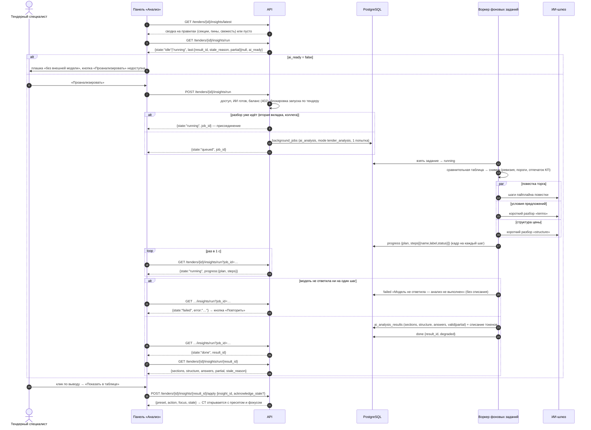

# API: ИИ-анализ тендера (insights)

Ручки панели «Анализ» в карточке тендера: сводка и сценарии разбора на правилах (без модели), разбор тендера по нажатию «Проанализировать» фоновым заданием (повестка торга, условия предложений, структура цены), разбор пары финалистов, черновик письма поставщику, короткие вопросы по таблице и ветки разговора специалиста с ИИ, последний разбор, история и переход из вывода в сравнительную таблицу. Все пути — `/tenders/{tender_id}/insights*`. ИИ-сопоставление строк КП с позициями — в [endpoints-quotes.md](endpoints-quotes.md). Общие соглашения — [overview.md](overview.md); оглавление раздела — [endpoints-tenders.md](endpoints-tenders.md).

Связанные разделы: бизнес-логика — [../02-business-logic/insights.md](../02-business-logic/insights.md), [../02-business-logic/tenders-comparison.md](../02-business-logic/tenders-comparison.md) (метрики, на которых стоят выводы); ИИ-пайплайны, промпты и проверка ответов — [../06-ai/](../06-ai/); экран — [../03-screens/tender-card.md](../03-screens/tender-card.md) (вкладка «Анализ»); биллинг ИИ — [endpoints-billing.md](endpoints-billing.md).

Сложность блока: **XL** вместе с пайплайнами (повестка торга, сверка чисел ответа с таблицей, адаптер контракта); сами ручки — **L**: фоновые задания с ходом прогона в БД, присоединение к идущему разбору, кэш коротких разборов, ветки разговора, свежесть результата и переход в таблицу.

## Сводка

| Метод | Путь | Кратко | Доступ |
|---|---|---|---|
| POST | `/tenders/{tender_id}/insights` | Сводка / сценарий разбора на правилах (с сохранением) | «Цены» + доступ к объекту |
| GET | `/tenders/{tender_id}/insights` | То же, GET-вариант | то же |
| GET | `/tenders/{tender_id}/insights/run` | Статус разбора тендера (идёт ли, прошлый результат) | то же |
| POST | `/tenders/{tender_id}/insights/run` | «Проанализировать» — поставить разбор | то же |
| GET | `/tenders/{tender_id}/insights/run/{result_id}` | Готовый разбор целиком | то же |
| POST | `/tenders/{tender_id}/insights/pair` | Запустить разбор пары финалистов | то же |
| GET | `/tenders/{tender_id}/insights/pair` | Последний разбор пары и ход прогона | то же |
| POST | `/tenders/{tender_id}/insights/letter` | Черновик письма поставщику (не отправляется) | то же |
| POST | `/tenders/{tender_id}/insights/ask` | Короткий разбор: структура цены, условия, вопрос, ячейка | то же |
| GET | `/tenders/{tender_id}/insights/chats` | Мои разговоры с ИИ по тендеру | то же |
| GET | `/tenders/{tender_id}/insights/chat` | Реплики разговора | то же |
| DELETE | `/tenders/{tender_id}/insights/chat` | Удалить разговор или все свои | то же |
| GET | `/tenders/{tender_id}/insights/latest` | Последняя сохранённая сводка (по раунду) | то же |
| GET | `/tenders/{tender_id}/insights/history` | История разборов | то же |
| POST | `/tenders/{tender_id}/insights/{result_id}/apply` | Переход из вывода в сравнительную таблицу | то же |

**Доступ — общее.**

- Гейт **«Цены»** (overview §3): ответ целиком о ценах, поэтому маскирование не применяется — без права 403 «Нет прав на финансовые данные — обратитесь к администратору системы».
- Затем **доступ к объекту** тендера: нет тендера — 404 «Тендер не найден»; объект не выдан — 403 «Нет доступа к тендерам этого проекта».
- `GET/POST /insights` входят в лимит `heavy-read` на пользователя (overview §12) → 429.
- Модель вызывается только при `AI_ENABLED=true` и заданном `AI_API_KEY` («ИИ готов»). Каждый вызов модели — ИИ-операция биллинга (`tender_analysis`, `pair_analysis`, `supplier_letter`, `table_question`); при исчерпанном балансе и блокировке при нуле — **402** `tokens_exhausted` на запуске.
- Вывод ИИ — **только рекомендация**: ни одна ручка не выбирает победителя, не меняет данные тендера и ничего не отправляет поставщику. Ответ модели, чьи числа не сошлись с таблицей, наружу не выходит (заменяется расчётом на правилах или пометкой).

**Деградация без ИИ.** Без модели работают: сводка и сценарии на правилах (`/insights`, `latest`, `history`, `apply`); статус разбора отвечает `ai_ready: false`; запуск разбора — 409 «ИИ-анализ не настроен»; короткие разборы и письмо возвращают расчёт/шаблон с пометкой (`written_by: rules`/`none`, `notice` — например «Модель не ответила — показан расчёт»). Поле `llm_enabled: false` и текст `llm_reason` «Сейчас без внешней модели: выводы считаются на сервере по цифрам таблицы. Данные КП в модель не передаются — штатный режим до утверждения контура.» интерфейс показывает плашкой.

## Последовательность: разбор тендера по нажатию

Пояснения к шагам:

1–4. Панель сразу показывает последнюю сводку на правилах и статус: идёт ли разбор тендера (чей угодно — разбор общий) и есть ли готовый разбор текущего раунда с причиной устаревания (`stale_reason`: «После разбора поставщик прислал новое КП» или «После разбора изменились позиции или объёмы тендера»).
5–6. Без готового ИИ запуск недоступен — остаётся сводка на правилах (деградация).
7–12. Запуск идемпотентен: блокировка по тендеру до постановки задания, второе нажатие получает идущее задание. Разбор — одна попытка: решение о повторе принимает человек.
13–17. Задание строит сравнительную таблицу и неизменяемый снимок (ревизия тендера, версия формул, пороги, отпечаток КП), затем параллельно запускает повестку торга и два коротких разбора. Ход прогона пишется в строку задания (а не в память процесса) — статус одинаков в любом процессе API.
18–20. Клиент опрашивает статус раз в секунду; `progress` — план шагов и их состояния (`running`, `ok`, `failed`, `skipped`).
21–24. Если модель не ответила ни на один шаг — «Анализ не выполнен», операция закрывается неуспешной, списания нет. Если часть коротких разборов упала — результат сохраняется со статусом `partial` и пометкой «Часть пояснений ИИ не получена».
25–30. Готовый результат читается по `result_id`.
31–33. Переход в таблицу проверяет свежесть сохранённого разбора; устаревший требует явного подтверждения.

## Общие объекты

**Вывод (`Insight`)** — элемент `items[]` сводок: `id`, `type` (`warn`/`info`/…), `icon`, `title`, `text`, `reason`, `next_action`, `caveat` («Цифры из расчётного слоя, не обещание скидки и не выбор победителя.»), `work_ids`, `contractor_ids` / `supplier_ids`, `preset` (пресет СТ), `filters`, `evidence[]` (`{work_id, contractor_id, metric, value}` — числа, на которых стоит вывод), `table_transition` (`{action, preset, focus}`; `action` ∈ `apply_preset`, `add_metric`, `focus`).

**Секция панели (`Section`)** — `id`, `title`, `kind`, `teaser`, `collapsed`, `blocks[]` (`id`, `title`, `paragraphs[].segments[]` — текст и «токены» с `label`, `work_ids`, `supplier_ids`, `preset`, `filters`, `entity`), `work_ids`, `supplier_ids`, `preset`, `filters`, `insight_ref`, `screen`, `signal`.

**Свежесть (`freshness`)** — `{status, reason, transition_allowed}`: `current`; `partial` («Пороги изменились. Старый вывод читаем, теги в таблице — по новым порогам.»); `stale` («С момента предыдущего анализа были изменения (например, поставщик прислал новое КП). Ревизия N → M. Текст сохранён — пересчитайте разбор.», «Сменилась версия формул. Пересчитайте анализ.», «Старый переход не мигрируется — текст читаем, клик в таблицу заблокирован до пересчёта.» — тогда `transition_allowed: false`).

**Сохранённый разбор (`AnalysisRow`)** — в `latest`/`history`: `items`, `summary`, `summary_pins[]` (`{section_id, title, teaser}`), `sections`, `disclaimer` («Результат ИИ-разбора. Решение принимает тендерный специалист.»), `structured`, `source` (`rules`/`llm`), `mode`/`scenario`, `scenario_label`, `result_id`, `created_at`, `tender_revision`, `formula_version`, `ai_contract_version`, `thresholds` (пороги аналитики), `validation_status` (`valid`/`partial`/`invalid`), `freshness`, `transition_allowed`, `round_id`, `round_number`, `round_status`, `round_is_current`, `round_label`, `rounds` (переключатель раундов: `{id, round_id, round_number, status, is_current, label}`), `llm_enabled`, `llm_reason`.

**Сценарии разбора на правилах** (`scenario`): `tender_summary` «Анализ тендера», `important` «Что важно», `bidding` «Точки торгов», `compare` «Сравнить подрядчиков», `breakdown` «Разобрать подрядчика», `why_expensive` «Почему дороже», `why_cheaper` «Почему дешевле», `anomalies` «Риски и аномалии», `rounds` «Сравнить раунды», `selection` «Анализировать выбранное».

---

### POST /tenders/{tender_id}/insights

**Назначение.** Посчитать сводку или сценарий разбора **на правилах** (детерминированно, без модели) по текущей сравнительной таблице и сохранить результат. Для сводки (`tender_summary`) к секциям правил первыми добавляются секции последней повестки торга (если она посчитана при той же ревизии).

**Доступ.** «Цены» + доступ к объекту; лимит `heavy-read`.

**Параметры запроса:**

| Параметр | Тип | По умолчанию | Смысл |
|---|---|---|---|
| `mode` | string | `positions` | `positions`, `rounds`, `selection`; задаёт сценарий по умолчанию (`tender_summary`, `rounds`, `selection`) |
| `scenario` | string | — | сценарий из списка выше |
| `supplier_ids` | string | — | срез участников, id через запятую |
| `work_ids` | string | — | выбранные позиции, id через запятую |
| `round_id` | integer | текущий | раунд: для прошлого раунда берутся версии КП на тот момент |

**Тело запроса.** Нет.

**Ответ `200`:** `AnalysisRow` текущего расчёта + `supplier_ids`, `work_ids`, `agenda_dropped`, `agenda_notices` (для сводки с повесткой). `round_is_current` всегда `true`.

**Ошибки.** 400 «Неизвестный вид анализа» (`mode`); 400 «Неизвестный сценарий анализа»; 403/404 — общие; 429.

**Пример.** `POST /tenders/100/insights?scenario=bidding` → `{"items": [{"id": "finding-1", "type": "warn", "title": "Точки торгов", "work_ids": [3106], "supplier_ids": [203, 206], "preset": "bidding", "evidence": [{"work_id": 3106, "contractor_id": 203, "metric": "negotiation_potential", "value": "10849877.640"}]}], "summary": "…", "source": "rules", "scenario": "bidding", "scenario_label": "Точки торгов", "result_id": 31, "validation_status": "valid", "freshness": {"status": "current", "reason": null, "transition_allowed": true}, "llm_enabled": false, "llm_reason": "Сейчас без внешней модели: …"}`

**Побочные эффекты.** Строка результата анализа (снимок, пороги, ревизия, статус проверки); журнал ИБ `ai_analysis_run` (сценарий, статус проверки, число выводов, ошибок, выбранных позиций и участников, ревизия). Модель не вызывается.

---

### GET /tenders/{tender_id}/insights

**Назначение.** То же, что `POST /tenders/{tender_id}/insights` (один обработчик; GET-вариант для простых клиентов). Несмотря на метод GET, сохраняет результат и пишет журнал ИБ.

**Доступ.** «Цены» + доступ к объекту; лимит `heavy-read`.

**Параметры запроса:** как у POST (`mode`, `scenario`, `supplier_ids`, `work_ids`, `round_id`).

**Ответ `200`:** как у POST.

**Ошибки.** Как у POST.

**Пример.** `GET /tenders/100/insights?mode=positions` → `{"scenario": "tender_summary", "structured": true, "sections": [{"id": "ai_suggestions", "title": "Что стоит сделать", …}], …}`

**Побочные эффекты.** Как у POST (см. открытые вопросы — изменяющий GET).

---

### GET /tenders/{tender_id}/insights/run

**Назначение.** Лёгкий статус разбора тендера для экрана панели (без сравнения и тел результатов): идёт ли разбор и на каком шаге, есть ли прошлый разбор текущего раунда, не устарел ли он. С `job_id` — чем кончилось именно это задание.

**Доступ.** «Цены» + доступ к объекту.

**Параметры запроса:** `job_id` — string (UUID), необязателен.

**Ответ `200`:**

| Поле | Тип | Смысл |
|---|---|---|
| `state` | string | `idle` (нет задания), `queued`, `running`, `done`, `failed` (в т. ч. отменено) |
| `job_id` | string \| null | |
| `progress` | object \| null | только при `running`: `{plan: [{name, label}], steps: [{name, label, status}]}`; шаги коротких разборов — «Сравниваю условия предложений» (`terms`), «Объясняю, из чего собрана цена» (`structure`) |
| `result_id` | integer \| null | при `done` |
| `error` | string \| null | при `failed` (по умолчанию «Анализ не выполнен») |
| `last` | object \| null | последний разбор текущего раунда: `{result_id, created_at, stale_reason, partial}` |
| `ai_ready` | boolean | можно ли запускать разбор |

**Ошибки.** 404 «Разбор не найден» (`job_id` не UUID, чужой тендер или не разбор тендера); 403/404 — общие.

**Пример.** → `{"state": "idle", "job_id": null, "progress": null, "result_id": null, "error": null, "last": null, "ai_ready": false}`

**Побочные эффекты.** Нет.

---

### POST /tenders/{tender_id}/insights/run

**Назначение.** «Проанализировать»: поставить разбор тендера фоновым заданием. Идущий разбор не дублируется — повторное нажатие присоединяется к нему.

**Доступ.** «Цены» + доступ к объекту.

**Тело запроса.** Нет.

**Ответ `200`:** `{state, job_id, progress, result_id, error}` (как в статусе, без `last`/`ai_ready`).

**Ошибки.**

| Код | Когда | `detail` |
|---|---|---|
| 409 | ИИ не готов | «ИИ-анализ не настроен» |
| 402 | баланс токенов исчерпан | `{"code": "tokens_exhausted", "message": "…"}` |
| 403 / 404 | общие | |

**Пример.** `POST /tenders/100/insights/run` → `{"state": "queued", "job_id": "a1b2…", "progress": null, "result_id": null, "error": null}`

**Побочные эффекты.** Задание `ai_analysis` (`mode: tender_analysis`, одна попытка). При выполнении: ИИ-операция `tender_analysis` (списание по факту при успехе), строка результата (`valid` или `partial`), привязка к последнему отправленному раунду; при отсутствии ответа модели — `failed` без списания.

---

### GET /tenders/{tender_id}/insights/run/{result_id}

**Назначение.** Готовый разбор тендера целиком — для экрана результата.

**Доступ.** «Цены» + доступ к объекту.

**Параметры пути:** `tender_id`, `result_id` — integer.

**Ответ `200`:**

| Поле | Тип | Смысл |
|---|---|---|
| `result_id`, `created_at`, `round_number` | | |
| `sections` | `Section[]` | секции повестки торга («Что стоит сделать», «Из чего сложена разница» и др.) |
| `structure` | object \| null | структура результата пайплайна |
| `answers` | object | короткие разборы: `{terms?, structure?}` — тексты «Условия предложений» и «Из чего собрана цена» |
| `partial` | boolean | часть пояснений не получена |
| `stale_reason` | string \| null | почему устарел |

**Ошибки.** 404 «Разбор не найден»; общие.

**Пример.** → `{"result_id": 12, "created_at": "2026-10-14T10:00:00+00:00", "round_number": 2, "sections": [{"id": "ai_suggestions", "title": "Что стоит сделать", "teaser": "Попросить участника дозаполнить КП: 29 позиций без цены", "blocks": […]}], "answers": {"terms": {"text": "…", "written_by": "llm"}}, "partial": false, "stale_reason": null}`

**Побочные эффекты.** Нет.

---

### POST /tenders/{tender_id}/insights/pair

**Назначение.** Запустить разбор пары финалистов («Альфа против Гаммы») фоновым заданием. Порядок в паре не важен; если разбор этой пары уже идёт — возвращается он (`reused: true`).

**Доступ.** «Цены» + доступ к объекту.

**Параметры запроса:** `left`, `right` — integer, обязательны (id контрагентов).

**Ответ `200`:** статус задания (как `GET /tenders/parse-excel/jobs/{id}`: `job_id`, `status`, `attempts`, `created_at`, … ) + `reused` — boolean.

**Ошибки.** 400 «Сравнивать можно двух разных подрядчиков»; 402 `tokens_exhausted`; 422 — нет `left`/`right`; общие.

**Пример.** `POST /tenders/100/insights/pair?left=201&right=203` → `{"job_id": "c3d4…", "status": "queued", "attempts": 0, "reused": false, …}`

**Побочные эффекты.** Задание `ai_analysis` (`mode: pair_duel`, до 3 попыток с экспоненциальной паузой); ИИ-операция `pair_analysis`; строка результата пары.

---

### GET /tenders/{tender_id}/insights/pair

**Назначение.** Последний посчитанный разбор пары (при текущей ревизии) и состояние её задания; панель опрашивает его раз в секунду (до 4 мин).

**Доступ.** «Цены» + доступ к объекту.

**Параметры запроса:** `left`, `right` — integer, обязательны.

**Ответ `200`:**

| Поле | Тип | Смысл |
|---|---|---|
| `status`, `attempts`, `error` | | последнее задание этой пары (идущее или завершённое); `error` — при `failed`/`cancelled` |
| `running`, `job_id`, `progress` | | идёт ли разбор и его ход |
| `sections`, `pair` | | секции панели и данные пары |
| `comparable` | boolean | можно ли вообще сравнивать этих двоих |
| `dropped`, `degraded`, `notices`, `trace` | | сколько выводов отброшено проверкой, частичность, пометки, трасса шагов |
| `result_id`, `created_at` | | сохранённый результат |
| `llm_enabled` | boolean | |

**Ошибки.** 422; общие.

**Пример.** → `{"status": null, "attempts": 0, "error": null, "sections": [], "pair": null, "comparable": true, "dropped": 0, "degraded": false, "notices": [], "trace": null, "result_id": null, "created_at": null, "running": false, "job_id": null, "progress": null, "llm_enabled": false}`

**Побочные эффекты.** Нет.

---

### POST /tenders/{tender_id}/insights/letter

**Назначение.** Черновик письма поставщику по пунктам разбора (повестки торга) — синхронно, бюджет 90 с. **Ничего не отправляется**: текст копирует и отправляет человек из переписки с контрагентом. Если у поставщика нет пунктов повестки (например, повод — «дозаполнить КП»), письмо пишется по поводу `about`; при молчании модели — детерминированный шаблон «Уточнение по коммерческому предложению».

**Доступ.** «Цены» + доступ к объекту.

**Параметры запроса:**

| Параметр | Тип | Обяз. | Смысл |
|---|---|---|---|
| `contractor_id` | integer | да | кому пишем |
| `work_id` | integer, повторяемый | нет | позиции письма; пусто — все пункты разбора этого поставщика |
| `about` | string | нет | повод (до 300 символов используются) |

**Ответ `200`:** `{contractor, contractor_id, subject, body, written_by ("llm"|"rules"), dropped, sent: false, notices[], trace?}`.

**Ошибки.** 402 `tokens_exhausted`; 422 — нет `contractor_id`; общие.

**Пример.** `POST /tenders/100/insights/letter?contractor_id=204&about=дозаполнить 29 позиций` → `{"contractor": "ООО «Дельта Стекло»", "contractor_id": 204, "subject": "Уточнение по коммерческому предложению", "body": "Уважаемые коллеги!\n\nПросим прояснить: дозаполнить 29 позиций\n\nБудем признательны за ответ в ближайшее время.", "written_by": "rules", "dropped": 0, "sent": false, "notices": []}`

**Побочные эффекты.** ИИ-операция `supplier_letter`. Письмо не отправляется (`sent` всегда `false`).

---

### POST /tenders/{tender_id}/insights/ask

**Назначение.** Короткий разбор поверх сравнительной таблицы — синхронно, бюджет 90 с: `structure` «Из чего собрана цена», `terms` «Условия предложений», `question` — свободный вопрос, `cell` — «почему здесь так» по одной позиции. Вопрос и разбор ячейки ведутся в ветке разговора (история — на сервере, модель получает 6 последних реплик). Ответы `structure`/`terms` кэшируются по отпечатку снимка таблицы и при неизменной таблице повторно не генерируются.

**Доступ.** «Цены» + доступ к объекту.

**Параметры запроса:**

| Параметр | Тип | По умолчанию | Смысл |
|---|---|---|---|
| `mode` | string | `question` | `structure`, `terms`, `question`, `cell` |
| `q` | string | `""` | текст вопроса (для `question`/`cell`); первые 80 символов становятся названием новой ветки |
| `thread_id` | integer | — | ветка разговора; пусто — новая |
| `work_id` | integer | — | позиция для `mode=cell` (обязательна) |

**Ответ `200`:**

| Поле | Тип | Смысл |
|---|---|---|
| `mode` | string | |
| `text`, `bullets` | string / string[] | ответ |
| `action`, `subject`, `draft` | | предложенное действие (например, черновик письма) |
| `tool`, `tool_args`, `tool_target` | | действие с экраном, которое предлагает модель (выполняет интерфейс по клику человека) |
| `written_by` | string | `llm`, `rules`, `none` |
| `dropped` | integer | сколько утверждений отброшено проверкой |
| `notice` | string | почему ответа нет или что убрано: «Модель не ответила — показан расчёт», «Ответ содержал число, которого нет в таблице, — он не показан», «Не указана позиция, которую надо разобрать» и др. |
| `thread_id` | integer \| null | ветка (для `question`/`cell`) |

**Ошибки.** 400 «Неизвестный разбор: <mode>»; 404 «Разговор не найден» (чужая/нет ветки); 402 `tokens_exhausted`; общие. Отсутствие данных для разбора — не ошибка: `200` с `written_by: "none"` и `notice`.

**Пример.** `POST /tenders/100/insights/ask?mode=question&q=Почему лидер дешевле медианы?` → `{"mode": "question", "text": "…", "bullets": ["…"], "written_by": "llm", "dropped": 0, "notice": "", "thread_id": 7}`

**Побочные эффекты.** ИИ-операция `table_question` (кроме ответа из кэша); для `question`/`cell` — ветка разговора (создаётся при необходимости) и две реплики (вопрос и ответ); для `structure`/`terms` — запись кэша при ответе модели.

---

### GET /tenders/{tender_id}/insights/chats

**Назначение.** Список **своих** разговоров с ИИ по этому тендеру, свежие (по последней реплике) сверху. Чужие разговоры не видны никому, включая администратора.

**Доступ.** «Цены» + доступ к объекту.

**Ответ `200`:** `{"items": [{id, title ("Без названия" при пустом), messages (число реплик), created_at, updated_at}]}`.

**Ошибки.** Общие.

**Пример.** → `{"items": [{"id": 7, "title": "Почему лидер дешевле медианы?", "messages": 4, "created_at": "2026-10-14T10:05:00+00:00", "updated_at": "2026-10-14T10:09:00+00:00"}]}`

**Побочные эффекты.** Нет.

---

### GET /tenders/{tender_id}/insights/chat

**Назначение.** Реплики одной своей ветки по порядку. Без `thread_id` — самая свежая ветка.

**Доступ.** «Цены» + доступ к объекту.

**Параметры запроса:** `thread_id` — integer, необязателен.

**Ответ `200`:** `{"thread_id": integer|null, "title": string, "items": [{role ("user"|"bot"), text, bullets, subject, draft, tool, tool_args, notice, created_at}]}`; нет веток — `{"thread_id": null, "title": "", "items": []}`.

**Ошибки.** Общие (чужая или несуществующая ветка — пустой ответ, как «нет веток»).

**Пример.** → `{"thread_id": 7, "title": "Почему лидер дешевле медианы?", "items": [{"role": "user", "text": "Почему лидер дешевле медианы?", "bullets": [], "created_at": "…"}, {"role": "bot", "text": "…", "bullets": ["…"], "notice": "", "created_at": "…"}]}`

**Побочные эффекты.** Нет.

---

### DELETE /tenders/{tender_id}/insights/chat

**Назначение.** Удалить одну свою ветку (`thread_id`) или все свои ветки по тендеру.

**Доступ.** «Цены» + доступ к объекту.

**Параметры запроса:** `thread_id` — integer, необязателен.

**Ответ `200`:** `{"cleared": true, "thread_id": integer|null}`.

**Ошибки.** 404 «Разговор не найден» (с `thread_id`); общие.

**Пример.** `DELETE /tenders/100/insights/chat?thread_id=7` → `{"cleared": true, "thread_id": 7}`

**Побочные эффекты.** Ветка и её реплики удаляются физически.

---

### GET /tenders/{tender_id}/insights/latest

**Назначение.** Последняя сохранённая сводка (`tender_summary`) выбранного раунда — то, что панель показывает при открытии; к ней приклеиваются секции повестки торга того же прогона. Для раунда без результата — пустой ответ (результат другого раунда под его меткой не показывается); у тендера без раундов — последний результат любого вида.

**Доступ.** «Цены» + доступ к объекту.

**Параметры запроса:** `round_id` — integer, необязателен (по умолчанию текущий).

**Ответ `200`:** `AnalysisRow` (свежесть — относительно текущей ревизии и порогов); пусто — `{"items": [], "summary_pins": [], "sections": [], "freshness": null, "llm_enabled", "llm_reason", "rounds", "round_id", "round_number", "round_label", "round_is_current": true}`.

**Ошибки.** Общие.

**Пример.** → `{"source": "rules", "scenario": "tender_summary", "result_id": 9, "round_number": 2, "round_label": "текущий", "summary": "Что понятно: Бюджет −45 652 013 ₽, подали 4. …", "summary_pins": [{"section_id": "round_summary", "title": "Общая картина между раундами", "teaser": "…"}], "freshness": {"status": "stale", "reason": "С момента предыдущего анализа были изменения … Ревизия 17 → 18. …", "transition_allowed": true}, "rounds": [{"id": 75, "round_number": 1, "status": "closed", "is_current": false, "label": "раунд №1, завершён"}, {"id": 86, "round_number": 2, "status": "sent", "is_current": true, "label": "текущий"}], …}`

**Побочные эффекты.** Нет.

---

### GET /tenders/{tender_id}/insights/history

**Назначение.** История разборов. По умолчанию — актуальная сводка каждого раунда плюс до 8 прочих сохранённых разборов (сценарии, повестки прежней схемы), по номеру раунда и id по убыванию. С `full=true` — все сохранённые сводки (тендер пересчитывают несколько раз за раунд).

**Доступ.** «Цены» + доступ к объекту.

**Параметры запроса:** `full` — boolean, по умолчанию `false`.

**Ответ `200`:** `{"items": AnalysisRow[], "rounds": [...]}`.

**Ошибки.** Общие.

**Пример.** → `{"items": [{"result_id": 10, "mode": "negotiation_agenda", "scenario_label": "Повестка торга", "source": "llm", "round_number": 2, "validation_status": "valid", "freshness": {"status": "stale", …}}], "rounds": […]}`

**Побочные эффекты.** Нет.

---

### POST /tenders/{tender_id}/insights/{result_id}/apply

**Назначение.** Переход из вывода разбора в сравнительную таблицу: сервер проверяет, что результат принадлежит тендеру, свеж (или устаревание подтверждено), действие из разрешённого списка, и возвращает пресет и фокус для СТ. Идентификаторы позиций и участников, которых больше нет в таблице, вычищаются.

**Доступ.** «Цены» + доступ к объекту.

**Параметры пути:** `tender_id`, `result_id` — integer.

**Тело запроса:**

| Поле | Тип | Обяз. | Смысл |
|---|---|---|---|
| `insight_id` | string | нет | вывод; не найден/пусто — первый вывод результата |
| `acknowledge_stale` | boolean | нет | подтверждение перехода по устаревшему разбору |

**Ответ `200`:** `{"ok": true, "preset": string, "action": string|null, "focus": object, "stale": boolean}`.

**Ошибки.**

| Код | Когда | `detail` |
|---|---|---|
| 404 | результата нет или он другого тендера | «Анализ не найден» |
| 409 | переход заблокирован (контракт не мигрируется) | текст причины свежести или «Переход заблокирован до пересчёта анализа.» |
| 409 | разбор устарел, нет подтверждения | «Анализ устарел: таблица покажет текущие числа. Подтвердите переход.» |
| 400 | в результате нет выводов | «Нет вывода для перехода» |
| 400 | действие не из списка | «Действие не из allowlist» |

**Пример.** `{"insight_id": "finding-1", "acknowledge_stale": true}` → `{"ok": true, "preset": "bidding", "action": "apply_preset", "focus": {"work_ids": [3106]}, "stale": true}`

**Побочные эффекты.** Журнал ИБ `ai_analysis_transition` (`result_id`, `insight_id`, пресет, действие, подтверждено ли устаревание).
