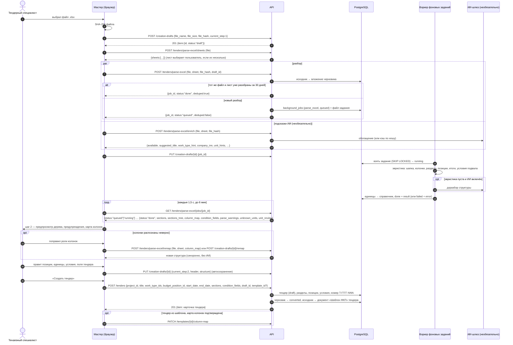

# API: импорт ФКП и черновики мастера создания тендера

Ручки шага 1–2 мастера создания тендера: список листов книги, фоновое задание распознавания Excel-ведомости (постановка, опрос, отмена), повторный разбор по подтверждённой карте колонок, ИИ-обогащение файла (подсказки названия, вида работ, заказчика, единиц), а также черновики мастера (`/creation-drafts`), которые хранят прогресс и исходный файл до создания тендера. Само создание тендера — [`POST /tenders`](endpoints-tenders.md#post-tenders). Общие соглашения — [overview.md](overview.md); оглавление раздела тендеров — [endpoints-tenders.md](endpoints-tenders.md).

Связанные разделы: бизнес-логика — [../02-business-logic/fkp-import.md](../02-business-logic/fkp-import.md) (правила распознавания), [../02-business-logic/tenders-lifecycle.md](../02-business-logic/tenders-lifecycle.md#2-создание-тендера--мастер-из-четырёх-шагов) (мастер, черновики), [../02-business-logic/tenders.md](../02-business-logic/tenders.md#7-фоновые-задачи-домена); экраны — [../03-screens/tender-create.md](../03-screens/tender-create.md), [../03-screens/templates.md](../03-screens/templates.md); ИИ и биллинг — [../06-ai/](../06-ai/), [endpoints-billing.md](endpoints-billing.md).

Сложность блока: **XL** вместе с парсером (распознавание произвольных ФКП — отдельная крупная работа, см. fkp-import.md); сами ручки — **M**: фоновая очередь с дедупликацией по хешу и повторами (M), черновики с глубоким слиянием JSON и TTL (S), ИИ-обогащение с деградацией (S).

## Сводка

| Метод | Путь | Кратко | Доступ |
|---|---|---|---|
| POST | `/tenders/parse-excel/sheets` | Имена листов книги до разбора | сотрудник |
| POST | `/tenders/parse-excel` | Поставить фоновое задание распознавания | сотрудник |
| GET | `/tenders/parse-excel/jobs/{job_id}` | Статус и результат задания | сотрудник (автор задания) |
| POST | `/tenders/parse-excel/jobs/{job_id}/cancel` | Отменить задание | сотрудник (автор) |
| POST | `/tenders/parse-excel/remap` | Синхронный повторный разбор по карте колонок | сотрудник |
| POST | `/tenders/parse-excel/enrich` | ИИ-обогащение файла (подсказки) | сотрудник |
| POST | `/creation-drafts` | Создать черновик мастера | сотрудник |
| GET | `/creation-drafts` | Список черновиков | сотрудник (свои; админ — все) |
| GET | `/creation-drafts/{draft_id}` | Черновик (с состоянием задания разбора) | автор или админ |
| PUT | `/creation-drafts/{draft_id}` | Частичное сохранение (слияние JSON) | автор или админ |
| DELETE | `/creation-drafts/{draft_id}` | Удалить черновик (`discarded`) | автор или админ |
| POST | `/creation-drafts/{draft_id}/remap` | Повторный разбор сохранённого файла по карте колонок | автор или админ |
| POST | `/creation-drafts/{draft_id}/enrich` | ИИ-обогащение по сохранённому файлу | автор или админ |

**Доступ — общее.** Гейт «сотрудник» (overview §3): контрагенту и лиду — 403 «Доступно только сотрудникам компании». Право `tenders.manage` здесь не требуется — оно нужно на `POST /tenders`.

**Файл Excel — общее** для multipart-ручек: поле `file` (`.xlsx`/`.xlsm`, читается целиком в память), лимит `MAX_EXCEL_UPLOAD_MB` = **50 МБ** → 413 «Файл слишком большой (максимум 50 МБ). Разбейте таблицу или удалите лишние листы.»; нечитаемая книга → 400 «Не удалось прочитать файл: <причина>». Разбор книги выполняется вне цикла событий (в потоке), чтобы не блокировать остальные запросы.

**ИИ — общее.** ИИ-операции (`file_recognition`) проходят через биллинг: при включённом биллинге и исчерпанном балансе с блокировкой — **402** `{"code": "tokens_exhausted", …}` ([endpoints-billing.md](endpoints-billing.md)). Без ключа модели (`AI_API_KEY` не задан) или при `AI_ENABLED=false` ручки не падают — работают правила без модели.

## Последовательность: импорт ФКП → черновик → тендер

Пояснения к шагам:

1–4. Черновик заводится до разбора, чтобы сервер мог сохранить исходный файл: после закрытия вкладки браузерный файл недоступен, а пересобрать состав или перезапустить ИИ-анализ можно только из сохранённого. Хеш файла считает клиент.
5–6. Лист выбирается до разбора; по умолчанию берётся первый.
7–12. Постановка задания возвращается сразу (`job_id`). Если тот же файл с тем же листом уже успешно разобран за последние **30 дней** (сравнение по `file_hash`), сервер возвращает готовое задание без новой очереди (`deduped: true`) — результат разбора не персональный, читать его можно любому сотруднику. ИИ-обогащение идёт параллельно и необязательно; его результат кэшируется по хешу.
13. Идентификатор задания записывается в черновик — при возврате к черновику мастер покажет состояние разбора.
14–17. Воркер берёт задания из очереди в БД (одно за раз на процесс, `FOR UPDATE SKIP LOCKED`). Если эвристика нашла позиции — результат принимается сразу (`parsed_by: heuristic`), ИИ не блокирует загрузку; если эвристика пуста — при включённом ИИ выполняется доразбор моделью (`file_recognition` в биллинге), иначе задание падает с понятной ошибкой формата. Неизвестные единицы сопоставляются со справочником: точный ключ → нормализованный ключ → запомненный синоним → ИИ (уверенный ответ запоминается, средний уходит в `unit_review`, остальное — в `unknown_units` на ручной выбор). Задание, выполняющееся дольше `PARSE_JOB_HANG_SECONDS` (600 с), сторож переводит в `failed` с текстом «Разбор занял слишком много времени и был остановлен. Попробуйте ещё раз или упростите файл.» (`HangTimeout`). Повторы — до `PARSE_JOB_MAX_ATTEMPTS` = 3 с паузой 30 с × 2^(попытка−1); повторяются только сбои связи с моделью.
18–19. Клиент опрашивает статус каждые 1,5 с; процента нет — только статус (`queued` «Файл принят, ждём очередь…», `running` «Файл принят, распознаём…»). Через 6 минут клиент прекращает ожидание с текстом «Разбор занимает слишком много времени. Обновите страницу — задание продолжится, или загрузите файл ещё раз.» Пользователь может отменить разбор.
20–24. Повторный разбор по карте колонок синхронный и без ИИ. Обязательные роли колонок — «Наименование», «Единица», «Количество».
25–26. Правки шага 2 сохраняются в черновик частично (только изменённые поля, глубокое слияние JSON).
27–31. Создание тендера проверяет поля и структуру заново (правила — [endpoints-tenders.md](endpoints-tenders.md#post-tenders)); черновик переходит в `converted`, исходный файл становится документом тендера «Шаблон ФКП».
32–33. Подтверждённая карта колонок запоминается в шаблоне — при следующей загрузке файла с той же шапкой она применится молча.

## Объект результата разбора (`ParseResult`)

Отдаётся в `GET /tenders/parse-excel/jobs/{job_id}` (поля результата лежат на верхнем уровне ответа при `status: done`) и в ответах `remap`.

| Поле | Тип | Смысл |
|---|---|---|
| `sections` | array | плоский список разделов-листьев: `{code, name (путь «Раздел / Подраздел / …»), items: [{code, name, unit, quantity, item_number?, budget_code?, mark?, equipment_code?, manufacturer?, attrs_json?}]}` |
| `sections_tree` | array | то же деревом: `{code, name, unit?, quantity?, items_before?, items, children}` — его мастер отправляет в `POST /tenders` |
| `condition_fields` | `{field_name, field_type, order_index}[]` | доп. условия, найденные в подвале ведомости или на отдельном листе |
| `column_map` | object \| null | распознанная карта колонок: `header_row`, `data_start_row`, индексы ролей (`number`, `budget_code`, `name`, `mark`, `equipment_code`, `manufacturer`, `unit`, `qty`), `price_start_col`, `columns[]` (`col`, `header`, `sample`, `role`, `role_label`, `zone` = `structure`/`price`, `include`, `required`), `ignored_price_headers`, `unknown_before_price` |
| `parse_meta` | object | `mode` (режим разбора), `sheet_name`, `sheet_index`, `conditions_source` (`footer`/`sheet`/`mixed`) |
| `parse_warnings` | string[] | предупреждения для показа (например, «ИИ-доразбор выключен — принята структура как есть. Проверьте разделы.») |
| `parsed_by` | string | `heuristic` — разобрано правилами; `ai` — правила не нашли позиций и структуру собрала модель; `heuristic+llm_repair` — зарезервировано под ремонт иерархии моделью (в текущей реализации не используется) |
| `skipped_totals` / `skipped_totals_detail` | string[] / `{row, kind, label}[]` | строки итогов и НДС, исключённые из позиций (`kind`: `grand_total`, `vat`, …) |
| `formula_check` | object \| null | сверка итогов файла с деревом (контрольные суммы) |
| `document` | object \| null | реквизиты документа из шапки (если найдены) |
| `unknown_units` | string[] | единицы, не сопоставленные со справочником (тендер с ними не создать) |
| `unit_review` | `{from, to}[]` | единицы, подставленные ИИ с средней уверенностью, — на проверку |

Роли колонок (`role`): `number` «№ п.п.», `budget_code` «Код статьи бюджета», `name` «Наименование», `mark` «Тип / марка», `equipment_code` «Код оборудования», `manufacturer` «Завод-изготовитель», `unit` «Единица», `qty` «Количество», `extra` «Доп. информация», `price` «Зона цены (поставщик)», `skip` «Не забирать».

---

## Разбор ведомости

### POST /tenders/parse-excel/sheets

**Назначение.** Имена листов книги до полного разбора — мастер предлагает выбрать лист, если их несколько.

**Доступ.** Сотрудник.

**Тело запроса (`multipart/form-data`):** `file` — файл Excel (обяз.), ≤ 50 МБ.

**Ответ `200`:** `{"sheets": string[]}` — в порядке книги (включая скрытые).

**Ошибки.** 400 «Не удалось прочитать файл: <причина>»; 413; 422 — нет `file`.

**Пример.** → `{"sheets": ["Отделка паркинга", "Условия"]}`

**Побочные эффекты.** Нет.

---

### POST /tenders/parse-excel

**Назначение.** Принять файл и поставить фоновое задание распознавания; ответ сразу, без ожидания разбора.

**Доступ.** Сотрудник.

**Тело запроса (`multipart/form-data`):**

| Поле | Тип | Обяз. | Смысл |
|---|---|---|---|
| `file` | файл | да | Excel ≤ 50 МБ |
| `sheet` | string | нет | имя листа; по умолчанию первый |
| `file_hash` | string | нет | SHA-256 файла (hex, 64 символа) — включает дедупликацию по готовым заданиям за 30 дней |
| `draft_id` | string (UUID) | нет | черновик, к которому сохранить исходник; чужой, не `draft` или битый id молча игнорируется |

**Ответ `200`:** `{"job_id": string (UUID), "status": "queued"|"done", "deduped": boolean}`.

**Ошибки.** 413; 422 — нет `file`. Ошибки содержимого файла сюда не приходят — они в статусе задания.

**Пример.** `file=ФКП.xlsx, sheet=Отделка паркинга, file_hash=9f2c…` → `{"job_id": "f80ae0c6-…", "status": "queued", "deduped": false}`

**Побочные эффекты.** Файл сохраняется вложением черновика (если у черновика уже есть файл с тем же хешем — ничего не делается; одинаковые байты на диск повторно не пишутся — переиспользуется уже сохранённый файл с тем же SHA-256), черновик ссылается на это вложение; строка `background_jobs` (`job_type = parse_excel`, `input_meta`: `filename`, `file_size`, `sheet`, `content_type`, `parser_version`, `file_hash`) и файл задания во временном хранилище.

---

### GET /tenders/parse-excel/jobs/{job_id}

**Назначение.** Статус задания разбора и, когда готово, результат.

**Доступ.** Сотрудник — автор задания; готовое (`done`) задание разбора может читать любой сотрудник (так работает дедупликация).

**Параметры пути:** `job_id` — UUID (иначе 422).

**Ответ `200`:**

| Поле | Тип | Смысл |
|---|---|---|
| `job_id`, `job_type` | string | `parse_excel` |
| `status` | string | `queued`, `running`, `done`, `failed`, `cancelled` |
| `attempts` | integer | номер попытки |
| `created_at`, `started_at`, `finished_at` | ISO \| null | |
| `input_meta` | object | имя, размер, лист, тип файла, версия парсера, хеш |
| поля `ParseResult` | | только при `done` |
| `error` | string | при `failed` — текст для показа (по умолчанию «Не удалось распознать файл»); при `cancelled` — «Отменено пользователем» |
| `error_class` | string | при `failed`: `InvalidFile`, `ParseEmpty`, `MissingInput`, `TokensExhausted`, `HangTimeout`, класс исключения |

Тексты ошибок задания: «Не удалось распознать ни одного раздела/позиции в файле. Проверьте формат (шапка «Наименование / Ед. / Количество»).»; «Не удалось прочитать файл. Проверьте формат Excel.»; «Файл не распознан стандартным способом, а баланс токенов для ИИ исчерпан. Обратитесь к администратору.»; «Входной файл задания не найден (возможно, удалён после рестарта).»; «Разбор занял слишком много времени и был остановлен. Попробуйте ещё раз или упростите файл.»

**Ошибки.** 404 «Задание не найдено» (нет, или чужое незавершённое); 422.

**Пример.** → `{"job_id": "f80ae0c6-…", "status": "done", "job_type": "parse_excel", "attempts": 1, "input_meta": {"filename": "ФКП.xlsx", "file_size": 14757, "sheet": "Отделка паркинга"}, "parsed_by": "heuristic", "sections": [{"code": "1.1", "name": "Стяжки / Помещение автостоянки / ТИП 1", "items": [{"code": "1.1.1", "name": "Устройство покрытия из бетона кл. В30", "unit": "м2", "quantity": 600.12}]}], "condition_fields": [{"field_name": "Условия оплаты (авансирование)", "field_type": "text", "order_index": 1}], "parse_warnings": [], "unknown_units": [], "skipped_totals": ["Итого :", "в т.ч. НДС 22%"]}`

**Побочные эффекты.** Нет. При сбоях чтения файла — оповещение в технический канал (с дедупликацией).

---

### POST /tenders/parse-excel/jobs/{job_id}/cancel

**Назначение.** Отменить незавершённое задание. Завершённое (`done`/`failed`/`cancelled`) не меняется.

**Доступ.** Автор задания.

**Ответ `200`:** как у GET (с `status: cancelled`, `error`).

**Ошибки.** 404 «Задание не найдено»; 422.

**Пример.** `POST /tenders/parse-excel/jobs/f80ae0c6-…/cancel` → `{"job_id": "f80ae0c6-…", "status": "cancelled", "error": "Отменено пользователем", …}`

**Побочные эффекты.** Статус `cancelled`, файл задания удаляется; идущий разбор, закончив эвристику, видит отмену и результат не сохраняет.

---

### POST /tenders/parse-excel/remap

**Назначение.** Повторный разбор с подтверждённой пользователем картой колонок — синхронно, без очереди и без ИИ (файл ещё в браузере). Для сохранённого файла черновика — `POST /creation-drafts/{id}/remap`.

**Доступ.** Сотрудник.

**Тело запроса (`multipart/form-data`):**

| Поле | Тип | Обяз. | Смысл |
|---|---|---|---|
| `file` | файл | да | Excel ≤ 50 МБ |
| `sheet` | string | нет | лист |
| `column_map` | string (JSON-объект) | да | карта колонок в формате `column_map`; среди `columns` с `include: true` и зоной не `price` должны быть роли `name`, `unit`, `qty` |

**Ответ `200`:** `ParseResult` (`parsed_by: heuristic`).

**Ошибки.** 400 «Некорректный JSON карты колонок»; 400 «Карта колонок должна быть объектом»; 400 «Не хватает обязательных колонок: Наименование, Единица» (перечисляются недостающие); 400 «Не удалось прочитать файл: …»; 413.

**Пример.** `column_map={"columns":[{"col":2,"role":"name","include":true},{"col":3,"role":"unit","include":true},{"col":4,"role":"qty","include":true}]}` → `{"sections": […], "sections_tree": […], "column_map": {…}, "parse_warnings": [], "parsed_by": "heuristic"}`

**Побочные эффекты.** Нет.

---

### POST /tenders/parse-excel/enrich

**Назначение.** Необязательный слой поверх разбора («бот-контроллер»): мастер вызывает его параллельно с разбором и получает подсказки — заказчик и ИНН из шапки, тема и предлагаемое название, вид работ, сводка, подсказки единиц и объекта, плановая сумма. Из-за модели ошибкой не отвечает: недоступная модель, невалидный ответ или выключенный ИИ дают подсказки по правилам либо `{"available": false}`.

**Доступ.** Сотрудник.

**Тело запроса (`multipart/form-data`):** `file` (обяз., ≤ 50 МБ), `sheet` (нет), `file_hash` (нет — включает кэш: готовый результат из выполненного задания или черновика по тому же хешу и листу).

**Ответ `200`:**

| Поле | Тип | Смысл |
|---|---|---|
| `available` | boolean | есть ли хоть одна подсказка |
| `hint_source` | string | `rules`, `llm`, `llm+rules` |
| `deduped` | boolean | ответ из кэша |
| `parser_version` | string | версия парсера |
| `company_name`, `company_inn`, `contact_person` | string \| null | заказчик из шапки файла |
| `suggested_title`, `domain`, `domain_label`, `summary`, `notes`, `confidence` | | тема пакета и предлагаемое название тендера |
| `work_type_hint` | string \| null | подсказка вида работ |
| `object_hint`, `object_name_hint`, `budget_amount_hint` | | подсказки объекта и плановой суммы |
| `unit_hints` | object | «как в файле» → «как в справочнике» |

**Ошибки.** 402 `tokens_exhausted` (биллинг); 413; 400 — нечитаемый файл.

**Пример.** → `{"available": true, "hint_source": "rules", "deduped": false, "parser_version": "…", "suggested_title": "Стяжки полов, автостоянка", "work_type_hint": "Стяжки", "company_inn": "7700000000", "unit_hints": {"м2": "м²"}}`

**Побочные эффекты.** ИИ-операция `file_recognition` в биллинге (списание по фактическим токенам только при успехе и включённом биллинге).

---

## Черновики мастера

Объект `DraftItem`:

| Поле | Тип | Смысл |
|---|---|---|
| `id` | string (UUID) | |
| `created_by` | integer | автор |
| `file_hash`, `file_name`, `file_size` | | исходный файл |
| `job_id` | string \| null | задание разбора |
| `status` | string | `draft` → `converted` / `discarded` |
| `current_step` | integer | шаг мастера 1–4 |
| `header` | object | поля тендера шага 2 (свободный JSON клиента) |
| `structure` | object | разобранная/правленная структура и выбранный лист (`chosen_sheet`) — свободный JSON клиента |
| `enrich` | object \| null | результат ИИ-обогащения и решения по подсказкам |
| `result_tender_id` | integer \| null | тендер, в который превратился черновик |
| `has_source_file` | boolean | сохранён ли исходный файл (можно пересобрать состав и перезапустить ИИ без повторной загрузки) |
| `created_at`, `updated_at` | ISO | |
| `expired` | boolean | не менялся дольше `CREATION_DRAFT_TTL_DAYS` (30) дней |
| `job_status` | object \| null | в `GET /creation-drafts/{id}` — состояние задания разбора (как `GET /tenders/parse-excel/jobs/{id}`) |

Видимость: автор; администратор — любые. Чужой черновик неотличим от несуществующего (404 «Черновик не найден»). Удалённый — 404 «Черновик удалён». Превращённый в тендер — 404 «Черновик уже преобразован в тендер» на всех ручках, кроме `GET /creation-drafts/{id}`.

### POST /creation-drafts

**Назначение.** Создать черновик мастера (при выборе файла или источника на шаге 1).

**Доступ.** Сотрудник.

**Тело запроса (JSON):**

| Поле | Тип | Обяз. | Ограничения |
|---|---|---|---|
| `file_hash` | string \| null | нет | ≤ 64 символов |
| `file_name` | string \| null | нет | |
| `file_size` | integer \| null | нет | |
| `job_id` | UUID \| null | нет | |
| `current_step` | integer | нет, 1 | 1–4 |
| `header`, `structure` | object | нет, `{}` | |
| `enrich` | object \| null | нет | |

**Ответ `201`:** `{"item": DraftItem}`.

**Ошибки.** 422 — схема (шаг вне 1–4, хеш длиннее 64, не UUID).

**Пример.** `{"file_name": "ФКП стяжки.xlsx", "file_size": 14757, "file_hash": "9f2c…", "current_step": 1}` → `201 {"item": {"id": "3b1e…", "status": "draft", "current_step": 1, "has_source_file": false, "expired": false, …}}`

**Побочные эффекты.** Нет.

---

### GET /creation-drafts

**Назначение.** «Незавершённые черновики» на экране создания тендера.

**Доступ.** Сотрудник: свои; администратор — все.

**Параметры запроса:**

| Параметр | Тип | По умолчанию | Ограничения |
|---|---|---|---|
| `status` | string | `draft` | `draft`, `converted`, `discarded` |
| `limit` | integer | 20 | 1–100 |
| `offset` | integer | 0 | ≥ 0 |
| `include_expired` | boolean | `false` | для `draft`: включить просроченные по TTL |

Сортировка — недавно изменённые сверху.

**Ответ `200`:** `{"items": DraftItem[], "total", "limit", "offset"}` (без `job_status`).

**Ошибки.** 400 «Некорректный status»; 422.

**Пример.** → `{"items": [{"id": "3b1e…", "file_name": "ФКП стяжки.xlsx", "current_step": 2, "status": "draft", "expired": false, "updated_at": "2026-10-14T09:12:00+00:00"}], "total": 1, "limit": 20, "offset": 0}`

**Побочные эффекты.** Нет. Физического удаления просроченных нет.

---

### GET /creation-drafts/{draft_id}

**Назначение.** Открыть черновик (продолжить мастер). Для превращённого — признак перехода в карточку тендера.

**Доступ.** Автор или администратор.

**Параметры пути:** `draft_id` — UUID.

**Ответ `200`:** `{"item": DraftItem}` с `job_status`; для `converted` — `{"item": DraftItem, "redirect_tender_id": integer}` (интерфейс уводит в карточку тендера). Просроченный открывается с `expired: true`.

**Ошибки.** 404 «Черновик не найден» / «Черновик удалён»; 422.

**Пример.** → `{"item": {"id": "3b1e…", "status": "draft", "job_id": "f80a…", "job_status": {"status": "done", …}, "header": {"title": "Стяжки полов"}, "structure": {"chosen_sheet": "Отделка паркинга"}}}`

**Побочные эффекты.** Нет.

---

### PUT /creation-drafts/{draft_id}

**Назначение.** Автосохранение прогресса: присылаются только изменившиеся поля.

**Доступ.** Автор или администратор.

**Тело запроса (JSON, все поля необязательны):** `file_hash` (≤ 64), `file_name`, `file_size`, `job_id` (UUID), `current_step` (1–4), `header`, `structure`, `enrich`. `header` и `structure` сливаются с сохранёнными **глубоко** (вложенные объекты объединяются, присланные ключи перезаписывают); `enrich` сливается, если уже был объектом; остальные поля заменяются. Незнакомые поля игнорируются.

**Ответ `200`:** `{"item": DraftItem}`.

**Ошибки.** 404 (не найден / удалён / уже преобразован); 422.

**Пример.** `{"current_step": 2, "header": {"title": "Стяжки полов, корпус 1", "project_id": 24}}` → `{"item": {"current_step": 2, "header": {"title": "Стяжки полов, корпус 1", "project_id": 24, "work_type_ids": [5]}, …}}`

**Побочные эффекты.** `updated_at` обновляется (продлевает TTL). Конфликты двух вкладок не детектируются — побеждает последняя запись.

---

### DELETE /creation-drafts/{draft_id}

**Назначение.** Удалить черновик из списка (кнопка «Удалить» у незавершённого черновика).

**Доступ.** Автор или администратор.

**Ответ `204`.**

**Ошибки.** 404; 422.

**Пример.** `DELETE /creation-drafts/3b1e…` → `204`

**Побочные эффекты.** Статус `discarded` (строка и файл сохраняются).

---

### POST /creation-drafts/{draft_id}/remap

**Назначение.** Повторный разбор по карте колонок из **сохранённого** файла черновика (после закрытия вкладки браузерный файл недоступен). Синхронно, без ИИ.

**Доступ.** Автор или администратор.

**Тело запроса (JSON):**

| Поле | Тип | Обяз. | Смысл |
|---|---|---|---|
| `column_map` | object | да | карта колонок (обязательные роли — `name`, `unit`, `qty`) |
| `sheet` | string \| null | нет | лист |

**Ответ `200`:** `ParseResult`.

**Ошибки.** 409 «Исходный файл черновика не сохранён — загрузите файл заново»; 400 «Не хватает обязательных колонок: …», «Не удалось прочитать файл: …»; 404; 422.

**Пример.** `{"column_map": {"columns": [{"col": 2, "role": "name", "include": true}, {"col": 3, "role": "unit", "include": true}, {"col": 4, "role": "qty", "include": true}]}, "sheet": "Отделка паркинга"}` → `{"sections": […], "parsed_by": "heuristic", …}`

**Побочные эффекты.** Нет (результат клиент сам сохраняет в `structure` черновика).

---

### POST /creation-drafts/{draft_id}/enrich

**Назначение.** ИИ-обогащение по сохранённому файлу черновика. Без `force` сначала берётся готовый результат по хешу файла и листу (возвращаясь к черновику, подсказки получают без повторной оплаты); `force: true` — осознанный перезапуск.

**Доступ.** Автор или администратор.

**Тело запроса (JSON):** `force` — boolean, по умолчанию `false`; `sheet` — string \| null (по умолчанию `structure.chosen_sheet` черновика).

**Ответ `200`:** как у `POST /tenders/parse-excel/enrich` (`deduped: true` — из кэша).

**Ошибки.** 409 «Исходный файл черновика не сохранён — загрузите файл заново»; 402 `tokens_exhausted`; 404; 422.

**Пример.** `{"force": false}` → `{"available": true, "deduped": true, "suggested_title": "Стяжки полов", …}`

**Побочные эффекты.** Результат записывается в `enrich` черновика; при новом прогоне — ИИ-операция `file_recognition` в биллинге.
