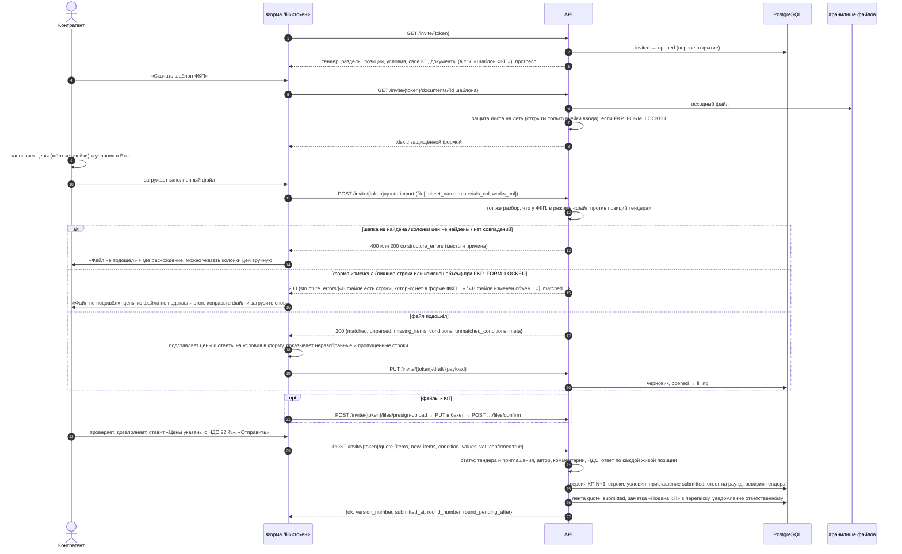

# API: форма КП по ссылке-приглашению (`/invite/{token}`)

Публичные ручки формы коммерческого предложения, которую контрагент открывает по персональной ссылке `/fill/<токен>` без учётной записи: просмотр тендера и своего КП, черновик (автосохранение), подача КП, лента событий, документы тендера (в том числе «Шаблон ФКП» с защитой формы), файлы к КП, загрузка заполненного Excel-файла КП с отчётом сопоставления, подтверждение ознакомления с изменениями ФКП. Общие соглашения — [overview.md](overview.md); оглавление раздела — [endpoints-tenders.md](endpoints-tenders.md). Переписка по ссылке — [endpoints-chat.md](endpoints-chat.md).

Связанные разделы: бизнес-логика — [../02-business-logic/tenders-invitations.md](../02-business-logic/tenders-invitations.md) (ссылка, стадии участника, черновик, ознакомление), [../02-business-logic/tenders-quotes.md](../02-business-logic/tenders-quotes.md) (заполнение, корректировки, НДС, подача, авторство, версии, загрузка Excel), [../02-business-logic/tenders-rounds.md](../02-business-logic/tenders-rounds.md) (ответ на раунд), [../02-business-logic/tenders-documents.md](../02-business-logic/tenders-documents.md), [../02-business-logic/fkp-import.md](../02-business-logic/fkp-import.md) (разбор файла КП); экраны — [../03-screens/fill.md](../03-screens/fill.md), [../03-screens/cabinet.md](../03-screens/cabinet.md); прямая загрузка файлов — [endpoints-files.md](endpoints-files.md).

Сложность блока: **L** — форма с черновиком, правилами подачи и корректировками (L), разбор заполненного файла КП против позиций тендера с отчётом и запретом изменения формы (L, вместе с парсером), документы с защитой листа на лету (M), файлы по токену (S).

## Сводка

| Метод | Путь | Кратко | Доступ |
|---|---|---|---|
| GET | `/invite/{token}` | Форма: тендер, своё КП, прогресс, раунд, версия ФКП, документы | по токену, 30/мин |
| GET | `/invite/{token}/activity` | Лента событий тендера, касающихся контрагента | по токену, 30/мин |
| GET | `/invite/{token}/draft` | Черновик формы | по токену, 30/мин |
| PUT | `/invite/{token}/draft` | Сохранить черновик (автосохранение) | по токену, 30/мин |
| POST | `/invite/{token}/quote` | Подать КП (новая версия) | по токену, 10/мин |
| POST | `/invite/{token}/ack-corrections` | Подтвердить ознакомление с изменениями ФКП | по токену |
| GET | `/invite/{token}/documents/{attachment_id}` | Скачать документ тендера / свой файл | по токену, 30/мин |
| GET | `/invite/{token}/documents/{attachment_id}/presign` | Подписанная ссылка на скачивание из бакета | по токену, 30/мин |
| GET | `/invite/{token}/attachments` | Файлы, приложенные к своему КП | по токену, 30/мин |
| POST | `/invite/{token}/quote-import` | Разобрать заполненный Excel-файл КП (отчёт, без записи) | по токену, 30/мин |
| POST | `/invite/{token}/files` | Приложить файл к КП (multipart) | по токену |
| POST | `/invite/{token}/files/presign-upload` | Ссылка на прямую загрузку файла | по токену, 20/мин |
| POST | `/invite/{token}/files/confirm` | Подтвердить прямую загрузку | по токену, 30/мин |
| DELETE | `/invite/{token}/files/uploads/{upload_id}` | Отменить прямую загрузку | по токену, 30/мин |
| DELETE | `/invite/{token}/files/{attachment_id}` | Удалить приложенный файл до подачи | по токену, 30/мин |

## Доступ по токену — общее

- **Токен** — UUID приглашения из ссылки `/fill/<токен>` (случайный UUID v4, срок не ограничен). Сессия и `Origin` не проверяются (overview §2.6, §4). Если в запросе есть cookie сессии пользователя ЛК **этого** контрагента, он фиксируется автором КП (см. «Авторство»).
- **Лимиты частоты** с одного IP (overview §12): корзина `invite` — 30 запросов / 60 с; `invite-submit` — 10 / 60 с (подача); `invite_files_presign` — 20 / 60 с. Превышение — 429 «Слишком много запросов — попробуйте немного позже». `ack-corrections` и `POST /files` лимитом не закрыты (см. открытые вопросы).
- **Общие отказы** (если у ручки не сказано иначе):

| Код | Когда | `detail` |
|---|---|---|
| 403 | токен не UUID или приглашения нет | «Ссылка недействительна или устарела» (существование тендера не раскрывается) |
| 410 | приглашение отозвано | «Приглашение отозвано — ссылка больше не действует. Обратитесь к представителю <Заказчика>.» |
| 403 | организация контрагента приостановлена | «Доступ организации приостановлен. Обратитесь к администратору системы.» |
| 410 | тендер завершён или отменён (для записи: черновик, подача) | «Тендер закрыт или отменён — подача и правки КП недоступны. Обратитесь к представителю <Заказчика>.» |

«<Заказчика>» — название клиента в родительном падеже из настройки `CLIENT_NAME` (иначе «клиента»).

- **Стадии приглашения** (`invited` → `opened` → `filling` → `submitted`; также `declined`, `revoked`) и их смена — [tenders-invitations.md §5](../02-business-logic/tenders-invitations.md#5-стадии-участника).
- **Авторство КП.** Автор фиксируется при первой подаче: пользователь ЛК этого контрагента из cookie сессии, иначе — единственная активная учётная запись ЛК контрагента, иначе неизвестен. Переподать и править черновик поданного КП может только автор: иначе 403 «КП подал другой сотрудник вашей организации — править и переподавать может только он.»; автор неизвестен для текущего запроса — 403 «Автор КП недоступен, а передача авторства не предусмотрена. Обратитесь к представителю <Заказчика> — перенос делается вручную.» КП без автора (данные до введения правила) правит любой с токеном.

## Последовательность: подача КП файлом Excel (с отказом при изменённой форме)



Пояснения к шагам:

1–3. Первое открытие формы переводит приглашение из «отправлено» в «открыто». Ответ формы содержит всё для заполнения: дерево разделов и позиций (без цен других участников), доп. условия, своё текущее КП, пакет документов, прогресс заполнения.
4–8. «Шаблон ФКП» — исходная ведомость тендера. При `FKP_FORM_LOCKED=true` участнику отдаётся копия с защитой листа (открыты только ячейки ввода); исходник у сотрудников не меняется. Подписанной ссылкой в бакет шаблон не выдаётся — только через API.
9–12. Файл разбирается тем же парсером, что ведомость при создании тендера, но против уже существующих позиций: строка сопоставляется с позицией по номеру (коду), затем по наименованию; итоги и НДС пропускаются; подвал после итога читается как ответы на доп. условия. Ручка **ничего не записывает**: возвращается только отчёт.
13–15. Ошибки, не позволяющие прочитать файл (не Excel, пустой, нет шапки, больше 20 000 строк) — 400. Ошибки структуры без признака `severity` (не найдены колонки цен за единицу; позиция встречается дважды; ни одна строка не совпала — «похоже, загружен файл другого тендера») блокируют подстановку целиком — форма показывает «Файл не подошёл» с местом расхождения. Колонки цен можно указать вручную номерами колонок Excel (с единицы).
16–18. **Отказ при изменённой форме.** При включённой защите формы (`FKP_FORM_LOCKED`) строки, которых нет в форме ФКП, и изменённый в файле объём добавляют блокирующие ошибки структуры: «В файле есть строки, которых нет в форме ФКП: N. Добавлять и менять строки нельзя — заполняйте только жёлтые ячейки скачанного шаблона.» и «В файле изменён объём в строках формы. Объёмы менять нельзя — заполняйте только жёлтые ячейки скачанного шаблона.» Цены из такого файла не берутся. Изменить объём или предложить свою позицию контрагент может только в онлайн-форме (корректировка с обязательным комментарием).
19–22. Подошедший файл: цены и ответы подставляются в форму, а форма сохраняет черновик на сервере (автосохранение также идёт при ручном вводе).
23–24. Файлы к КП грузятся прямой загрузкой в бакет (или multipart при локальном хранилище).
25–30. Подача проверяет статус тендера и приглашения, авторство, обязательные комментарии, подтверждение НДС и что по каждой действующей позиции есть цена или отказ; создаёт новую версию КП и запускает уведомления.

---

### GET /invite/{token}

**Назначение.** Всё для формы КП: тендер (без цен других участников и без плановой суммы), своё текущее КП, прогресс заполнения, активный раунд, последняя содержательная версия ФКП с дельтой, документы, признаки доработки и дозаполнения.

**Доступ.** По токену; 30/мин.

**Параметры пути:** `token` — string (UUID).

**Ответ `200`:**

| Поле | Тип | Смысл |
|---|---|---|
| `tender` | object | `id`, `number`, `title`, `work_type`, `project_name`, `object_name`, `status`, `start`, `end`, `responsible`, `budget_position_name`, `budget_position_code`, `sections` (как в карточке тендера: разделы с позициями — `id`, `name`, `unit`, `quantity`, `original_quantity`, `is_removed`, `is_corrected`, атрибуты), `condition_fields` (`id`, `field_name`, `field_type`) |
| `supplier` | `{id, name}` | своя организация |
| `inviter_name` | string | кто пригласил (иначе ответственный) |
| `fill_progress`, `fill_priced`, `fill_declined`, `fill_total`, `fill_zero` | integer | прогресс по позициям (как в `GET /me/tenders`) |
| `existing_quote` | object \| null | текущая версия своего КП: `version_number`, `status`, `round_number` (каким раундом подана; `null` — первичная подача), `revision_comment`, `fkp_version_number`, `submitted_at`, `items[]` (`tender_item_id`, `is_new_position`, `custom_name`, `materials_price`, `works_price` — за единицу, `declined`, `comment`, `quantity_override`, `review_status`, `review_comment`, `refill_required`), `condition_values` (`{id условия: текст}`) |
| `corrections_acked_at` | ISO \| null | когда подтверждено ознакомление с изменениями ФКП |
| `has_pending_corrections` | boolean | есть снятые/изменённые позиции, ознакомление не подтверждено, нет доработки и дозаполнения → показать плашку |
| `active_round` | object \| null | отправленный раунд №2+ без ответа этого контрагента: `{id, round_number, message_all: null, personal_comment (текст с подставленными полями), deadline_at}` |
| `previous_round_baseline` | object \| null | при активном раунде — свои прошлые цены `{tender_item_id: {materials_price, works_price}}` для показа дельты |
| `fkp_version` | object \| null | последняя содержательная версия ФКП: `id`, `version_number`, `change_summary`, `notified_at`, `created_at`, `delta` (`added`/`removed`/`changed` к предыдущей) |
| `documents` | `{items: DocumentSlot[]}` | пакет документов: `{key, label, kind (url/file/offer), present, url, attachment ({id, name, size, content_type, uploaded_at}), href, editable}`; ключи `rd_url`, `tz_file`, `smr_contract_file`, `surety_file`, `fkp_template`, `offer_form` |
| `vat_rate_pct` | integer | ставка НДС для подтверждения (по умолчанию 22) |
| `revision_requested` | boolean | КП возвращено на доработку целиком или есть строки дозаполнения → форма открыта |
| `collection_expired` | boolean | срок сбора прошёл (признак, не запрет: подачу закрывает только статус тендера) |
| `pending_volume_corrections` | array | свои нерассмотренные корректировки объёма: `{tender_item_id, quantity_override, review_status, comment}` |
| `refill` | object | построчное дозаполнение: `{required, item_ids, items: [{tender_item_id, name, quantity, original_quantity, reason ("volume_changed"/"correction_rejected"), rejected_quantity?, review_comment?}], message}` |

**Ошибки.** Общие отказы (403/410/403 орг.); 429.

**Пример.** → `{"tender": {"id": 100, "number": "T-2026-100", "title": "Витражи, дворовой фасад", "status": "open", "end": "2026-10-06", "sections": […], "condition_fields": [{"id": 128, "field_name": "Условия оплаты (авансирование)", "field_type": "text"}]}, "supplier": {"id": 201, "name": "ООО «Альфа Фасад»"}, "fill_progress": 100, "fill_total": 898, "existing_quote": {"version_number": 2, "status": "submitted", "round_number": 2, "submitted_at": "2026-09-25T06:55:00Z", "items": […]}, "active_round": null, "vat_rate_pct": 22, "revision_requested": false, "collection_expired": true, "refill": {"required": false, "item_ids": [], "items": [], "message": null}}`

**Побочные эффекты.** Первое открытие: стадия `invited` → `opened`.

---

### GET /invite/{token}/activity

**Назначение.** Лента событий тендера глазами контрагента: только события, касающиеся его (и общие правки структуры/документов), `details` — по белому списку ключей (как в `GET /me/activity`).

**Доступ.** По токену; 30/мин.

**Ответ `200`:** `{"items": [{id, action, entity_type, entity_id, details, actor, created_at}]}` — до 50 последних.

**Ошибки.** 403/410; 429.

**Пример.** → `{"items": [{"id": 392, "action": "correction_decided", "entity_type": "quote_item", "entity_id": 31960, "details": {"kind": "volume", "from_quantity": 542.8, "to_quantity": 618.792, "review_status": "accepted"}, "actor": "Иванов Иван Иванович", "created_at": "2026-09-28T08:03:42Z"}]}`

**Побочные эффекты.** Нет.

---

### GET /invite/{token}/draft

**Назначение.** Сохранённый на сервере черновик формы (второй слой после локального хранилища браузера — для смены устройства).

**Доступ.** По токену; 30/мин.

**Ответ `200`:** `{"payload": InviteDraftPayload | null, "updated_at": ISO | null}`.

`InviteDraftPayload` (формат задаёт клиент, сервер хранит как есть): `items` — `{"<tender_item_id>": {materials, works, declined, comment, quantity?}}` (строки); `custom_items` — свои позиции `[{key, sectionId, name, unit?, quantity?, materials, works, comment}]`; `condition_values` — `{"<id условия>": текст}`.

**Ошибки.** 403/410; 429.

**Пример.** → `{"payload": {"items": {"2504": {"materials": "15520", "works": "17000", "declined": false, "comment": ""}}, "custom_items": [], "condition_values": {"128": "30%"}}, "updated_at": "2026-10-14T09:00:00+00:00"}`

**Побочные эффекты.** Нет.

---

### PUT /invite/{token}/draft

**Назначение.** Автосохранение черновика формы. Пустой `payload` (без строк, своих позиций и условий) — очистка черновика, она разрешена и после подачи.

**Доступ.** По токену; 30/мин; правило авторства (для поданного КП).

**Тело запроса:** `{"payload": InviteDraftPayload}`.

**Ответ `200`:** `{"ok": true, "invitation_status": string}`.

**Ошибки.**

| Код | Когда | `detail` |
|---|---|---|
| 409 | КП подано и не возвращено, нет открытого раунда и дозаполнения (и это не очистка) | «КП уже подано — повторная отправка недоступна» |
| 410 | тендер закрыт/отменён; приглашение отозвано | общие тексты |
| 403 | не автор КП; организация приостановлена; неизвестный токен | общие тексты / тексты авторства |

**Пример.** `{"payload": {"items": {"2504": {"materials": "15520", "works": "17000", "declined": false, "comment": ""}}, "custom_items": [], "condition_values": {}}}` → `{"ok": true, "invitation_status": "filling"}`

**Побочные эффекты.** Черновик (одна запись на приглашение, перезаписывается); при непустом черновике стадия `invited`/`opened` → `filling`.

---

### POST /invite/{token}/quote

**Назначение.** Подать КП: создаётся новая версия (первая подача, повторная после доработки, ответ на раунд или дозаполнение строк). Правила — [tenders-quotes.md §8](../02-business-logic/tenders-quotes.md#8-подача-кп).

**Доступ.** По токену; 10/мин; правило авторства.

**Тело запроса:**

| Поле | Тип | Обяз. | Правила |
|---|---|---|---|
| `items[]` | array | да | ответ по позициям тендера |
| `items[].tender_item_id` | integer | да | позиция; строки по несуществующим позициям молча отбрасываются |
| `items[].materials_price` / `works_price` | number \| null | | цена **за единицу** с НДС; `null` — не введено, `0` — введённый ноль (ответ) |
| `items[].declined` | boolean | | отказ от позиции (цены обнуляются); комментарий обязателен |
| `items[].comment` | string | | ≤ 1000 символов; обязателен при отказе и при изменении объёма |
| `items[].quantity_override` | number | нет | предложенный объём (корректировка, ждёт решения специалиста) |
| `items[].negotiation_potential` | number | нет | заявленный запас торга (> 0, иначе игнорируется) |
| `items[].awaiting_reply` | boolean | нет | «жду ответа» по позиции |
| `new_items[]` | array | нет | свои позиции: `name` (пустые пропускаются), `unit`, `quantity` (строки — сохраняются префиксом «Объём: Q ед.» в комментарии), `materials_price`, `works_price`, `comment` (обязателен, ≤ 1000) |
| `condition_values[]` | array | нет | `{condition_field_id, value_text}` |
| `vat_confirmed` | boolean | да, `true` | «цены указаны с НДС N %» — при каждой подаче |
| `hp_website` | string | — | ловушка для ботов, должна быть пустой |

Порядок проверок: статус приглашения/тендера/организации → ловушка → комментарии → НДС → можно ли подавать (новое КП; КП на доработке; есть строки дозаполнения; открыт раунд без ответа этого контрагента — иначе поданное КП не переподаётся) → покрытие позиций → авторство.

**Ответ `200`:** `{"ok": true, "version_number": integer, "submitted_at": ISO, "round_number": integer|null (раунд, на который это ответ), "round_pending_after": integer|null (сколько адресатов раунда ещё не ответили)}`.

**Ошибки.**

| Код | Когда | `detail` |
|---|---|---|
| 400 | ловушка заполнена | «Не удалось обработать форму» |
| 400 | отказ без комментария | «Укажите комментарий при отказе от позиции» |
| 400 | изменение объёма без комментария | «Укажите комментарий при изменении объёма» |
| 400 | своя позиция без комментария | «Укажите комментарий к новой позиции» |
| 400 | длинный комментарий | «Комментарий длиннее 1000 символов» |
| 400 | нет подтверждения НДС | «Подтвердите, что цены указаны с НДС 22%» |
| 400 | есть позиции без ответа | «Укажите цену или откажитесь от позиции: «<название>» и ещё N» |
| 409 | КП уже подано, переподача не открыта | «КП уже подано — повторная отправка недоступна» |
| 410 | тендер закрыт/отменён; приглашение отозвано | общие тексты |
| 403 | авторство; приостановка; неизвестный токен | см. «Доступ» |
| 429 | > 10 подач в минуту с IP | |

**Пример.**

```json
{"items": [{"tender_item_id": 2504, "materials_price": 15520, "works_price": 17000, "declined": false},
           {"tender_item_id": 2505, "materials_price": null, "works_price": null, "declined": true, "comment": "Не выполняем"},
           {"tender_item_id": 2506, "materials_price": 6500, "works_price": 3060, "declined": false,
            "quantity_override": 9.5, "comment": "Объём по обмерам: 9.5"}],
 "new_items": [], "condition_values": [{"condition_field_id": 128, "value_text": "30%"}],
 "vat_confirmed": true, "hp_website": ""}
```

→ `{"ok": true, "version_number": 3, "submitted_at": "2026-10-15T08:30:00Z", "round_number": 2, "round_pending_after": 3}`

**Побочные эффекты.** Новая версия КП (предыдущие — не текущие; запоминаются версия ФКП, по которой подано, автор, время и ставка подтверждённого НДС), строки и ответы на условия; статус КП `submitted`, комментарий доработки очищается; приглашение `submitted`; адресат активного раунда отмечается ответившим; при изменении объёма — флаг тендера «Требует внимания»; ревизия тендера растёт (кэш СТ); заметка «Подана КП» в переписку по тендеру; событие ленты `quote_submitted` (версия, версия ФКП, ставка НДС, раунд, изменения объёма); уведомление ответственному «Новое КП от поставщика» / «КП с изменением объёма» и письмо (overview §16.5).

---

### POST /invite/{token}/ack-corrections

**Назначение.** Контрагент подтвердил ознакомление со снятыми/изменёнными позициями ФКП (закрывает плашку). Отметка сбрасывается при следующей правке позиций сотрудником.

**Доступ.** По токену (без лимита частоты).

**Тело запроса.** Нет.

**Ответ `200`:** `{"ok": true, "corrections_acked_at": ISO}`.

**Ошибки.** 404 «Ссылка недействительна» (токен не UUID, нет приглашения или оно отозвано).

**Пример.** `POST /invite/<токен>/ack-corrections` → `{"ok": true, "corrections_acked_at": "2026-10-15T08:10:00+00:00"}`

**Побочные эффекты.** Время ознакомления в приглашении.

---

### GET /invite/{token}/documents/{attachment_id}

**Назначение.** Скачать файл по ссылке-приглашению: документ из пакета тендера (ТЗ, договор СМР, поручительство), «Шаблон ФКП» этого тендера или файл, приложенный к своему КП. Угадать чужой id бесполезно — проверяется принадлежность.

**Доступ.** По токену; 30/мин.

**Параметры пути:** `token`, `attachment_id` — integer.

**Ответ `200`:** тело файла, `Content-Disposition: attachment` (имя с кириллицей — RFC 5987). «Шаблон ФКП» при `FKP_FORM_LOCKED=true` отдаётся копией с защитой листа (открыты только ячейки ввода), если защиту удалось наложить; иначе — как есть.

**Ошибки.** 404 «Файл не найден»; 403 «Файл недоступен по этой ссылке»; общие отказы по токену (403/410); ошибки хранилища — как у [GET /files/{id}/download](endpoints-files.md).

**Пример.** `GET /invite/<токен>/documents/225` → `200` (xlsx «ФКП витражи.xlsx»)

**Побочные эффекты.** Нет.

---

### GET /invite/{token}/documents/{attachment_id}/presign

**Назначение.** То же, но короткоживущей подписанной ссылкой прямо в бакет. «Шаблон ФКП» так не выдаётся (ссылка отдала бы файл без защиты формы).

**Доступ.** По токену; 30/мин.

**Ответ `200`:** `{"url": string, "expires_at": ISO}`.

**Ошибки.** 409 «Шаблон ФКП выдаётся только через API»; 409 «Прямое скачивание выключено — используйте /download» (локальное хранилище — клиент идёт в `/documents/{id}`); 404/403 — как у скачивания.

**Пример.** → `{"url": "https://<бакет>/tender/100/…?X-Amz-Signature=…", "expires_at": "2026-10-15T08:15:00+00:00"}`

**Побочные эффекты.** Нет.

---

### GET /invite/{token}/attachments

**Назначение.** Файлы, приложенные контрагентом к своему КП по этой ссылке.

**Доступ.** По токену; 30/мин.

**Ответ `200`:** `{"items": [{id, name, doc_type, size, uploaded_at}]}`.

**Ошибки.** 403/410; 429.

**Пример.** → `{"items": [{"id": 301, "name": "Расчёт цены.pdf", "doc_type": "other", "size": 120345, "uploaded_at": "2026-09-25T06:50:00+00:00"}]}`

**Побочные эффекты.** Нет.

---

### POST /invite/{token}/quote-import

**Назначение.** Разобрать заполненный контрагентом шаблон КП против позиций тендера и вернуть отчёт: что подставилось, что не разобрано (построчно, с причиной), какие позиции отсутствуют, ответы на доп. условия и где структура файла разошлась с выданной формой. **Ничего не записывает** — цены подставляет форма и сохраняет в черновик.

**Доступ.** По токену; 30/мин. Статус тендера не проверяется (запись всё равно не происходит).

**Тело запроса (`multipart/form-data`):**

| Поле | Тип | Обяз. | Смысл |
|---|---|---|---|
| `file` | файл | да | `.xlsx` или `.xlsm`, ≤ 50 МБ (`MAX_EXCEL_UPLOAD_MB`), ≤ 20 000 строк |
| `sheet_name` | string | нет | лист; по умолчанию выбирается лист с шапкой таблицы позиций |
| `materials_col` | integer | нет | номер колонки Excel (с 1) цены материалов за единицу — если шапка её не отдаёт |
| `works_col` | integer | нет | то же для работ |

**Ответ `200`:**

| Поле | Тип | Смысл |
|---|---|---|
| `ok`, `file_name` | | |
| `matched[]` | array | `{row, tender_item_id, code, name, materials_price, works_price, note, matched_by ("code"/"name"), derived}` — `derived`: цена за единицу выведена из суммы и объёма |
| `unparsed[]` | array | `{row, tender_item_id|null, code, name, reason}` — строка адресована позиции, но цену не взять (например, «Цены за единицу не заполнены») или позиция неоднозначна |
| `extra_rows[]` | array | строки, которых нет в тендере: `{row, code, name, unit, quantity, section_id, note, materials_price, works_price}` |
| `missing_items[]` | array | позиции тендера, которых нет в файле: `{tender_item_id, name, code}` |
| `volume_changes[]` | array | объём в файле ≠ объёму тендера: `{row, tender_item_id, name, file_quantity, tender_quantity}` |
| `structure_errors[]` | array | `{row, where, message, severity?, columns_seen?}`; без `severity` — **блокирующая** (форма не подставляет цены из файла), `severity: "info"` — информационная |
| `conditions[]` | array | ответы на доп. условия из подвала: `{condition_field_id, label, value, row}` |
| `unmatched_conditions[]` | array | метки подвала, не узнанные как условия |
| `price_columns` | object | `{materials, works, by_order, detail[]}` — найденные колонки цен и что видел разбор в шапке |
| `meta` | object | `{sheet_name, sheet_index, rows_scanned, tender_items, priced_items, derived_items, note_col}` |

Блокирующие ошибки структуры: «Не найдены колонки цен за единицу («Мат./ед.» и «Раб./ед.»). В шапке видно — …. Укажите колонки цен вручную или загрузите тот же файл, который скачали в «Документах тендера».»; «Позиция «…» встречается в файле дважды.»; «Ни одна строка файла не совпала с позициями этого тендера ни по номеру, ни по наименованию — похоже, загружен файл другого тендера.»; при `FKP_FORM_LOCKED=true` — «В файле есть строки, которых нет в форме ФКП: N. Добавлять и менять строки нельзя — заполняйте только жёлтые ячейки скачанного шаблона.» и «В файле изменён объём в строках формы. Объёмы менять нельзя — заполняйте только жёлтые ячейки скачанного шаблона.». Информационная: «Не удалось разобрать N строк файла (нет ни номера, ни наименования с единицей) — они не попали в КП.»

**Ошибки.**

| Код | Когда | `detail` |
|---|---|---|
| 400 | не `.xlsx`/`.xlsm` | «Нужен файл Excel (.xlsx) — тот самый шаблон из «Документов тендера»» |
| 400 | пустой файл | «Пустой файл» |
| 400 | у тендера нет позиций | «В тендере пока нет позиций — нечего сопоставлять» |
| 400 | книга не читается / нет листов | «Не удалось прочитать файл: …» / «В файле нет листов» |
| 400 | слишком много строк | «В файле N строк — больше допустимых 20000» |
| 400 | нет шапки | «Лист «…»: не найдена шапка таблицы позиций. Загрузите тот же файл, который скачали в «Документах тендера».» |
| 413 | > 50 МБ | «Файл слишком большой (максимум 50 МБ). Разбейте таблицу или удалите лишние листы.» |
| 403 / 410 | токен, отзыв, приостановка | общие |

**Пример.** → `{"ok": true, "file_name": "КП Альфа.xlsx", "matched": [{"row": 14, "tender_item_id": 2504, "code": "1.1", "name": "Профильная система", "materials_price": 15520, "works_price": 17000, "note": null, "matched_by": "code", "derived": false}], "unparsed": [], "extra_rows": [{"row": 95, "code": null, "name": "Доп. крепёж", "unit": "шт", "quantity": 10, "materials_price": 150, "works_price": null}], "missing_items": [], "volume_changes": [], "structure_errors": [{"row": 95, "where": "строки 95", "message": "В файле есть строки, которых нет в форме ФКП: 1. Добавлять и менять строки нельзя — заполняйте только жёлтые ячейки скачанного шаблона."}], "conditions": [{"condition_field_id": 128, "label": "Условия оплаты (авансирование)", "value": "30%", "row": 120}], "unmatched_conditions": [], "price_columns": {"materials": 5, "works": 6, "by_order": false, "detail": []}, "meta": {"sheet_name": "ФКП", "rows_scanned": 106, "tender_items": 90, "priced_items": 89, "derived_items": 0}}`

**Побочные эффекты.** Нет (файл не сохраняется).

---

### POST /invite/{token}/files

**Назначение.** Приложить файл к своему КП через API (локальное хранилище или запасной путь прямой загрузки).

**Доступ.** По токену (лимит частоты не установлен).

**Тело запроса (`multipart/form-data`):** `doc_type` — string, обязателен (слот: `tz_file`, `smr_contract_file`, `surety_file`, `other` …; сервер значение не проверяет); `file` — файл ≤ 25 МБ, типы вложений overview §13, сигнатура и антивирус.

**Ответ `200`:** `{"ok": true, "id", "name", "doc_type", "size"}`.

**Ошибки.** 403 «Ссылка недействительна» (не UUID); 403 «Ссылка недействительна или устарела»; 410 «Приглашение отозвано — ссылка больше не действует»; 403 приостановка; 400/413/503 — проверки файла как у [POST /files/upload](endpoints-files.md#post-filesupload). Статус тендера и КП не проверяются (см. открытые вопросы).

**Пример.** `doc_type=other, file=Расчёт.pdf` → `{"ok": true, "id": 301, "name": "Расчёт.pdf", "doc_type": "other", "size": 120345}`

**Побочные эффекты.** Файл в хранилище, вложение `entity_type=tender_invite` (на приглашение); журнал ИБ загрузки файла.

---

### POST /invite/{token}/files/presign-upload

**Назначение.** Подписанная ссылка на прямую загрузку файла к КП в бакет.

**Доступ.** По токену; 20/мин.

**Тело запроса (JSON):** `doc_type` (string, обяз.), `filename` (string, обяз.), `content_type` (string \| null), `file_size` (integer, обяз.).

**Ответ `200`:** `{"upload_id", "url", "method": "PUT", "headers", "expires_at"}` — как у [POST /files/presign-upload](endpoints-files.md#post-filespresign-upload).

**Ошибки.** 409 «Прямая загрузка выключена — используйте /files/upload» (клиент уходит на `POST /invite/{token}/files`); отказы по токену — как у `POST /files`; 400/413 — имя, тип, размер; 422; 429.

**Пример.** `{"doc_type": "other", "filename": "Расчёт.pdf", "content_type": "application/pdf", "file_size": 120345}` → `{"upload_id": "6f1c…", "url": "https://<бакет>/…", "method": "PUT", "headers": {"Content-Type": "application/pdf"}, "expires_at": "…"}`

**Побочные эффекты.** Незавершённая загрузка (без автора).

---

### POST /invite/{token}/files/confirm

**Назначение.** Подтвердить прямую загрузку (сверка размера, сигнатуры, антивирус) и зарегистрировать файл к КП.

**Доступ.** По токену; 30/мин.

**Тело запроса:** `{"upload_id": string}`.

**Ответ `200`:** `{"ok": true, "id", "name", "doc_type", "size"}`.

**Ошибки.** 404 «Загрузка не найдена или уже подтверждена» (чужое приглашение, уже подтверждена); 409 «Файл ещё не загружен в хранилище»; 400 размер/сигнатура/вирус; 503; отказы по токену.

**Пример.** `{"upload_id": "6f1c…"}` → `{"ok": true, "id": 302, "name": "Расчёт.pdf", "doc_type": "other", "size": 120345}`

**Побочные эффекты.** Вложение `tender_invite`; журнал ИБ `file_uploaded` / `file_upload_rejected`.

---

### DELETE /invite/{token}/files/uploads/{upload_id}

**Назначение.** Отменить незавершённую прямую загрузку.

**Доступ.** По токену; 30/мин.

**Параметры пути:** `token`, `upload_id` — string (UUID).

**Ответ `200`:** `{"ok": true}`.

**Ошибки.** 404 «Загрузка не найдена или уже подтверждена»; отказы по токену.

**Пример.** `DELETE /invite/<токен>/files/uploads/6f1c…` → `{"ok": true}`

**Побочные эффекты.** Объект в бакете (если успел загрузиться) и запись незавершённой загрузки удалены.

---

### DELETE /invite/{token}/files/{attachment_id}

**Назначение.** Удалить приложенный к КП файл до подачи (снять и заменить). После подачи форма только для просмотра.

**Доступ.** По токену; 30/мин.

**Параметры пути:** `token`, `attachment_id` — integer.

**Ответ `200`:** `{"ok": true, "id": integer}`.

**Ошибки.** 409 «КП уже подано — повторная отправка недоступна» (поданное КП без доработки/дозаполнения); 404 «Файл не найден»; 403 «Файл недоступен по этой ссылке» (файл другого приглашения или сущности); 403/410 — по токену.

**Пример.** `DELETE /invite/<токен>/files/302` → `{"ok": true, "id": 302}`

**Побочные эффекты.** Файл удаляется из хранилища, запись вложения — из БД.
