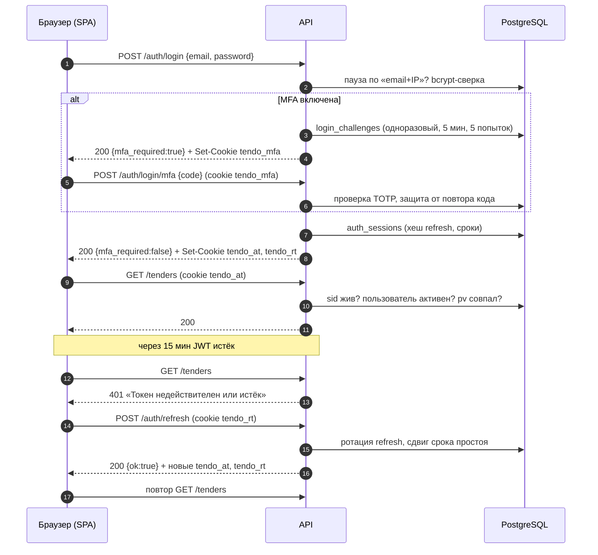

# API: общие соглашения

Сквозные правила HTTP API платформы: адрес и префикс, аутентификация на cookie, проверки доступа, CSRF и CORS, формат ошибок и валидации, пагинация, даты и деньги, лимиты частоты и загрузки, служебные заголовки, живой поток SSE с каталогом событий реального времени, выгрузки файлов и карта разделов API. Описания отдельных ручек — в файлах `endpoints-*.md` этой папки; машинная спецификация — [openapi.json](openapi.json) (333 операции, 270 путей).

Связанные разделы: архитектура — [../07-architecture/architecture.md](../07-architecture/architecture.md); безопасность — [../07-architecture/security.md](../07-architecture/security.md); нефункциональные требования — [../07-architecture/nonfunctional.md](../07-architecture/nonfunctional.md); модель данных — [../05-data-model/](../05-data-model/); бизнес-логика входа и ролей — [../02-business-logic/identity.md](../02-business-logic/identity.md), уведомлений — [../02-business-logic/notifications.md](../02-business-logic/notifications.md), файлов — [../02-business-logic/files.md](../02-business-logic/files.md).

Сложность сквозного слоя (без доменных ручек): **L** — cookie-сессии с ротацией и MFA (M), матрица прав и гейты (M), лимиты частоты в БД (S), SSE-шина на `LISTEN/NOTIFY` (M), единый формат ошибок/пагинации (S).

---

## 1. Базовый адрес и префикс

- API обслуживается **на том же домене, что и SPA**, под префиксом `/api`: `https://<домен-приложения>/api/...`. Отдельного домена API нет — поэтому браузер шлёт cookie сессии без кросс-доменных настроек.
- Обратный прокси перед бэкендом **срезает** префикс `/api`: приложение видит пути без него (`/auth/login`, `/tenders/{id}`), а о префиксе знает из настройки «корневой путь» (`root_path = /api`). От корневого пути зависят:
  - адрес спецификации в Swagger UI: интерактивная документация — `/api/docs`, спецификация — `/api/openapi.json`;
  - пути cookie сессии (см. §2): `Path=/api/`, `/api/auth`, `/api/auth/login/mfa`.
- В этом разделе ТЗ пути ручек указаны **без** префикса, как в `openapi.json` (`POST /auth/login` = `POST /api/auth/login` в браузере).
- Формат тел — JSON (`Content-Type: application/json; charset=utf-8`), кроме загрузки файлов (`multipart/form-data`), выгрузок (xlsx/docx/csv/md/jsonl) и потоков SSE (`text/event-stream`).
- Сериализация ответов — быстрым JSON-сериализатором; словари с целочисленными ключами (карты «id → значение») допустимы и отдаются со строковыми ключами.

## 2. Аутентификация

Аутентификация — **только HttpOnly-cookie**. Заголовка `Authorization`, токенов в теле ответа и в `localStorage` нет; браузер сам несёт cookie (`credentials: include`). JS-код фронта токенов не видит.

### 2.1. Cookie сессии

| Cookie | Что внутри | Path (в браузере) | Срок (`Max-Age`) | Флаги |
|---|---|---|---|---|
| `tendo_at` | JWT доступа | `/api/` | `ACCESS_TOKEN_MINUTES`×60 + 60 с (по умолчанию 960 с) — на минуту дольше самого JWT, чтобы просроченный токен давал понятный 401, а не «нет cookie» | HttpOnly, SameSite=Lax, Secure |
| `tendo_rt` | непрозрачный refresh-токен (в БД хранится только его SHA-256) | `/api/auth` — не уезжает с обычными запросами | до конца скользящего срока простоя сессии: `SESSION_IDLE_DAYS` (14 сут = 1 209 600 с), но не дальше абсолютного потолка | то же |
| `tendo_mfa` | непрозрачный токен шага второго фактора | `/api/auth/login/mfa` | `MFA_CHALLENGE_MINUTES` (5 мин) | то же |

- Флаг `Secure` выключается настройкой `COOKIE_SECURE=false` только для отладки по голому http.
- Путь cookie = корневой путь приложения + относительный путь; префикс берётся из запроса, а не зашивается.
- Выход и любой отказ обновления **снимают** все три cookie (`Max-Age=0` с теми же путями).

### 2.2. JWT доступа

- Алгоритм `JWT_ALGORITHM` (по умолчанию HS256), ключ — секрет `JWT_SECRET` (только переменная окружения; без него приложение не стартует).
- Срок — `ACCESS_TOKEN_MINUTES` = **15 мин**.
- Поля: `sub` — id пользователя; `exp`; `sid` — id серверной сессии (`auth_sessions`); `pv` — отпечаток текущего хеша пароля (первые 16 hex SHA-256 от хеша).
- На **каждом** запросе система проверяет: подпись и срок → сессия `sid` жива в БД (не отозвана) → пользователь существует и активен → `pv` совпадает с текущим паролем → для пользователя контрагента: организация не приостановлена → для администратора: MFA настроена (если `MFA_ENFORCED`) → для владельца площадки: путь разрешён. Поэтому выход, «выйти везде», смена пароля, отключение учётки и приостановка организации действуют **сразу**, а не по истечении 15 минут. Права по матрице читаются из БД на каждый запрос (в пределах запроса — кэш), изменения матрицы и ролей действуют со следующего запроса.

| Проверка | Код | `detail` |
|---|---|---|
| нет cookie `tendo_at` | 401 | «Не авторизован» |
| подпись/срок JWT неверны | 401 | «Токен недействителен или истёк» |
| сессия `sid` закрыта или токен без `sid` | 401 | «Сессия завершена. Войдите заново.» |
| пользователь удалён | 401 | «Пользователь не найден» |
| пароль сменён после выдачи токена | 401 | «Сессия завершена: пароль был изменён. Войдите заново.» |
| учётная запись отключена | 403 | «Учётная запись отключена. Обратитесь к администратору системы.» |
| организация контрагента приостановлена | 403 | «Доступ организации приостановлен. Обратитесь к администратору системы.» |
| администратор (или владелец площадки) без MFA при `MFA_ENFORCED=true`, путь не из списка настройки MFA (`/auth/me`, `/auth/mfa/setup`, `/auth/mfa/verify`) | 403 | «Для продолжения работы настройте двухфакторную аутентификацию» |
| владелец площадки вне путей `/auth/*` и `/owner*` | 403 | «Раздел недоступен учётной записи владельца площадки» |

### 2.3. Refresh-токен и серверная сессия

- Сессия устройства — строка `auth_sessions`: хеш текущего и предыдущего refresh-токена, `idle_expires_at` (скользящий срок простоя, `SESSION_IDLE_DAYS` = 14 сут), `expires_at` (абсолютный потолок, `SESSION_ABSOLUTE_DAYS` = 30 сут), IP и User-Agent, время последнего использования, причина отзыва.
- `POST /auth/refresh` **вращает** refresh: выдаёт новый refresh и новый JWT, сдвигает срок простоя (не дальше потолка); предыдущее значение запоминается.
- **Окно гонки 30 с.** Если старый refresh пришёл в течение 30 с после ротации (две вкладки обновили сессию одновременно), выдаётся только новый JWT доступа; refresh-cookie не меняется (новое значение уже поставила первая вкладка).
- Старый refresh **позже 30 с** — признак кражи: сессия закрывается целиком (причина `reuse`), событие журнала ИБ `session_reuse_detected`, ответ 401 «Сессия завершена. Войдите заново.».
- Сессия, у которой истёк срок простоя или потолок, закрывается (событие `session_idle_timeout`), ответ 401 «Сессия завершена из-за неактивности. Войдите снова.».
- Фронт обновляет сессию один раз на вкладку при первом 401 (очередь через Web Locks между вкладками) и повторяет исходный запрос; при окончательном отказе уводит на `/login?reason=<текст detail>`.
- Просроченные сессии, челленджи MFA и снятые паузы входа удаляет периодическая задача раз в час.



### 2.4. Второй фактор (MFA, TOTP)

- TOTP по RFC 6238: 6 цифр, шаг 30 с, допуск ±1 шаг; код, шаг которого не новее последнего принятого (`users.mfa_last_counter`), отклоняется (защита от повторного ввода того же кода). Издатель в приложении-аутентификаторе — `TOTP_ISSUER` (пусто — `BRAND_NAME`).
- Шаг «пароль принят, ждём код» хранится в БД (`login_challenges`), а не в памяти процесса: одноразовый, живёт `MFA_CHALLENGE_MINUTES` (5 мин), не больше `MFA_CHALLENGE_MAX_ATTEMPTS` (5) неверных кодов.
- MFA спрашивается при входе у **любого** пользователя с включённым фактором (при `MFA_ENFORCED=false` — флаг для локальной отладки — второй шаг пропускается у всех). Для администратора и владельца площадки MFA **обязательна** (`MFA_ENFORCED`, по умолчанию `true`): без настроенного фактора вход открывает сессию, но все пути, кроме `/auth/me`, `/auth/mfa/setup`, `/auth/mfa/verify`, отвечают 403, а `GET /auth/me` возвращает `mfa_setup_required: true` — фронт ведёт на экран настройки. Отключить MFA администратору нельзя; сбросить чужую — может другой администратор (`POST /users/{id}/mfa/reset`). Подробно — [endpoints-identity.md](endpoints-identity.md).

### 2.5. Повторное подтверждение паролем

Необратимые действия (сброс чужой MFA, закрытие тендера с победителем, перевыпуск ссылки участника) требуют заголовок `X-Reauth-Password: <текущий пароль>`. Без заголовка — 403 «Подтвердите действие паролем», с неверным паролем — 403 «Пароль не подошёл — действие не выполнено» (не 401: сессия в порядке).

### 2.6. Публичные ручки

Без сессии работают: вход и восстановление (`/auth/login*`, `/auth/refresh`, `/auth/logout`, `/auth/password-reset/*`), `POST /leads`, `GET /files/config`, `/health*`, форма КП по ссылке-приглашению `/invite/{token}/*`, переписка по ссылке `/chats/invite/{token}/*`, анкета контрагента `/suppliers/register*`, вебхук баг-трекера. Их защищают токен в пути и/или лимиты частоты (§12).

## 3. Роли и проверки доступа

Роли (`roles.code`): `admin` — администратор; `tender_specialist` — тендерный специалист; `security` — служба безопасности; `lawyer` — юрист; `supplier` — пользователь контрагента (ЛК); `lead` — заявка с лендинга (прав нет); `owner` — владелец площадки (вне ролей клиента, доступ решает признак `users.is_superadmin`). Сотрудники — `admin`, `tender_specialist`, `security`, `lawyer`.

Каждая ручка объявляет один из гейтов:

| Гейт | Кого пускает | Отказ |
|---|---|---|
| **Вошедший** | любой с действующей сессией (с учётом проверок §2.2) | 401/403 по §2.2 |
| **Сотрудник** | роли `admin`, `tender_specialist`, `security`, `lawyer` | 403 «Доступно только сотрудникам компании» |
| **Право `<код>`** | сотрудник, роли которого в матрице «роль × действие» выдано действие; администратор — всегда (матрицу обходит) | 403 «Недостаточно прав для этого действия — обратитесь к администратору системы»; событие журнала ИБ `permission_denied` |
| **Цены** (`finance.view`) | право роли **или** персональный флаг пользователя `can_view_finance`; администратор — всегда | 403 «Нет прав на финансовые данные — обратитесь к администратору системы» (там, где ответ целиком о ценах); на остальных ручках цены маскируются (`null`) |
| **Доступ к объекту** | администратор — все объекты; остальные — объекты по грантам на портфель/объект (с подобъектами и путём до корня) | 403 с текстом ручки («Нет доступа к этому объекту», «Нет доступа к проекту этого тендера» …) |
| **Владелец площадки** | `users.is_superadmin = true` | 403 «Раздел доступен только владельцу площадки» |
| **Контрагент** | роль `supplier` с действующей связкой «пользователь → контрагент»; видит только данные своей организации | 403 по тексту ручки |

Действия матрицы (14, список фиксирован в коде, в БД хранятся только выданные «галочки»): `portfolios.manage`, `tenders.manage`, `quotes.manage`, `suppliers.manage`, `suppliers.contacts.view`, `reports.view`, `finance.view`, `budget.view`, `budget.manage`, `catalogs.manage`, `users.manage`, `security.manage`, `settings.manage`, `billing.view`. Подписи, группы и значения по умолчанию — [endpoints-identity.md](endpoints-identity.md#get-permissionsmatrix).

## 4. Защита от CSRF

- Основная защита — `SameSite=Lax` у cookie: кросс-сайтовый POST/PUT/PATCH/DELETE браузер отправляет без cookie.
- Второй рубеж — проверка заголовка `Origin` на **небезопасных** методах (всё, кроме GET/HEAD/OPTIONS): если `Origin` есть и не входит в множество `CORS_ORIGINS ∪ {origin(PUBLIC_APP_URL)}` (сравнение схемы и хоста без учёта регистра) — **403 «Запрос с чужого источника отклонён»**.
- Запрос без `Origin` (не браузер: curl, интеграции) пропускается — у него нет чужой cookie.
- Проверка выполняется во всех ручках, требующих сессию (входит в гейт «вошедший»), и явно — в `POST /auth/login`, `/auth/login/mfa`, `/auth/refresh`, `/auth/logout`, `/auth/logout-all`. Публичные ручки без сессии (восстановление пароля, `/leads`, ссылки-приглашения) `Origin` не проверяют.

## 5. CORS

- Разрешённые источники — список `CORS_ORIGINS` из окружения; пустой список или `*` — отказ старта приложения.
- `Access-Control-Allow-Credentials: true`; методы — все; заголовки запроса — `Content-Type`, `Authorization`, `Cache-Control`, `If-None-Match`, `X-Request-Id`; открытые клиенту заголовки ответа — `X-Request-Id`, `X-Response-Time-Ms`, `ETag`; кэш preflight — 600 с.
- В штатной схеме SPA и API на одном домене, и CORS не задействуется; список нужен для раздельных доменов. Заголовок `X-Reauth-Password` в разрешённые не входит (см. открытые вопросы).

## 6. Формат ошибок

Тело любой ошибки — объект с полем `detail`. Встречаются четыре формы:

| Форма `detail` | Где | Пример |
|---|---|---|
| строка | бизнес-отказы, доступ, «не найдено», лимиты | `{"detail": "Тендер не найден"}` |
| объект с ошибками полей | валидация форм на сервере (анкета, пользователи, лид, контакты) — **400** | `{"detail": {"error": "Проверьте заполнение формы", "fieldErrors": {"email": "Укажите корректный email"}}}` |
| объект с кодом | машинно-различимые отказы (исчерпан баланс ИИ — **402**) | `{"detail": {"code": "tokens_exhausted", "message": "Баланс токенов исчерпан — обратитесь к администратору"}}` |
| массив | ошибки схемы запроса (типы, обязательность, диапазоны) — **422** | см. §7 |

Коды ответов:

| Код | Когда | Типичный `detail` |
|---|---|---|
| 400 | нарушено бизнес-правило, неверные данные формы, неверный код MFA | текст правила; форма с `fieldErrors` |
| 401 | нет сессии / сессия закрыта / JWT истёк / неверный логин-пароль / мёртвый челлендж MFA | «Не авторизован», «Неверный email или пароль» |
| 402 | ИИ-операция при исчерпанном балансе и включённой блокировке при нуле | объект `tokens_exhausted` |
| 403 | нет права, чужой объект, отключённая учётка, CSRF, требуется повторный ввод пароля | «Недостаточно прав для этого действия — обратитесь к администратору системы» |
| 404 | сущности нет или она скрыта от пользователя; выключенный раздел (биллинг, лиды) | «… не найден(а)», «Not Found», «Раздел недоступен» |
| 409 | состояние не допускает операцию (уже рассмотрено, гонка, дубль, прямая загрузка выключена) | «Заявка уже рассмотрена», «Пользователь с таким email уже есть» |
| 410 | ссылка отозвана / сущность больше недоступна | текст ручки |
| 413 | файл больше лимита | «Файл больше 25 МБ» |
| 422 | тело/параметры не прошли схему | массив ошибок (§7) |
| 423 | ресурс временно заблокирован (класс ошибки предусмотрен) | — |
| 429 | лимит частоты, пауза входа | «Слишком много запросов — попробуйте немного позже»; для входа — с заголовком `Retry-After` |
| 503 | недоступна зависимость (хранилище, БД счётчиков лимитов на входе) | «Сервис временно недоступен — попробуйте позже», «Хранилище файлов сейчас недоступно — попробуйте ещё раз через минуту» |
| 504 | обработка дольше `REQUEST_TIMEOUT_SECONDS` | «Запрос выполняется слишком долго — попробуйте сузить выборку» |
| 500 | необработанная ошибка: тело `Internal Server Error` (text/plain), оповещение в технический канал с дедупликацией по маршруту и классу ошибки | — |

**Тексты `detail` — на русском и готовы к показу пользователю.** Фронт показывает текст так:
1. если `detail` — осмысленная русская строка (или `detail.message`, или `detail.error`) без технических подробностей — показывается как есть;
2. иначе — текст по коду ответа: 401 «Сессия закончилась. Войдите снова — после входа повторите действие.»; 402 «Баланс токенов исчерпан — обратитесь к администратору»; 403 «Недостаточно прав для этого действия. Если доступ нужен, обратитесь к администратору.»; 404 «Не нашли запрошенное: запись удалили или ссылка устарела. Обновите страницу.»; 409 «Данные успели измениться — их правили одновременно с вами. Обновите страницу и повторите действие.»; 410 «Это больше недоступно: запись закрыли или отозвали. Обновите страницу.»; 413 «Файл слишком большой для загрузки. Уменьшите его или разбейте на части и загрузите снова.»; 422 «Сервер не принял данные. Проверьте заполнение полей и попробуйте снова.»; 429 «Слишком много запросов подряд. Подождите минуту и повторите.»; 502/503 «Сервер временно недоступен. Попробуйте ещё раз через минуту.»; 408/504 «Сервер не ответил вовремя. Обновите страницу, чтобы проверить, сохранилось ли действие, и повторите при необходимости.»; прочие 5xx «На сервере произошла ошибка. Попробуйте ещё раз через пару минут; если повторится — сообщите об ошибке.»; обрыв сети — «Не удалось связаться с сервером. Проверьте соединение и попробуйте снова.»;
3. `fieldErrors` раскладываются под соответствующие поля формы;
4. 403 с текстом про отключённую учётку/приостановленную организацию — выход и переход на `/login?reason=<текст>`.

## 7. Валидация

- **Схема запроса** (типы, обязательность, диапазоны `ge/le`, длины) проверяется до бизнес-логики, ответ **422** в стандартном формате FastAPI/pydantic:

```json
{"detail": [{"type": "less_than_equal", "loc": ["query", "limit"], "msg": "Input should be less than or equal to 200",
  "input": "500", "ctx": {"le": 200}}]}
```

  `loc` — где ошибка (`path` / `query` / `body`, затем имя поля). Нечисловой id в пути — тоже 422 (`int_parsing`); фронт трактует 422 на чтении по id как «записи нет».
- **Нормализаторы полей** (email, телефон, ИНН/ОГРН/КПП, адрес, ФИО, сайт, пароль) — одни правила на сервере и фронте. В pydantic-моделях их отказ превращается в 422 с `msg: "Value error, <русский текст>"`; в ручках, разбирающих тело словарём, — в **400** с `fieldErrors` (все ошибки формы разом).
  - email: обрезка, нижний регистр, ≤ 254 символов, проверка формы адреса и зоны от 2 букв; служебные домены (`.local`, `.localhost`, `.test`, `.invalid`, `.example`) принимаются только при `ALLOW_LOCAL_EMAIL_DOMAINS=true`; текст ошибки «Укажите корректный email». На входе в систему — мягкая проверка (регистр, пробелы, наличие `@` и точки в домене).
  - телефон: хранится в E.164 (`+79001112233`), российские записи `8…`/`7…`/10 цифр приводятся к `+7`; без добавочного; тексты ошибок — «Укажите телефон без добавочного номера», «Российский телефон — это 10 цифр после +7, например +7 900 111-22-33» и т. п.
  - пароль: 8–64 символа и ≤ 72 байт UTF-8, без пробелов по краям, минимум 3 категории из 4 (строчные, прописные, цифры, спецсимволы), не из списка распространённых, ≥ 4 разных символов, не содержит логин-часть email (от 3 символов) и части ФИО (от 4 символов); история — нельзя повторить текущий и 5 прошлых паролей. Тексты — см. [endpoints-identity.md](endpoints-identity.md#post-authpassword).
- Многие ручки принимают тело как произвольный JSON-объект (в спецификации тело не описано) и проверяют поля сами — их поля перечислены в описаниях ручек.

## 8. Пагинация

Единый контракт реестров: параметры `?limit=&offset=`, ответ — конверт

```json
{"items": [...], "total": 27, "limit": 2, "offset": 0}
```

| Параметр | Тип | По умолчанию | Ограничения |
|---|---|---|---|
| `limit` | integer | нет — «срез целиком» в пределах потолка | 1–200 (`MAX_PAGE_SIZE`) |
| `offset` | integer | 0 | ≥ 0 |

- Без `limit` ручка отдаёт до 200 строк; в ответе `limit` = фактически применённый потолок (200). `total` — всегда полное число строк под фильтром (отдельный `COUNT(*)` того же запроса без сортировки и страницы), поэтому клиент видит, что показал не всё, и может дочитать (фронт дочитывает страницами по 200 до `total`, с предохранителем 5000 строк).
- Ручка вправе добавить в конверт свои поля (например, `unread` у ленты уведомлений).
- Исключения со своими параметрами: журнал ИБ (до 500 строк), история баланса и журнал обращений ИИ (`limit` 1–200, по умолчанию 50, конверт `{items, total}`), события пользователя (`limit` без `offset`), чат (курсоры `before`/`before_seq`/`since`).

## 9. Сортировка и фильтры

- Поиск — параметр `q` (или `<сущность>_q`): подстрока без учёта регистра (`ILIKE '%…%'` с экранированием спецсимволов), пробелы по краям обрезаются.
- Мультифильтры — значения через запятую (`role=admin,lawyer`); незнакомые значения отбрасываются (не 400), чтобы старые ссылки открывались.
- Сортировка — параметр `sort` с именем поля, префикс `-` — по убыванию (`sort=-last_login_at`); незнакомое поле — сортировка по умолчанию, не 400. Пустые значения сортируются в конец при любом направлении. Вторым ключом всегда идёт `id` (устойчивый порядок).
- Булевы флаги — `true/false` (`include_archived=true`).
- Периоды — `date_from`/`date_to` в формате `YYYY-MM-DD`, границы включительно; граница суток — московская там, где фильтр задан в МСК (отчёты), и UTC в разделе владельца площадки.

## 10. Дата и время

- Моменты хранятся в БД как `timestamptz` (UTC).
- В ответах момент — **строка ISO 8601 в UTC**: `2026-09-25T07:20:00+00:00` или `2026-09-25T07:20:00Z` (обе формы допустимы и разбираются фронтом; в чате и части новых ручек — `Z`). Клиент форматирует время в локальном часовом поясе браузера.
- Календарные даты (сроки, даты сбора КП, начало недели) — `YYYY-MM-DD`.
- Строки, которые **собирает сервер** (тексты писем и уведомлений, выгрузки, имена файлов, подписи вида «ДД.ММ.ГГГГ ЧЧ:ММ», блок «последние правки прав»), — всегда в **московском времени** (UTC+3, без перехода на летнее время), формат по умолчанию `%d.%m.%Y %H:%M`; где нужно — с пометкой «(МСК)».
- Параметры-даты в запросах — `YYYY-MM-DD`; моменты в теле — ISO 8601.

## 11. Деньги и числа

- Суммы хранятся `NUMERIC` (план тендера — `NUMERIC(15,2)`, максимум 9 999 999 999 999,99) и отдаются **JSON-числом**: целое значение — целым, дробное — числом с плавающей точкой (`23000000.0`, `150031118.06`). Валюта — рубли; НДС — ставка `VAT_RATE_PCT` (22 %) в текстах.
- Суммы в разделе владельца округляются до копеек (`round(x, 2)`); токены биллинга — целые.
- Цены без права «Цены» отдаются `null` (маскирование), а не удаляются из ответа.
- Количества (объёмы позиций) — числа с плавающей точкой; форматирование для человека — задача клиента (сервер форматирует только в письмах и выгрузках).

## 12. Лимиты частоты

Счётчики — в таблице Postgres `rate_limit_counters` (общие для всех процессов и реплик), окно **фиксированное** (атомарный upsert на попадание; на стыке окон допустимо до двух окон подряд). Ключ — `<корзина>:<IP клиента>` или `<корзина>:user:<id>`. IP берётся из соединения; заголовок `X-Forwarded-For` учитывается только от доверенных прокси частных сетей (`FORWARDED_ALLOW_IPS`), иначе лимиты по IP обходились бы подделкой.

**Fail-closed:** для входа и восстановления пароля недоступность БД счётчиков даёт **503** «Сервис временно недоступен — попробуйте позже» (лимит в памяти процесса умножался бы на число процессов). Для остальных корзин при сбое БД решение принимает окно в памяти процесса (деградация, запись в лог).

| Корзина | Ручки | Лимит | Ключ | Fail-closed |
|---|---|---|---|---|
| `login` | `POST /auth/login` | 20 / 60 с | IP | да |
| `login-mfa` | `POST /auth/login/mfa` | 10 / 60 с | IP | да |
| `auth-refresh` | `POST /auth/refresh` | 120 / 60 с | IP | нет |
| `login-check-email` | `POST /auth/login/check-email` | 30 / 60 с | IP | нет |
| `password-reset-request` | `POST /auth/password-reset/request` | 5 / 3600 с | IP | да |
| `password-reset-email` | то же, письма на один адрес | 3 / 3600 с (сверх — тот же ответ без письма) | email | нет |
| `password-reset-confirm` | `POST /auth/password-reset/confirm`, `POST /auth/login/set-initial-password` | 20 / 3600 с | IP | да |
| `lead` | `POST /leads` | 20 / 3600 с | IP | нет |
| `files_presign` | `POST /files/presign-upload` | 20 / 60 с | пользователь | нет |
| `heavy-read` | сравнительная таблица, ИИ-разбор, выгрузки СТ и протокола, сводка бюджета, отчёты | `HEAVY_READ_RATE_LIMIT` / `HEAVY_READ_RATE_WINDOW` (60 / 60 с) | пользователь | нет |
| `chat_send`, `chat_open` | отправка/правка/удаление реплики; открытие треда | 30 / 60 с; 10 / 60 с | пользователь | нет |
| чат по ссылке | `/chats/invite/{token}/*` | 60 / 60 с чтение, 30 / 60 с отправка | токен + IP | нет |
| `invite`, `invite-submit`, `invite_files_presign` | форма КП по ссылке: чтение; подача КП; presign | 30 / 60 с; 10 / 60 с; 20 / 60 с | IP | нет |
| `supplier_register` | анкета контрагента | 20 / 60 с | IP | нет |
| баг-репорты | `POST /bug-reports` | 5 / 3600 с | пользователь | нет |

Превышение — **429** «Слишком много запросов — попробуйте немного позже». Сверх лимитов по IP вход защищён **паузой по паре «email + IP»**: после 5-й неудачи подряд (`MAX_FAILED_LOGIN_ATTEMPTS`) пара получает паузу 1, 2, 4, 8 … мин (не больше `LOGIN_THROTTLE_MAX_MINUTES` = 60), счётчик живёт сутки с последней неудачи; учётка целиком не блокируется. Ответ во время паузы — 429 «Слишком много неудачных попыток входа. Повторите через N мин.» и заголовок `Retry-After: <секунды>`.

## 13. Лимиты загрузки

| Что | Лимит | Настройка | Ответ при превышении |
|---|---|---|---|
| Вложение (все места загрузки, кроме Excel) | 25 МБ | `MAX_UPLOAD_MB` | 413 «Файл больше 25 МБ» |
| Excel ведомости (мастер тендера, импорт) | 50 МБ | `MAX_EXCEL_UPLOAD_MB` | 413 «Файл слишком большой (максимум 50 МБ). Разбейте таблицу или удалите лишние листы.» |
| Имя файла | 200 символов (обрезается с сохранением расширения) | — | — |
| Типы вложений | PDF, PNG, JPG/JPEG, GIF, WEBP, DOC, DOCX, XLS, XLSX, XLSM, ZIP, RAR, 7Z, TXT, CSV | — | 400 «Такой тип файла не принимается. Можно: …» |

Значения лимитов и список расширений фронт получает из `GET /files/config` и не дублирует. Чат имеет свой список типов (см. [endpoints-chat.md](endpoints-chat.md)). Подробно — [endpoints-files.md](endpoints-files.md).

## 14. Сжатие, тайм-ауты, кэширование

- **gzip** — для ответов от `GZIP_MIN_BYTES` (1000 байт), уровень `GZIP_LEVEL` (6), по `Accept-Encoding`. Пути, оканчивающиеся на `/stream` (SSE), не сжимаются: иначе кадры копились бы в буфере.
- **Тайм-аут обработки** — `REQUEST_TIMEOUT_SECONDS` (60 с) на работу обработчика до начала ответа; отдача тела (поток SSE, большие выгрузки) тайм-аутом не ограничена. Превышение — 504 «Запрос выполняется слишком долго — попробуйте сузить выборку». Отдельно — тайм-аут SQL-запроса 30 с на стороне БД.
- **Журнал медленных** — ответ дольше `SLOW_REQUEST_MS` (200 мс) пишется в лог с шаблоном маршрута и длительностью.
- **Условные GET** — лента уведомлений и тяжёлые чтения (сравнительная таблица, сводка бюджета) отдают `ETag`; запрос с тем же `If-None-Match` получает **304** без тела. Тяжёлые чтения дополнительно ставят `Cache-Control: private, …` (тело зависит от прав смотрящего) и кэшируются на сервере на `HEAVY_READ_CACHE_SECONDS` (60 с).

## 15. Служебные заголовки

| Заголовок | Направление | Смысл |
|---|---|---|
| `X-Request-Id` | запрос/ответ | сквозной id запроса: берётся из запроса или генерируется (32 hex), возвращается в ответе, попадает в каждую строку лога и в журнал ИБ |
| `X-Response-Time-Ms` | ответ | время до начала ответа, мс |
| `ETag` / `If-None-Match` | ответ/запрос | условный GET (§14) |
| `Retry-After` | ответ | секунды до конца паузы входа (429) |
| `Deprecation: true` | ответ | ручка устарела (например, `GET /notifications/unread-count`, выгрузка СТ с `full=false` — ещё `Sunset` и `Warning`) |
| `X-Reauth-Password` | запрос | повторное подтверждение паролем (§2.5) |
| `X-Content-Type-Options: nosniff`, `X-Frame-Options: DENY`, `Referrer-Policy: strict-origin-when-cross-origin`, `Permissions-Policy: camera=(), microphone=(), geolocation=()` | ответ | на всех ответах |
| `Strict-Transport-Security: max-age=31536000; includeSubDomains` | ответ | только за TLS (схема https или `X-Forwarded-Proto: https`) |
| `Cache-Control: no-cache`, `X-Accel-Buffering: no` | ответ | потоки SSE (запрет буферизации в прокси) |
| `Content-Disposition` | ответ | выгрузки и скачивание (§17) |

## 16. Живой поток событий (SSE)

### 16.1. Общий формат

- Потоки — обычный `GET` с ответом `text/event-stream; charset=utf-8`, заголовки `Cache-Control: no-cache`, `Connection: keep-alive`, `X-Accel-Buffering: no`; путь оканчивается на `/stream`. Аутентификация — та же cookie (проверяется при подключении; открытый поток не закрывается при истечении JWT).
- Потоков два: **топбар вошедшего пользователя** `GET /notifications/stream` (колокольчик, бейдж чатов, события чата, смена статуса контрагента — описан в [endpoints-notifications.md](endpoints-notifications.md#get-notificationsstream)) и **переписка контрагента по ссылке** `GET /chats/invite/{token}/stream` ([endpoints-chat.md](endpoints-chat.md)). Второй поток на вкладку у вошедших не открывается — чат едет в общем.
- Кадры:
  - первый — `retry: 3000` (подсказка клиенту: переподключаться через 3 с);
  - данные — `id: <n>` (необязательно) + `data: <JSON одной строкой>` + пустая строка. Поле `event:` не используется: тип события — внутри JSON (`type`);
  - keep-alive — комментарий `: ping` раз в **15 с** простоя (держит соединение через прокси и даёт клиенту заметить обрыв).
- Принцип: **каждый кадр — повод перечитать состояние, а не источник данных.** Кадры топбара — полные снимки; события чата — тонкие (вид, тред, номер), текст клиент забирает дельтой. Потеря кадра ничего не ломает.
- Клиент: одна вкладка-лидер держит поток (выбор лидера через Web Locks, раздача состояния соседним вкладкам через BroadcastChannel); при обрыве — переподключение с паузой 3 с, удвоение до 30 с, если поток не поднялся ни разу; при первом неудачном подключении — разовый запрос ленты `GET /notifications?limit=8` (без опроса по таймеру).

### 16.2. Догон пропущенного

- Топбар: каждый кадр — полный снимок (счётчик, 8 последних уведомлений, id последнего, бейдж и курсор чатов). Переподключившийся клиент получает актуальное состояние первым же кадром — `Last-Event-ID` и курсоры не нужны. Новые уведомления клиент отличает от показанных по множеству показанных id.
- Чат: снимок несёт `chats_cursor`; увидев курсор больше своего, клиент запрашивает `GET /chats/updates?since=<курсор>` (дельта из БД с нахлёстом 20 событий, при отставании > 300 — `reset`). Подробно — [endpoints-chat.md](endpoints-chat.md).
- Если LISTEN-соединение процесса с БД обрывалось, после переподключения всем подписчикам процесса рассылается событие `resync` — каждый поток пересчитывает всё.

### 16.3. Шина событий

- Канал Postgres **`app_realtime`** (один на приложение). Публикация — `pg_notify` **внутри транзакции** изменения: событие доставляется только при коммите и пропадает при откате, поэтому подписчик не может проснуться раньше, чем изменение станет видимым.
- Payload — маленький JSON `{"keys": [...], "type": "...", ...скалярные поля}`; лимит `NOTIFY` — 8000 байт, тела сущностей (тексты, суммы) в payload не кладутся.
- Каждый процесс держит одно отдельное LISTEN-соединение (переподключение с паузой 1 → 30 с) и раскладывает события по очередям открытых потоков по **ключам адресации**; очередь потока — 32 события, при переполнении лишние отбрасываются (следующий кадр всё равно пересчитает состояние). Несколько событий одной пачки дают один кадр.

Ключи адресации (повторяют предикаты выдачи ленты уведомлений):

| Ключ | Кто слушает |
|---|---|
| `staff` | все сотрудники (широковещательные staff-уведомления, `user_id IS NULL`) |
| `staff:<user_id>` | конкретный сотрудник |
| `supplier:<supplier_id>` | все пользователи ЛК контрагента и потоки по его ссылкам-приглашениям |
| `supplier:u<user_id>` | конкретный пользователь контрагента |
| `chat:p<project_id>` | сотрудники с доступом к объекту (события чата по тендерам объекта) |
| `chat:all` | администраторы (события чата по всем объектам) |

Набор ключей потока считается при подключении: сотрудник — `staff`, `staff:<id>` и `chat:p<id>` по каждому доступному объекту (администратор — `chat:all`); контрагент — `supplier:<id>`, `supplier:u<id>`. Выданный или отозванный доступ к объекту применяется при переподключении.

### 16.4. Каталог событий реального времени

| `type` | Кто публикует | Ключи | Доп. поля payload | Что делает поток топбара |
|---|---|---|---|---|
| `notification` | создание записи центра уведомлений (любой домен, см. 16.5); рассылка события каталога ролям; отметка «прочитано» / «прочитать все» (эхо другим вкладкам и, для общих записей, всем, кто их видел) | `staff`, `staff:<id>` (при > 200 адресатах — один `staff`), `supplier:<id>`, `supplier:u<id>` | — | пересчитывает колокольчик (счётчик, 8 последних, id последнего) |
| `chat` | домен чата: новая/изменённая/удалённая реплика (`kind: msg`), сторона дочитала (`kind: read`), «печатает…» (`kind: typing`) | `msg`: сторона контрагента `supplier:<id>` + сторона сотрудников `chat:p<объект>`, `chat:all`; `read` контрагента — обеим сторонам, `read` сотрудника — `staff:<свой id>` + `supplier:<id>`; `typing` — только противоположной стороне | `kind`, `thread_id`, `tender_id`, `seq`, `cursor` (у `msg`), `side` (`specialist`/`supplier`), `name` (у `typing`, ≤ 80 символов) | кладёт событие в массив `events` кадра; бейдж чатов пересчитывает только если событие меняет непрочитанное зрителя (реплика другой стороны или собственное «прочитано»), иначе только поднимает `chats_cursor` |
| `supplier` | смена статуса проверки СБ / юриста / финансов и даты аккредитации в карточке контрагента | `staff` | `supplier_id` | кладёт id в массив `supplier_events` кадра — клиент перечитывает карточку, если она открыта |
| `resync` | сам процесс после переподключения LISTEN-соединения (не через БД) | все подписчики процесса | — | полный пересчёт колокольчика и бейджа чатов |

Внутрипроцессные доменные события (подписки между модулями в одной транзакции: инцидент ИБ → уведомления, заметка в диалог, слияние позиций → комментарии) в шину реального времени не попадают.

### 16.5. Источники уведомлений (порождают `type: notification`)

Запись центра уведомлений создаётся **всегда** (отключить нельзя); письмо — надстройка по галочке профиля (сотрудник) или настройке ЛК (контрагент: `notify_chat`, `notify_revision`, `notify_tender` гасят и запись в ЛК для видов `message`, `revision`, `tender`).

| Событие | Аудитория | `kind` | Заголовок записи | Письмо |
|---|---|---|---|---|
| Контрагент подал КП (в т.ч. с изменением объёма) | сотрудник — ответственный за тендер | `quote` | «Новое КП от поставщика» / «КП с изменением объёма» | да |
| Решение по корректировке объёма | контрагент | `revision` | «Корректировка принята» / «Корректировка отклонена» | да |
| Решения по пачке корректировок | контрагент | `revision` | «Решения по корректировкам» | да |
| Запрошена доработка КП | контрагент | `revision` | «Требуется повторное заполнение КП» | да |
| Разослан раунд | контрагент | `revision` | «Раунд №N: запрошено уточнение КП» | да |
| Продлён срок раунда | контрагент | `revision` | «Раунд №N: срок подачи КП продлён» | да |
| Разослана версия ФКП / документы тендера | контрагент | `revision` | заголовок уведомления версии | да |
| Создана версия ФКП с отложенной рассылкой; применены корректировки ФКП | сотрудник — автор правки | `revision` | «Версия ФКП создана — рассылка отложена» / «Корректировки ФКП применены» | нет |
| Тендер завершён | ответственный; победитель; остальные участники | `tender` | «Тендер завершён» / «Ваше предложение выбрано» / «Тендер завершён» | да |
| Новая реплика в чате | контрагент / ответственный сотрудник | `message` | «Новое сообщение по тендеру» / «Сообщение от контрагента» | да |
| Комментарий с «+ Уведомить» или по тендеру | адресат и ответственный (кроме автора) | `comment` | «Вас упомянули в комментарии» / «Новый комментарий» | да |
| Новая анкета контрагента; контрагент заведён вручную | все сотрудники (широковещательно) | `tender` | «Новая анкета контрагента» / «Новый контрагент добавлен вручную» | по ролям каталога |
| Закрыта проверка СБ / юриста; закрыты все проверки | носители роли-адресата + администраторы | `tender` | «Проверка СБ закрыта» / «Юридическая проверка закрыта» / «Контрагент проверен: СБ, юрист и финансы» | по галочке |
| Инцидент ИБ по правилу | роль `security` + администраторы | `security` | тема инцидента | по галочке (+ адреса правила) |

Каталог галочек сотрудника — [endpoints-identity.md](endpoints-identity.md#get-authmenotification-prefs); выдача и отметка прочтения — [endpoints-notifications.md](endpoints-notifications.md).

## 17. Выгрузки файлов

Выгрузки отдаются телом ответа с заголовком `Content-Disposition: attachment; filename="…"`; имена файлов собираются из латиницы и московского времени (кириллица в имени — только у скачиваемых вложений, тогда добавляется `filename*=UTF-8''…` по RFC 5987).

| Выгрузка | Ручка | Тип | Имя файла | Описание |
|---|---|---|---|---|
| Сравнительная таблица | `GET /tenders/{id}/comparison/export` | xlsx | `<id>_sravnenie_<ГГГГ-ММ-ДД_ЧЧММ>.xlsx` | endpoints-tenders.md |
| Протокол комиссии | `GET /tenders/{id}/protocol/export` | docx | формируется сервисом протокола | endpoints-tenders.md |
| Отчёты | `GET/POST /reports/*.xlsx` | xlsx | по отчёту | [endpoints-reports.md](endpoints-reports.md) |
| Журнал ИБ | `GET /security/events/export[.jsonl/.txt]` | csv / jsonl / txt | `security_events.<ext>` | [endpoints-security.md](endpoints-security.md) |
| Пакет уведомления РКН | ручки раздела ИБ | json | `rkn_incident_<id>_v<версия>.json` | [endpoints-security.md](endpoints-security.md) |
| Переписка | `GET /chats/{thread_id}/export` | md | `chat-<id>.md` | [endpoints-chat.md](endpoints-chat.md) |
| Вложение | `GET /files/{id}/download` | исходный тип | исходное имя | [endpoints-files.md](endpoints-files.md) |

- xlsx: первый лист с жирной шапкой и заливкой; при наличии — строка-гриф над таблицей («ГРИФ: КОММЕРЧЕСКАЯ ТАЙНА / КОНФИДЕНЦИАЛЬНО…» для коммерческих данных, «ГРИФ: КОНФИДЕНЦИАЛЬНО (ПДн)…» для выгрузок с персональными данными); колонки типизированы (текст, деньги, целое, дата).
- Тяжёлые выгрузки собираются вне цикла событий (в пуле потоков) и входят в лимит `heavy-read`; факт выгрузки пишется в журнал ИБ (`report_export`, `chat_thread_exported` и т. п.).

## 18. Журнал ИБ и побочные эффекты

Значимые действия (вход/выход, смена пароля и MFA, управление пользователями и правами, правка справочников, портфелей и бюджета, загрузка файлов, биллинг) пишутся в журнал безопасности `security_audit_log` с id пользователя, IP, `request_id`, типом и id сущности и деталями. Журнал append-only; каталог событий и выгрузка — [endpoints-security.md](endpoints-security.md). В описаниях ручек код события указан в разделе «Побочные эффекты».

Письма уходят по SMTP: выключатель `MAIL_ENABLED`, пауза из настроек и отсутствие SMTP-сервера не роняют ручку — письмо просто не отправляется (подробно — [endpoints-settings.md](endpoints-settings.md)). Письма ручек входа и пользователей отправляются синхронно в запросе; рассылки по каталогу уведомлений — фоновым заданием `notification_mail` после коммита.

## 19. Карта разделов API

Счёт — по первому тегу операции в `openapi.json`. Операция `GET /statuses/usage` помечена тегами `tenders` и `statuses` и описана в разделе тендеров.

| Файл | Теги OpenAPI (операций) | Операций |
|---|---|---|
| [endpoints-identity.md](endpoints-identity.md) | auth (16), users (11), permissions (4), leads (1) | 32 |
| [endpoints-billing.md](endpoints-billing.md) | billing (5), owner (11) | 16 |
| [endpoints-catalog.md](endpoints-catalog.md) | catalog (15), statuses (5), project-work-type-configs (2) | 22 |
| [endpoints-portfolios.md](endpoints-portfolios.md) | portfolios (8) | 8 |
| [endpoints-notifications.md](endpoints-notifications.md) | notifications (5) | 5 |
| [endpoints-files.md](endpoints-files.md) | files (9) | 9 |
| [endpoints-system.md](endpoints-system.md) | без тега (3) | 3 |
| [endpoints-suppliers.md](endpoints-suppliers.md) — реестр, карточка, статусы, контакты, пользователи ЛК, корзина | suppliers, supplier-contacts | 39 |
| [endpoints-suppliers-registration.md](endpoints-suppliers-registration.md) — ссылки на анкету, анкета, кабинет `/me/*` | suppliers, supplier-cabinet (5) | 17 |
| | *итого контрагенты: suppliers (47), supplier-contacts (4), supplier-cabinet (5)* | *56* |
| [endpoints-tenders.md](endpoints-tenders.md) — карточка, создание, правка, состав ФКП, лента, приглашения; оглавление группы | tenders | 14 |
| [endpoints-tenders-import.md](endpoints-tenders-import.md) — распознавание Excel, черновики мастера | tenders, creation-drafts (7) | 13 |
| [endpoints-tenders-templates.md](endpoints-tenders-templates.md) — шаблоны тендеров | templates (6) | 6 |
| [endpoints-tenders-comparison.md](endpoints-tenders-comparison.md) — СТ и выгрузка, протокол, версии КП, корректировки, комментарии | tenders | 14 |
| [endpoints-tenders-analysis.md](endpoints-tenders-analysis.md) — ИИ-анализ `/tenders/{id}/insights*` | tenders | 15 |
| [endpoints-tenders-invite.md](endpoints-tenders-invite.md) — форма КП по персональной ссылке `/invite/{token}*` | tenders | 15 |
| | *итого тендеры: tenders (64), creation-drafts (7), templates (6)* | *77* |
| [endpoints-rounds.md](endpoints-rounds.md) | rounds (13) | 13 |
| [endpoints-quotes.md](endpoints-quotes.md) | quotes (8) | 8 |
| [endpoints-chat.md](endpoints-chat.md) | chats (22) | 22 |
| [endpoints-comments.md](endpoints-comments.md) | comments (3) | 3 |
| [endpoints-budget.md](endpoints-budget.md) | budget (4) | 4 |
| [endpoints-reports.md](endpoints-reports.md) | reports (10) | 10 |
| [endpoints-security.md](endpoints-security.md) | security (30) | 30 |
| [endpoints-settings.md](endpoints-settings.md) | settings (12) | 12 |
| [endpoints-bug-reports.md](endpoints-bug-reports.md) | bug-reports (3) | 3 |
| **Итого** | | **333** |

Ручка `POST /leads` присутствует в схеме OpenAPI **только при `LEADS_ENABLED=true`** (демо-стенд); без флага она отвечает 404 «Not Found» и в Swagger не видна — число операций тогда 332.
