# Модель данных: ER-диаграммы

Связи между таблицами по доменным группам (диаграммы Mermaid `erDiagram`) и пояснение главных агрегатов. Полное описание колонок, ключей, индексов и перечислений — в [tables.md](tables.md); у каждой таблицы там есть раздел с якорем `tables.md#<имя_таблицы>`.

Связанные разделы: [архитектура](../07-architecture/architecture.md), бизнес-логика доменов `../02-business-logic/<домен>.md`, открытые вопросы — `../_oq/DATA.md`.

**Как читать диаграммы.**

- В сущностях показаны первичный ключ (`PK`), внешние ключи (`FK`), уникальные (`UK`) и 2–5 ключевых бизнес-полей; полный набор колонок — в tables.md. Типы упрощены: `int`/`bigint` — целые, `varchar`/`text` — строки, `numeric` — деньги/объёмы, `timestamptz` — момент времени (UTC), `jsonb` — JSON.
- Сплошная линия — внешний ключ в БД; подпись — колонка FK в дочерней таблице. Пунктир — **логическая связь без FK** (полиморфная ссылка, ссылка-автор, курсор, JSON-список id) с пометкой «логич.».
- Кардинальности: `||` — ровно один, `|o` — ноль или один (FK допускает NULL), `o{` — ноль или много, `o|` — ноль или один (FK уникален, связь 1:1).
- Сущности из других групп показаны «заглушками» — только с первичным ключом.
- Чтобы диаграммы оставались читаемыми, на части из них не показаны связи-авторы с `users` (`created_by`, `changed_by`, `decided_by`, `updated_by` и т.п.) и ссылки пакета документов на `attachments` — они перечислены в tables.md у каждой таблицы.

---

## 1. Обзор: группы и связи между ними

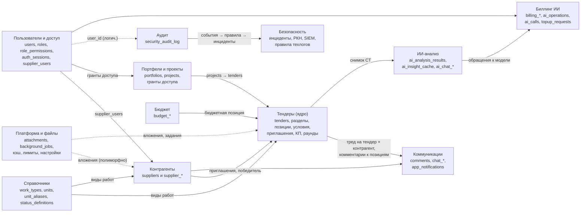

Пользователь (`users`) — точка входа почти для всех групп: он автор действий, ответственный, адресат уведомлений. Контрагенты и тендеры связаны через приглашения (`tender_invitations`), на которых держатся КП и чат «тендер × контрагент». Файлы привязаны к сущностям полиморфно (`attachments.entity_type/entity_id`), журнал ИБ ссылается на пользователей и сущности логически — без внешних ключей, чтобы записи журнала переживали любые удаления.

### 1.1. Главные агрегаты

**Тендер** ([`tenders`](tables.md#tenders)) — центральный агрегат системы:

- *Состав (ФКП):* тендер → разделы [`tender_sections`](tables.md#tender_sections) (дерево через `parent_section_id`, позиции и подразделы перемежаются по `items_before`) → позиции [`tender_items`](tables.md#tender_items) (объём, единица, атрибуты; снятые позиции остаются с `is_removed`). Дополнительные условия — [`tender_condition_fields`](tables.md#tender_condition_fields). Каждая значимая правка состава даёт новую версию шаблона ФКП [`tender_fkp_versions`](tables.md#tender_fkp_versions) (JSON-слепок) и увеличивает `tenders.tender_revision`.
- *Контекст:* проект [`projects`](tables.md#projects) (обязателен), виды работ [`tender_work_types`](tables.md#tender_work_types), бюджетная позиция и плановая сумма, ответственный, пакет документов (ссылки на [`attachments`](tables.md#attachments)), черновик протокола [`tender_protocols`](tables.md#tender_protocols) (1:1), журнал [`activity_log`](tables.md#activity_log).
- *Участники:* приглашение [`tender_invitations`](tables.md#tender_invitations) (тендер × контрагент, персональная ссылка) → ровно одно КП.

**КП** ([`quotes`](tables.md#quotes)) — агрегат внутри тендера, 1:1 с приглашением: КП → версии [`quote_versions`](tables.md#quote_versions) (каждая подача — новая версия, одна текущая; фиксирует номер версии ФКП и подтверждение НДС) → строки [`quote_items`](tables.md#quote_items) (цены материалов и работ за единицу по позиции тендера; отказ от позиции; корректировка объёма или новая позиция с решением специалиста) и значения условий [`quote_condition_values`](tables.md#quote_condition_values). До подачи состояние формы хранится в черновике [`invite_quote_drafts`](tables.md#invite_quote_drafts). Сравнительная таблица (СТ) не хранится — строится из текущих версий КП всех участников (с кэшем готового ответа в `heavy_read_cache`).

**Раунд** ([`tender_rounds`](tables.md#tender_rounds)) — повторный запрос КП: раунд → адресаты [`tender_round_recipients`](tables.md#tender_round_recipients) (контрагент, доставка письма, ответ = ссылка на поданную версию КП).

**Контрагент** ([`suppliers`](tables.md#suppliers)) — второй крупный агрегат: карточка (реквизиты, шифруемые контакты организации, оси проверок СБ/юрист/финансы, вычисляемый сводный статус, пул) → контакты-представители [`supplier_contacts`](tables.md#supplier_contacts) (ПДн, шифруются; опционально связаны с пользователем) и пользователи ЛК через [`supplier_users`](tables.md#supplier_users) → специализация [`supplier_work_types`](tables.md#supplier_work_types) и опыт [`supplier_work_experience`](tables.md#supplier_work_experience) → выручка по годам [`supplier_revenues`](tables.md#supplier_revenues) → автопроверки по реестрам [`supplier_checks`](tables.md#supplier_checks) → история решений [`supplier_qualification_history`](tables.md#supplier_qualification_history) (append-only, триггеры) и лента статусных событий [`supplier_status_events`](tables.md#supplier_status_events); документы анкеты — вложения `entity_type='supplier'`.

**Пользователь** ([`users`](tables.md#users)) — одна роль ([`roles`](tables.md#roles), права — [`role_permissions`](tables.md#role_permissions)), сессии устройств [`auth_sessions`](tables.md#auth_sessions), шаг MFA [`login_challenges`](tables.md#login_challenges), одноразовые ссылки [`password_reset_tokens`](tables.md#password_reset_tokens), гранты на портфели/проекты, для поставщика — привязка к контрагенту.

**Портфель** ([`portfolios`](tables.md#portfolios)) → проекты и подпроекты [`projects`](tables.md#projects) → тендеры. Доступ специалиста — гранты на портфель или проект с наследованием вниз по дереву.

**Чат** ([`chat_threads`](tables.md#chat_threads)) — один тред на пару «тендер × контрагент» → сообщения [`chat_messages`](tables.md#chat_messages) (глобальный номер события, ответы, мост к ячейке КП) → ревизии [`chat_message_revisions`](tables.md#chat_message_revisions); персональные отметки прочтения [`chat_thread_reads`](tables.md#chat_thread_reads).

**Инцидент ИБ** ([`security_incidents`](tables.md#security_incidents)) — создаётся правилом [`security_incident_rules`](tables.md#security_incident_rules) по событиям журнала [`security_audit_log`](tables.md#security_audit_log) → лента расследования [`security_incident_timeline`](tables.md#security_incident_timeline) → пакеты для РКН [`rkn_packages`](tables.md#rkn_packages).

**Клиент биллинга** ([`billing_clients`](tables.md#billing_clients)) → ИИ-операции [`ai_operations`](tables.md#ai_operations) → обращения к модели [`ai_calls`](tables.md#ai_calls); книга баланса [`billing_entries`](tables.md#billing_entries) (списание — одна запись на операцию) и заявки на пополнение [`topup_requests`](tables.md#topup_requests).

---

## 2. Пользователи, аудит, биллинг

### 2.1. Пользователи, доступ, аудит

Журнал ИБ ссылается на пользователя логически (без FK). Таблица пауз входа `login_throttle` связей не имеет (ключ — «e-mail + IP»).

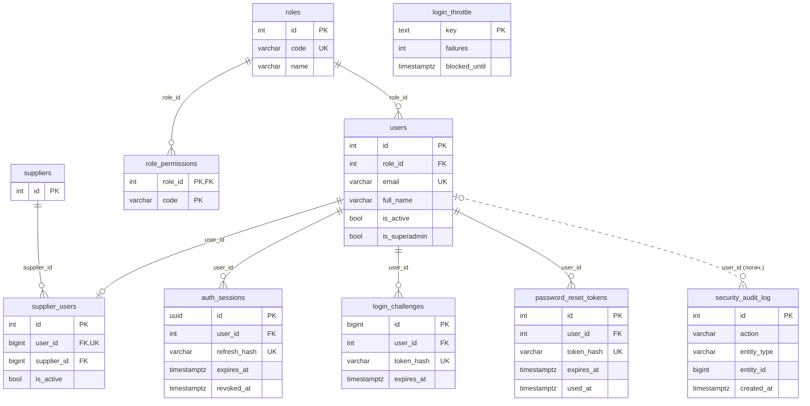

### 2.2. Биллинг ИИ

Баланс клиента = сумма `billing_entries.tokens`. Списание за операцию — не более одной записи (`uq_billing_entries_operation`). `billing_owner_settings` — одна строка настроек владельца, связей не имеет.

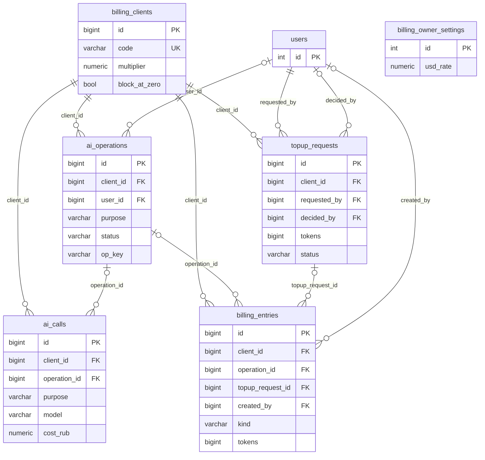

---

## 3. Каталог и портфели

Справочники и дерево объектов. Гранты доступа (`user_portfolio_access`, `user_project_access`) в БД не имеют внешних ключей — связи логические. Пользовательские статусы связаны с тендерами и КП по строковому коду (`custom_status_code`).

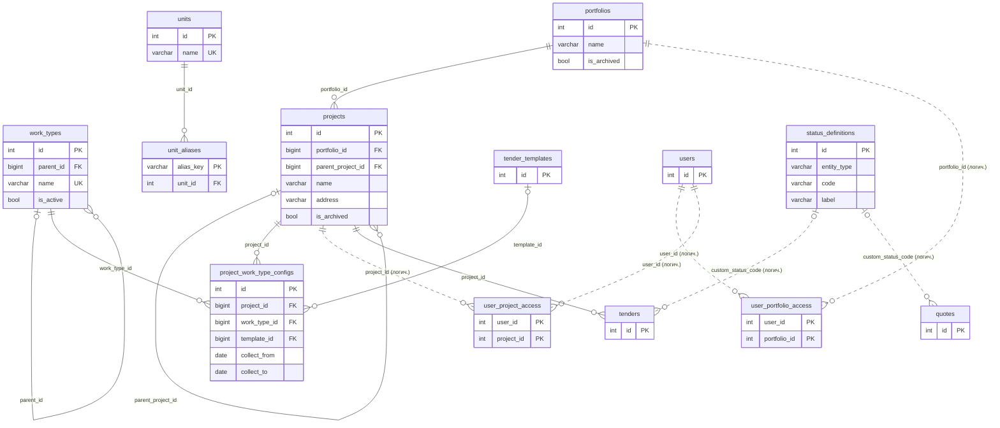

---

## 4. Поставщики

Связи-авторы смены статусов (`*_changed_by`, `decided_by`, `performed_by`, `created_by`) с `users` на диаграмме не показаны.

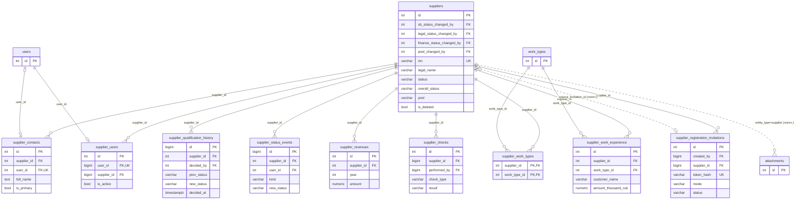

---

## 5. Тендеры (ядро)

### 5.1. Тендер и его состав

Связи-авторы с `users` и ссылки пакета документов (`doc_*_attachment_id`) на `attachments` не показаны.

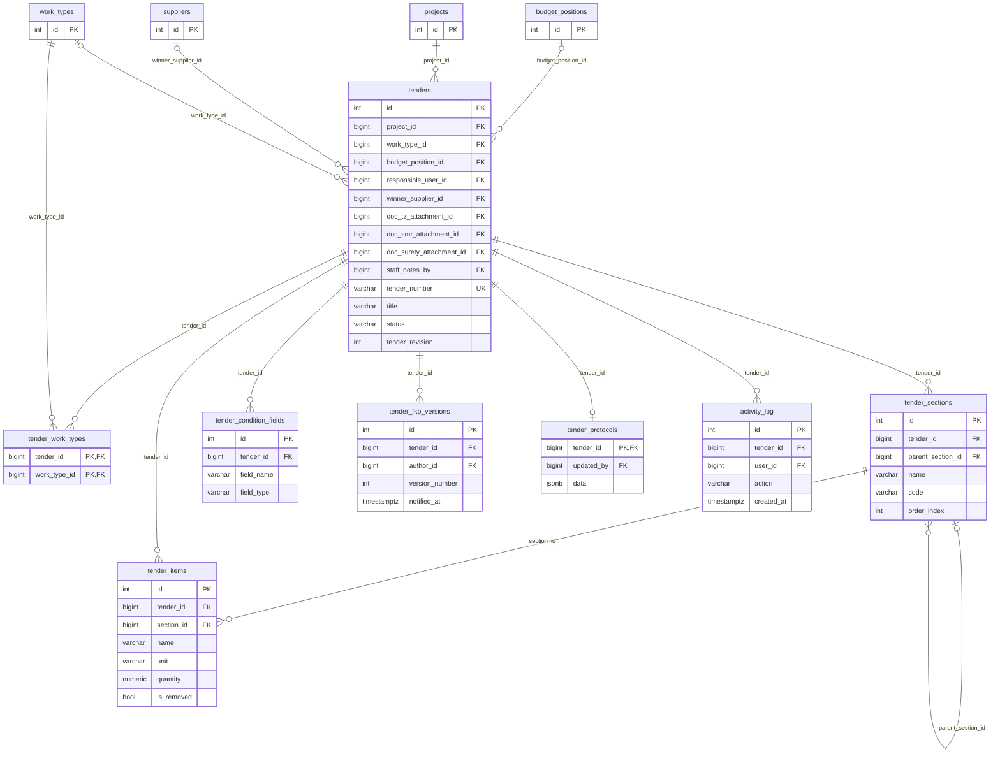

### 5.2. Приглашения, КП, раунды

Одно КП на приглашение (`quotes.tender_invitation_id` уникален). Строка КП ссылается на позицию тендера; у новой позиции поставщика ссылка пуста. Номер версии ФКП в версии КП (`fkp_version_number`) сопоставляется с `tender_fkp_versions.version_number` того же тендера логически.

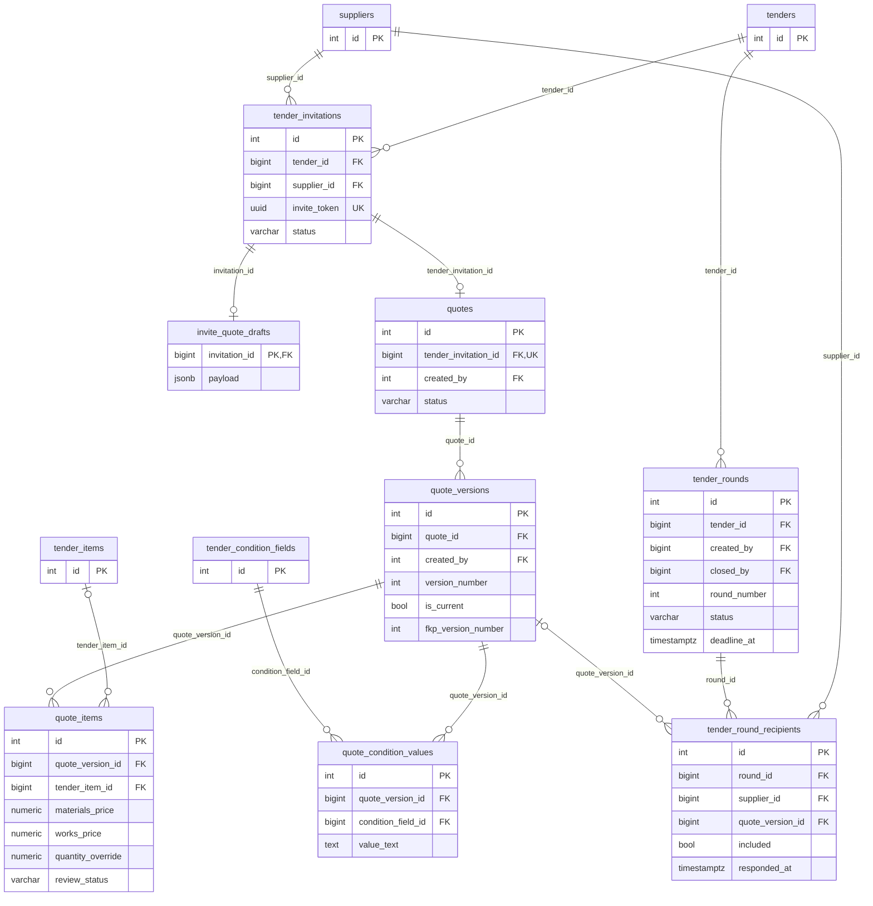

### 5.3. Шаблоны и черновики мастера создания

Шаблон и тендер связаны логически в обе стороны (тендер создан из шаблона; шаблон снят с тендера). Черновик мастера ссылается на задание разбора Excel и исходный файл; после создания тендера — на результат.

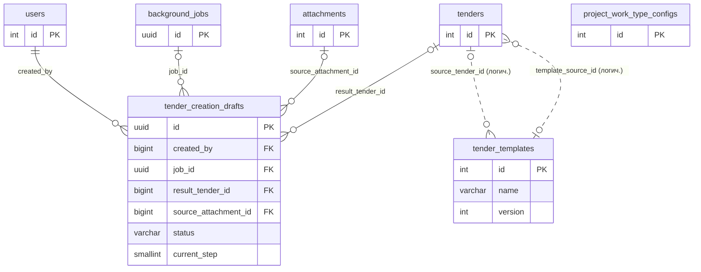

---

## 6. Бюджет

Бюджетная позиция (дерево) → бюджет на год (одна строка на позицию × год) → история изменений суммы. Тендер ссылается на бюджетную позицию; факт освоения не хранится.

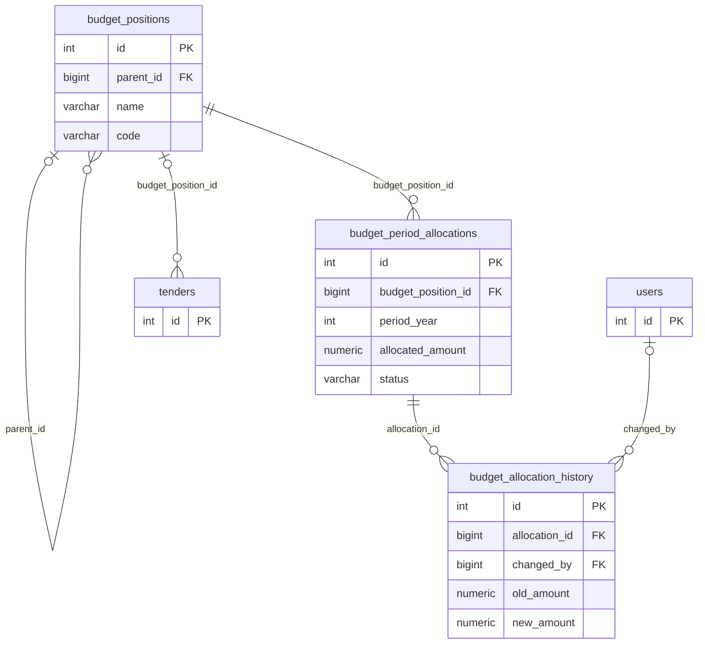

---

## 7. Коммуникации: комментарии, чат, уведомления

Комментарии привязаны к сущности полиморфно (`entity_type`, `entity_id`: тендер, КП, позиция, контрагент); для треда ячейки сравнения добавлен контрагент. Отметки прочтения в чате — на пользователя или (для поставщика без учётной записи) на приглашение: ровно одно из двух.

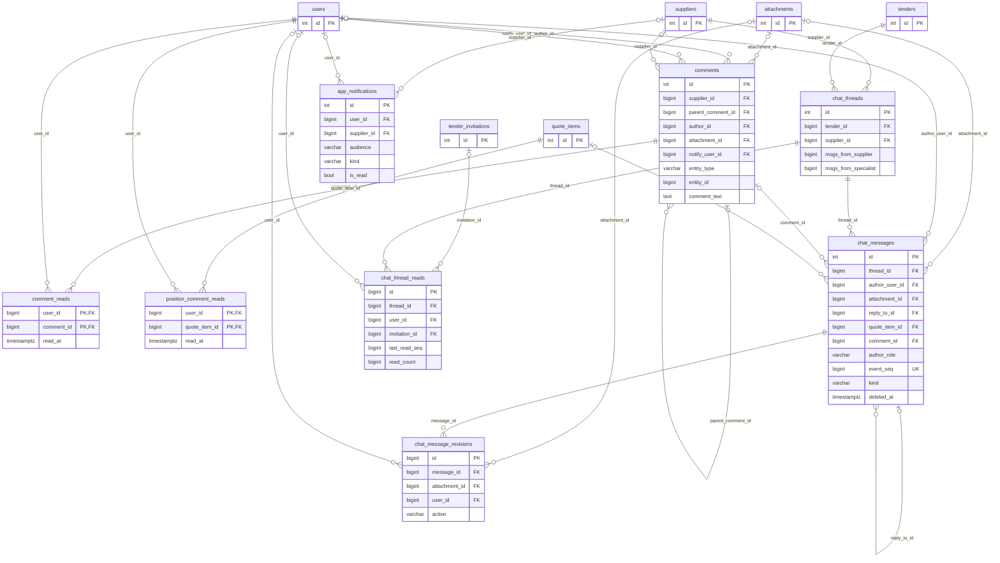

---

## 8. ИИ

Сохранённые разборы СТ, кэш коротких пояснений и разговоры с ИИ привязаны к тендеру (разговоры — ещё и к пользователю). Учёт обращений к модели — таблицы биллинга `ai_operations`/`ai_calls` (показаны и здесь, и в §2.2).

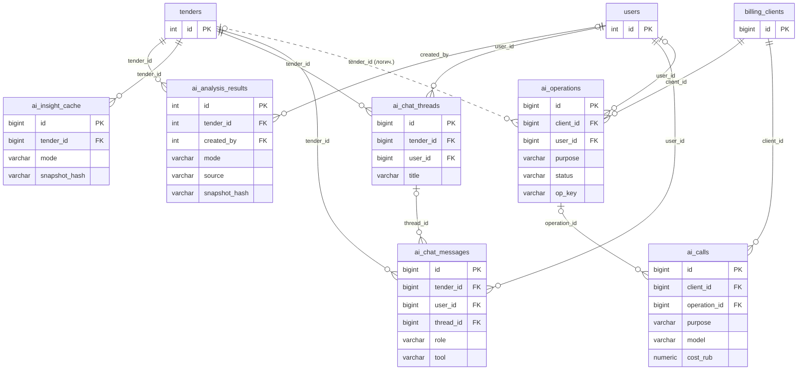

---

## 9. Безопасность

Инцидент создаётся правилом по событиям журнала; список событий инцидента — JSON-массив id (`related_event_ids`). Выгрузка в SIEM ведёт курсор по id журнала. Правила техлогов и состояние форвардера с бизнес-таблицами не связаны.

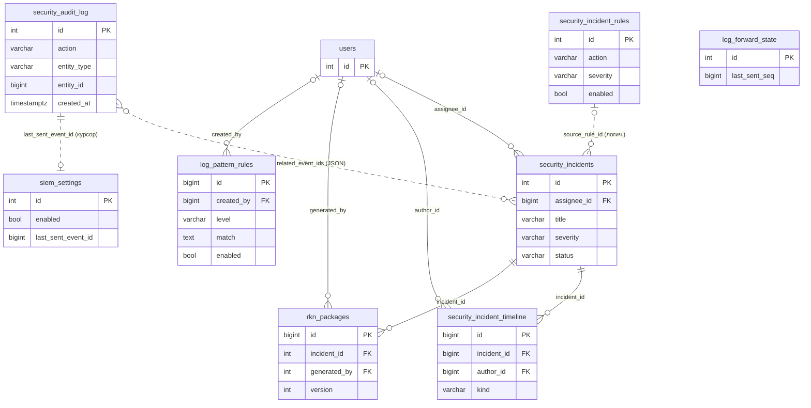

---

## 10. Платформа, файлы, настройки

Вложения и незавершённые загрузки привязаны к сущностям полиморфно; при подтверждении прямой загрузки строка `pending_uploads` превращается в строку `attachments`. Однострочные настройки (`app_settings`, `smtp_settings`), кэш тяжёлых чтений и счётчики лимитов связей не имеют.

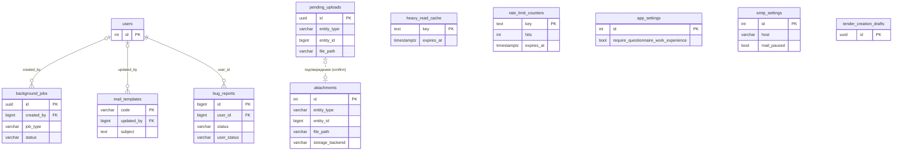
