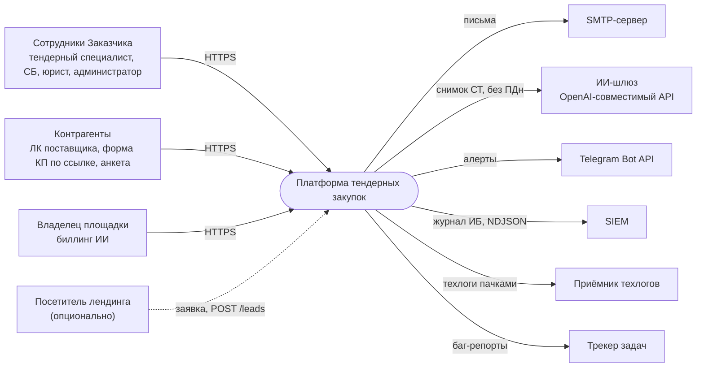
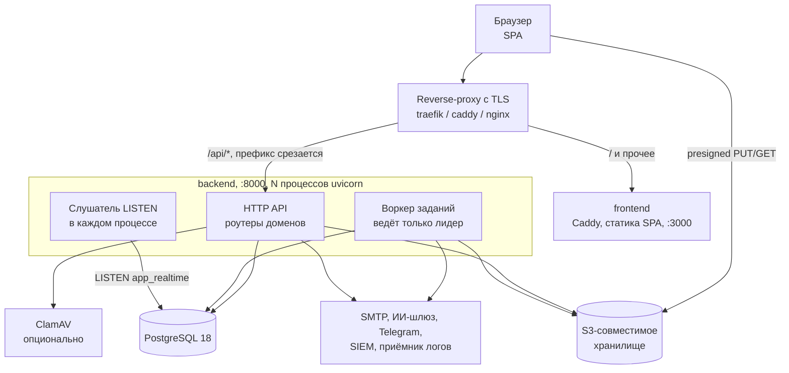
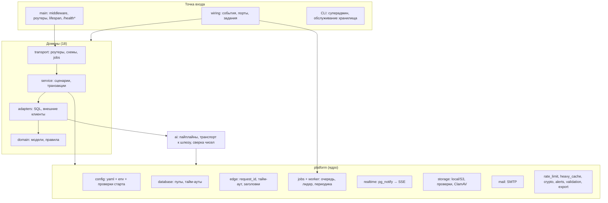
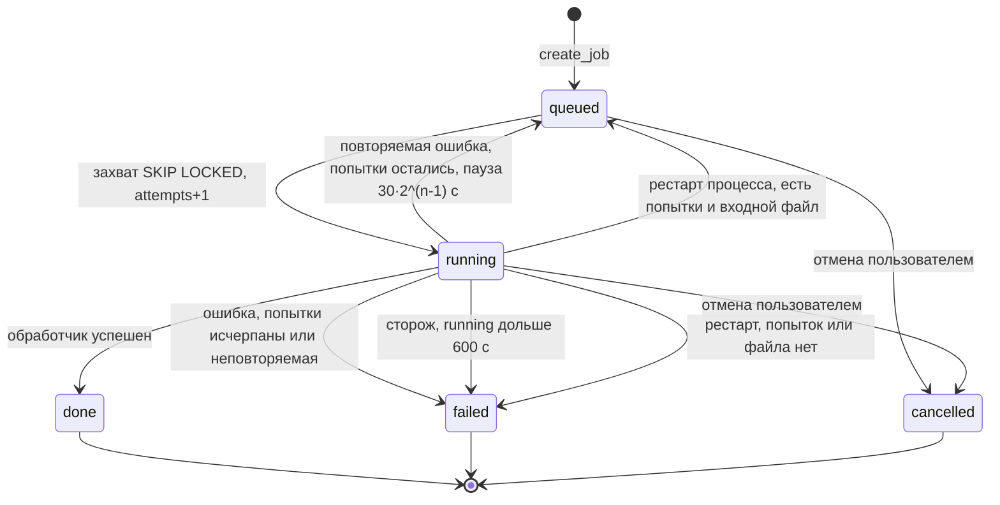
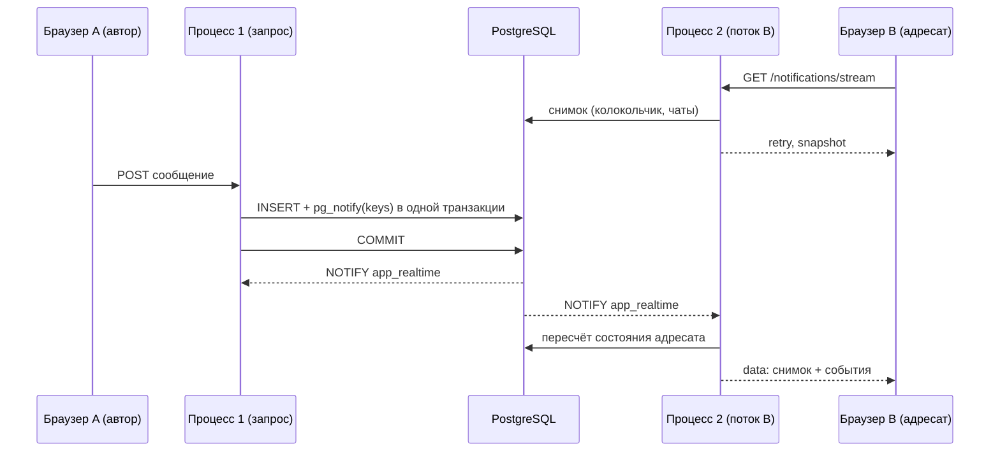
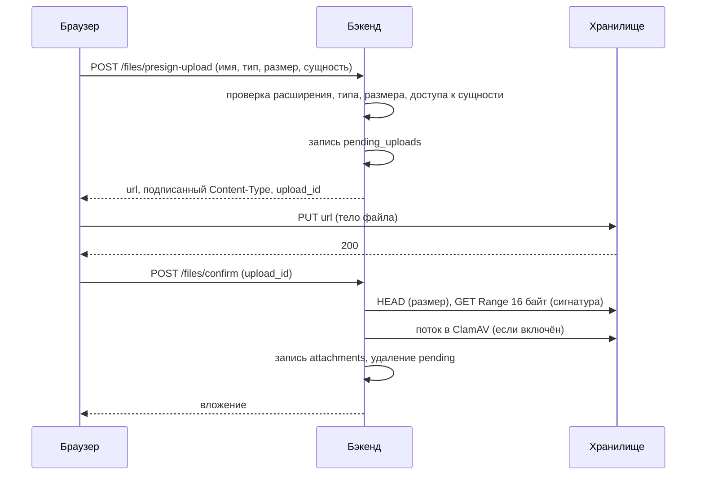
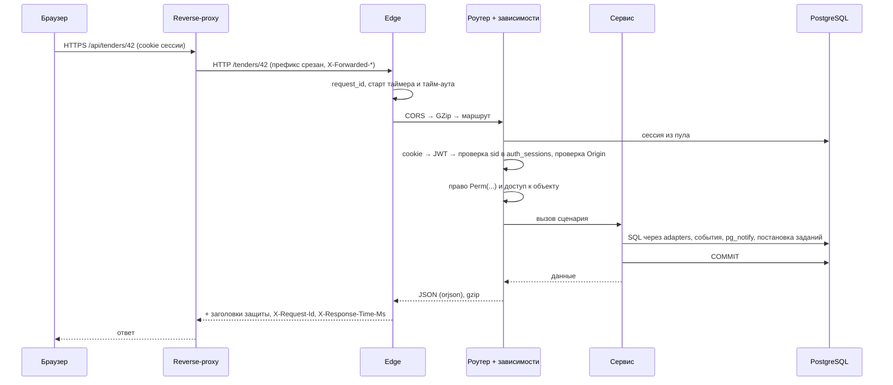

# Архитектура системы

Текущая архитектура платформы и обязательные требования к ней: модульный монолит бэкенда,
SPA фронтенда, фоновые задания, живые события, файлы, почта, ИИ-шлюз, конфигурация, сквозная
обработка запроса и логи.

Связанные разделы: [масштабирование](scalability.md), [безопасность](security.md),
[нефункциональные требования](nonfunctional.md), [окружения](../08-deploy/environments.md),
[демо-развёртывание](../08-deploy/demo-deploy.md), [CI/CD](../08-deploy/ci-cd.md),
[модель данных](../05-data-model/), [ИИ](../06-ai/), [API (OpenAPI)](../04-api/openapi.json).
Открытые вопросы раздела — в `../_oq/INFRA.md`.

Нумерация требований: **ARC-NN**. Метки сложности: **S / M / L / XL**.

---

## 1. Обзор

Платформа состоит из трёх исполняемых частей и двух хранилищ:

| Часть | Что это | Текущая реализация |
|---|---|---|
| Фронтенд | SPA, отдаётся статикой | Vite + React 19 + TypeScript, статику отдаёт Caddy (порт 3000) |
| Бэкенд | HTTP API + фоновый воркер + шина живых событий **в одном процессе** | Python 3.13, FastAPI, async SQLAlchemy 2 + asyncpg, uvicorn (порт 8000, по умолчанию 4 процесса) |
| Миграции | Применяются на старте контейнера бэкенда, до запуска API | Atlas (versioned SQL), источник истины схемы — декларативный файл схемы |
| БД | Единственное общее состояние всех процессов и реплик | PostgreSQL 18 (82 таблицы) |
| Файлы | Вложения, входные файлы заданий | S3-совместимое хранилище (или локальный диск в режиме `local`) |

Внешние интеграции (все — опциональны, без них система работает с деградацией):
SMTP-сервер, OpenAI-совместимый ИИ-шлюз, Telegram Bot API (техалерты и уведомления владельцу),
SIEM-коллектор (журнал ИБ), приёмник техлогов, трекер задач (баг-репорты), антивирус ClamAV.

Принципы, на которых держится архитектура:

1. **Postgres — единственная точка координации.** Очередь заданий, лидерство воркера, шина
   живых событий, счётчики лимитов, кэш тяжёлых чтений, шаг MFA — всё в БД. Ни Redis, ни
   брокера сообщений нет.
2. **Процесс без локального состояния, которое нужно другим процессам.** Любой процесс любой
   реплики может обслужить любой запрос (при `STORAGE_BACKEND=s3`). Исключения перечислены в
   [scalability.md](scalability.md#2-модель-процессов-и-реплик).
3. **Деградация вместо отказа.** Нет ИИ — детерминированный расчёт с пометкой «Пояснения ИИ
   недоступны»; нет почты — запись «не отправлено: причина»; нет хранилища — отказ только
   загрузок; нет Telegram — тихий no-op.

### 1.1. Контекст (C4, уровень 1)

### 1.2. Контейнеры (C4, уровень 2)

### 1.3. Технологический стек

| Слой | Текущий выбор | Требование |
|---|---|---|
| Язык/рантайм бэкенда | Python 3.13, asyncio | Асинхронный ввод-вывод; блокирующие операции (bcrypt, openpyxl, SMTP, gzip больших тел) — в пуле потоков |
| Веб-фреймворк | FastAPI + Starlette, uvicorn | Генерация OpenAPI 3 со всех ручек; `root_path=/api` |
| ORM/драйвер | SQLAlchemy 2 (async), asyncpg | Явные `select`, без ленивых связей (защита от N+1) |
| Сериализация | orjson | Быстрая сериализация крупных числовых тел (сравнительная таблица) |
| Миграции | Atlas (community), файл схемы — источник истины | Вперёд-только, применяются на старте |
| Хранилище | aioboto3 (S3 SigV4, path-style) | Любой S3-совместимый провайдер |
| Фронтенд | React 19, TypeScript, Vite 8, TanStack Router/Query/Virtual, Zustand, CSS Modules + Tailwind 4 (только вендоренные компоненты), Radix UI, recharts, иконки Solar | SPA без SSR |
| Пакетные менеджеры | uv (бэкенд), bun (фронт) | Lock-файлы в репозитории, сборка `--frozen` |

- **ARC-01.** Исполнитель может предложить иной стек, если все требования этого и смежных
  разделов выполняются; замена согласуется с Заказчиком до начала работ (см. открытые вопросы).

---

## 2. Бэкенд: модульный монолит

### 2.1. Домены и порядок зависимостей

Код бэкенда — один пакет приложения, в котором есть только: общее ядро `platform/`,
библиотека ИИ `ai/`, доменные пакеты и корень композиции (`main`, `wiring`, реестр моделей,
CLI-утилиты). Новые пакеты верхнего уровня вне доменов запрещены (проверяется тестом).

Домены упорядочены; домен может импортировать **только домены левее себя**:

`audit → identity → billing → catalog → portfolios → notifications → files → suppliers →
fkp_import → tenders → budget → analytics → insights → comments → chat → security → settings →
bug_reports`

| # | Домен | Ответственность |
|---|---|---|
| 1 | `audit` | Журнал событий ИБ (append-only), заведение инцидента правилом; пишут все домены |
| 2 | `identity` | Пользователи, роли, матрица «роль × действие», вход (пароль, TOTP, пауза), сессии, активация и восстановление, лиды; зависимости `CurrentUser`/`StaffUser`/`Perm` для всех ручек |
| 3 | `billing` | Биллинг ИИ: журнал обращений к модели, ИИ-операции, баланс клиента, заявки на пополнение, кабинет владельца |
| 4 | `catalog` | Справочники: виды работ (дерево), единицы измерения, статусы тендеров и КП |
| 5 | `portfolios` | Дерево портфель → проект (объект) → подпроект, гранты доступа пользователей |
| 6 | `notifications` | Центр уведомлений, каталог «событие → роли → письмо», живой поток топбара |
| 7 | `files` | Вложения: приём (через API и прямой загрузкой), проверки, выдача, уборка |
| 8 | `suppliers` | Контрагенты: реестр, карточка, анкета саморегистрации, аккредитация (СБ / юрист / финансы), проверки, контакты, учётки ЛК |
| 9 | `fkp_import` | Разбор Excel-ведомости ФКП/КП: детерминированный парсер + ИИ-подстраховка, фоновое задание разбора |
| 10 | `tenders` | Тендер целиком: структура, раунды, приглашения, КП и версии, сравнительная таблица, протокол, лента активности |
| 11 | `budget` | Бюджетные позиции деревом, распределение по годам, план/факт |
| 12 | `analytics` | Отчёты-реестры для экрана и выгрузки .xlsx (своих таблиц нет) |
| 13 | `insights` | ИИ-разбор тендера: сводка, повестка торга, пара финалистов, письмо поставщику, вопросы по таблице, сопоставление позиций |
| 14 | `comments` | Комментарии к тендеру, КП, позиции, контрагенту; переписка по ячейкам СТ |
| 15 | `chat` | Чат специалист ↔ контрагент, протокол синхронизации, публичный контур по ссылке |
| 16 | `security` | Экран журнала ИБ, выгрузки, SIEM, инциденты и их правила, пакеты для регулятора, статус шифрования, форвардинг техлогов, паттерны логов |
| 17 | `settings` | Экран «Настройки»: адреса уведомлений, требования к анкете, SMTP (если в интерфейсе) |
| 18 | `bug_reports` | Баг-репорты из виджета, отправка во внешний трекер и Telegram |

- **ARC-02.** Система должна быть реализована как модульный монолит с перечисленными (или
  эквивалентными) доменами и **однонаправленными** зависимостями между ними. Циклы между
  доменами недопустимы.
- **ARC-03.** Порядок доменов и правила импорта должны проверяться автоматическим тестом
  архитектуры (статический разбор импортов, без запуска приложения), который запускается в
  git-хуке и/или CI и падает на нарушении с указанием файла и строки. **M**
- **ARC-04.** Чужой домен импортируется только через его публичный API (файл пакета домена),
  не через внутренние слои. ORM-связи между доменами объявляются строковыми ссылками.

### 2.2. Слои внутри домена

Каждый домен разбит на слои `domain → adapters → service → transport` (модуль или подпакет);
слой импортирует только слои ниже себя.

| Слой | Содержимое | Может импортировать | Нельзя |
|---|---|---|---|
| `domain` | ORM-модели, чистые правила, константы, тексты отказов | `platform` | `ai`, HTTP-библиотеки, верхние слои |
| `adapters` | Репозитории: весь SQL, внешние клиенты | `domain`, `platform`, `ai` | HTTP-библиотеки |
| `service` | Сценарии, **владение транзакцией** (commit/rollback) | нижние слои; из SQLAlchemy только сессию, отметку изменения JSONB и исключения | HTTP-библиотеки, построение запросов |
| `transport` | HTTP-роутеры, схемы запросов/ответов, задания воркера (`jobs`) | все слои своего домена | SQLAlchemy |
| `__init__` | Публичный API домена | любые свои слои | — |

- **ARC-05.** HTTP-фреймворк используется только в `transport`. Отказы в нижних слоях
  выражаются доменными исключениями (`BadRequest`, `Unauthorized`, `PaymentRequired`,
  `Forbidden`, `NotFound`, `Conflict`, `Gone`, `PayloadTooLarge`, `Unprocessable`, `Locked`,
  `TooManyRequests`, `Unavailable`), которые единый обработчик отображает в коды 400, 401, 402,
  403, 404, 409, 410, 413, 422, 423, 429, 503 с телом `{"detail": <текст или структура>}`.
- **ARC-06.** SQL — только в `adapters`; `transport` не импортирует ORM вовсе.
- **ARC-07.** Общее ядро `platform/` не импортирует ничего вне себя; библиотека `ai/` — только
  себя и `platform/`; `ai/` не обращается к БД (получает снимок) и ничего не отправляет
  контрагентам.
- **ARC-08.** Модели ORM и декларативная схема БД должны совпадать по именованным индексам
  (тест сверки). Каждая модель регистрируется в реестре таблиц.

### 2.3. Связь «снизу вверх» и корень композиции

Нижний домен не знает о верхнем. Всё, что идёт снизу вверх, подключается в одном месте —
**корне композиции** (`wiring`), который вызывают и приложение, и тестовый плагин (тесты
собираются так же, как прод). Повторный вызов ничего не удваивает.

| Механизм | Как работает | Подключено сейчас |
|---|---|---|
| **События** | Синхронный вызов подписчиков в той же сессии и транзакции; ошибка подписчика летит в публикующего. Нужна доставка с повтором — подписчик ставит фоновое задание | `audit.IncidentCreated → security` (письмо об инциденте); `tenders.DialogNote → chat` (реплика в чат); `tenders.ItemsMerged → comments` (перенос комментариев при слиянии позиций) |
| **Порты** | Нижний домен объявляет протокол и порт; верхний даёт реализацию. Порт без реализации отвечает понятной ошибкой «порт не подключён» | `identity ← suppliers.SupplierDirectory` (приостановлена ли организация); `portfolios ← tenders.ProjectTenders`; `notifications ← suppliers.SupplierNotificationPrefs`; `suppliers ← tenders.SupplierTenderFacts`; `notifications ← chat.ChatBadge`; `files ← tenders.EntityAccess` (доступ к сущности вложения); `tenders ← budget.BudgetDirectory`; `platform.ai_metering ← billing.CallJournal` (журнал обращений к ИИ) |
| **Фоновые задания** | Домен экспортирует обработчики, периодические задачи и «повторяемые» исключения; воркер их не знает по имени | см. [§3](#3-фоновые-задания) |

- **ARC-09.** Система должна иметь единый корень композиции, в котором явно перечислены
  подписки на события, реализации портов и регистрация заданий; роутеры и middleware
  регистрируются явно в точке входа приложения. **S**

### 2.4. Компоненты бэкенда

---

## 3. Фоновые задания

### 3.1. Очередь

Очередь — таблица `background_jobs` в Postgres. Воркер — asyncio-задача **внутри процесса
API**, отдельного сервиса нет.

| Поле | Назначение |
|---|---|
| `id` (UUID) | Идентификатор; отдаётся клиенту для опроса статуса |
| `job_type` | Тип задания (см. §3.3) |
| `status` | `queued` → `running` → `done` / `failed` / `cancelled` |
| `created_by`, `request_id` | Автор и сквозной идентификатор запроса, породившего задание |
| `input_meta` (JSON) | Постановка задачи |
| `input_path` | Ключ входного файла в общем хранилище (`jobs/<id>_<имя>`), если есть |
| `result` (JSON), `progress` (JSON) | Результат; ход прогона (кадр поверх прежнего) |
| `attempts`, `max_attempts` | Счётчик попыток и потолок |
| `next_attempt_at` | Не раньше этого момента (пауза перед повтором) |
| `started_at`, `heartbeat_at`, `finished_at` | Времена; heartbeat обновляется записью хода |
| `error_message`, `error_class` | Причина отказа для человека и класс ошибки |

Правила:

- **ARC-10.** Задание можно поставить в **текущую транзакцию** вызывающего (не коммитя её):
  воркер увидит его только после коммита и не увидит при откате («сделать после коммита» без
  отдельного хука). Массовая постановка однотипных заданий — одним `INSERT` на пачку.
- **ARC-11.** Захват — `SELECT … WHERE status='queued' AND (next_attempt_at IS NULL OR
  next_attempt_at <= now()) ORDER BY created_at FOR UPDATE SKIP LOCKED LIMIT 1`, затем перевод в
  `running` с `attempts+1`.
- **ARC-12.** Повтор: экспоненциальная пауза `30 с × 2^(попытка−1)` (30, 60, 120 с…). Повторяются
  сетевые сбои HTTP-клиента (тайм-аут, транспорт), сбой транспорта ИИ и то, что обработчик сам
  пометил повторяемым. Необработанное исключение помечает задание `failed` с текстом
  «Внутренняя ошибка разбора. Попробуйте ещё раз.» и шлёт техалерт.
- **ARC-13.** Сторож: задание в `running` дольше `parse_job_hang_seconds` (600 с) переводится в
  `failed` с текстом «Разбор занял слишком много времени и был остановлен. Попробуйте ещё раз
  или упростите файл.» и алертом.
- **ARC-14.** После рестарта новый лидер возвращает прерванные `running` в очередь (текст
  «Прервано рестартом сервиса — повторная попытка»), если остались попытки и входной файл;
  иначе — `failed` («Разбор прерван рестартом сервиса»).
- **ARC-15.** Дедупликация: повторный запуск задания «того же смысла» (совпадают ключевые поля
  `input_meta`, например тендер и режим разбора) присоединяется к идущему, а не ставит второе.
  Для запуска разбора тендера используется блокировка строки до коммита постановки.
- **ARC-16.** Входной файл задания хранится в общем хранилище, а не на диске процесса; удаляется
  при `done`/`failed`/`cancelled`.
- **ARC-17.** Статус задания отдаётся клиенту единым форматом: `job_id`, `status`, `job_type`,
  `attempts`, времена, `input_meta`; при `done` — поля результата; при `failed` — `error` и
  `error_class`. Чужое задание — 404 «Задание не найдено».

### 3.2. Лидер очереди и цикл воркера

- **ARC-18.** Очередь и периодические задачи над общими данными ведёт **ровно один процесс** на
  всю установку — лидер. Лидерство — сессионная advisory-блокировка Postgres
  (`pg_try_advisory_lock` с фиксированным ключом) на отдельном соединении в режиме AUTOCOMMIT.
  Процесс умер или связь порвалась — блокировка снимается сама, её на следующем тике берёт
  другой процесс (любой реплики). **M**
- **ARC-19.** Цикл воркера: каждые `parse_job_poll_interval` (1 с) — проверка/взятие лидерства,
  периодические задачи, сторож зависаний, затем выборка очереди подряд не дольше 5 с
  (`DRAIN_SECONDS`), чтобы широкая рассылка не шла «по письму в секунду», а периодика получала
  свой тик. Задания выполняются **последовательно**.
- **ARC-20.** Кратковременная потеря связи с БД (до 60 с) логируется предупреждением без
  трейсбэка и без алерта (рестарт БД при выкатке — не сбой); дольше — ошибка и алерт.
- **ARC-21.** Остановка процесса: воркер получает сигнал, дожидается текущего тика до 5 с,
  освобождает лидерство.

### 3.3. Типы заданий

| Тип | Домен | Кто ставит | Назначение | Попыток | Что повторяется |
|---|---|---|---|---|---|
| `parse_excel` | fkp_import | Мастер создания тендера при загрузке Excel | Разбор ведомости в разделы и позиции; ИИ-подстраховка иерархии, если эвристика пуста | 3 | Сетевые сбои |
| `ai_analysis` (режим разбора тендера) | insights | Кнопка «Проанализировать» | Повестка торга и сводка по СТ; ход пишется в `progress`, экран опрашивает раз в 1 с | 1 | — («Анализ не выполнен», повтор решает человек) |
| `ai_analysis` (режим пары) | insights | Разбор пары финалистов | Сравнение двух подрядчиков | 3 | Сбой транспорта ИИ, сетевые сбои |
| `security_incident_email` | security | Событие «инцидент создан» | Письмо ответственным; строка задания — след доставки | 3 | Любой сбой |
| `supplier_notification` | suppliers | Новый контрагент (анкета) | Письмо ответственным о новом контрагенте | 3 | Любой сбой |
| `notification_mail` | notifications | Событие каталога уведомлений | Письма адресатам; при частичном отказе повтор только недоставленным, остаток адресатов — в `input_meta` | 3 | Отказ SMTP |
| `chat_mail` | chat | Сообщение чата | Письмо о сообщении (не из запроса: SMTP до 15 с не держит транзакцию) | 3 | Любой сбой |
| `bug_report_dispatch` | bug_reports | Виджет баг-репорта | Отправка в трекер задач и Telegram | 5 | Любой; несетевой сбой помечает репорт «не отправлен» |

### 3.4. Периодические задачи

| Имя | Домен | Интервал | Где идёт | Назначение |
|---|---|---|---|---|
| `shared-store-purge` | platform | 1 ч | лидер | Удалить просроченные строки счётчиков лимитов и кэша тяжёлых чтений |
| `auth-purge` | identity | 1 ч | лидер | Удалить сессии, истёкшие/отозванные более 7 дней назад; челленджи MFA через 1 ч после истечения; истёкшие паузы входа |
| `pending-uploads-cleanup` | files | 1 ч | лидер | Удалить незавершённые прямые загрузки старше `UPLOAD_PENDING_TTL_HOURS` (24 ч): объект и запись |
| `ai-prompt-purge` | billing | 6 ч | лидер | Стереть тексты промптов и ответов в журнале обращений к ИИ старше `AI_PROMPT_LOG_DAYS` (30) |
| `siem-drain` | security | 15 с | лидер | Отправить следующую пачку журнала ИБ в SIEM (до 1000 событий, NDJSON, курсор двигается после успеха) |
| `log-forward` | security | 10 с | лидер | Отправить пачку техлогов (по 200 строк) во внешний приёмник |
| `log-patterns` | security | каждый тик | **каждый процесс** | Отправить в Telegram сработавшие паттерны логов этого процесса; раз в 30 с обновить снимок правил |

Кроме того, каждый тик лидера: сторож зависших заданий (§3.1, ARC-13).

- **ARC-22.** Периодические задачи регистрируются доменами с именем, функцией и интервалом,
  который читается из настроек на каждом тике (нулевой — каждый тик). Задача сама открывает
  сессию и ловит свои ошибки; сбой задачи не роняет очередь. **S**

Оценка подсистемы фоновых заданий целиком (очередь, лидер, повторы, сторож, восстановление,
периодика, тесты): **L**.

---

## 4. Живые события (realtime)

Сценарии: бейдж колокольчика, бейдж и сообщения чатов, «печатает…», «прочитано» у
отправителя. Раньше — опрос раз в 15/30 с; сейчас — поток событий без опроса.

### 4.1. Шина `LISTEN/NOTIFY`

- **ARC-23.** Публикация — `pg_notify('app_realtime', payload)` **внутри транзакции**, рядом с
  записью строки: уведомление доставляется только при коммите и пропадает при откате. Публикация
  сама не коммитит.
- **ARC-24.** Payload — JSON не больше нескольких сотен байт (жёсткий лимит NOTIFY — 8000 байт):
  ключи адресатов, тип события и несколько скалярных полей (курсор чата и т.п.). Тело
  уведомления/сообщения в payload не кладётся.
- **ARC-25.** Ключи адресации повторяют предикаты выдачи уведомлений:

| Ключ | Кому |
|---|---|
| `staff` | Широковещательное всем сотрудникам |
| `staff:<user_id>` | Персонально сотруднику |
| `supplier:<supplier_id>` | Всей организации контрагента |
| `supplier:u<user_id>` | Персонально пользователю контрагента |
| `chat:p<project_id>` | Событие чата по тендеру объекта — сотрудникам с доступом к объекту |
| `chat:all` | События чата для администраторов (видят все объекты) |

- **ARC-26.** В **каждом** процессе бэкенда работает один слушатель `LISTEN` на отдельном
  (не из пула) соединении, раскладывающий события по очередям подписчиков этого процесса
  (очередь на поток — 32 события; переполнение отбрасывает событие: каждое событие — лишь повод
  пересчитать состояние). Обрыв — переподключение с паузой 1 → 30 с и рассылка всем
  подписчикам события `resync` (пересчитать, т.к. пропущены NOTIFY).

### 4.2. SSE-потоки

| Поток | Кто | Особенности |
|---|---|---|
| `GET /notifications/stream` | Сотрудник и пользователь контрагента (по cookie) | Кадр — полный снимок: колокольчик + чаты, плюс тонкие события чата пачки |
| `GET /chats/invite/{token}/stream` | Контрагент по magic-link (без учётки) | Лимит частоты по паре «токен + IP» |

- **ARC-27.** Первый кадр — `retry: 3000`, затем `snapshot`; далее кадр на пачку событий
  (накопившиеся забираются разом); без событий — комментарий `: ping` каждые 15 с. Каждый кадр
  — полный снимок, поэтому переподключение не требует курсора и `Last-Event-ID`.
- **ARC-28.** Соединение БД возвращается в пул сразу после построения снимка; поток живёт
  часами без занятого соединения и берёт его только на пересчёт.
- **ARC-29.** Маршруты потоков оканчиваются на `/stream` и исключены из gzip (иначе кадры
  копятся в буфере сжатия) и из тайм-аута обработчика (тайм-аут покрывает только время до
  начала ответа).
- **ARC-30.** Фронтенд держит **один поток на браузер**: лидер вкладок выбирается через Web
  Locks, снимки раздаются остальным вкладкам через BroadcastChannel. Поток читается через
  `fetch` (не `EventSource`), чтобы при 401 обновить сессию и переподключиться; разбор
  потока — отдельный чистый модуль, устойчивый к разрыву события границей сетевого куска.
- **ARC-31.** Ход ИИ-разбора **не** идёт через SSE: он пишется в строку задания, экран
  опрашивает статус раз в секунду (работает при любом числе процессов и при смене лидера).

Оценка: шина + два потока + клиент с лидером вкладок: **L**.

---

## 5. Хранилище файлов

| Режим `STORAGE_BACKEND` | Где байты | Прямая загрузка браузером | Назначение |
|---|---|---|---|
| `local` (по умолчанию) | Каталог `UPLOAD_DIR` на диске процесса | Нет | Разработка без бакета, тесты |
| `s3` | S3-совместимый бакет | Да, presigned PUT/GET | Стенды и прод |

- **ARC-32.** Каждое вложение помнит, где лежит (`storage_backend` в записи), поэтому включение
  `s3` на живой установке безопасно; перенос старых файлов — идемпотентная CLI-команда
  `migrate-local` (уже залитый объект того же размера не перезаливается).
- **ARC-33.** Ключ объекта: `<тип сущности>/<id сущности>/<uuid>_<безопасное имя>`; входные
  файлы заданий — `jobs/<id>_<имя>`.
- **ARC-34.** Прямая загрузка: `POST /files/presign-upload` → браузер `PUT` по ссылке (с тем
  `Content-Type`, что вернул presign: он входит в подпись) → `POST /files/confirm`. До
  подтверждения файл — запись `pending_uploads`, во вложениях его нет. Подтверждение сверяет
  размер, сигнатуру и антивирус; отказ удаляет объект. Ссылки живут `S3_PRESIGN_TTL_SEC`
  (900 с, допустимо 60–3600).
- **ARC-35.** Загрузка через API (`POST /files/upload`, multipart) работает всегда и пишет тело в
  хранилище потоком; фронтенд переходит на неё, если прямая загрузка недоступна (режим `local`,
  бакет без CORS, сетевой сбой).
- **ARC-36.** Те же пары ручек есть у формы КП по magic-link и у анкеты контрагента; скачивание
  — presigned GET прямо из бакета (с `ResponseContentType` = канонический тип), прежние ручки
  `/download` отдают поток в обоих режимах.
- **ARC-37.** Публичная `GET /files/config` сообщает фронту лимит и доступность прямой загрузки
  (без адресов и ключей); фронт не дублирует лимит в коде.
- **ARC-38.** Адрес подписи ссылок для браузера (`S3_PRESIGN_ENDPOINT`) может отличаться от
  адреса, которым ходит бэкенд (`S3_ENDPOINT`): хост входит в подпись, подменить его после
  нельзя.
- **ARC-39.** Проверки при приёме, антивирус ClamAV (опционально) и лимиты — см.
  [security.md §8](security.md#8-загрузка-файлов).
- **ARC-40.** CLI обслуживания: `check` (бакет отвечает, ключи верны), `ensure-bucket`,
  `migrate-local [--dry-run]`, `cleanup-pending`.

Оценка: **M** (оба режима, presign, проверки, CLI, уборка).

---

## 6. Почта

- **ARC-41.** Рубильник `MAIL_ENABLED` (false — ни одно письмо не уходит). Источник SMTP-сервера:
  при `SMTP_SETTINGS_IN_UI=false` — один на установку из окружения (`SMTP_*`), ручки настройки SMTP
  отвечают 404; при `true` — строка настроек, которую правит администратор в интерфейсе (с
  проверкой соединения), переменные `SMTP_*` не читаются. Администратор может поставить почту на
  паузу в настройках.
- **ARC-42.** Порт 465 — SMTPS (TLS сразу); прочие — SMTP + STARTTLS по флагу `SMTP_USE_TLS`.
  Тайм-аут подключения 15 с. Отправка выполняется в пуле потоков, не блокируя цикл событий.
- **ARC-43.** Письма уходят **фоновыми заданиями** (не из HTTP-запроса); строка задания —
  след доставки (кому, что ушло, что нет). Итог отправки — «принято SMTP-сервером» или причина
  для человека: «Почта выключена», «Почта выключена в настройках», «Почтовый сервер не
  настроен», «Нет адреса», «Адрес не расшифрован», «Адрес не принимается», «Адрес отклонён
  почтовым сервером», «Письмо отклонено почтовым сервером», «Почтовый сервер недоступен».
- **ARC-44.** На зарезервированные зоны (`.test`, `.invalid`, `.example`) письма не отправляются;
  адреса на служебных доменах (`.localhost`, `.local`, `.test`) принимаются формами только при
  `ALLOW_LOCAL_EMAIL_DOMAINS=true` (стенды и демо).
- **ARC-45.** Ссылки в письмах строятся от `PUBLIC_APP_URL`; имя площадки в теме и подписи —
  `BRAND_NAME`.

Оценка: **M**.

---

## 7. ИИ-шлюз

Подробно пайплайны и инварианты — в [разделе ИИ](../06-ai/). Здесь — инфраструктурная часть.

- **ARC-46.** Все обращения к модели идут через один транспортный модуль к
  **OpenAI-совместимому API** (`AI_BASE_URL`, ключ `AI_API_KEY`): `/chat/completions` с
  `temperature: 0` и `response_format` (строгая JSON-схема или `json_object`), `/embeddings` для
  векторов, `/models` для проверки. Провайдер любой (облачный шлюз по умолчанию, допускается
  локальный OpenAI-совместимый сервер).
- **ARC-47.** Модель выбирается по роли: `mechanical` (в т.ч. разбор Excel), `language`,
  `embedding` (настройка `ai_models`, переопределяется `AI_MODELS__<РОЛЬ>`). Имён моделей в коде
  нет.
- **ARC-48.** Общий рубильник `AI_ENABLED` и флаги пайплайнов `AI_PIPELINES__<ИМЯ>`
  (`negotiation_agenda`, `pair_duel`, `position_matching`, `supplier_letter`, `table_qa`). Без
  ключа транспорт в сеть не ходит и пишет об этом в лог.
- **ARC-49.** Тайм-ауты: соединение не дольше 10 с, до 3 попыток соединения (тело ещё не ушло —
  повтор безопасен); бюджет шага `AI_STEP_BUDGET_SECONDS` (60 с), прогона `AI_RUN_BUDGET_SECONDS`
  (180 с) — превышение отдаёт собранное и помечает шаг в трассе. Один повтор ответа, не прошедшего
  схему. Параллелизм чтения комментариев в повестке — 6 запросов.
- **ARC-50.** Опциональный HTTP-прокси `AI_HTTP_PROXY` применяется **только** к запросам в
  ИИ-шлюз (не на весь процесс).
- **ARC-51.** Каждый вызов модели учитывается (токены, стоимость) через порт журнала обращений
  биллинга; хранение текста промптов — только при `AI_PROMPT_LOG_ENABLED`, со сроком
  `AI_PROMPT_LOG_DAYS`.
- **ARC-52.** Проверка пути до модели — `GET /health/llm` (см. [nonfunctional.md](nonfunctional.md#2-доступность-и-health-check)).

---

## 8. Конфигурация

### 8.1. Источники и приоритет

От сильного к слабому:

1. Явные параметры (только тесты).
2. Переменные окружения процесса (compose `environment:` / окружение PaaS).
3. Файл `.env` рядом с приложением (локальная разработка).
4. Версионируемый YAML-baseline (`config/dev.yaml` | `config/prod.yaml`), выбирается `CONFIG_FILE`
   (по умолчанию `prod.yaml`; несуществующий файл — отказ старта).
5. Значения по умолчанию в коде.

- **ARC-53.** Несекретные настройки описаны схемой (типизированные поля с умолчаниями) и
  задаются YAML-файлом в репозитории (видны в ревью), любое поле переопределяется переменной
  окружения с тем же именем в верхнем регистре; вложенные — через `__`
  (`AI_PIPELINES__POSITION_MATCHING=true` меняет один ключ).
- **ARC-54.** **Секреты — только из окружения/.env**, в YAML их нет и быть не может:
  `DATABASE_URL`, `JWT_SECRET`, `FIELD_ENCRYPTION_KEY`, `AI_API_KEY`, `SMTP_USERNAME`,
  `SMTP_PASSWORD`, `S3_ACCESS_KEY`, `S3_SECRET_KEY`, `TELEGRAM_BOT_TOKEN`, `TELEGRAM_CHAT_ID`,
  `LOG_FORWARD_TOKEN`, `GITHUB_BUGREPORT_TOKEN`, `GITHUB_BUGREPORT_WEBHOOK_SECRET`.
  `JWT_SECRET` и `FIELD_ENCRYPTION_KEY` не имеют значений по умолчанию.
- **ARC-55.** Понятия «окружение» у приложения нет: поведение зависит только от конкретных
  настроек, а не от имени стенда. Исключений «на dev можно» в проверках нет.

### 8.2. Отказ старта при небезопасной конфигурации

- **ARC-56.** При старте (до приёма запросов) система должна проверить конфигурацию и
  **отказаться стартовать** с понятным перечнем проблем, если: **M**

| # | Проверка | Текст проблемы (образец) |
|---|---|---|
| 1 | Нет файла `CONFIG_FILE` | «CONFIG_FILE=…: нет файла …» |
| 2 | Не заданы `JWT_SECRET` или `FIELD_ENCRYPTION_KEY` | ошибка валидации настроек |
| 3 | `STORAGE_BACKEND=s3`, но пусты `S3_BUCKET` / `S3_ACCESS_KEY` / `S3_SECRET_KEY` | «STORAGE_BACKEND=s3, но не заданы: …» |
| 4 | `JWT_SECRET` равен публичному dev-значению из репозитория | «JWT_SECRET: публичное dev-значение из git» |
| 5 | `FIELD_ENCRYPTION_KEY` равен публичному dev-значению | «FIELD_ENCRYPTION_KEY: публичное dev-значение из git» |
| 6 | `CORS_ORIGINS` пуст или содержит `*` | «CORS_ORIGINS: пусто или '*'» |
| 7 | `PUBLIC_APP_URL` не `https://` (http допустим только для loopback-хостов) | «PUBLIC_APP_URL: должен быть https:// …» |
| 8 | `LOG_LEVEL` не из DEBUG/INFO/WARNING/ERROR/CRITICAL | «LOG_LEVEL: неизвестное значение …» |
| 9 | `LOG_FORMAT` не `text`/`jsonl` | «LOG_FORMAT: неизвестное значение …» |
| 10 | `LOG_FORWARD_ENABLED=true` при `WEB_CONCURRENCY≠1` | «LOG_FORWARD_ENABLED несовместим с WEB_CONCURRENCY=N: нужен один процесс» |
| 11 | `S3_PRESIGN_TTL_SEC` вне 60–3600 | ошибка валидации |

Все найденные проблемы перечисляются в одном сообщении («Конфигурация не готова: …; …»).

- **ARC-57.** Не блокирует, но громко предупреждает в лог: провайдер шифрования полей не является
  сертифицированным СКЗИ.
- **ARC-58.** При старте в лог пишется снимок эффективной конфигурации, в котором **все** поля
  секретов (перечень берётся из схемы секретов, не руками) заменены на `***`.
- **ARC-59.** Порядок старта (lifespan): проверки → предупреждение о криптографии → снимок
  конфигурации → создание бакета при `S3_CREATE_BUCKET=true` (сбой не валит старт) → заведение
  клиента биллинга (сбой не валит старт) → запуск воркера → запуск слушателя realtime. Остановка —
  в обратном порядке.

---

## 9. Сквозная обработка запроса (middleware)

Порядок снаружи внутрь: **Edge → CORS → GZip → маршрутизация**.

| Слой | Что делает | Параметры |
|---|---|---|
| **Edge** (один ASGI-слой без лишних задач на запрос) | `request_id`: из `X-Request-Id` или новый UUID, кладётся в контекст (виден логам и журналу ИБ как `correlation_id`); журнал медленных ответов (метод, **шаблон** маршрута, статус, мс); тайм-аут обработчика; при необработанном исключении — лог + техалерт (дедуп по методу, маршруту и классу ошибки), затем 500; заголовки защиты; `X-Request-Id` и `X-Response-Time-Ms` в ответе | `SLOW_REQUEST_MS`=200, `REQUEST_TIMEOUT_SECONDS`=60 → 504 `{"detail":"Запрос выполняется слишком долго — попробуйте сузить выборку"}` |
| **CORS** | Явный список origin, credentials, все методы; разрешённые заголовки: `Content-Type`, `Authorization`, `Cache-Control`, `If-None-Match`, `X-Request-Id`; открытые клиенту: `X-Request-Id`, `X-Response-Time-Ms`, `ETag`; кэш preflight 600 с | `CORS_ORIGINS` |
| **GZip** (селективный) | Сжатие ответов ≥ 1000 байт уровнем 6; маршруты `…/stream` не сжимаются | `GZIP_MIN_BYTES`, `GZIP_LEVEL` |
| Обработчик ошибок | Доменные исключения → HTTP-коды (ARC-05) | — |
| Сериализация | orjson для всех ответов | — |

- **ARC-60.** Сквозная обработка должна стоить дёшево: один проход по ASGI-сообщениям без
  обёрток, порождающих задачи на каждый запрос (замер исходной системы: пять отдельных
  middleware съедали ~22 % CPU пустого `/health`). **S**
- **ARC-61.** Тайм-аут покрывает только обработчик до начала ответа; отдача тела (SSE, выгрузки)
  тайм-аутом не ограничена.

---

## 10. Логи и наблюдаемость

- **ARC-62.** Логи — в stdout контейнера. Формат `LOG_FORMAT`:
  `text` — `<время ISO> <уровень> [<логгер>] <сообщение>`; `jsonl` — одна JSON-строка на запись с
  полями строго `ts`, `level`, `logger`, `msg`, `request_id` (+ `exc` при исключении). Поля не
  расширяются содержимым записи (в техлог не попадает чувствительный payload).
- **ARC-63.** Уровень `LOG_LEVEL` (по умолчанию INFO). Логгеры HTTP-клиента подняты до WARNING
  (иначе в лог попадает полный URL запроса, у Telegram — с токеном бота в пути).
- **ARC-64.** Пересылка техлогов (опционально, `LOG_FORWARD_ENABLED` + `LOG_FORWARD_URL` +
  `LOG_FORWARD_TOKEN`): обработчик логов кладёт ту же строку, что и в stdout, в ограниченный
  буфер в памяти (5000 строк, переполнение режет самые старые и считает их); периодическая
  задача отправляет пачку одним POST, курсор хранится в БД и двигается после успеха. Без
  включателя и токена — ни одного сетевого вызова. Совместимо только с одним процессом (ARC-56 п.10).
- **ARC-65.** Паттерны логов → Telegram: правила (уровень, подстрока или регулярное выражение,
  окно в минутах, порог срабатываний, ключ дедупликации, включён) хранятся в БД и правятся без
  кода; обработчик только оценивает строку и кладёт сработку в очередь, отправку делает тик
  воркера в каждом процессе.
- **ARC-66.** Техалерты в Telegram (`ALERTS_ENABLED` + токен и чат): необработанная ошибка
  запроса, падение задания, зависание задания. Дедупликация по ключу с окном
  `ALERTS_DEDUPE_SECONDS` (300 с, не меньше 30) и счётчиком подавленных; сбой отправки — только
  предупреждение. Опциональный прокси `TELEGRAM_HTTP_PROXY` только для этих запросов.

Подробнее о мониторинге — [nonfunctional.md](nonfunctional.md#4-мониторинг-и-алерты).

---

## 11. Фронтенд

### 11.1. Слои Feature-Sliced Design

Зависимости — только вниз: `app → screens → widgets → features → entities → shared`.

| Слой | Что лежит | Примеры слайсов |
|---|---|---|
| `app` | Дерево маршрутов, провайдеры, каркасы, глобальные стили, экран сбоя | `router`, `AuthGuard`, каркас приложения |
| `screens` | Экран под маршрутом (27 слайсов) | `tender`, `tender-registry`, `tender-create`, `fill`, `login`, `owner` |
| `widgets` | Самостоятельные блоки из нескольких фич | `topbar`, `rail`, `sidebar`, `workspace`, `comment-thread` |
| `features` | Действие пользователя со своим UI (11 слайсов) | `ai-analysis`, `chat`, `mfa`, `invite-participants`, `tender-lifecycle` |
| `entities` | Предметные сущности: данные, модель, двери к API, мелкий UI (25 слайсов) | `tender`, `comparison`, `supplier`, `session`, `notification` |
| `shared` | Без предметной области: UI-примитивы, утилиты, транспорт | `ui/Button`, `api/http`, `lib/router` |

Сегменты слайса: `ui/` (компоненты и их `.module.css`), `model/` (типы, чистые функции, сторы),
`api/` (`*.api.ts` — единственное место запросов слайса), `lib/`, `config/`.

- **ARC-67.** Импорт слоя выше себя и заход внутрь чужого слайса в обход его `index.ts` должны
  ловиться линтером (правило ограниченных импортов) с понятным текстом. Соседи по слою друг
  друга не импортируют. Между сущностями значения импортируются в одну сторону, встречная связь
  — только типы. Вторая публичная точка `testing` отдаёт фикстуры (основная — никогда). **S**
- **ARC-68.** `shared` не импортирует верхние слои и не читает флаги окружения напрямую (флаги —
  единственный модуль вне слоёв, передаются параметрами).

### 11.2. Роутинг

- **ARC-69.** Дерево маршрутов задаётся кодом в одном файле (TanStack Router); каждый экран —
  отдельный чанк (ленивая загрузка). Остальной код берёт навигацию только из прослойки
  `shared/lib/router` (смена роутера — правка одного файла); линт запрещает прямой импорт
  роутера. Около 50 маршрутов: публичные (`/login`, `/reset-password`, `/register`,
  `/fill/$token`, `/welcome`), рабочие под каркасом приложения, раздел владельца `/owner/*`.
- **ARC-70.** URL — источник истины активного раздела: в стор его проецирует одно место;
  навигация — только `navigate()`.

### 11.3. Состояние

- **ARC-71.** Серверное состояние — TanStack Query с умолчаниями: `staleTime` 30 с, `gcTime` 5 мин,
  `retry` 1, `refetchOnWindowFocus: false` (экраны тяжёлые), мутации без повторов; частности на
  месте (справочники — 5 мин, сравнение и счётчики — 10 с). Ключи запросов — в одном модуле.
  Клиент запросов создаётся на монтирование (не модульная константа), чтобы кэш не переживал
  смену пользователя.
- **ARC-72.** Клиентское состояние — Zustand, небольшие сторы: рабочее пространство
  (`sidebarOpen` и т.п.), оформление, закреплённые разделы, чат. Выведенное из данных —
  функция от данных, не хранимое состояние.

### 11.4. Клиент API

- **ARC-73.** Типизированный клиент генерируется из OpenAPI живого бэкенда (orval); сгенерированный
  код коммитится, руками не правится, исключён из линта; проверка рассинхронизации — команда
  `api:check`. Ручной транспорт `apiFetch` — для ручек без описанной схемы ответа. **S**
- **ARC-74.** Транспорт: базовый URL `VITE_API_URL` (по умолчанию `/api` на том же домене),
  `credentials: include`; при 401 — одно обновление сессии на вкладку и одно на браузер
  (очередь через Web Locks, т.к. refresh-токен вращается), затем повтор запроса; окончательный
  отказ — переход на `/login?reason=…`. Текст ошибки для человека — единая функция
  (`detail` сервера → код ответа → запасной текст).
- **ARC-75.** Флаги сборки `VITE_*` вшиваются в бандл и по умолчанию выключены; см. таблицу в
  [demo-deploy.md](../08-deploy/demo-deploy.md#7-переменные-окружения).

### 11.5. Сборка и раздача

- **ARC-76.** Прод-сборка: `tsc --noEmit` + `vite build` → статика; Caddy отдаёт `/assets/*` с
  `Cache-Control: public, max-age=31536000, immutable` (пропавший чанк — честный 404), остальное —
  SPA-фолбэк на `index.html` с `Cache-Control: no-cache`; сжатие zstd/gzip.

Оценка каркаса фронтенда (слои, роутинг, провайдеры, транспорт, генерация клиента, SSE-клиент):
**L**.

---

## 12. Сводка оценок

| Блок | Сложность |
|---|---|
| Каркас модульного монолита, автотест архитектуры, корень композиции | M |
| Очередь заданий, лидер, повторы, периодика | L |
| Realtime: pg_notify + SSE + клиент с лидером вкладок | L |
| Хранилище local/S3 с presign, проверками, ClamAV, CLI | M |
| Почта (env/UI, задания, причины) | M |
| Транспорт ИИ-шлюза, учёт вызовов, health | M |
| Конфигурация с проверками старта и редактированием снимка | M |
| Middleware Edge, обработка ошибок, логи text/jsonl, форвардинг, паттерны, алерты | M |
| Каркас фронтенда FSD, роутинг, состояние, клиент API | L |
