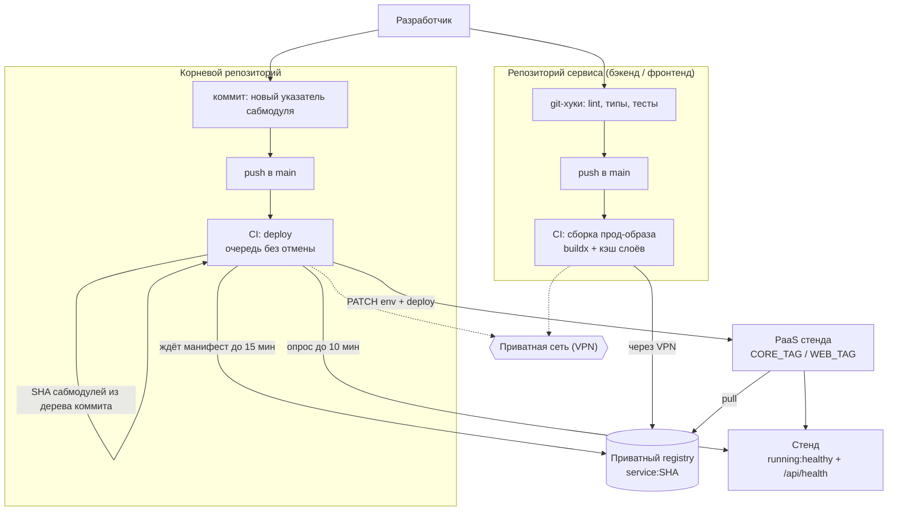

# CI/CD: сборка и выкатка

Цепочка от пуша в основную ветку сервиса до работающего стенда: сборка прод-образа с тегом =
SHA коммита, «бамп» указателя в корневом репозитории, задача выкатки с ожиданием образов и
здоровья сервиса; откат, миграции, чего CI не делает и что требуется от исполнителя.

Связанные разделы: [окружения](environments.md), [демо-развёртывание](demo-deploy.md),
[нефункциональные требования](../07-architecture/nonfunctional.md#9-требования-к-коду-и-тестам).
Открытые вопросы — `../_oq/INFRA.md`.

Нумерация требований: **CI-NN**. Метки сложности: **S / M / L / XL**.

---

## 1. Устройство репозиториев

| Репозиторий | Что в нём | Своя CI-задача |
|---|---|---|
| Сервис «бэкенд» | Код API, миграции, прод- и dev-Dockerfile, compose сервиса | Сборка прод-образа на каждый пуш в основную ветку |
| Сервис «фронтенд» | Код SPA, прод- (bun → Caddy) и dev-Dockerfile | То же |
| Инфраструктура локального стенда | Общий reverse-proxy, инфра-контейнеры, утилита локального CA, конфиги git-хуков | — (подключается вложенным сабмодулем в оба сервиса) |
| **Корневой** | Указатели (сабмодули) на сервисы, корневые compose и команды, задача выкатки | Выкатка на стенд по пушу в основную ветку |

Изменение сервиса попадает на стенд **только после бампа** указателя в корневом репозитории;
сервис пушится раньше корня. Рабочая ветка — `main` во всех репозиториях.

---

## 2. Цепочка

### 2.1. Сборка образа сервиса

- **CI-01.** На каждый пуш в основную ветку сервиса (и вручную) CI собирает прод-Dockerfile и
  публикует образ `<REGISTRY>/<сервис>:<полный SHA коммита>` в приватный registry. Тег — SHA, а
  не `latest`: по указателю сабмодуля всегда однозначно известен образ. **S**
- **CI-02.** Сборка — BuildKit/buildx с кэшем слоёв в кэше CI (отдельная область на сервис):
  пока lock-файл зависимостей не менялся, зависимости не ставятся заново; слои, уже лежащие в
  registry, не заливаются повторно. Потолок задачи — 20 мин. В отчёт задачи пишутся тег и digest
  образа.
- **CI-03.** Образ фронтенда собирается с build-args `VITE_APP_VERSION=<SHA>` и флагами стенда
  (для демо — `VITE_DEMO_TOOLS=1`, `VITE_LEADS=1`); для прода Заказчика — отдельная сборка без
  демо-флагов и с `VITE_CLIENT_*` (см. [demo-deploy.md §7.10](demo-deploy.md#710-фронтенд--build-args-вшиваются-в-бандл-при-сборке-образа)).
- **CI-04.** Доступ CI к registry — только через приватную сеть: раннер подключается к VPN
  эфемерным узлом с отдельной учёткой, которой ACL открывает только порт registry; внутреннее имя
  registry резолвится через hosts/DNS приватной сети; доверие к внутреннему CA передаётся сборщику.
  Секреты CI: ключ подключения к VPN (секрет), сертификат внутреннего CA (переменная). **S**

### 2.2. Бамп и выкатка

- **CI-05.** Пуш в основную ветку корневого репозитория (и ручной запуск) запускает выкатку на
  стенд: **M**
  1. checkout **без** сабмодулей — нужны только SHA указателей (`git rev-parse HEAD:<путь
     сабмодуля>`) для бэкенда и фронтенда;
  2. подключение к VPN, имена registry и API PaaS, доверие к внутреннему CA;
  3. **ожидание образов**: для каждого — запрос манифеста в API registry v2 (`HEAD
     /v2/<сервис>/manifests/<SHA>` с заголовками OCI index/manifest и Docker manifest v2) раз в
     15 с, до 60 попыток (15 мин) — бамп обычно приходит сразу за пушем сервиса, и образ ещё
     собирается; не дождались — ошибка «Нет образа <сервис>:<SHA> за 15 минут — упала сборка
     образа в сервисе?»;
  4. **выставление тегов**: через API PaaS (токен — секрет CI, идентификатор сервиса — переменная
     CI) пакетно обновить переменные `CORE_TAG` и `WEB_TAG` в сервисе стенда и запустить его
     выкатку;
  5. **ожидание здоровья**: пауза 30 с, затем до 40 опросов раз в 15 с (10 мин), пока статус
     сервиса в PaaS не станет `running:healthy` **и** публичный `https://<APP_DOMAIN>/api/health`
     не ответит 200; иначе — ошибка «Сервис не поднялся за 10 минут (<статус>) — логи в PaaS»;
  6. в отчёт задачи — таблица «сервис → образ (короткий SHA)» и ссылка на стенд (environment CI
     с URL).
- **CI-06.** Выкатки идут **строго по очереди** (группа конкурентности на стенд), новый бамп
  **не отменяет** уже начатую выкатку, а ждёт её окончания. Потолок задачи — 30 мин.
- **CI-07.** Compose стенда живёт в PaaS (не в git) и ссылается на образы через `CORE_TAG` и
  `WEB_TAG`; задача выкатки меняет только эти две переменные.

---

## 3. Миграции БД в цепочке

- **CI-08.** Отдельного шага миграций в CI нет: контейнер бэкенда при старте выполняет
  `atlas migrate apply` и только потом запускает API; провал — контейнер не становится
  `healthy`, выкатка падает по тайм-ауту ожидания здоровья.
- **CI-09.** Миграции — только вперёд. Дамп старше кода доводится до актуальной схемы на старте
  (это же используется при замене базы демо-стенда дампом).
- **CI-10.** Миграции должны быть **совместимы с предыдущей версией кода** (схема
  «расширить → перевести код → сузить» в разных выкатках): только тогда возможны откат образа и
  выкатка без простоя на двух репликах. Удаление/переименование колонок — отдельной выкаткой после
  того, как код перестал их использовать. **M**
- **CI-11.** Перед миграцией, меняющей или удаляющей данные, на проде снимается резервная копия
  (вручную или шагом выкатки).

---

## 4. Откат

- **CI-12.** Откат — выставить предыдущие теги образов: `git revert` коммита-бампа в корневом
  репозитории и пуш (выкатка пройдёт штатно, образы уже в registry) либо ручная установка
  `CORE_TAG`/`WEB_TAG` в PaaS и перезапуск сервиса. **S**
- **CI-13.** Откат бэкенда **через миграцию** штатно не поддерживается: старый образ не знает
  новых ревизий схемы, и применение миграций на старте завершится ошибкой. Варианты: миграции,
  совместимые назад (CI-10), с откатом только кода при сохранении схемы (требует, чтобы старый образ
  стартовал при «более новой» схеме — исполнитель обеспечивает это настройкой проверки ревизий),
  либо восстановление БД из резервной копии, снятой перед выкаткой. Процедура согласуется и
  документируется. **M**
- **CI-14.** Откат фронтенда безопасен всегда (статика); после отката фронта старые чанки
  отдаются по-прежнему, `index.html` — без кэша.

---

## 5. Чего CI исходной системы не делает

| Не делается | Где это ловится сейчас |
|---|---|
| Тесты (pytest, vitest, assert-скрипты) | Хук pre-push у разработчика |
| Линтеры и форматтеры, тесты архитектуры | Хук pre-commit у разработчика |
| Проверка типов фронта | Только как часть сборки образа (`tsc --noEmit` в `build`) |
| Сканирование образов на уязвимости, SBOM, подпись образов | Нигде |
| Smoke-тесты после выкатки, кроме `/api/health` | Вручную |
| Промежуточный стенд (staging) и ручное подтверждение выкатки | Нет: выкатка на демо — сразу по пушу корня |
| Автоматический откат при неудаче | Нет: задача падает, стенд остаётся в том состоянии, до которого дошёл PaaS |

Хуки можно обойти (`--no-verify`) или не установить — гарантии качества основной ветки нет.

---

## 6. Требования к CI/CD воссоздаваемой системы

- **CI-15.** На каждый pull request и пуш в основную ветку сервиса CI выполняет до сборки
  образа: линтеры и форматтеры, проверку типов, тесты архитектуры (слои/домены, FSD-границы),
  юнит- и компонентные тесты, тесты бэкенда **с сервисным контейнером PostgreSQL** (с проверкой,
  что тесты с БД не пропущены), assert-скрипты фронта, сборку. Сборка образа — только при
  зелёных проверках. **M**
- **CI-16.** Сканирование прод-образов на известные уязвимости (уровень HIGH/CRITICAL —
  предупреждение или блокировка по согласованию) и сканирование секретов в репозитории. **S**
- **CI-17.** Выкатка на демо — автоматически после бампа; выкатка на прод Заказчика — та же
  цепочка с отдельным registry/PaaS и **ручным подтверждением** (защищённое окружение CI). **S**
- **CI-18.** После выкатки — smoke-проверки: `/api/health`, `/api/health/storage` (с
  доступом из внутренней сети), открытие главной страницы, API-вход тестовой учёткой на демо;
  при провале — уведомление (Telegram/почта) и инструкция отката в отчёте задачи. **S**
- **CI-19.** Версии используемых действий CI и базовых образов закреплены; секреты — только в
  хранилище секретов CI; отчёт каждой выкатки содержит теги и digest образов. **S**
- **CI-20.** Допускается заменить схему «корневой репозиторий с сабмодулями» на монорепозиторий
  или на манифест версий в репозитории инфраструктуры (GitOps), если сохраняются: однозначная
  связь «версия стенда → SHA образов», очередь выкатки без отмены, ожидание образов и здоровья,
  простой откат. Решение согласуется с Заказчиком.

---

## 7. Оценка

| Работа | Сложность |
|---|---|
| Сборка и публикация образов двух сервисов с кэшем, доступ через приватную сеть | S |
| Задача выкатки: ожидание образов, теги в PaaS, ожидание здоровья, очередь | M |
| CI-проверки до сборки (линт, типы, тесты с Postgres, архитектура) | M |
| Сканирование образов и секретов, smoke-тесты, уведомления | S |
| Процедура отката и совместимых миграций (документ + проверка) | M |
