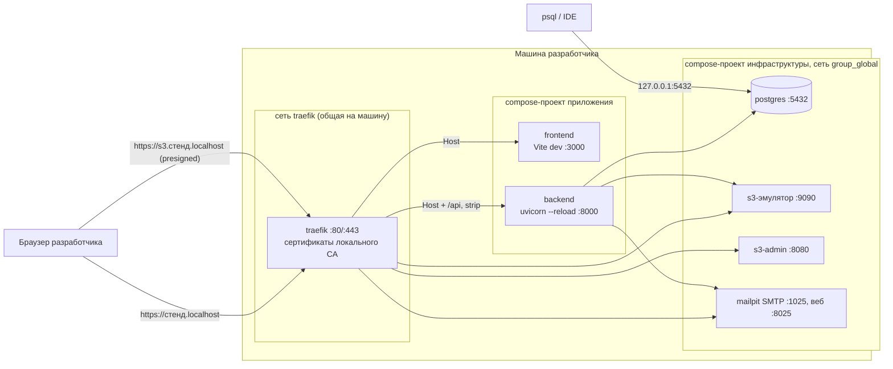
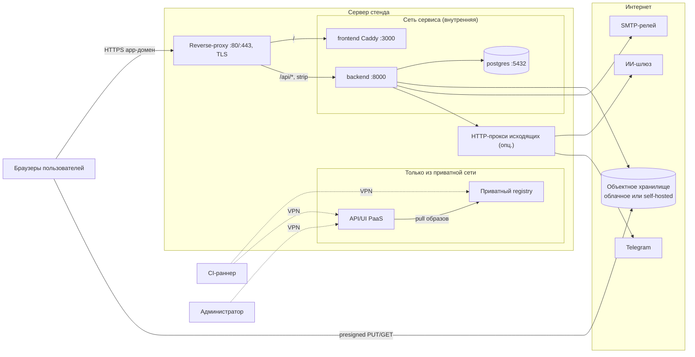

# Окружения

Какие окружения нужны системе, как устроен локальный стенд разработчика, демо-стенд для
Заказчика и продуктивная установка в контуре Заказчика; схема сетей.

Связанные разделы: [демо-развёртывание с нуля](demo-deploy.md), [CI/CD](ci-cd.md),
[архитектура](../07-architecture/architecture.md), [безопасность](../07-architecture/security.md).
Открытые вопросы — `../_oq/INFRA.md`.

Нумерация требований: **ENV-NN**. Метки сложности: **S / M / L / XL**.

---

## 1. Таблица окружений

| Окружение | Назначение | Где | Данные | Образы | Особенности |
|---|---|---|---|---|---|
| **Локальный стенд** | Разработка и ручная проверка | Машина разработчика, Docker | Общий дамп стенда из репозитория (обезличенный), накатывается автоматически | Dev-образы с монтированием кода (горячая перезагрузка) | HTTPS на локальных доменах `*.localhost`; почта не уходит наружу (ловушка писем); S3-эмулятор |
| **Тестовая БД** | Автотесты бэкенда | Тот же Postgres стенда, отдельная база `<имя>_test` | Пустая, схема из моделей, откат после каждого теста | — | Создаётся автоматически |
| **CI** | Сборка прод-образов, выкатка | Облачные раннеры | — | Прод-образы → приватный registry | Доступ к registry и PaaS — только через приватную сеть (VPN) |
| **Демо-стенд** | Показ Заказчику, пилот, обучение | Один сервер с PaaS (класса Coolify/Dokku) | Демо-набор (обезличенный дамп) + учётки ролей | Прод-образы с тегом = SHA коммита | Включены демо-инструменты, заявки с лендинга, биллинг ИИ; одна общая SMTP-конфигурация из окружения |
| **Прод Заказчика** | Эксплуатация | Изолированный контур Заказчика | Боевые данные | Те же прод-образы (без демо-флагов фронта) | Требования СБ Заказчика, TLS Заказчика, политика исходящего доступа, бэкапы |

- **ENV-01.** Один и тот же прод-образ бэкенда должен работать в любом окружении; различия —
  только переменными окружения (понятия «окружение» в коде нет). Образ фронтенда различается
  build-аргументами `VITE_*` (вшиваются в бандл), поэтому для прода Заказчика собирается отдельный
  тег без демо-флагов. **S**

---

## 2. Локальный стенд разработчика

### 2.1. Состав

| Компонент | Образ (версия в исходной системе) | Где доступен | Назначение |
|---|---|---|---|
| Общий reverse-proxy | traefik v3 (один на машину, общий для всех локальных стендов) | `:80` → редирект на `:443` | TLS-терминация локальных доменов, маршрутизация по Host/PathPrefix по меткам контейнеров |
| `frontend` | Dev-образ на bun, Vite dev server, HMR | `https://<стенд>.localhost` | SPA с горячей перезагрузкой (HMR через тот же домен, wss) |
| `backend` | Dev-образ на Python 3.13 + uv + Atlas | `https://<стенд>.localhost/api` (префикс срезается) | API с `uvicorn --reload`; на каждом старте — `atlas migrate apply` |
| `postgres` | `postgres:18.6-alpine` | изнутри — `postgres:5432`; с хоста — `127.0.0.1:5432` | БД стенда и тестовая БД |
| `s3` | S3-эмулятор (adobe/s3mock 5.x) | изнутри — `http://s3:9090`; браузеру — `https://s3.<стенд>.localhost` | Бакет `uploads` создаётся на старте; файлы на томе. **Подписи не проверяет** — только для разработки |
| `s3-admin` | Веб-админка S3 (s3manager) | `https://s3-admin.<стенд>.localhost` | Просмотр/загрузка/удаление объектов |
| `smtp` | Ловушка писем (mailpit) | SMTP изнутри — `smtp:1025` без логина и TLS; веб — `https://smtp.<стенд>.localhost` | Принимает всё, наружу не отправляет; база писем на томе, лимит 1000 писем |

### 2.2. Устройство

- **ENV-02.** Локальный HTTPS: утилита выпускает локальный корневой CA (ставит его в доверенные
  системы и браузеров), выпускает leaf-сертификаты на домены стенда (срок 825 дней) и держит в
  `/etc/hosts` один управляемый блок с доменами. Reverse-proxy читает сертификаты из общего
  каталога (динамическая конфигурация файлом). Домены `*.localhost` в браузерах резолвятся на
  loopback и без `/etc/hosts`. **S**
- **ENV-03.** Три compose-проекта:
  1. **общий reverse-proxy** — один на машину (сеть `traefik`); кто поднял первым, того конфиг
     работает, остальные видят запущенный контейнер и ничего не делают; имена роутеров
     префиксуются именем продукта, чтобы не пересечься с соседними стендами;
  2. **инфраструктура стенда** — отдельный проект (postgres, s3, s3-admin, smtp) с сетью
     `<группа>_global`, DNS — имена сервисов; настройки сервисов — в env-файлах рядом, учётка БД —
     в `.env` бэкенда;
  3. **приложение** — корневой compose только **включает** compose сервисов (бэкенд, фронтенд,
     лендинг); у всех одно имя проекта, поэтому сервисы видят друг друга по имени
     (`backend`, `frontend`). Каждый сервис можно поднять и отдельно своей командой.
- **ENV-04.** Порты наружу не публикуются (кроме postgres на `127.0.0.1` для IDE/psql): всё — за
  reverse-proxy. API — на домене фронта под `/api` с **срезанием префикса** (как на демо и проде),
  бэкенд знает префикс через `root_path=/api`. У правила `/api` приоритет выше, чем у правила
  фронта (правило длиннее).
- **ENV-05.** `.env` сервисов создаются командой один раз из `.env.example`: dev-значения
  (`CONFIG_FILE=dev.yaml`, `MFA_ENFORCED=false`, `ALLOW_LOCAL_EMAIL_DOMAINS=true`) и **свежие
  случайные** `JWT_SECRET`, `FIELD_ENCRYPTION_KEY`, `POSTGRES_PASSWORD`; ключ ИИ вписывается
  руками (пусто — ИИ выключен). Топология стенда (адрес БД, S3, SMTP, CORS, `PUBLIC_APP_URL`,
  `LEADS_ENABLED`) задаётся в `environment:` compose и сильнее `.env`.
- **ENV-06.** Зависимости ставятся только в контейнере (на хосте нет ни venv, ни
  `node_modules` — последний живёт в анонимном томе контейнера и пересоздаётся при пересборке).
- **ENV-07.** Набор команд (Taskfile или эквивалент) из корня: поднять стенд, остановить, логи,
  статус, доверие к сертификатам, диагностика CA/hosts, накат/снятие дампа, перенос дампа на
  демо-стенд, добавить зависимость бэкенда/фронта, сгенерировать миграцию из правок схемы,
  ручная SQL-миграция, установка git-хуков, выдать признак суперадмина. **M**

### 2.3. Дамп стенда в репозитории

- **ENV-08.** Данные стенда хранятся в репозитории бэкенда: дамп БД (`pg_dump -Fc`, ≈ 2 МБ) и
  архив вложений (tar объектов бакета, ≈ 1 МБ). Команда «поднять стенд» сравнивает sha256 файла
  дампа с отметкой в `COMMENT ON DATABASE` и, если они разошлись, **автоматически** накатывает
  дамп (с предупреждением «локальные данные будут заменены») и синхронизирует вложения в бакет;
  флаг `SKIP_DB_SYNC=1` пропускает шаг. Процедура накатки — одна транзакция с коммитом только
  при полном чтении дампа ([nonfunctional.md §5](../07-architecture/nonfunctional.md#5-резервное-копирование-и-восстановление)). **M**
- **ENV-09.** Команда «снять дамп» пишет дамп и архив во временные файлы, переименовывает после
  успеха и ставит отметку; дальше дамп коммитится в репозиторий — у команды стенд поднимется с
  этими данными. Дамп старше кода доводится миграциями на старте бэкенда.
- **ENV-10.** Дамп в репозитории — только обезличенные данные; значения шифруемых полей в нём
  должны быть открытым текстом (читаются при любом ключе) либо дамп переносится вместе с ключом
  шифрования стенда: у каждого разработчика свой случайный `FIELD_ENCRYPTION_KEY`.

---

## 3. Демо-стенд для Заказчика

- **ENV-11.** Один сервер (VPS) с PaaS (класса Coolify/Dokku) или голым Docker Compose. Состав
  сервиса: `backend` (прод-образ), `frontend` (прод-образ, Caddy), `postgres` 18, reverse-proxy с
  TLS (встроенный в PaaS), объектное хранилище (облачное S3-совместимое или self-hosted),
  исходящая почта. Пошагово — [demo-deploy.md](demo-deploy.md). **M**
- **ENV-12.** Compose демо-сервиса хранится в PaaS; теги образов — переменные `CORE_TAG`,
  `WEB_TAG`, их выставляет задача выкатки ([ci-cd.md](ci-cd.md)). Рекомендуется держать копию
  compose (без секретов) в репозитории инфраструктуры, чтобы стенд был воспроизводим.
- **ENV-13.** Флаги демо: фронт собран с `VITE_DEMO_TOOLS=1` (демо-учётки на входе, примеры
  файлов, автозаполнение форм), `VITE_LEADS=1`; бэкенд — `LEADS_ENABLED=true`,
  `BILLING_ENABLED=true`, `ALLOW_LOCAL_EMAIL_DOMAINS=true` (демо-учётки на служебных доменах),
  `SMTP_SETTINGS_IN_UI=false` (на демо заходят разные компании — общий экран SMTP позволил бы
  перенаправить почту всем).
- **ENV-14.** Управляющие интерфейсы (API PaaS, приватный registry, административный доступ к серверу) доступны только из
  приватной сети (VPN); CI подключается к ней эфемерным узлом с правами только на нужные порты;
  внутренние имена резолвятся DNS приватной сети, сертификаты — от внутреннего CA.
- **ENV-15.** Замена базы демо-стенда дампом — отдельная команда с подтверждением: бэкенд
  останавливается, дамп накатывается одной транзакцией, ставится отметка sha256, бэкенд
  запускается (и доводит схему миграциями), ожидание `healthy` до 150 с; при любом исходе бэкенд
  запускается снова. Вложения демо живут в своём бакете и дампом не переносятся.
- **ENV-16.** Исходящие запросы к ИИ-шлюзу и Telegram при необходимости идут через HTTP-прокси
  (`AI_HTTP_PROXY`, `TELEGRAM_HTTP_PROXY`), только эти запросы — не весь трафик процесса.

---

## 4. Прод Заказчика (обобщённо)

- **ENV-17.** Установка в изолированном контуре Заказчика по чек-листу
  [security.md §11](../07-architecture/security.md#11-требования-к-серверам-заказчика-обобщённо):
  площадка и ответственные, исходящий доступ, способ доставки образов (registry Заказчика или
  перенос архивом), выгрузка логов, доступ поддержки, контур ИИ. **L** (зависит от требований СБ)
- **ENV-18.** Отличия от демо: фронт без `VITE_DEMO_TOOLS` и `VITE_LEADS`; `LEADS_ENABLED=false`;
  `MFA_ENFORCED=true`; `ALLOW_LOCAL_EMAIL_DOMAINS=false`; ИИ — по решению Заказчика; бренд и имя
  клиента — переменными (`BRAND_NAME`, `CLIENT_NAME`, `VITE_CLIENT_*`); SMTP Заказчика (из
  окружения или из интерфейса — `SMTP_SETTINGS_IN_UI`); бэкапы и мониторинг — обязательны.
- **ENV-19.** Если reverse-proxy Заказчика уже занимает 80/443 (корпоративный TLS-терминатор),
  сервис слушает внутренний порт на loopback, а внешний прокси проксирует на него; адрес прокси
  добавляется в `FORWARDED_ALLOW_IPS`, если он вне частных сетей.

---

## 5. Схемы сетей

### 5.1. Локальный стенд

### 5.2. Демо-стенд / прод

- **ENV-20.** Postgres, внутренние порты бэкенда и фронтенда наружу не публикуются; снаружи
  открыты только 80/443 reverse-proxy (и, если хранилище self-hosted, его домен через тот же
  reverse-proxy). **S**
