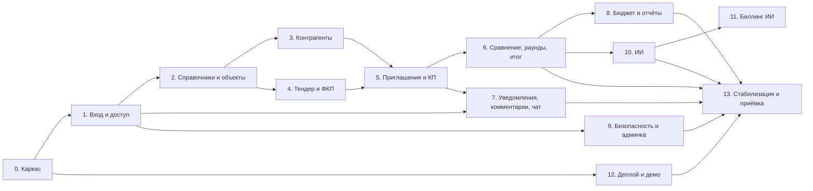

# Декомпозиция работ

Работа разбита на этапы. У каждого этапа указаны состав, критерии приёмки, зависимости,
риски и сложность (S/M/L/XL — см. [complexity-map.md](complexity-map.md)). Часы и
стоимость оценивает исполнитель. Приоритеты функций — [../01-product/scope-and-mvp.md](../01-product/scope-and-mvp.md).

## 0. Общие правила приёмки (для всех этапов)

1. Ручки этапа соответствуют [04-api](../04-api/overview.md): пути, поля, коды ошибок и
   тексты `detail`. Схема OpenAPI генерируется автоматически.
2. Экраны соответствуют [03-screens](../03-screens/screen-map.md): блоки, поля, состояния
   (загрузка, пусто, ошибка, нет доступа). Сверка по скриншотам.
3. Таблицы и миграции соответствуют [05-data-model](../05-data-model/tables.md).
4. Есть автотесты: доменные на реальном PostgreSQL, матрица доступа на каждую новую ручку,
   компонентные тесты ключевых экранов. Тесты и линтеры проходят в CI.
5. Нет регрессий по сквозным сценариям из
   [end-to-end-scenarios](../02-business-logic/end-to-end-scenarios.md), реализованным
   к этому моменту.
6. Выполнены требования безопасности [security.md](../07-architecture/security.md) для
   затронутых функций.
7. Этап развёрнут на тестовом стенде контейнерами из [08-deploy](../08-deploy/demo-deploy.md).

## 1. Сводка этапов

| # | Этап | Приоритет | Сложность | Зависит от |
|---|---|---|---|---|
| 0 | Каркас бэкенда и фронтенда, инфраструктура разработки | Must | **L** | — |
| 1 | Вход, сессии, MFA, пользователи, роли и права, аудит | Must | **L** | 0 |
| 2 | Справочники, портфели и объекты | Must | **M** | 1 |
| 3 | Контрагенты: реестр, карточка, анкета, квалификация, кабинет | Must | **L** | 2 |
| 4 | Тендер: мастер создания, распознавание Excel, карточка, версии ФКП, шаблоны, документы | Must | **XL** | 2 |
| 5 | Приглашения, персональные ссылки, форма КП, подача, входящие КП | Must | **XL** | 3, 4 |
| 6 | Сравнительная таблица, раунды, победитель, протокол, выгрузки | Must | **XL** | 5 |
| 7 | Уведомления (SSE и почта), комментарии к позициям, чат | Must / Should | **L** | 1, 5 |
| 8 | Бюджет, отчёты, главная | Should | **M** | 6 |
| 9 | Журнал ИБ и инциденты, настройки площадки, обращения об ошибках | Must / Should | **L** | 1 |
| 10 | ИИ: шлюз, снимок, сверка чисел, пайплайны, ИИ в распознавании | Should | **XL** | 6 |
| 11 | Биллинг ИИ, кабинет владельца, заявки с лендинга | Could | **L** | 10 |
| 12 | Контейнеры, CI/CD, демо-стенд, бэкапы, мониторинг | Must | **M** | 0 (сквозной) |
| 13 | Стабилизация, нагрузка, безопасность, приёмка | Must | **M** | все |

Этапы 3 и 4 можно вести параллельно. Этапы 7, 8 и 9 — параллельно с 6. Этап 12 идёт сквозным
потоком с первого спринта.

## 2. Этапы подробно

### Этап 0. Каркас — L

**Состав:**

- репозитории, ветки, git-хуки (линтеры, форматтер, тесты), CI со сборкой образов;
- бэкенд: модульный монолит с доменами и слоями, автотест порядка зависимостей, события,
  порты, корень композиции ([architecture](../07-architecture/architecture.md));
- конфигурация (yaml + env), секреты только из env, отказ старта при небезопасных значениях;
- БД и миграции, применяемые при старте; очередь фоновых задач на PostgreSQL с лидером,
  повторами и периодикой; канал realtime `LISTEN/NOTIFY` → SSE; хранилище файлов
  (S3/локальное) с presigned-загрузкой; отправка почты; middleware-стек; логи;
  health-ручки ([endpoints-system](../04-api/endpoints-system.md));
- фронтенд: SPA, маршрутизация, слои FSD с проверкой границ линтером, дизайн-токены и
  базовые компоненты (кнопки, поля, модальные окна на `<dialog>`, выпадающие меню, таблица
  с закреплением и виртуализацией), каркас вошедшего пользователя ([shell](../03-screens/shell.md)),
  клиент API, генерируемый из OpenAPI, единый вывод ошибок;
- локальный стенд одной командой: прокси с TLS, PostgreSQL, S3-эмулятор, перехватчик почты
  ([environments](../08-deploy/environments.md)).

**Критерии приёмки:** стенд поднимается одной командой; пустое приложение с каркасом
открывается; health-ручки отвечают; фоновая задача-пример выполняется и переживает рестарт;
тестовое SSE-событие доходит до браузера; архитектурный тест падает при запрещённом импорте.

**Риски:** недооценка табличного компонента (на нём держатся СТ, реестры и отчёты).

### Этап 1. Вход и доступ — L

**Состав:** вход в два шага, cookie-сессии (access JWT + ротируемый refresh с детектом
повтора), скользящий и абсолютный срок, MFA (TOTP) с обязательностью для администратора,
пауза входа, политика и история паролей, сброс пароля, первый вход по ссылке, выход и
«выйти везде»; пользователи (реестр, приглашение, роль, блокировка, сброс MFA); матрица прав
и экран прав ролей; гранты на портфели и объекты; флаг «видит финансы»; журнал действий и
журнал ИБ с append-only ([identity](../02-business-logic/identity.md),
[audit](../02-business-logic/audit.md), [users-and-roles](../01-product/users-and-roles.md)).
Экраны: [login](../03-screens/login.md), [reset-password](../03-screens/reset-password.md),
[profile](../03-screens/profile.md), [users](../03-screens/users.md).

**Критерии приёмки:** все требования SEC-* из [security.md](../07-architecture/security.md)
по аутентификации покрыты тестами. Матрица «роль × ручка» прогоняется автотестом. Повтор
старого refresh после 30 с закрывает сессию. Выход действует сразу на всех вкладках.

**Зависимости:** этап 0. **Риски:** мелкие расхождения кодов ошибок с фронтом.

### Этап 2. Справочники, портфели и объекты — M

**Состав:** виды работ, единицы измерения и алиасы, бюджетные позиции, пользовательские
статусы; дерево портфель → проект → подпроект, архив, конфиги видов работ проекта
([catalog](../02-business-logic/catalog.md), [portfolios](../02-business-logic/portfolios.md)).
Экраны: [portfolios](../03-screens/portfolios.md), [object-card](../03-screens/object-card.md),
`catalog-*`.

**Критерии приёмки:** CRUD с мягким удалением; защита от циклов дерева; гранты на объект
ограничивают видимость во всех списках.

### Этап 3. Контрагенты — L

**Состав:** реестр с фильтрами и экспортом; карточка (реквизиты, виды работ, опыт, выручка,
лицензии, контакты с шифрованием, пользователи кабинета, история изменений); ручное заведение
с проверкой дубля по ИНН; приглашение к регистрации и анкета с согласием на обработку ПДн;
независимые проверки СБ и юриста, вычисляемый общий статус, пул, «не приглашать до»,
история квалификации (append-only); кабинет поставщика; маска контактов
([suppliers](../02-business-logic/suppliers.md)). Экраны:
[suppliers](../03-screens/suppliers.md), [supplier-card](../03-screens/supplier-card.md),
[register](../03-screens/register.md), [questionnaires](../03-screens/questionnaires.md),
[cabinet](../03-screens/cabinet.md).

**Критерии приёмки:** валидаторы ИНН/КПП/ОГРН/телефона/e-mail одинаковы на фронте и сервере
(общий набор тест-значений). ПДн контактов в БД зашифрованы. СБ и юрист меняют только свою ось.

**Риски:** объём интеграций с открытыми реестрами — см. [suppliers](../02-business-logic/suppliers.md)
и открытые вопросы.

### Этап 4. Тендер и ФКП — XL

**Состав:** мастер создания (шаги, черновики с TTL, создание из шаблона); загрузка Excel и
распознавание в фоновой задаче с прогрессом; предпросмотр и правка структуры (разделы,
подразделы, позиции, единицы, объёмы, доп. условия); поля тендера и валидации; карточка
тендера, статусы и переходы, правка с предпросмотром последствий, версии ФКП и пересборка
разделов; заметки сотрудников; шаблоны тендеров; пакет документов
([fkp-import](../02-business-logic/fkp-import.md),
[tenders-lifecycle](../02-business-logic/tenders-lifecycle.md),
[tenders-documents](../02-business-logic/tenders-documents.md)). Экраны:
[tender-create](../03-screens/tender-create.md), [tender-card](../03-screens/tender-card.md)
(шапка, обзор, структура, документы, активность), [templates](../03-screens/templates.md),
[tenders-registry](../03-screens/tenders-registry.md).

**Критерии приёмки:** 20–30 реальных смет Заказчика распознаются без ручной правки структуры
не менее чем в согласованной доле случаев (порог согласовать — см. открытые вопросы); остальные
правятся в предпросмотре без перезагрузки файла. Тендер из сценария 1 создаётся по шагам
сценария.

**Риски:** R1 из [complexity-map](complexity-map.md).

### Этап 5. Приглашения и КП — XL

**Состав:** приглашение участников (подбор, ограничения, письма со статусом доставки),
персональная ссылка (выпуск, перевыпуск, отзыв), стадии участника; форма КП: ставки
материалов и работ, объёмы, корректировки с обязательным комментарием, отказ от позиции,
доп. условия, НДС и его подтверждение, «заполнено», файлы, черновик, загрузка заполненного
Excel с проверкой неизменности формы, подача и повторная подача (версии КП), причины отказа
в подаче; кабинет поставщика; входящие КП и карточка КП с решениями
([tenders-invitations](../02-business-logic/tenders-invitations.md),
[tenders-quotes](../02-business-logic/tenders-quotes.md)). Экраны: [fill](../03-screens/fill.md),
[cabinet](../03-screens/cabinet.md), [quotes-inbox](../03-screens/quotes-inbox.md),
[quote-card](../03-screens/quote-card.md), вкладка «Контрагенты» карточки тендера.

**Критерии приёмки:** шаги 3–4 сценария 1 проходят. Поставщик ни через интерфейс, ни через
API не видит чужих КП, цен и участников (автотест). Файл КП с изменённой формой отклоняется
с понятным списком ошибок.

**Риски:** объём экрана формы КП; согласованность «заполнено» во всех местах (R2).

### Этап 6. Сравнение, раунды, итог — XL

**Состав:** СТ по последним версиям: итоги разделов и общий, полный и неполный итог,
медиана, отклонения, MIN/MAX/Δ к лидеру, «честный минимум», потенциал, разброс и градации,
вес и ключевые позиции, аномалии с настраиваемыми порогами, динамика; основной показатель и
спутники, сортировки, фильтры, выделение и закрепление; экспорт СТ в Excel; раунды (мастер,
письма, предпросмотр, сроки, просрочка, ручное закрытие); выбор победителя (в т. ч.
неаккредитованного с подтверждением), завершение и отмена с повторным вводом пароля;
протокол DOCX ([tenders-comparison](../02-business-logic/tenders-comparison.md),
[tenders-rounds](../02-business-logic/tenders-rounds.md)). Экраны:
[tender-card-comparison](../03-screens/tender-card-comparison.md),
[tender-card-rounds](../03-screens/tender-card-rounds.md),
[tender-card-lifecycle](../03-screens/tender-card-lifecycle.md).

**Критерии приёмки:** числа сценария 1 совпадают до копейки в СТ, выгрузке Excel и протоколе.
СТ на 300 позиций × 10 поставщиков открывается и прокручивается без задержек (цель согласовать,
см. [nonfunctional](../07-architecture/nonfunctional.md)). После завершения тендера входящее
заморожено.

**Риски:** R2, R3.

### Этап 7. Уведомления, комментарии, чат — L

**Состав:** центр уведомлений и поток SSE, почтовые уведомления с очередью, повторами и
статусами доставки, предпочтения пользователя; комментарии поставщика к позициям и
«просмотренность», внутренние комментарии; чат специалиста и поставщика, в т. ч. по
персональной ссылке, правки сообщений, прочтения, вложения, догон событий
([notifications](../02-business-logic/notifications.md),
[comments](../02-business-logic/comments.md), [chat](../02-business-logic/chat.md)).
Экраны: [notifications](../03-screens/notifications.md), [chats](../03-screens/chats.md),
[tender-card-messages](../03-screens/tender-card-messages.md).

**Критерии приёмки:** событие доходит до открытой вкладки за секунды; после обрыва связи
пропущенные сообщения чата догружаются; письмо уходит в фоне и не задерживает действие.

### Этап 8. Бюджет, отчёты, главная — M

**Состав:** бюджетные позиции объектов, распределение по периодам, история, связь с тендерами;
отчёты и выгрузки; главная страница по ролям ([budget](../02-business-logic/budget.md),
[analytics](../02-business-logic/analytics.md)). Экраны: [budget](../03-screens/budget.md),
[budget-position](../03-screens/budget-position.md), [reports](../03-screens/reports.md),
[home](../03-screens/home.md).

**Критерии приёмки:** суммы отчётов совпадают с СТ; без права на финансы суммы не видны.

### Этап 9. Безопасность и администрирование — L

**Состав:** журнал ИБ с фильтрами и экспортом, инциденты и правила автоинцидентов, выгрузки
для регулятора по ПДн, статус криптографии; настройки площадки, SMTP и тестовое письмо,
шаблоны писем с переменными и предпросмотром, пороги аномалий; обращения об ошибках
([security](../02-business-logic/security.md), [settings](../02-business-logic/settings.md),
[bug-reports](../02-business-logic/bug-reports.md)). Экраны:
[security-log](../03-screens/security-log.md), [settings](../03-screens/settings.md).

**Критерии приёмки:** запись в журнале ИБ нельзя изменить или удалить даже из БД без
отключения триггера; инцидент создаётся по правилу автоматически.

### Этап 10. ИИ — XL

**Состав:** шлюз к OpenAI-совместимому API, роли моделей, бюджеты времени, деградация;
снимок данных, единый форматтер чисел и сверка чисел; пайплайны: повестка переговоров,
сравнение пары, вопросы по таблице, письмо поставщику (сопоставление позиций — опционально);
ИИ в распознавании ФКП; фоновое задание анализа с ходом прогона; панель анализа
([ai-features](../06-ai/ai-features.md), [insights](../02-business-logic/insights.md)).
Экран: [tender-card-analysis](../03-screens/tender-card-analysis.md).

**Критерии приёмки:** без ключа ИИ система работает полностью и показывает детерминированный
результат с сообщением; в тестах ИИ выключен, а сценарии ИИ проходят на заглушке шлюза; ни
одно число в тексте модели не попадает пользователю без сверки со снимком.

**Риски:** R4. Решение о контуре ИИ (внешний провайдер или локальная модель) — за Заказчиком.

### Этап 11. Биллинг ИИ, кабинет владельца, заявки с лендинга — L (Could)

**Состав:** учёт обращений к нейросети, ИИ-операции, книга баланса (начисления, списания,
корректировки), множитель, блокировка при нулевом балансе, заявки на пополнение, кабинет
владельца, расходы на ИИ у клиента; приём заявок с лендинга и роль «Лид»
([billing](../02-business-logic/billing.md)). Экраны: `owner-*`, [expenses](../03-screens/expenses.md),
[welcome](../03-screens/welcome.md).

**Критерии приёмки:** успешная ИИ-операция списывается ровно один раз, неуспешная — не
списывается; записи баланса не меняются и не удаляются.

### Этап 12. Деплой и демо — M (сквозной)

**Состав:** прод-образы бэкенда и фронтенда, compose для демо, обратный прокси с TLS,
S3-совместимое хранилище, SMTP; цепочка CI/CD с тегами образов по коммиту и откатом;
загрузка демо-данных; бэкапы и восстановление; мониторинг и алерты
([demo-deploy](../08-deploy/demo-deploy.md), [ci-cd](../08-deploy/ci-cd.md),
[nonfunctional](../07-architecture/nonfunctional.md)).

**Критерии приёмки:** демо-стенд поднимается с нуля по инструкции; восстановление из бэкапа
проверено; откат на предыдущий образ занимает минуты.

### Этап 13. Стабилизация и приёмка — M

**Состав:** прогон всех сквозных сценариев, нагрузочный тест по целевым цифрам
([scalability](../07-architecture/scalability.md)), проверка безопасности по
[security.md](../07-architecture/security.md), сверка экранов со скриншотами, исправление
дефектов, документация для администратора Заказчика.

**Критерии приёмки:** сквозные сценарии проходят на демо-стенде; открытых дефектов критичности
«блокер» и «высокая» нет.

## 3. Что нужно от Заказчика до старта

Решения по вопросам с пометкой «влияет на оценку» из [../99-open-questions.md](../99-open-questions.md):
целевые нагрузки, контур ИИ и допустимость передачи данных провайдеру, СКЗИ, интеграции с
открытыми реестрами, мультиарендность, набор реальных смет для распознавания, браузеры и SLA.
